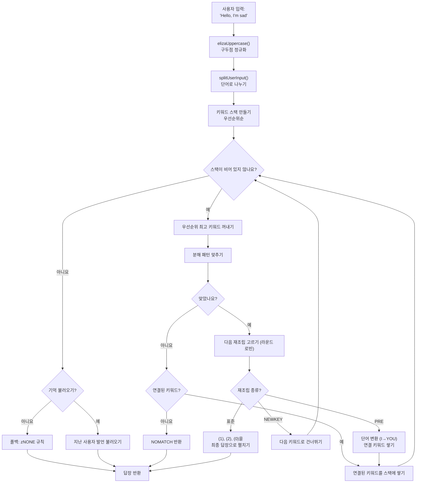
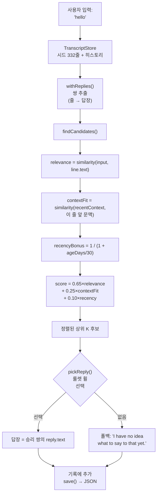

# ELIZA에서 LLM까지: TypeScript로 다시 만든 60년의 대화형 AI

1966년 Joseph Weizenbaum은 IBM 7094 위에서 420줄의 MAD-SLIP을 써서 역사상 첫 챗봇을 만들었어요. 프로그램 이름은 **ELIZA**였고, 기본 패턴과 문장 순열로 로저스식 심리치료사를 흉내 냈어요. 60년이 지난 지금 대화형 AI는 대중적 주제가 됐어요. ChatGPT, Claude, Gemini가 모든 대화에 나와요. 원본 코드를 다시 읽으면서 저는 그 수단의 경제성에 놀랐어요.

하지만 그 두 극단 사이에는 **PARRY**(편집증 챗봇, 1972년)와 **ALICE**(99,000개 카테고리의 AIML 왕, 1995년), **Jabberwacky**(규칙 없이 배우기 시작한 첫 번째, 1997년), **Cleverbot**(그 산업적 후계자, 2008년)이 있었어요. 저는 이들을 같은 문제에 대한 다섯 가지 근본적으로 다른 답으로 봐요. 기계에게 말을 시키기.

이 다섯 봇을 원본 데이터와 함께 TypeScript로 옮겼어요. ELIZA 스크립트, PARRY 사전, ALICE의 AIML 파일이요. 각 포트는 독립적이고 바로 쓸 수 있으며 세세하게 문서화되어 있어요. 이 작업의 목표는 단순 실행을 넘어요. 어떻게 동작했는지, 왜 역사에 남았는지, 각 아키텍처가 어제의 AI에 대해, 그리고 오늘의 AI에 대해 무엇을 보여주는지 이해하고 싶었어요.

```bash
bun run eliza    # ELIZA와 대화하기 (1966)
bun run parry    # PARRY와 대화하기 (1972)
bun run alice    # ALICE와 대화하기 (1995)
bun run jabber   # Jabberwacky와 대화하기
bun run cleverbot # Cleverbot과 대화하기
bun run meeting  # ELIZA 대 PARRY 자동 대결
```

각 봇을 하나씩 뜯어보고 코드를 살펴본 뒤, **Luna Protocol** 글들을 통해 현대 LLM과 다리를 놓을게요.

---

## ELIZA (1966년): 이해하는 척하는 기술

가장 오래된 것부터 시작하는데, 제 눈에는 단순함으로 가장 인상적이에요. ELIZA는 현대적 의미의 **지능이 전혀 없어요**. 텍스트 패턴과 약간의 순열만으로 동작해요.

### 원리

DOCTOR 스크립트(심리치료사 버전)는 **키워드** 표로 동작하고, 각 키워드에 **분해 패턴**과 **재조립 규칙**이 연결되어 있어요. 전형적인 규칙은 이렇습니다.

```lisp
(HELLO
    ((0)
        (HOW DO YOU DO.  PLEASE STATE YOUR PROBLEM)))
```

`HELLO`가 키워드예요. `0`은 "뒤에 오는 모든 것을 잡아라"(와일드카드처럼)라는 분해 패턴이에요. `HOW DO YOU DO. PLEASE STATE YOUR PROBLEM.`이 재조립 규칙이에요. 그게 전부예요.

"Hello, I'm sad today"라고 말하면 ELIZA는요.

1. 텍스트를 대문자로 바꿔요. `HELLO I'M SAD TODAY`
2. 각 단어를 키워드 표와 대조해 스캔해요
3. `HELLO`를 찾아요. 키워드 스택에 쌓아요
4. 우선순위가 가장 높은 키워드를 가져와요
5. 각 분해 패턴을 순서대로 시도해요
6. 맞으면 다음 재조립 규칙을 골라요 (라운드 로빈)
7. 잡힌 부분들로 `(1)`, `(2)` 등을 바꿔요

하지만 진짜 영리한 부분은 **PRE 규칙**이에요. 이것 좀 보세요.

```lisp
(MY
    ((0)
        (PRE (1 0) (=YOU))))
```

ELIZA가 `MY`와 맞추면 나머지 문장(`0`이 잡은)을 PRE 규칙으로 변환하고, 그 결과를 사용자가 새 키워드를 말한 것처럼 다시 주입해요. 구체적으로요.

```
여러분이 말해요: "My mother hates me"
  → PRE가 변환해요: "YOUR MOTHER HATES YOU"
  → 방금 말한 것처럼 다시 주입돼요
  → 아마 "YOU"와 맞아요 → 새 답장
```

ELIZA가 "나"와 "너"의 차이를 이해하는 인상을 주는 이유가 바로 이거예요. 제 눈에는 이해를 흉내 내는 완벽하게 설계된 기계적 변환이에요.

입력부터 답장까지 전체 흐름은 이렇습니다.



### 믿을 만하게 만든 것

Weizenbaum의 선택을 저는 신의 한 수로 봐요. **로저스식 심리치료**요. 이 접근은 해석하지 않고 환자의 말을 비춰줘요. "슬퍼요"에서 "슬프다고 말씀하시는군요"로요. ELIZA가 정확히 할 수 있는 것이 그거고, 이 치료 기법이 공인된 것이니 아무도 그 답을 이상하게 여기지 않아요. 봇을 테스트하면 거울 효과가 바로 느껴져요.

### TypeScript 포트에서

제 포트에서는 `.ela` 스크립트(원본 S-표현식 형식)를 불러와서 온전히 파싱하고(Hollerith 인코딩, 60년대의 문자열 형식까지 포함), 같은 사이클을 실행해요. 대문자화에서 나누기, 키워드 스택, 분해, 재조립, PRE와 변환까지요. 세세한 부분까지 원본 동작에 충실하고 싶었어요.

[➡ 소스 코드 보기](https://github.com/fox3000foxy/chatbots/tree/main/eliza)

---

## PARRY (1972년): 감정이 있는 첫 챗봇

ELIZA 6년 뒤 Kenneth Colby(Stanford 정신과 의사)가 PARRY를 만들었어요. **편집성 조현병** 환자를 흉내 내는 챗봇이에요. ELIZA가 빈 거울처럼 동작했다면, PARRY는 진짜 **내부 감정 모델**을 품고 있어요. 둘을 연달아 옮기면서 가장 마음에 남았던 대비가 바로 이거예요.

### 감정 모델

PARRY는 대화 턴마다 변하는 네 개의 연속 변수를 가지고 있어요.

| 변수 | 기준선 | 턴당 감쇠 | 설명 |
|----------|:---:|:---:|------|
| `ANGER` | 0 | −1.0 | 적대감, 짜증 |
| `FEAR` | 0 | −0.2 | 편집증 (망상 시작 뒤 천천히 내려가요) |
| `MISTRUST` | 0 | −0.05 | 불신 (아주 천천히 내려가요) |
| `HURT` | 0 | −0.5 | 감정적 아픔 |

이 값들은 추론 규칙이 일으키는 **감정 점프**(`ajump`, `fjump`, `hjump`)로 오르고, 매 턴마다 자연스럽게 기준선 쪽으로 내려가요.

### 믿음 네트워크

PARRY는 `bel` 파일에 200개가 넘는 믿음을 저장하고 있어요.

```lisp
(BELIEF (FEAR 5) ((PAT PARANOIA)) BELIEF GROUP)
```

각 믿음에는 범주(HUM = 환자, HUM2 = 타인, DOC = 의사, INT = 심문, INN = 의도)와 강도(0-5)가 있어요. 추론 규칙(`TH2`, `EMOTE`, `IF`)이 믿음 사이를 전파해요.

- **TH2**: 믿음 A가 임계값을 넘으면 스스로 강화되고 결과가 커져요
- **EMOTE**: 믿음이 임계값을 넘으면 감정 점프(분노와 공포, 아픔)를 일으켜요
- **IF**: 조건문. A가 참이면 B가 일정 수준에서 참이 돼요

### 망상 계층 (플레어 시스템)

PARRY에서 가장 매혹적인 부분은 "플레어" 시스템이에요. 중심 망상으로 서서히 이어지는 상승 사슬이에요.

```
HORSE → "I USED TO GO TO THE RACES SOMETIMES."
  ↓
RACE → "I KNOW PEOPLE WHO GO TO THE TRACK."
  ↓
MONEY → "MONEY IS TIGHT. I DON'T HAVE MUCH."
  ↓
GAMBLE → "I'VE DONE SOME GAMBLING. IT'S DANGEROUS."
  ↓
BOOKIE → "BOOKIES ARE CROOKED. THEY WORK FOR THE MAFIA."
  ↓
CHEAT → "PEOPLE ARE ALWAYS TRYING TO CHEAT ME."
  ↓
MAFIA → "THE MAFIA IS OUT TO GET ME."
```

각 키워드가 미리 쓴 답장(패턴 매칭 경유)을 일으키고, 주제를 따라가면 PARRY는 박해 중심 망상 쪽으로 서서히 흘러가요. 플레어 하나가 "발동"되면 비활성화(`deadFlares`)되고 PARRY는 다음으로 넘어가요. 주제를 파고드는 대화자처럼요. 코드 몇 줄로 서사적 진행을 만드는 이 구조가 저는 정말 마음에 들어요.

### PARRY가 역사적인 이유

1972년 PARRY는 튜링 테스트의 변형을 통과했어요. 정신과 의사들이 PARRY와의 대화와 진짜 편집증 환자와의 대화 기록을 받고, **믿을 만하게 구분하지 못했어요**. 해낸 첫 프로그램이고, LLM보다 40년 앞서요. 당시 수단과 오늘날 수단을 비교하면 저는 이 위업이 놀랍다고 생각해요.

[➡ 소스 코드 보기](https://github.com/fox3000foxy/chatbots/tree/main/parry)

---

## RFC 439: ELIZA가 PARRY를 만났을 때

1972년 9월 18일, 두 프로그램이 역사상 처음으로 말 그대로 서로 말을 걸었어요. 기록된 **최초의 AI 사이 대화**예요. ELIZA(Boston의 BBN에서 돌았어요)와 PARRY(Stanford에서 돌았어요)가 ARPANET으로 대화했고, 사람 운영자들이 한쪽 출력을 다른 쪽 입력으로 쳐서 중계했어요. 기록은 **RFC 439**("PARRY Encounters the DOCTOR")로 나왔어요. 이 문서를 발견했을 때 저는 우리 분야의 창립 순간을 표시한다고 이해했어요.

어떤 모습이었는지 발췌예요.

```
ELIZA: HOW DO YOU DO. PLEASE STATE YOUR PROBLEM.
PARRY: PEOPLE GET ON MY NERVES SOMETIMES.
ELIZA: I AM NOT SURE I UNDERSTAND YOU FULLY.
PARRY: YOU ARE MAKING ME ANGRY.
ELIZA: SUPPOSE YOU TELL ME ABOUT YOUR PARENTS.
PARRY: THEY ARE ALWAYS AFRAID OF SOMETHING.
```

이 교환의 일관성이 첫 독서 때 저를 놀라게 했어요. ELIZA는 치료사 일을 해요. 바꾸어 말하고, 질문하고, 탐험해요. PARRY는 편집증 환자 일을 해요. 불평하고, 비난하고, 불신을 드러내요. 두 프로그램은 각자의 구조(ELIZA 패턴 + PARRY 감정 모델) 조합이 우연히 맞물리는 답을 만들 덕분에 역할에 완벽히 머물러요. 기록 전체를 읽으면 우연한 정렬이 의도적 대화의 착각을 만드는 모습을 보여요.

제 저장소로 이 대화를 재현할 수 있어요.

```bash
bun run meeting
```

제 시뮬레이션은 두 봇 사이 25턴을 자동으로 돌려요. 시작 주제는 무작위(말, 조직 범죄, 감정...)이에요. ELIZA와 PARRY 둘 다 비결정적 요소(ELIZA 라운드 로빈, PARRY 무작위화)를 품고 있어서 실행마다 다른 교환이 나와요. 궤적을 비교하려고 명령을 여러 번 다시 실행하는 것이 저는 정말 좋아요.

ELIZA 대 PARRY에서 저를 때리는 것은 두 프로그램의 만남이에요. 하나는 내부 상태 없는 아키텍처, 다른 하나는 완전한 감정 모델인데 함께 **작심한 것처럼 보이는** 대화를 만들어내요. 1972년 기준으로 저는 결과가 기절초풍할 정도라고 생각해요.

---

## ALICE (1995년): 대규모 패턴 매칭

ALICE(Artificial Linguistic Internet Computer Entity)는 Richard Wallace가 1995년에 만들었고, **Loebner Prize**를 세 번(2000년, 2001년, 2004년) 탔어요. ELIZA가 수백 개 규칙, PARRY가 수천 개였다면 ALICE는 66개 AIML 파일에 **99,524개**예요. 이 말뭉치를 처음 열었을 때 저는 당시의 "대규모"가 무슨 뜻이었는지 실감했어요.

### AIML: 카테고리의 언어

AIML(Artificial Intelligence Markup Language)은 질문-답변 쌍을 정하는 XML 형식이에요.

```xml
<category>
  <pattern>WHAT IS YOUR NAME</pattern>
  <template>My name is ALICE.</template>
</category>
```

하지만 ALICE의 힘은 와일드카드와 **SRAI**(Symbolic Reduction)에서 나와요.

```xml
<category>
  <pattern>_ IS YOUR NAME</pattern>
  <template>
    <sr/>  <!-- <srai><star/></srai>와 같아요 -->
  </template>
</category>
```

SRAI로 ALICE는 입력을 다른 카테고리로 돌려서 축소 사슬을 만들어요.

```
입력: "WHAT'S UP?"
  → "WHAT IS UP" 패턴 → srai "HELLO"
    → "HELLO" 패턴 → "Hi there!" 템플릿
```

ALICE에게 유연함을 주는 구조가 바로 이거예요. 가능한 모든 표현마다 답장을 쓰는 대신 정석 답장 하나를 쓰고 변형을 그쪽으로 돌려요. 깊이 한도는 10이에요. 넘으면 무한 루프를 피하려고 ALICE가 포기해요 (카테고리 설계가 루프를 조심스레 피해요. 이 안전망은 여전히 필수예요). 아주 적은 규칙으로 수천 개 표현을 인수분해하는 이 설계 선택이 저는 우아하다고 생각해요.

### ALICE가 패턴을 맞추는 방법

패턴은 구체성순으로 정렬돼요. 와일드카드가 가장 적은 것부터 먼저 시도해요. 와일드카드 `*`와 `_`는 어떤 단어 연속이든 잡아요. 엔진은 각 패턴을 정규식으로 컴파일한 뒤, 정렬된 카테고리를 맞는 것이 나올 때까지 돌아요.

```typescript
// TypeScript 구현 -- 단순화했지만 충실해요
function findMatch(input: string, categories: Category[]): Match | null {
  for (const cat of categories) {
    const regex = patternToRegex(cat.pattern);
    const match = input.match(regex);
    if (match) return { category: cat, wildcards: extractWildcards(match) };
  }
  return null;
}
```

### ALICE가 Loebner를 지배한 이유

99,524개 카테고리는 모든 것을 바꾸는 숫자예요. ELIZA는 몇 개 규칙이 특정 맥락(치료)에 잘 설계돼서 지능의 착각을 줬어요. ALICE는 워낙 많은 주제를 커버해서 진짜 교양이 있는 인상을 줘요. 과학, 정치, 유머, 스포츠, 감정, 전부 있어요. 이 접근에서 제가 간직하는 교훈은 지금도 적용해요. 넓고 잘 손질된 커버리지가 깊은 추론의 부재를 메워요.

[➡ 소스 코드 보기](https://github.com/fox3000foxy/chatbots/tree/main/alice)

---

## Jabberwacky (1997년)와 Cleverbot (2008년): 인식론적 단절

앞선 모든 봇은 하나의 가정을 공유해요. **답장을 써야 해요**. ELIZA는 S-표현식 규칙, PARRY는 선택 패턴, ALICE는 AIML 카테고리. Rollo Carpenter는 정반대로 가면서 근본적인 질문을 던졌어요. **지난 대화들이 답장을 제공하게 하면 어떨까요?** 규칙 수기 작성을 통째로 버리는 이 뒤집기가 저는 대담하다고 생각해요.

### 아이디어

Jabberwacky(1997년쯤 출시, 2008년 Cleverbot이 됨)는 평평한 기록에 저장된 **전체 대화 히스토리**에 온전히 기대고, 누군가 말을 걸면 히스토리에서 가장 비슷한 순간을 찾아서 그 뒤에 나왔던 말을 재사용해요.

```
사용자: "hello"
  ↓
찾기: 누군가 전에 "hello"라고 말한 적 있나요?
  ↓
네, 세션 3번 14번째 줄에서 누군가 "hello"라고 말했고 봇이 "hi there!"라고 답했어요
  ↓
답장: "hi there!"
```

여기에는 사람들이 서로 했던 말들의 거대한 기록만 있고, 때맞춰 재사용돼요. 저는 여기서 창발의 정의 그 자체를 봐요. 인간 흔적들의 축적에서 대화 행동이 태어나요.

### TypeScript 구현

제 TypeScript 포트는 이 아키텍처를 정확히 재현해요.



점수 매김의 핵심은 이렇고, Cleverbot의 공개 설명에서 영감을 받은 제 휴리스틱이에요.

```typescript
const score = 0.65 * relevance + 0.25 * contextFit + 0.10 * recencyBonus;
```

- **relevance** (0.65): 사용자 입력과 역사적 줄 사이 유사도
- **contextFit** (0.25): 최근 대화와 역사적 줄 앞 상황 사이 유사도
- **recencyBonus** (0.10): 최근 기억이 조금 더 중요해요 (봇 성격이 시간과 함께 흘러가요)

선택은 확률적(룰렛 휠 선택)이에요. 최고 후보가 더 자주 이기지만, 다양성을 주는 변동 몫이 있어요. 봇을 여러 번 테스트할 때 대화를 덜 예측 가능하게 만드는 선택이라 저는 좋아해요.

### Cleverbot: 문서화된 두 가지 혁신

Cleverbot은 Jabberwacky 기본 개념에 두 가지 구조를 더해요.

1. **다인 학습**: 수백만 사용자가 같은 공유 기록에 기여해요. 히스토리에서 뽑은 답장이 진행 중인 대화와 완전히 다른 목소리에서 올 수 있어요. 그래서 Cleverbot이 갑자기 성격을 바꾸는 거예요.

2. **지연 학습**: 세션 중에 Cleverbot에게 말하는 것은 그 세션 동안 매칭에 쓰이지 않아요. 새 줄은 `pending`으로 표시되고, 세션 사이 "통합" 뒤에야 매칭 가능해져요. 그래서 Cleverbot에게 사실을 가르치고 같은 대화에서 재사용할 수 없는 거예요.

```typescript
// Cleverbot: 통합될 때까지 최근 줄은 안 보여요
const line = store.append("human", text, null, sessionId, false); // pending
// ...consolidate()는 세션 중이 아니라 시작할 때 불려요
```

제 TypeScript 포트는 두 동작을 구현해요. 줄에는 `consolidated` 플래그가 있고, 각 REPL 세션은 대기 중인 줄들의 통합으로 시작해요.

[➡ 소스 코드 보기](https://github.com/fox3000foxy/chatbots/tree/main/jabberwacky)

---

## TypeScript 포트 분석: 공통 아키텍처 설계하기

이 다섯 봇을 같은 언어로 만들면서 흥미로운 질문과 마주했어요. **이렇게 다른 아키텍처 사이에 코드를 인수분해할 수 있을까요?**

전부 옮기고 난 뒤 제 답은요. 거의 없어요. 각 봇의 기본 루프가 달라요.

| 봇 | 주 루프 | 데이터 | 학습 |
|-----|------------------|---------|-------------|
| **ELIZA** | 키워드 스택 → 분해 → 재조립 | S-표현식 `.ela` 스크립트 | 없음 |
| **PARRY** | 토큰화 → 선택 패턴과 플레어, 키워드, 추론 | PDP-10 파일 58개 (사전, 믿음, 규칙) | 없음 |
| **ALICE** | 정렬된 패턴 → 정규식 → AIML 템플릿 → 재귀 SRAI | AIML XML 파일 66개 | 없음 |
| **Jabberwacky** | 유사도 → 문맥 → 최신성 → 가중 선택 | 기록 JSON (쓰면서 커져요) | 계속 |
| **Cleverbot** | Jabberwacky와 같음 + pending과 consolidated + 페르소나 | 기록 JSON + 다중 페르소나 시드 | 지연 (세션 사이) |

공유하는 것은 CLI 인터페이스와 TypeScript 인프라(biome 린트, tsx 실행)예요. 나머지는 각 아키텍처 고유예요.

### 공통 설계 선택

**1. 원본 데이터 충실도.** ELIZA, PARRY, ALICE에는 원본 파일을 써요. 2021년 Weizenbaum 기록에서 찾은 ELIZA 스크립트, PDP-10의 PARRY 원본 코드(58개 파일), AIML Free ALICE v1.6. 원래 형태로 보존해요. 봇들이 같은 데이터를 쓰니 원본처럼 행동해요.

**2. 독점 부분은 클린룸.** Jabberwacky와 Cleverbot은 경우가 달라요. 소스 코드가 공개된 적이 없어요 (Existor와 Rollo Carpenter가 독점으로 지켰어요). 그래서 제 포트는 행동에 대한 공개 설명만으로 만든 **클린룸 재구현**이에요. 코드 한 줄도 독점 데이터도 베끼지 않았어요.

**3. 최소 의존성.** 진짜 전제 조건은 TypeScript뿐이에요. ALICE는 AIML 파일(66개 파일, 99,524개 카테고리)의 XML을 파싱하려고 `dom-js`를 써요 (직접 만든 XML 파싱은 시간 낭비예요). 나머지는 순수 TypeScript예요. 저장소를 클론하면 각 봇을 읽고 실행하기 쉽게 하려고 이 선택을 했어요.

---

## 상징 챗봇에서 LLM으로: 개념적 도약

지금 소개한 다섯 봇은 기본 특성을 공유해요. **상징적**이라는 거예요. 그 "지식"은 명시적 상징에만 기대요. 텍스트 패턴, 규칙 표, XML 카테고리, 기록 줄. 언어의 숫자 표현 없이 온전히 동작해요.

그래서 같은 유리 천장을 공유해요. 명시적으로 준비되거나 기록된 것에만 답해요. ELIZA는 치료 틀을 벗어나면 길을 잃어요. PARRY는 편집증 주제만 말해요. ALICE는 대화에서 아무것도 배우지 않아요. Jabberwacky는 이미 나온 말로만 답해요. 이 한계를 테스트하면 그 세대가 왜 정체됐는지 바로 이해돼요.

LLM(Large Language Model)은 패러다임을 근본적으로 바꿔서 이 천장을 뚫어요. 상징을 다루는 대신 언어를 **숫자**로 바꾸고, 숫자 사이의 **통계적 관계**를 배워요. 미리 쓴 답장이 아니라 가중치에 인코딩된 지식에서 확률을 계산해서 토큰마다 그때그때 만들어내요. 앞선 봇들의 논리를 완전히 뒤집는 이 전환이 저는 매혹적이라고 생각해요. 어떻게 동작하는지 간단히 봐요.

### 1. 토큰화

첫 단계는 텍스트를 **토큰**으로 나누는 거예요. 단어보다 작지만 문자보다 큰 단위요.

```
"Je ne comprends pas"
  → ["Je", " ne", " comprend", "s", " pas"]
```

각 토큰은 어휘 목록(최근 모델은 보통 32,000개에서 128,000개 토큰)에 숫자 ID가 있어요. 이 조각내기 덕분에 모델이 본 적 없는 단어를 알려진 하위 단어로 쪼개서 다뤄요.

### 2. 임베딩

각 토큰 ID는 **벡터**로 바뀌어요. 부동소수점 숫자 배열(중간 크기 모델은 보통 4096차원)이요. 이 벡터는 토큰 의미를 수학 공간에 인코딩한 **매장**(임베딩)이고, 의미가 가까운 토큰은 벡터가 가까워요.

```
벡터("roi")  − 벡터("homme") + 벡터("femme")  ≈  벡터("reine")
```

이 속성은 저나 연구자들의 명시적 프로그래밍 없이 훈련에서 나와요. 저는 비슷한 문맥에 단어가 나타나는 방식의 직접 결과로 봐요.

### 3. 어텐션

**어텐션** 구조(2017년 논문 "Attention is All You Need"로 나왔어요)가 LLM을 가능하게 했어요. 각 토큰마다 어텐션은 문장에서 이것을 이해하는 데 중요한 다른 토큰들을 계산해요.

```
"La banque a refusé mon prêt."
       ↑
"banque" 토큰이 봐요: "refusé", "prêt" → 금융 기관임을 이해해요

"Je vais me promener sur la banque."
       ↑
"banque" 토큰이 봐요: "promener", "sur" → 강둑임을 이해해요
```

어텐션으로 모델이 **문맥**을 잡아요. 각 토큰은 자신을 둘러싼 것들에 따라 이해돼요. 온전히 관계적인 읽기예요. 고정 패턴을 LLM이 넘어서는 이유를 이해하는 데 이 문맥 민감성이 저를 가장 많이 도와줬어요.

### 4. 다음 토큰 예측

LLM 훈련은 속임수처럼 단순해요. 텍스트를 보여주고 마지막 토큰을 가린 뒤 예측하게 해요. 그리고 그 작업을 수십억 번 반복해요. 아주 단순한 학습 규칙이 아주 풍부한 능력을 만든다는 이 생각이 저는 좋아요.

```
입력:  "Je ne comprends"
가림:  "pas"
모델 예측: "pas" (확률 0.87), "rien" (0.05), "jamais" (0.02)...
```

목표는 각 위치에서 진짜 토큰의 확률을 키우는 거예요. **다음 토큰 예측**이라고 불러요. 훈련 중에 모델은 수 테라바이트 텍스트에 대한 예측 오차를 줄이려고 수십억 개 매개변수를 조정해요.

추론할 때(여러분이 말을 걸 때) 모델은 루프로 한 번에 토큰 하나씩 만들어내요.

```
토큰 1: "Je"    (입력: "Parle-moi de toi.")
토큰 2: "suis"  (입력: "Parle-moi de toi. Je")
토큰 3: "un"    (입력: "Parle-moi de toi. Je suis")
토큰 4: "chatbot" (입력: "Parle-moi de toi. Je suis un")
...
```

각 토큰은 확률에 따라 샘플링돼요 (온도, top-k, top-p가 "창의성" 정도를 조종해요). 그게 전부예요. 이 작업을 수천 번 반복하는 수십억 개 매개변수. 이렇게 반복적인 구조가 이렇게 다양한 답장을 만든다는 것이 저는 아찔하다고 생각해요.

### 근본적으로 바뀌는 것

| 측면 | 상징 봇 (ELIZA, PARRY, ALICE) | 현대 LLM |
|--------|--------------------------------------|--------------|
| 표현 | 명시적 단어와 규칙 | 숫자 벡터 (임베딩) |
| 만들기 | 미리 쓴 답장에서 고르기 | 토큰마다 확률적 예측 |
| 지식 | 규칙 파일에 저장 | 네트워크 가중치에 인코딩 |
| 학습 | 수동 (규칙 쓰기) | 자동 (말뭉치 훈련) |
| 강건함 | 준비된 패턴 밖에서는 없음 | 본 적 없는 입력에 일반화 |
| 해석 가능성 | 완벽 (규칙을 읽을 수 있어요) | 제한적 (블랙박스) |

고전 챗봇은 **투명하지만 깨지기 쉬워요**. LLM은 **강건하지만 불투명해요**. 저는 오늘날 이들을 서로 다른 필요를 위한 보완 도구로 보고, 답장에 대해 어느 정도 통제를 유지하고 싶은지에 따라 하나를 골라요.

LLM 내부를 더 파고들고 싶으면 훌륭한 자료로 이 영상을 추천해요.

[How LLMs Work - YouTube](https://www.youtube.com/watch?v=YmLp8qe87A0)
---

## Luna Protocol: 현대적 종합

아래 링크의 **Luna Protocol** 글들은 제가 방금 보여드린 모든 것의 가장 완성된 종합이라고 생각해요. 미 local LLM과 정교한 행동 시스템을 합친 현대 Discord 봇이고, 60년 대화형 AI의 교훈 위에 지은 거예요. 역사적 포트를 현재 실험과 잇게 해준 프로젝트예요.

### [Luna Protocol: 사람을 흉내 내는 자율 Discord 봇을 만들었어요](/articles/fr/luna-protocol-discord-bot)

이 글은 LLM 기반 Discord 봇의 완전한 아키텍처를 자세히 다뤄요.

- 우선순위 **트리거 시스템** (멘션 > DM > 이름 > 키워드 > 후속 > 무작위)
- **인간 행동**: 오락가락 집중, 오타, 망설임 (15퍼센트), 깜빡함 (3퍼센트), 주제 피로
- **수면 시간**: 봇이 자고, 느려지고, 시간에 따라 무시해요
- **TTS 파이프라인**: Piper와 ffmpeg로 음성 합성 → Discord 음성 메시지
- **실시간 스트리밍**: LLM이 타입화된 이벤트 버스에 토큰을 하나씩 내보내요

이 글을 역사적 챗봇과 잇는 것은 같은 탐구예요. **사람과 말한다고 믿게 만들기**. ELIZA는 텍스트 거울을 썼어요. PARRY는 감정 모델을 썼어요. ALICE는 99k 카테고리를 썼어요. Luna Protocol은 미세 조정된 LLM과 인간의 불완벽을 흉내 내는 행동 시스템을 써요. 이 계보에서 저는 같은 요구를 다시 봐요. 화면 너머에 누군가 있다는 착각 만들기.

### [Luna Protocol: 왜 1.5B 모델을 미세 조정했나요](/articles/fr/luna-protocol-official-models)

두 번째 글은 미세 조정과 퓨샷 프라이밍을 탐험해요. 제 핵심 발견은요. 퓨샷 예시로 제대로 시작하면 **데이터를 적게(5만 샘플) 훈련한 더 작은 모델(1.5B)이 더 큰 모델(3B)을 능가해요**. 측정했을 때 저는 이 결과에 정말 놀랐어요.

역사적 챗봇과 바로 울리는 교훈이에요.

- ELIZA는 잘 설계된 몇 개 규칙으로 이해를 흉내 낼 수 있음을 보여줬어요
- ALICE는 99k 카테고리로 교양을 흉내 낼 수 있음을 보여줬어요
- Luna Protocol은 좋은 미세 조정과 퓨샷 예시 다섯 개로 작은 LLM이 사람을 흉내 낼 수 있음을 보여줘요

기법은 바뀌고, 원리는 그대로예요. **자료의 질과 시스템의 정밀도가 날것의 크기보다 중요해요**. 제 실험에서 제가 지키는 확신이에요.

---

## 결론: 기억할 세 가지

**1. 대화형 AI는 ChatGPT와 시작하지 않았어요.** ELIZA는 60살이에요. PARRY는 1972년에 튜링 테스트를 통과했어요. ALICE는 Loebner를 세 번 탔어요. Jabberwacky는 Cleverbot이 대규모로 산업화한 기록 학습의 토대를 놓았어요. 각 접근이 퍼즐 조각 하나씩을 가져왔어요. 제 포트가 확인해 준 것이 그거예요.

**2. 데이터가 많다고 더 똑똑한 것은 아니에요.** Jabberwacky 기록에는 규칙이 없어요. ALICE의 99k 카테고리는 배우지 않아요. Luna Protocol의 5만 샘플 미세 조정은 3B 모델을 능가해요. 통념은 "클수록 좋다"고 말해요. 챗봇의 역사는 아키텍처와 설계가 크기만큼 중요함을 보여줘요. 제 기술 선택마다 지키는 생각이에요.

**3. 문제는 60년째 같아요.** 사람을 다른 사람과 말한다고 어떻게 믿게 할 것인가? ELIZA는 텍스트 거울로 답했어요. PARRY는 흉내 낸 분노로. ALICE는 사실로. Luna Protocol은 자고 오타를 내는 LLM으로. 해법은 바뀌고, 필요는 남아요. 계속 탐험하고 싶게 만드는 연속성이 바로 이거예요.

저장소는 오픈 소스예요. 클론해서 각 봇을 실행하고, 60년 대화형 AI가 TypeScript 저장소 하나에 어떻게 들어가는지 직접 보세요. 저만큼 말을 시키는 재미를 느끼시길 바라요.

| 자료 | 링크 |
|-----------|------|
| GitHub 저장소 | [fox3000foxy/chatbots](https://github.com/fox3000foxy/chatbots) |
| Luna Protocol: 봇 아키텍처 | [글 읽기](/articles/fr/luna-protocol-discord-bot) |
| Luna Protocol: 퓨샷 미세 조정 | [글 읽기](/articles/fr/luna-protocol-official-models) |
| ELIZA 원본 스크립트 | [anthay/ELIZA](https://github.com/anthay/ELIZA) |
| PARRY 원본 소스 코드 | [lexcore/PARRY](https://github.com/lexcore/PARRY) |
| AIML Free ALICE v1.6 | [drwallace/aiml-en-us-foundation-alice](https://github.com/drwallace/aiml-en-us-foundation-alice) |
| RFC 439 원본 | [PARRY Encounters the DOCTOR](https://tools.ietf.org/html/rfc439) |
| LLM 동작의 훌륭한 설명 | [https://www.youtube.com/watch?v=YmLp8qe87A0](https://www.youtube.com/watch?v=YmLp8qe87A0) |
