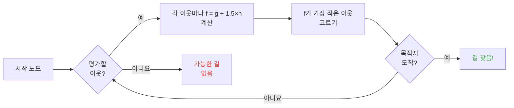

## 소개

양들이 벽에 부딪히는 것을 몇 시간 바라봤어요.

솔직히요? 제 인생 최고의 투자였어요.

이 몹들을 오래 볼수록 무작위가 전혀 아니라는 것을 깨달아요. 모든 움직임이 코딩되어 있고, 예측 가능하고, 무엇보다 완전히 깨뜨릴 수 있어요. 결국 길찾기(길 찾기)가 정확히 어떻게 동작하는지 알려고 Minecraft 소스 코드에 뛰어들었어요. 발견한 것은 몹을 말 그대로 마인드컨트롤할 수 있다는 거예요. 운이 정하는 곳이 아니라 여러분이 원하는 곳으로 가게 강제하는 거예요.

이 가이드는 뒤지면서 배운 모든 것이에요. AI, A* 알고리즘, 숨은 패널티, 서바이벌에서 쓸 수 있는 악용법. 곡괭이 챙기세요.

---

## 몹 AI가 동작하는 방법 (스포일러: 바보예요)

### 목표

각 몹은 *목표*들을 가지고 있어요. 할 수 있는 행동 목록과 얼마나 하고 싶은지예요. 숫자가 작을수록 우선순위가 높아요. 혼돈 버전 할 일 목록 같아요.

```java
protected void registerGoals() {
   this.goalSelector.addGoal(4, new Zombie.ZombieAttackTurtleEggGoal(this, 1.0, 3));
   this.goalSelector.addGoal(8, new LookAtPlayerGoal(this, Player.class, 8.0F));
   this.goalSelector.addGoal(8, new RandomLookAroundGoal(this));
   this.addBehaviourGoals();
}
```

좀비가 거북 알을 무시하고 여러분을 쫓는 것을 본 적 있나요? 이유가 바로 이거예요. `ZombieAttackTurtleEggGoal` 우선순위가 4인데, 여러분 얼굴을 먹으라고 말하는 `ZombieAttackGoal` 목표는 우선순위 2예요.

네, 좀비는 알을 깨는 것보다 여러분을 먹는 것을 좋아해요. 사랑이 아름다워요.

정말 관심 있는 목표는 `WaterAvoidingRandomStrollGoal`, 우선순위 7. "할 일 없어서 막 걸어다녀요" 목표. 모든 것이 흥미로워지는 지점이 바로 여기예요.

### 움직임 (또는 "무작위 걷기가 60분의 1 확률로 일어나는 방법")

매 틱(0.05초마다)마다 게임이 `canUse()`를 불러서 몹이 움직일 마음이 있는지 봐요. 매 틱마다 60분의 1 확률. 완전히 바보 같은 설계고, 저는 그게 좋아요.

```java
public boolean canUse() {
   if (this.mob.hasControllingPassenger()) {
      return false;
   } else {
      if (!this.forceTrigger) {
         if (this.checkNoActionTime && this.mob.getNoActionTime() >= 100) {
            return false;
         }
         if (this.mob.getRandom().nextInt(reducedTickDelay(this.interval)) != 0) {
            return false;
         }
      }
      Vec3 $$0 = this.getPosition();
      if ($$0 == null) {
         return false;
      } else {
         this.wantedX = $$0.x;
         this.wantedY = $$0.y;
         this.wantedZ = $$0.z;
         this.forceTrigger = false;
         return true;
      }
   }
}
```

정리하면요. 몹에 탔으면 안 돼요, 몹이 5초 동안 아무것도 안 했으면 안 돼요, 무작위가 아니라고 하면 안 돼요. 게임은 몹이 움직이지 않기를 정말 원해요.

하지만 움직이면 `getPosition()`이 이어받아요.

```java
protected Vec3 getPosition() {
   if (this.mob.isInWater()) {
      Vec3 $$0 = LandRandomPos.getPos(this.mob, 15, 7);
      return $$0 == null ? super.getPosition() : $$0;
   } else {
      return this.mob.getRandom().nextFloat() >= this.probability
         ? LandRandomPos.getPos(this.mob, 10, 7)
         : super.getPosition();
   }
}
```

끝의 두 숫자 좀 보세요. XZ 반경과 Y 반경이에요. 물에서는 몹이 더 멀리 찾아요 (10 대신 15). 땅을 찾지 못하면 물을 받아들이는 `super.getPosition()`으로 돌아가요. **결과: 몹은 물에서 나가고 싶어 해요.** 그래서 여러분 동물들이 미친 듯이 가장자리로 헤엄치는 거예요.

톡 쏘는 세부 사항 하나: 몹이 `LandRandomPos` 대신 `super.getPosition()`을 쓸 확률이 말 그대로 0.1퍼센트예요. 천분의 일. 전형적인 Mojang이에요.

### LandRandomPos: 모든 것을 바꾸는 허접 최적화

제가 제일 좋아하는 단계예요. 길찾기를 악용 가능하게 만드는 가장 아름다운 기술적 바보짓.

```java
public static Vec3 getPos(PathfinderMob $$0, int $$1, int $$2, ToDoubleFunction<BlockPos> $$3) {
   boolean $$4 = GoalUtils.mobRestricted($$0, $$1);
   return RandomPos.generateRandomPos(() -> {
      BlockPos $$4xx = RandomPos.generateRandomDirection($$0.getRandom(), $$1, $$2);
      BlockPos $$5 = generateRandomPosTowardDirection($$0, $$1, $$4, $$4xx);
      return $$5 == null ? null : movePosUpOutOfSolid($$0, $$5);
   }, $$3);
}
```

`movePosUpOutOfSolid`. 이름이 전부예요. 고른 위치가 고체 블록 안에 있으면 게임이 공기 중에 있을 때까지 위로 밀어 올려요.

최적화예요. 땅속 위치를 무시하느라 시간을 낭비하는 대신 표면으로 올려요. 영리하죠? 네. 그런데 엄청난 편향을 만들어요. **몹은 높은 곳을 좋아해요**.

상상해 보세요. 표면 아래 블록이 잔뜩 있고, 게임이 무작위 위치 10개를 만들어요. 블록 안에 든 것들은 위로 밀려 올라가요. 빽빽한 구역(언덕 아래)은 빈 구역보다 유효 위치를 더 많이 만들어요. 결과: 몹이 통계적으로 언덕 쪽으로 더 자주 가요.

믿어 보세요. 2분 만에 깨뜨릴게요.

### 선택: 최고의 블록 대회

위치 10개, 승자 하나, 점수 대회예요.

```java
public static Vec3 generateRandomPos(Supplier<BlockPos> $$0, ToDoubleFunction<BlockPos> $$1) {
   double $$2 = Double.NEGATIVE_INFINITY;
   BlockPos $$3 = null;
   for(int $$4 = 0; $$4 < 10; ++$$4) {
      BlockPos $$5 = (BlockPos)$$0.get();
      if ($$5 != null) {
         double $$6 = $$1.applyAsDouble($$5);
         if ($$6 > $$2) {
            $$2 = $$6;
            $$3 = $$5;
         }
      }
   }
   return $$3 != null ? Vec3.atBottomCenterOf($$3) : null;
}
```

최고 점수 위치가 이겨요. 그리고 점수 기준을 알면 원하는 위치가 이기게 할 수 있어요. 선거를 조작하는 것과 같아요.

---

## 몹의 취향 (또는 "왜 네 소가 길을 건너나요")

각 몹은 취향이 달라요. 그리고 모든 것을 바꿔요.

| 몹 | 좋아하는 것 |
| --- | --- |
| **동물** (소, 양, 돼지) | 풀과 빛 (힙스터) |
| **몬스터** (좀비, 스켈레톤) | 어둠 (엣지로드) |
| **거북** | 물, 아니면 모래, 아니면 빛 |
| **호글린** | `crimson_nylium`. `warped_fungus` 싫어해요 |
| **스트라이더** | 용암만. 다른 것은 아무것도. |
| **실버피시** | 감염 가능한 블록 (당연하죠) |
| **가디언** | 물 + 빛 (스놉) |
| **무슴** | 균사체 + 빛 (버섯) |
| **벌** | 공기. 네, 공기를 좋아해요. |

```java
// 동물: 아래를 보고 풀이면 최고 점수
public float getWalkTargetValue(BlockPos $$0, LevelReader $$1) {
   return $$1.getBlockState($$0.below()).is(Blocks.GRASS_BLOCK) ? 10.0F : $$1.getPathfindingCostFromLightLevels($$0);
}

// 몬스터: 정확히 반대
public float getWalkTargetValue(BlockPos $$0, LevelReader $$1) {
   return -$$1.getPathfindingCostFromLightLevels($$0);
}
```

몬스터는 말 그대로 "밝으면 마이너스 점수, 다른 데로 가요"예요. 빛을 보면 얼굴을 찡그려요.

그래서 말 그대로 풀과 빛으로 동물을 이끌고, 어둠으로 몬스터를 이끌 수 있어요. 바보 같으면서 genial해요.

---

## Minecraft 속 A* 알고리즘 (비밀 공식)

Minecraft는 길찾기에 A*(A-star) 알고리즘을 써요. 하지만 Mojang이 손을 댔어요.

```
f(n) = g(n) + 1.5 × h(n)
```

- **g(n)** = 이미 간 길 (블록당 1, 대각선 약 1.41)
- **h(n)** = 직선 거리
- **1.5** = Mojang이 살짝 맛 간 값을 좋아해서

보통 A*는 `f(n) = g(n) + h(n)`을 써요. MOJANG이 1.5 계수를 더했어요. 왜요? 알고리즘이 목적지로 더 빨리 가고 탐색 가지를 덜 자르게요. 결과: 찾은 길이 "괜찮지만" 항상 최고는 아니에요. 살짝 취한 A*예요.



중요한 세부 사항: **몹은 16블록까지만 길찾기**할 수 있어요 (추적 범위). 목적지가 너무 멀면 도달 가능한 가장 가까운 블록을 골라요. 닿지 않는 곳에 기념비를 세우면, 몹은 그 기념비에 가까워지는 가장 가까운 블록 쪽으로 길을 찾아서 움직임이 완전히 예측 가능해진다는 뜻이에요.

### 게임을 깨는 두 가지 악용법

#### 1. 블록 고치기 = 강제 재계산

```java
public boolean shouldRecomputePath(BlockPos $$0) {
   if (this.hasDelayedRecomputation) return false;
   if (this.path != null && !this.path.isDone() && this.path.getNodeCount() != 0) {
      Node $$1 = this.path.getEndNode();
      Vec3 $$2 = new Vec3(
         ((double)$$1.x + this.mob.getX()) / 2.0,
         ((double)$$1.y + this.mob.getY()) / 2.0,
         ((double)$$1.z + this.mob.getZ()) / 2.0
      );
      return $$0.closerToCenterThan($$2, (double)(this.path.getNodeCount() - this.path.getNextNodeIndex()));
   }
   return false;
}
```

몹 길 근처의 매 블록 고치기는 1초 쿨다운과 함께 A* 재계산을 강제해요. 몹 옆에 1초 시계를 두면 길을 계속 다시 계산해요. 1초마다 리셋되는 GPS를 두는 것과 같아요.

50마리 몹에 동시에 하면요? 렉 파티. TPS 안녕.

#### 2. 블록 패널티 (길찾기 악의)

몹을 무섭게 하는 블록들이 있어요. 말 그대로요. 각 블록에는 열거형으로 정한 비용이 있어요.

| 블록과 조건 | 패널티 |
| --- | --- |
| **꿀 블록** | 통과 +8 |
| **가루눈** | 통과 불가 |
| **닫힌 문** | 통과 불가 |
| **불** | 통과 +16, 옆 +8 |
| **동물과 주민** | 불 = -1 (안 돼요) |
| **선인장과 달콤한 열매** | 통과 불가. 옆 = +8 |
| **물** | 통과나 옆 +8 |
| **마그마** | 옆 +8 (아야) |

동물은 한술 더 떠요.

```java
protected Animal(EntityType<? extends Animal> $$0, Level $$1) {
   super($$0, $$1);
   this.setPathfindingMalus(PathType.DANGER_FIRE, 16.0F);
   this.setPathfindingMalus(PathType.DAMAGE_FIRE, -1.0F);
}
```

DAMAGE_FIRE가 -1.0F, 말 그대로 "금지"예요. 동물은 불을 통과하느니 허공에 몸을 던져요. 휴.

### 연습: 대경주 대회

여러 길 중 골라야 하는 주민을 상상해 보세요.

- **길 A**: 15블록이지만 6블록이 물을 낀 길 (개당 +8)
- **길 B**: 18블록에 물 2블록 (+8)과 옆 물 1블록 (+8)
- **길 C**: 똑바로 14블록... 하지만 불이 있어서 주민에게는 통과 불가
- **길 D**: 16블록에 옆 마그마 1블록 (+8) + 옆 꿀 1블록 (+8)
- **길 E**: 25블록이지만 도처에 선인장 (+8 도처) → 총비용 90.82

암산:

- 길 A: 15블록 + 물 6×8 = 15 + 48 = **63** ... 하지만 1.5×거리를 더해야 해요. 진짜 계산을 해요.
- 길 B: 더 길지만 패널티가 적어요. 총비용 = 누적 거리 + 패널티.
- 길 D: 마그마와 꿀이 패널티를 쌓아요.

승자는 흔히 **길 B**예요. 물이 비싸니 우회가 남는 장사예요.

주민은 본질적으로 다리가 달린 비용 계산기예요.

### 몹마다 취향이 있어요

주민: "불이요? 사양할게요 안녕"
좀비: "불이요? 됐거든요 *불타며 통과*"

몹에 따라 가고 안 가는 길이 말 그대로 있어요. 좀비는 타 죽는 주민용 고속도로를 만들 수 있어요.

---

## 주민: 궁극의 난장판

좋아요, 주민. Minecraft 전체에서 가장 덜 이해된 시스템. 하지만 코드를 잡고 나면 사무 시간표가 있는 예측 가능한 기계라는 것을 깨달아요.

### 센서와 기억

센서 9개, 20틱(1초)마다 돌아요. 각자 주민 주변 반경을 훑고 결과를 기억에 저장해요. 주민은 전부 보고, 전부 기억하고, 그에 따라 행동해요.

예를 들면요. "적 있어요? 땅에 아이템 있어요? 말할 플레이어 있어요?" 전부 체크해요.

### 패키지 (하루 단계)

주민의 뇌는 시간에 따라 켜지는 활동 패키지예요.

| 패키지 | 시간 | 주민은... |
| --- | --- | --- |
| **Core** | 24시간 | 문 열고, 헤엄치고 (80퍼센트 시간), POI 획득 |
| **Work** | 8시~15시 | "일하러 가요" → 작업대로 걸어가요 |
| **Meet** | 15시~17시 | "회식!" → 종으로 가서 수다 |
| **Rest** | 18시~6시 | "자야 해요" → 침대로 가요 |
| **Idle** | 6시~8시, 17시~18시 | "빈둥거려요" → 돌아다니고, 아기 만들고, 침대에서 뛰어요 |
| **Panic** | 부상과 적대적 몹 | "살려 줘요" → 도망 |

**Panic** 패키지만이 다른 모든 것을 끊을 수 있어요. 주민이 자거나 일해도 좀비가 있으면 전면 패닉.

### POI 획득: 무선 레드스톤을 가능하게 하는 것

```java
Set<Pair<Holder<PoiType>, BlockPos>> $$12 = (Set)$$10xx.findAllClosestFirstWithType(
   $$0, $$11, $$8x.blockPosition(), 48, PoiManager.Occupancy.HAS_SPACE
)
```

`Acquire POI`는 반경 48블록의 모든 POI(관심 지점)를 스캔해요. 가장 가까운 5개를 유지하고, 길이 있는지 확인하고, 닿을 수 있는 첫 번째를 획득해요.

각 POI에는 제한된 슬롯 수가 있어요.

- **작업대**: 1개 슬롯
- **침대**: 1개 슬롯
- **종**: 32개 슬롯

미친 지점: **슬롯은 도착 때가 아니라 획득 순간 예약돼요**. 주민은 절대 닿지 않고 맵 반대편에서 퇴비통을 잠글 수 있어요.

힘이 느껴지시죠?

### 무선 레드스톤. 네, 무선으로요.

1. 길을 따라 퇴비통으로 가는 주민을 마인카트에 둬요
2. 퇴비통을 획득해요 (슬롯 차지, 다른 누구도 못 써요)
3. 주민은 눌러대기에는 너무 멀고, 뼛가루 식량이 남아요
4. 이 주민을 세상 어디든 데리고 다녀요. 슬롯을 유지해요
5. 기계를 작동시키고 싶으면 주민을 죽여요
6. 슬롯이 풀리고, 다른 주민이 퇴비통을 획득하고, 뼛가루를 빼요
7. 블록 고치기 → 어떤 레드스톤 회로든 작동

경로에 청크 로드 없이 세상 전체에 전송되는 무선 레드스톤 신호를 말 그대로 만들었어요. 엔더 진주 정지 챔버에 이걸 연결하면 주민 하나를 죽여서 어디에서든 텔레포트될 수 있어요.

제가 제일 좋아하는 쓰임? "현상금 사냥" 미니게임이에요. 퇴비통이 있는 주민 여러 명을 두고, 플레이어가 출구를 작동시키려고 맞는 주민 하나를 죽여야 해요. 완전히 wtf한 구조예요.

### 길찾기 교착 (또는 "영원히 멈추는 주민")

`Acquire POI`(길을 본다는)와 실제 이동(그 길을 가기 거부한다) 사이에 너무 좋은 버그가 있어요. 작업대 위 블록을 걸을 수 없을 때 일어나요. 결과:

- Core 패키지: "POI를 획득하고 싶어요"
- 이동: "거기는 걸을 수 없어요"
- 결과: 주민이 영원히 멈춰서 자기 자신과 싸워요.

말 그대로 제자리에 멈춘 주민들, 장식이나 빌드의 "소품"으로 쓸 수 있어요. 갑옷 거치대 탱크? 네. 움직이지 않는 경비? 네. 잔인하냐고요? 아마요. 하지만 효과적이에요.

---

## 결론

Minecraft 몹 길찾기는 운이 아니에요. 점수 기반의 결정적 시스템이고, 예측 가능하고 깨뜨릴 수 있어요.

**기억할 세 가지:**

1. **발밑 블록 = 높이 편향**: 몹을 이끌려고 지하를 채우거나 비워요
2. **패널티는 몹마다 달라요**: 어떤 몹은 가고 어떤 몹은 안 가는 길을 만들어요
3. **POI 슬롯은 원격 예약돼요**: 무료 무선 레드스톤, 텔레포트, 전부요

Minecraft 소스 코드는 덜 쓰이는 구조의 금광이에요. 디컴파일된 Java를 읽느라 몇 시간을 썼는데 솔직히요? 매 줄이 동작하는 이스터 에그예요. 다만 그것들을 서바이벌에서 주민 무선 레드스톤을 만드는 데 써요. 최고의 게임 확정.
