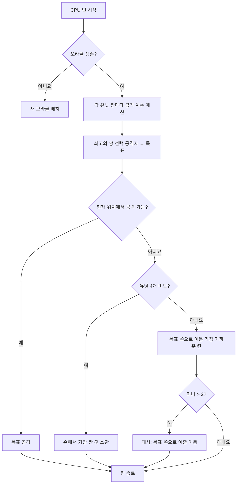

## Nausicaa용 엉뚱한 내 AI

어떤 프로젝트는 "신화로 체스 게임을 만들면 어떨까?"로 시작해서, 5턴마다 스스로 하이퍼파라미터를 정하는 AI가 있는 시스템으로 끝나곤 해요.

Nausicaa가 그래요. 신화 속 생물 덱을 만들고, 마나를 관리하고, 10x8 보드에 유닛을 배치하는 턴제 보드 게임이에요. 그리고 성격 위기를 겪는 AI가 있어요.

이 AI에 꽤 많은 시간을 썼는데, 결과가 아직도 가끔 제 손을 벗어나요. 그 점이 가장 마음에 들어요.

## 실제 게임 모습

두뇌를 이야기하기 전에 몸을 이해해야 해요.

- 10x8 보드, 플레이어당 2줄 배치 구역
- 마나는 1에서 시작해서 턴마다 +1, 최대 6. 소환과 공격, 능력 사용에 써요
- 목표: 상대 오라클 처치

12개 유닛, 비용과 이동 패턴이 각각 달라요.

| Unit | 비용 | 이동 | 체력 |
| --- | --- | --- | --- |
| Oracle | 0 | 킹 (8방향) | 1 |
| Gobelin | 1 | 앞으로 3칸 | 1 |
| Harpie | 1 | 킹 (8방향) | 1 |
| Naïade | 1 | 대각선 | 1 |
| Griffin | 2 | 2칸 점프 | 2 |
| Sirène | 2 | 옆으로 | 1 |
| Centaure | 2 | 나이트 (L자) | 2 |
| Archer | 3 | 옆으로 | 1 |
| Phénix | 3 | 대각선 (어두운 칸) | 1 |
| Métamorphe | 4 | 자리 바꾸기 | 1 |
| Voyant | 4 | 없음 (마나 생성) | 1 |
| Titan | 6 | 제한적 (범위 공격) | 3 |

각 유닛은 고유한 공격 패턴을 가지고 있어요. 사이렌은 4개 대각선을 때리고, 궁수는 3칸 원거리에서 쏘고, 타이탄은 소환될 때 주변을 전부 파괴해요. 한마디로 신화와 덱빌딩이 들어간 체스예요.

## CPU에게 생각하는 법을 가르친 방법

기본 아이디어는 바보스러울 정도로 단순해요. **적 유닛마다 매력 계수가 있어요**. 위험할수록 AI가 더 처리하고 싶어 해요.

```javascript
const UNITS_ATTRACTIVENESS = {
    "oracle": 100,
    "titan": 95,
    "shapeshifter": 90,
    "phoenix": 80,
    "siren": 70,
    "archer": 70,
    "seer": 70,
    "griffin": 60,
    "centaur": 60,
    "harpy": 50,
    "naiad": 30,
    "gobelin": 20
};
```

오라클이 100인 건 당연해요. 승리 조건이니까요. 타이탄이 95인 건 소환될 때 옆에 있는 것을 원샷으로 잡기 때문이에요. 고블린은 20이에요. 보병일 뿐이니 신경 안 써요.

다음으로 각 유닛 쌍(아군 하나, 적 하나)마다 이렇게 계산해요.

```
interet = attractivite × coeff_attract / (distance × coeff_dist)
```

대충 말하면, 위험하고 가까울수록 AI가 더 때려잡고 싶어 해요.

```javascript
calculateAttackCoefficient(x1, y1, x2, y2) {
    const distance = this.calculateEuclideanDistance(x1, y1, x2, y2);
    if (distance === 0) return Infinity;
    return (UNITS_ATTRACTIVENESS[unit.type] * COEFFICIENTS_IMPORTANCE["attractiveness"]) / distance;
}
```

### 바뀌는 계수 이야기

중요한 점은 중요도 계수가 **5턴마다 무작위로 바뀐다**는 거예요.

```javascript
if (this.turnCount % 5 === 0) {
    const distanceCoefficient = parseInt(Math.random() * 100);
    const attractivenessCoefficient = parseInt(Math.random() * 100);
    this.regulateImportanceCoefficients({
        distance: distanceCoefficient,
        attractiveness: attractivenessCoefficient
    });
}
```

한번은 AI가 초공격적(매력 95, 거리 5)이 되어서 여러분의 오라클을 잡으려고 전부 가로질러요. 다음번에는 거리를 우선해서 재배치해요.

팩맨 유령에서 따온 거예요. 블링키는 사냥하고 핑키는 매복하죠. 여기서 AI는 페이즈마다 "성격"을 바꿔요.

**결과: 한 판 내내 AI를 예측하는 것은 불가능해요.** CPU는 같은 경기를 두 번 절대 안 해요.

### 오라클은 겁쟁이예요

적 오라클은 도망쳐요. 말 그대로요.

```javascript
const awayFromTarget = {
    row: Math.max(0, Math.min(7, botUnitElement.row + (botUnitElement.row - targetUnitElement.row))),
    col: Math.max(0, Math.min(9, botUnitElement.col + (botUnitElement.col - targetUnitElement.col)))
};
```

위협과 반대 방향을 계산해서 튀어요. 벽이 있으면 그 방향에서 가장 가까운 빈 칸을 찾아요.

오라클에게 다가가려고 3턴을 쓰는데, 팡 하고 벌써 반대편 끝으로 도망가 있어요.

### 의사결정 루프

AI가 결정하는 방법은 이렇습니다.

1. 오라클이 없으면(죽었으면) 새로 배치
2. 아군 유닛에서 적 유닛으로 가는 각 쌍마다 계수 계산
3. 최고의 쌍 선택
4. 유닛이 현재 위치에서 목표를 공격할 수 있으면 공격
5. 유닛이 4개 미만이면 손에서 가장 싼 것을 소환
6. 아니면 목표 쪽으로 이동(적에게 가장 가까운 이동 칸)
7. 마나가 충분하면(2 초과) 더 가까워지려고 대시(이중 이동)
8. 유닛이 오라클이면 도망



```javascript
async makeAction(dash=false) {
    // tout ça en séquence
    // le CPU dash si il a assez de mana
    if(botPlayer.mana > 2) {
        this.makeAction(true);
    }
}
```

### 왜 유클리드 거리인가요

유클리드 거리를 써요.

```javascript
calculateEuclideanDistance(x1, y1, x2, y2) {
    const deltaX = Math.pow(x1 - x2, 2);
    const deltaY = Math.pow(y1 - y2, 2);
    return Math.sqrt(deltaX + deltaY) * COEFFICIENTS_IMPORTANCE["distance"];
}
```

맨해튼은 왜 안 쓰냐고요? 유닛들의 이동 패턴이 제각각이라서요 (나이트처럼 L자, 대각선 등). 직선 거리가 위험도를 더 잘 근사해요.

## 왜 미니맥스가 아닌가요

고전적인 미니맥스를 코딩할 수도 있었어요. 하지만 유닛 종류가 12개에 이동 패턴도 다르고 특수 능력도 있어서, 게임 트리가 너무 빨리 폭발해서 플레이가 불가능해져요. 휴리스틱 접근은 수천만 개 상태를 탐색하지 않고도 현명한 선택을 해요.

## 멋진 점

매력 시스템이 재미있는 딜레마를 만들어요.

- 선견자(70)는 마나를 만들어내요. 살려 두면 상대가 자원을 더 얻어요. 하지만 타이탄(95)이 훨씬 더 위험해요.
- 변신술사(90)는 어떤 유닛과도 자리를 바꿀 수 있어요. 여러분의 오라클을 훔칠 수 있어요.
- 하피(50)는 자신을 죽이는 폭발 공격이 있어요. 부차적으로 남아요. 하지만 여러분 유닛 셋 옆에 서는 순간까지는요.

AI는 단순 스탯이 아니라 위치에 따른 전체 위험을 평가해요.

판을 새로 시작하지 않고 시나리오를 테스트하는 `activateSimulation()` 함수도 있어요.

```javascript
activateSimulation() {
    // 보드에 특정 유닛들을 배치해요
    // AI를 디버깅하는 데 유용해요
    this.game.board = simulation.board;
    this.game.players = simulation.players;
}
```

## 부족한 점

시간이 더 있었다면요.

- AI는 현재 상태에 반응할 뿐, 플레이어가 무엇을 할지 예측하지 않아요
- 여러 턴에 걸쳐 손패를 계획하지 않아요
- 변신술사와 켄타우로스의 능력을 충분히 활용하지 않아요
- 강화 학습: 스스로와 대결시켜서 계수를 조정하기

하지만 브라우저 게임으로는 충분히 통행해요. 친구들이 지고 오니 검증된 셈이에요.

## 테스트해 보세요

[nausicaa-game.github.io](https://nausicaa-game.github.io/)에서 할 수 있어요. "JOUER"를 누르고 CPU 모드를 켠 뒤 AI가 하는 것을 보세요.

팁: AI끼리 대결시켜 보세요. 공격적인 페이즈를 보다가, 푸슥 하고 전부 후퇴하는 것을 보게 될 거예요.

코드는 `js/cpu.js`의 [GitHub](https://github.com/nausicaa-game/nausicaa-game.github.io)에 있어요.

**기억할 3가지:**

1. **휴리스틱 계수**: 미니맥스 없이, 각 유닛에 매력도가 있어요
2. **5턴마다 바뀌는 계수**: AI는 팩맨처럼 공격성과 컨트롤을 오가요
3. **도망치는 오라클**: 위협과 반대 방향을 계산해서 줄행랑쳐요

AI를 더 교활하게 만들 아이디어가 있으면 이슈를 열어 주세요. 패배에서 배우는 버전을 계획 중인데, 다음 글에서 다룰게요.
