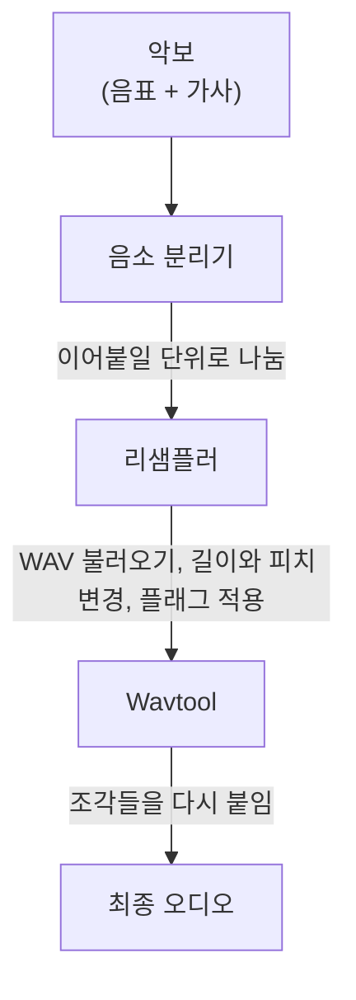

## UTAU: Visual Basic 6 소프트웨어가 합성 음성을 대중화한 방법

메인 페이지에서 살짝 언급했어요. 저는 UTAU를 좋아해요. 왜인지 이야기해 볼게요.

2008년에 합성 음성으로 노래를 부르게 하고 싶으면 선택지가 하나였어요. VOCALOID. Yamaha 소프트웨어요. 비싸고 독점적이고, 직접 만들 수 없는 공식 음성만 있었어요.

그러다 일본의 한 사람 Ameya와 Ayame가 자기 방에서 프로그램을 내놓았어요. **Visual Basic 6**으로 짠 소프트웨어요. 무료. 직접 녹음한 WAV 파일로 자신만의 목소리를 만들 수 있게 해주는...

그 소프트웨어가 **UTAU**(歌う, 일본어로 "노래하다")예요. 그 시대에는 마법 같은 물건이었어요.

저는 기술적 깔끔함보다 출발점 아이디어 때문에 늘 매력적으로 느껴졌어요 (인코딩 원리는 지금도 정말 영리해요. 구현이 눈이 아플 뿐이죠). 대중에게 음성 합성을 열어주었어요. 마이크 하나 가진 여러분도, 저도, 누구든요.

왜 대단했는지 설명해 드릴게요.

---

## 먼저, 노래 합성이 왜 어려운지

노래하는 목소리는 음표가 아니에요. 자음이 치고 들어오고, 모음이 유지되고, 숨이 있고, 둘 사이의 전이가 있어요. "salut"의 "sa"는 "s"가 쉬익 나다가 열린 "a"로 미끄러지고, 인간답게 들리는지는 바로 그 미끄러짐에 달려 있어요.

오늘날은 딥러닝으로 풀어요. 수 시간의 노래로 모델을 훈련시키고 목소리를 만들어내요 (Synthesizer V, DiffSinger). 하지만 그건 2020년 이후 이야기예요. 2008년에는 아무것도 없었어요.

UTAU는 그 이전의, 더 오래되고 더 영리한 방법을 써요. **이어붙이기 합성**이에요.

---

## 이어붙이기 합성: 목소리 조각 복붙

아이디어는 우스울 정도로 단순해요. 작은 목소리 조각들을 녹음해서 단어를 만들려고 이어붙여요. "salut" = "sa" 샘플 + "lu" + "to"를 잇는 거예요. 악보가 조종하는 소리 퍼즐이에요.

캐릭터의 말을 잘라서 아무 말이나 시키는 YouTube Poop 원리와 같아요. 다만 여기서는 깔끔하고 자동화되어 있어요.

그리고 UTAU는 말 그대로 거기에서 나왔어요. 그 이전에 **"Jinriki Vocaloid"**(人力ボーカロイド, "수제 Vocaloid")가 있었어요. 사람들이 손으로 보컬 트랙을 자르고, 음소를 뽑고, 피치를 바꾸고, 오디오 편집기에서 전부 다시 조립해서 VOCALOID 음성을 흉내 냈어요. 손으로요. 작업량이 상상이 가시죠.

Ameya가 그 고생을 보고 자동화하는 도구를 짰어요. 원래 UTAU는 그저 그거였어요. 수제 Vocaloid용 도우미.

---

## 혁신적이었던 이유: 여러분이 목소리를 만들어요

모든 것을 바꾸는 지점이 바로 여기예요.

VOCALOID는 목소리를 사는 거였어요. Miku, Luka 등. 프로가 만들고 Yamaha가 팔아요. 제작은 Yamaha에게만 열려 있었어요. UTAU로는 **누구나 자기 목소리를 녹음해서 노래하는 악기로 만들어요**.

CV 방식(가장 단순)은 이렇습니다. 일본어 기본 음절 100개쯤("a", "ka", "sa", "ta"...)을 녹음하고, 자르는 지점을 설정하면 여러분의 보이스뱅크 완성. 몇 시간 작업이에요.

결과: 생태계가 폭발했어요. 커뮤니티가 만든 수천 개의 보이스뱅크. 팬의 목소리, 친구의 목소리, 창작 캐릭터의 목소리. 가상 가수들의 세계 전체가 무료로요. 그리고 소프트웨어에는 AquesTalk TTS 엔진으로 만든 기본 음성 **Defoko**(Utane Uta)가 들어 있어서, 마이크 없이도 시작할 수 있었어요.

---

## oto.ini: 시스템의 심장

UTAU는 소리를 어디서 자르고 붙이는지 어떻게 알까요? 보이스뱅크별 설정 파일 **`oto.ini`** 덕분이에요. 각 WAV마다 자르는 지점(밀리초 단위)을 정해요.

- **Offset**: 앞쪽 무음을 버려요
- **Preutterance**: 자음이 모음으로 넘어가는 지점("sa"에서 "s"에서 "a"로의 경계)
- **Overlap**: 앞 음표가 이번 음표에 얼마나 겹쳐요
- **Fixed region**: 긴 음표에서도 늘어나면 안 되는 부분(보통 자음)
- **Cutoff**: 끝을 어디서 잘라요

**preutterance**가 가장 영리한 매개변수예요. 음절에는 모음 앞에 항상 자음 조각이 있어요. 음표가 박자에 맞으려면 떨어져야 하는 것은 자음이 아니라 *모음*이에요. 그래서 UTAU는 샘플을 뒤로 밀어요. "sa"의 "a"가 박자에 떨어지고 "s"는 바로 앞에만 겹쳐요. 소리가 정확히 떨어지려고 치기 전에 미리 움직이는 드러머처럼요. 다만 그게 `.ini` 안에 있는 거예요.

"ka" 샘플에서 `oto.ini` 구역이 이렇게 나뉘는 것을 시각적으로 보면요.

```mermaid
flowchart LR
    A["🔇 무음<br/>(offset)"] --> B["🅺 자음<br/>(fixed region,<br/>늘어나지 않음)"]
    B --> C["🅰 모음<br/>(늘어나는 구역)"]
    C --> D["🔇 끝 자름<br/>(cutoff)"]
    style B fill:#3b4a6b
    style C fill:#5b3b6b
```



자음과 모음의 경계가 preutterance예요. 모음은 긴 음표를 위해 늘리는 구역이고, 자음은 그대로 두어요. "k"가 2초 동안 이어지면 끔찍하게 들리니까요.

```ini
# oto.ini (단순화)
# 파일=별칭,offset,consonant,cutoff,preutterance,overlap
_ka.wav=ka,120,80,-200,90,40
```

소리마다 값 다섯 개, 모든 샘플에 대해, 그러면 UTAU가 어떤 단어든 깔끔하게 조립해요.

---

## CV, VCV, CVVC: 리얼리즘 경쟁

기본 방식 **CV**(자음-모음)는 음절당 소리 하나예요. 단순하지만 살짝 로봇 같아요. 음절 사이 이음이 거칠어요.

2010년에 커뮤니티가 **VCV**(모음-자음-모음)를 발명했어요. "ka"만 녹음하는 대신 "a ka"를 녹음해요. 앞 모음의 꼬리까지요. 전이가 *녹음 안에* 들어 있으니 뒤에서 계산하지 않아도 자연스러워져요.

아픈 세부 사항인데요. **VOCALOID는 VOCALOID3인 2011년까지 VCV가 없었어요.** 혼자 짠 VB6 프리웨어가 전이의 리얼리즘에서 Yamaha를 1년 앞선 거예요. 다국적 기업보다 빠른 팬 커뮤니티.

이어서 **CVVC**와 영어용 **ARPAsing**, **VCCV**가 나왔어요. 각 방식이 리얼리즘을 한층 끌어올렸고, 전부 커뮤니티가 발명하고 문서화했어요.

---

## 전체 파이프라인: 단어가 소리가 되는 과정

음표를 놓고 가사를 치면 뒤에서 이런 일이 일어나요.



**리샘플러**가 핵심이에요. 주어진 높이로 녹음된 "ka" 샘플을 가져다가 원하는 음표에 맞게 길이와 피치를 바꿔요. 늘릴 수 있는 구역만 늘리고 자음은 그대로 두어요 (그래서 `oto.ini`가 있는 거예요).

그리고 **모듈식**이에요. UTAU에는 기본 리샘플러가 들어 있었지만, 커뮤니티가 다른 것들(moresampler, TIPS...)을 만들었어요. 각각 고유한 소리 결이요. 합성 엔진을 플러그인처럼 바꿨어요. 2008년에요. 프리웨어에서요.

---

## 후드 아래 공사 현장 (그래서 정이 가는 이유)

소프트웨어의 기술 상태에 대해서는 솔직해야겠어요.

- **Visual Basic 6으로 코딩.** 2008년에 이미 죽은 언어. 돌리려면 VB6 런타임이 필요해요.
- 기본적으로 **Windows 전용**(Mac 이식 UTAU-Synth는 2011년에 나왔어요).
- **Shift-JIS 인코딩 필수.** 파일이 일본어 Shift-JIS로 인코딩되어 있지 않으면 UTAU가 아무것도 이해하지 못해요. 지금도 PC를 일본어 로캘로 두거나 AppLocale로 실행해야 하는 경우가 많아요.
- **소박한 인터페이스**, 당시 문서가 거의 100퍼센트 일본어.

그런데요. 그런데도 이 소프트웨어는 세계적 움직임을 만들었어요. 수만 개의 보이스뱅크. 수백만 번 들린 노래들.

최고의 예는 **Kasane Teto**예요. 2008년에 만들어져 만우절 장난으로 VOCALOID인 척 던져진 캐릭터예요. 농담이었어요. 그런데 사람들이 캐릭터를 사랑했고, 뒤이어 진짜 UTAU 보이스뱅크가 만들어졌고, Teto는 세계에서 가장 유명한 가상 가수 중 하나가 됐어요. 2023년에는 공식 Synthesizer V 음성까지 받았어요. 무료 소프트웨어 위의 만우절에서 태어난 캐릭터.

---

## 왜 아직도 중요한지

UTAU는 "가난한" 기술이 개방성으로 이기는 완벽한 예예요.

VOCALOID는 기술적으로 우월했고, 자금도 많았고, 더 프로였어요. 하지만 닫혀 있었어요. UTAU는 대충 만들었고, 못생겼고, VB6이었어요. 하지만 모두의 참여를 열어주었어요. 목소리 만들기, 리샘플러 만들기, 플러그인 만들기, 녹음 방식 만들기. 나머지는 커뮤니티가 했어요.

그리고 개념은 오늘날에도 완전히 살아 있어요. 현대 오픈 소스 후계자 **OpenUtau**가 아이디어를 이어받아 손질했어요 (멀티 플랫폼, UTF-8, 현대 리샘플러와 AI 지원). 이어붙이기 합성은 딥러닝 모델 옆에서도 여전히 건재해요. 그들이 가지지 못한 이점이 있으니까요. 무슨 일이 일어나는지 정확히 이해하고, 매 밀리초를 통제해요.

UTAU에서 늘 좋았던 점이 그거예요. 무슨 일이 일어나는지 정확히 보여요. 이해하지 못하는 마법 결과를 뱉는 AI가 아니에요. WAV와 자르는 지점이 있고, 모든 것을 여러분이 정해요. 소리가 이상하면 이유를 알고 고칠 수 있어요. 저는 그런 통제를 좋아해요.

---

**기억할 3가지:**

1. **이어붙이기 합성 = 목소리 퍼즐**: UTAU는 작은 WAV 샘플들을 이어붙여 단어를 만들어요. `oto.ini`가 각 소리를 어디서 자르고 붙이는지 정해요. 블랙박스 없이 밀리초 단위까지 모두 통제해요.

2. **개방이 기술을 이겨요**: VOCALOID는 더 좋았지만 닫혀 있었어요. UTAU는 대충 만들었지만 모두에게 목소리를 만들게 해주었어요. 커뮤니티가 생태계를 폭발시켰고, VCV에서는 Yamaha까지 앞섰어요.

3. **좋은 아이디어는 코드를 살아남아요**: VB6, Shift-JIS, Windows 전용... 그런데도 개념은 OpenUtau를 통해 여전히 돌아가요. 훌륭한 기술은 허접하게 코딩되어도 돼요.

솔직히, 만우절에서 태어난 Kasane Teto 하나만으로도 이 소프트웨어는 존경을 받을 자격이 있어요.
