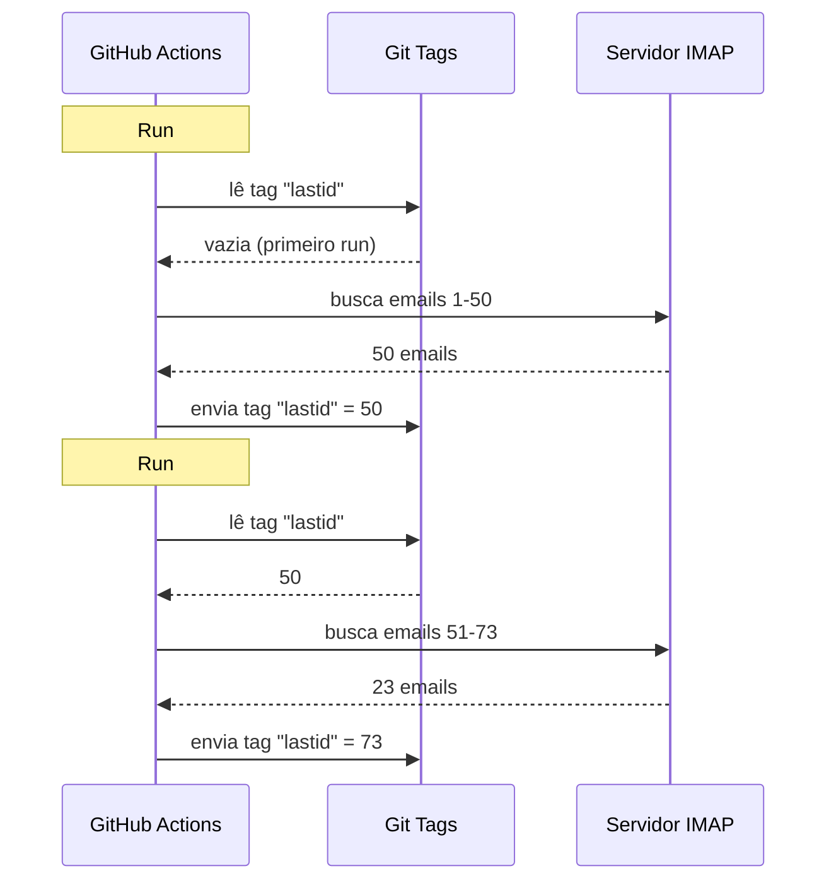

# Usei git como banco de dados para rodar um bot de graça no GitHub Actions

Tenho um respondedor automático de email rodando 24/7.

Ele lê meus emails, entende do que se trata, e responde sozinho com uma IA. Lembra das conversas anteriores. Ignora newsletters e `noreply@`. Encaminha para um humano quando esquenta.

Custo mensal : **0€**.

Dispenso servidor, VPS e banco de dados. Só GitHub Actions e um hack doido : **usar git como banco de dados**.

Sacou onde quero chegar ? Não ? Então se segura, é idiota e genial ao mesmo tempo.

---

## O problema : GitHub Actions é stateless

GitHub Actions é de graça. Dá para lançar um cron a cada 5 minutos, rodar seu código, grátis.

Mas tem um porém : é **stateless**.

Cada run começa em uma máquina limpa. Nada é salvo entre duas execuções. O run anterior ? Esquecido. Apagado. Como se nunca tivesse existido.

Para um respondedor de email, isso é um problema enorme. Tipo :

> "Qual foi o último email que já processei ?"

Se o bot esquece isso a cada run, vai responder aos mesmos emails em loop (catástrofe), ou perder emails.

Precisa de um estado persistente. E normalmente, estado persistente = banco de dados. Mas banco de dados é servidor, e servidor não é mais grátis.

É aí que fica interessante.

---

## A solução : git tags como banco de dados

Seu repo do GitHub já é armazenamento persistente. Grátis. Versionado. Sempre lá.

Então por que não guardar o estado nele ?

A ideia : a cada run, o bot lê o último UID de email processado a partir de uma **git tag**. Processa os emails novos. Depois reenvia a tag com o novo UID.



A tag git É o banco de dados. Um único valor, mas é tudo que precisamos.

### Ler o estado

No início do job, pegamos o valor a partir da tag :

```bash
git fetch origin --tags lastid || true
git show refs/tags/lastid:data/lastId > data/lastId || true
```

`git show refs/tags/lastid:data/lastId` quer dizer : "me dá o conteúdo do arquivo `data/lastId` como estava na tag `lastid`".

Boom. Você tem seu valor, sem banco de dados.

### Escrever o estado

No fim, recriamos a tag com o novo valor :

```bash
git switch --orphan lastid-tmp   # branch limpo sem histórico
git rm -rf .                      # esvazia tudo
mkdir -p data
printf "%s\n" "${LAST_ID_CONTENT}" > data/lastId

git add data/lastId
git commit -m "lastId snapshot"
git tag -f lastid                 # força a tag neste commit
git push --force ...origin lastid # envia a tag
```

Criamos um branch **órfão** (sem histórico), colocamos só o arquivo `lastId`, commitamos, marcamos, forçamos o push.

Por que órfão ? Para não acumular 10 000 commits de estado no histórico do repo. Cada update sobrescreve o anterior. A tag aponta sempre para UM único commit que contém UM único valor.

É limpo. É grátis. É completamente torto e funciona.

---

## O segundo hack : o snapshot de runtime

Há outro problema com GitHub Actions : o `npm install`.

Se a cada run (a cada 5 minutos) você faz `npm install` + `npm run build`, desperdiça 60-90 segundos toda vez. Em um cron frequente, são minutos de compute jogados fora à toa.

Solução : pré-compilar o código UMA vez, e guardar em uma tag git também.

O workflow de build (que roda quando você dá push em `master`) faz isso :

```bash
# compile le code
bun install
bun run build

# stocke dist/ + node_modules/ dans un tag "runtime"
git checkout --orphan temp-runtime
git rm -rf .
cp -r "$TMPDIR"/* .
git add dist node_modules package.json bun.lock data
git commit -m "runtime build"
git tag -f runtime
git push --force ...origin runtime
```

A tag `runtime` contém o código compilado E os `node_modules`. Tudo pronto para rodar.

E o cron faz checkout direto dessa tag :

```yaml
- name: Checkout runtime snapshot
  uses: actions/checkout@v4
  with:
    ref: refs/tags/runtime    # o código pré-build, não o fonte
    fetch-depth: 1

# sem npm install, sem build !
- name: Process emails
  run: node dist/index.js --action
```

O cron inicia na hora e só executa `node dist/index.js`, sem install nem build.

Tipo, você tem duas tags com dois trabalhos :
- `runtime` = o código pronto para rodar (atualizado quando você dá push no código)
- `lastid` = o estado persistente (atualizado a cada run)

É elegante que só.

---

## O bot em si : autorespondedor com IA

Bom, o hack git é legal, mas o que o bot faz exatamente ?

Ele lê seus emails via IMAP, entende com uma IA (Groq + Llama 3.3 70B), e responde automaticamente.

Arquitetura em serviços limpos com injeção de dependências (InversifyJS) :

```
App
├── ImapService      → lê os emails (IMAP)
├── SmtpService      → envia as respostas (SMTP)
├── ParserService    → interpreta o conteúdo dos emails
├── ReplyService     → gera a resposta com IA
├── SummaryService   → memória de conversa
├── AccountsService  → gerencia várias contas de email
└── ConfigService    → config / env vars
```

### Dois modos de funcionamento

O bot pode rodar de dois jeitos :

**Modo listener** (tempo real) : conexão IMAP permanente com reconnect exponencial. Para um VPS.

```typescript
this.imapService.on("exists", async (data) => {
  console.log(`[MAIL] Nouveau mail ! Total: ${data.count}`);
  // processa o email novo imediatamente
});
```

**Modo action** (batch) : processa os emails novos desde o `lastId`, depois fecha. Para o cron do GitHub Actions.

```bash
# Modo batch para o cron : processa o que é novo e fecha
node dist/index.js --action
```

O modo `--action` é o que usa o hack git. Lê o `lastId`, processa o que é novo, escreve o novo `lastId`, fim.

### NÃO responder a robôs

Se seu bot responder a TODOS os emails, vai responder a newsletters, notificações, `noreply@`. Catástrofe. Pior : se dois bots respondem um ao outro, você tem um loop infinito de emails. O pesadelo.

Então filtragem agressiva :

```typescript
export function isAutomatedSender(address) {
  const automatedPatterns = [
    "noreply", "no-reply", "donotreply",
    "mailer-daemon", "postmaster", "bounce",
    "newsletter", "notification", "marketing",
    "billing", "receipt", "promo", ...
  ];
  const local = address.split("@")[0].toLowerCase();
  return automatedPatterns.some(p => local.includes(p));
}
```

E também detecção via headers do email :

```typescript
export function isAutomatedByHeaders(headers) {
  return (
    ["bulk", "list", "junk"].includes(headers.precedence) ||
    headers["auto-submitted"] !== "no" ||
    headers["list-unsubscribe"] !== "" ||   // newsletters têm isso
    /mailchimp|sendgrid|mailgun|brevo/i.test(headers["x-mailer"])
  );
}
```

`List-Unsubscribe` nos headers ? É newsletter. `Precedence: bulk` ? Email em massa. `X-Mailer: Mailchimp` ? Sacou. Ignoramos.

É como um segurança de balada : robôs não entram.

### Os triggers mágicos

A IA pode decidir não responder nada, ou passar para um humano. Como ? Com triggers especiais na resposta dela.

O prompt de sistema diz :

> Se for email automático/newsletter → responda `<no_reply>`
> Se for muito importante/sensível (legal, financeiro...) → responda `<manual_reply_required>`
> Senão → escreva uma resposta de verdade

E o código lê isso :

```typescript
const aiReply = completion.choices[0].message.content.trim();
const manualTrigger = aiReply.includes(MANUAL_REPLY_TRIGGER);
const noReply = aiReply.includes(NO_REPLY_TRIGGER);

if (noReply) {
  console.log("[MAIL] L'IA a décidé d'ignorer. Skip.");
  return;
}

if (manualTrigger) {
  console.log("[MAIL] Trop chaud, je forward à un humain.");
  await this.smtpService.sendManualForward(...);
  return;
}

// senão enviamos a resposta da IA
await this.smtpService.sendReply(...);
```

Tipo a IA tem o direito de dizer "não, aqui não mexo, chama um humano de verdade". É sabedoria.

---

## A memória de conversa

Um detalhe que muda tudo : o bot **lembra** das conversas.

Quando responde a alguém, salva um resumo da troca. Da próxima vez que essa pessoa escrever, o resumo é reinjetado no prompt.

Armazenamento : um arquivo JSON por contato.

```
data/customers/
├── moi%40gmail.com/
│   ├── alice%40example.com.json
│   └── bob%40client.fr.json
```

E o resumo é ele mesmo gerado pela IA, que junta o resumo antigo com a mensagem nova :

```typescript
const completion = await groq.chat.completions.create({
  model: "llama-3.3-70b-versatile",
  messages: [
    { role: "system", content: "Tu es un assistant de mémoire. Merge l'ancien résumé avec le nouveau message sans perdre d'info." },
    { role: "user", content: `Résumé existant:\n${existing}\n\nNouveau message:\n${incomingContent}` }
  ],
  temperature: 0.0,  // determinístico, sem criatividade
  max_tokens: 800,
});
```

Então o bot constrói uma memória comprimida ao longo do tempo. Um resumo que cresce com inteligência basta, sem guardar todos os emails.

E esses arquivos JSON ? Bom... ficam guardados no git também, na tag runtime. Git por todo lado.

---

## O ponto esperto com o tamanho do prompt

Pequeno detalhe técnico que me fez sorrir.

Os modelos têm um limite de tokens. Se seu email + o resumo + o prompt de persona passarem, a API devolve um erro.

O código lida com isso com **truncamento em cascata** + retry :

```typescript
try {
  // primeira tentativa com os limites normais
  completion = await groq.chat.completions.create({...});
} catch (error) {
  if (!this.isLengthError(error)) throw error;

  // foi erro de tamanho : tentamos de novo com limites mais apertados
  ({ systemContent, userContent } = this.buildPromptPayload({
    ...,
    limits: {
      systemPromptChars: 2200,  // em vez de 3000
      summaryChars: 1800,       // em vez de 4000
      personaChars: 900,        // em vez de 1500
      userContentChars: 2200,   // em vez de 8000
    },
  }));
  completion = await groq.chat.completions.create({...});  // retry
}
```

Se não passar, cortamos mais curto e tentamos de novo. Simples, eficaz, sem crash.

---

## Bom, e concretamente, como roda ?

O fluxo completo de um run do cron :

```
1. GitHub Actions dispara (cron a cada 5 min)
2. Checkout da tag "runtime" (código pré-build)
3. git show refs/tags/lastid → pega o último UID processado
4. node dist/index.js --action
   ├── conexão IMAP
   ├── busca dos emails desde lastId+1
   ├── para cada email :
   │   ├── interpreta o conteúdo
   │   ├── filtra os robôs (pula se automatizado)
   │   ├── casa a conta destinatária
   │   ├── pega a memória de conversa
   │   ├── gera a resposta com IA (Groq)
   │   ├── <no_reply> ? pula
   │   ├── <manual_reply_required> ? encaminha para humano
   │   ├── senão : envia a resposta (SMTP)
   │   └── atualiza a memória de conversa
   └── escreve o novo lastId
5. git push --force da tag "lastid" com o novo valor
```

E recomeça em 5 minutos. Para sempre. Grátis.

---

**Os 3 pontos para lembrar :**

1. **Git = banco de dados gratuito**, Uma tag órfã pode guardar seu estado persistente entre dois runs stateless. `git show refs/tags/X:arquivo` para ler, force-push para escrever. Você economiza um DB inteiro.

2. **Pré-compile em uma tag runtime**, Em vez de `npm install` a cada run do cron, guarde o código compilado + node_modules em uma tag git. O cron inicia na hora.

3. **Um bot de IA precisa saber calar**, Os triggers `<no_reply>` e `<manual_reply_required>` deixam a IA decidir não responder ou passar adiante. Mais a filtragem anti-robô. Senão você cria um loop infinito de emails.

Cron serverless com estado persistente, IA, memória, tudo por 0€/mês. É completamente maluco e adoro essa montagem.
