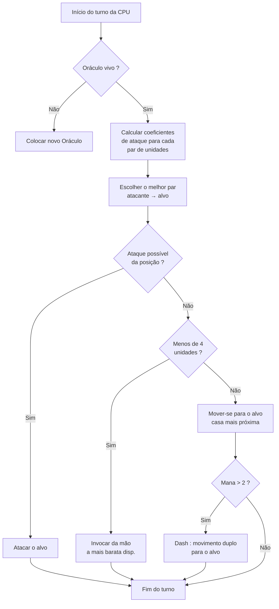

## Minha IA maluca para Nausicaa

Tem projeto que começa com "e se eu fizesse um xadrez com mitologias ?" e termina com um sistema com uma IA que decide seus próprios hiperparâmetros a cada 5 turnos.

Nausicaa é isso. Um jogo de tabuleiro por turnos onde você monta seu deck de criaturas mitológicas, gerencia sua mana, posiciona unidades em um tabuleiro 10x8. E tem uma IA que tem crises de personalidade.

Passei bastante tempo nessa IA, e o resultado ainda me escapa às vezes, e é disso que mais gosto.

## O jogo de verdade

Antes de falar do cérebro, preciso mostrar o corpo :

- Tabuleiro 10x8, zona de posicionamento de 2 fileiras por jogador
- Mana começa em 1, +1 por turno, máx 6. Você gasta para invocar, atacar, usar habilidades
- Objetivo : matar o Oráculo adversário

12 unidades, com custos e padrões de movimento diferentes :

| Unidade | Custo | Movimento | PV |
| --- | --- | --- | --- |
| Oráculo | 0 | Rei (8 direções) | 1 |
| Goblin | 1 | Para frente 3 casas | 1 |
| Harpia | 1 | Rei (8 direções) | 1 |
| Náiade | 1 | Diagonal | 1 |
| Grifo | 2 | Pulo 2 casas | 2 |
| Sereia | 2 | Lateral | 1 |
| Centauro | 2 | Cavalo (em L) | 2 |
| Arqueiro | 3 | Lateral | 1 |
| Fênix | 3 | Diagonal (casas escuras) | 1 |
| Metamorfo | 4 | Troca de lugar | 1 |
| Vidente | 4 | Nenhum (gera mana) | 1 |
| Titã | 6 | Limitado (ataque em área) | 3 |

Cada unidade tem seu próprio padrão de ataque. A Sereia bate nas 4 diagonais, o Arqueiro à distância em 3 casas, o Titã destrói tudo ao redor na invocação. Resumindo, um xadrez com mitologia e deckbuilding.

## Como fiz a CPU pensar

A ideia base é bobamente simples : **cada unidade inimiga tem um coeficiente de atratividade**. Quanto mais perigosa, mais a IA quer cuidar dela.

```javascript
// Atratividade por unidade : Oráculo no topo, Goblin na base
const UNITS_ATTRACTIVENESS = {
    "oracle": 100,
    "titan": 95,
    "shapeshifter": 90,
    "phoenix": 80,
    "siren": 70,
    "archer": 70,
    "seer": 70,
    "griffin": 60,
    "centaur": 60,
    "harpy": 50,
    "naiad": 30,
    "gobelin": 20
};
```

Oráculo em 100, lógico, é a condição de vitória. Titã em 95 porque mata tudo ao lado na invocação. Goblin em 20, é um soldado raso, ninguém liga.

Depois para cada par de unidades (uma aliada, uma inimiga), calculo :

```
interesse = atratividade × coef_atrat / (distância × coef_dist)
```

Resumindo : quanto mais perigoso e perto você está, mais a IA quer te destruir.

```javascript
// Interesse de ataque : atratividade ponderada dividida pela distância
calculateAttackCoefficient(x1, y1, x2, y2) {
    const distance = this.calculateEuclideanDistance(x1, y1, x2, y2);
    if (distance === 0) return Infinity;
    return (UNITS_ATTRACTIVENESS[unit.type] * COEFFICIENTS_IMPORTANCE["attractiveness"]) / distance;
}
```

### O truque dos coeficientes que mudam

O ponto importante é que os coeficientes de importância **mudam aleatoriamente a cada 5 turnos**.

```javascript
// A cada 5 turnos, novos coeficientes aleatórios mudam a "personalidade"
if (this.turnCount % 5 === 0) {
    const distanceCoefficient = parseInt(Math.random() * 100);
    const attractivenessCoefficient = parseInt(Math.random() * 100);
    this.regulateImportanceCoefficients({
        distance: distanceCoefficient,
        attractiveness: attractivenessCoefficient
    });
}
```

Uma hora a IA fica hiper agressiva (atrat em 95, distância em 5), atravessa tudo para matar seu Oráculo. Na vez seguinte prioriza a distância e se reposiciona.

É roubado dos fantasmas do Pac-Man, Blinky caça, Pinky embosca. Aqui a IA muda de "personalidade" a cada fase.

**Resultado : impossível prever a IA em uma partida inteira.** A CPU nunca faz dois jogos iguais.

### O Oráculo é um medroso

O Oráculo inimigo foge. Literalmente.

```javascript
// Fuga do Oráculo : calcula a direção oposta à ameaça
const awayFromTarget = {
    row: Math.max(0, Math.min(7, botUnitElement.row + (botUnitElement.row - targetUnitElement.row))),
    col: Math.max(0, Math.min(9, botUnitElement.col + (botUnitElement.col - targetUnitElement.col)))
};
```

Ele calcula a direção oposta à ameaça e vaza. Se tem uma parede, procura a casa livre mais próxima nessa direção.

Você passa 3 turnos se aproximando do Oráculo, e paf ele já fugiu para o outro lado.

### O loop de decisão

Eis como a IA decide :

1. Se não tenho mais Oráculo (morto), colocar um novo
2. Calcular o coeficiente para cada par unidade aliada → unidade inimiga
3. Escolher o melhor par
4. Se a unidade pode atacar o alvo da sua posição → ataca
5. Se tenho menos de 4 unidades → invocar a mais barata disponível na mão
6. Senão, mover-se para o alvo (casa de movimento mais próxima do inimigo)
7. Se mana suficiente (> 2), dash (movimento duplo) para se aproximar ainda
8. Se a unidade é o Oráculo → fugir



```javascript
// Ação da CPU em sequência, com dash se houver mana suficiente
async makeAction(dash=false) {
    // tudo isso em sequência
    // a CPU dá dash se tiver mana suficiente
    if(botPlayer.mana > 2) {
        this.makeAction(true);
    }
}
```

### Por que a distância euclidiana

Uso a distância euclidiana :

```javascript
// Distância em linha reta ponderada pela importância da distância
calculateEuclideanDistance(x1, y1, x2, y2) {
    const deltaX = Math.pow(x1 - x2, 2);
    const deltaY = Math.pow(y1 - y2, 2);
    return Math.sqrt(deltaX + deltaY) * COEFFICIENTS_IMPORTANCE["distance"];
}
```

Por que não Manhattan ? Porque as unidades têm padrões de movimento variados (L como o cavalo, diagonal, etc). A distância em linha reta é uma aproximação melhor do perigo.

## Por que não minimax

Eu poderia ter codado um minimax clássico. Mas com 12 tipos de unidades, padrões de movimento diferentes, habilidades especiais... a árvore do jogo explode tão rápido que fica injogável. A abordagem heurística faz escolhas inteligentes sem explorar 10 milhões de estados.

## O que é legal

O sistema de atratividade cria dilemas engraçados :

- O Vidente (70) gera mana. Se você deixá-lo viver, o adversário tem mais recursos. Mas o Titã (95) é ainda mais perigoso.
- O Metamorfo (90) pode trocar de lugar com qualquer unidade. Pode roubar seu Oráculo.
- A Harpia (50) tem um ataque explosivo que também a mata. Ela fica secundária... até aparecer ao lado de 3 das suas unidades.

A IA avalia o perigo global conforme as posições, não só os stats brutos.

Também há uma função `activateSimulation()` para testar cenários sem refazer uma partida :

```javascript
// Coloca unidades específicas no tabuleiro para debugar a IA
activateSimulation() {
    // Coloca unidades específicas no tabuleiro
    // Útil para debugar a IA
    this.game.board = simulation.board;
    this.game.players = simulation.players;
}
```

## O que falta

Se eu tivesse mais tempo :

- A IA reage ao estado atual, não prevê o que o jogador vai fazer
- Ela não planeja a mão em vários turnos
- O Metamorfo e o Centauro têm habilidades que ela subexplora
- Aprendizado por reforço : fazê-la jogar contra si mesma para ajustar os coefs

Mas para um jogo de navegador segura bem a onda. Uns amigos conseguem perder para ela, então está validado.

## Teste

Disponível em [nausicaa-game.github.io](https://nausicaa-game.github.io/). Você clica em "JOUER", modo CPU ON, e assiste a IA jogar.

Conselho : deixa a IA jogar contra si mesma. Você vai ver fases agressivas, e depois pfft ela recua tudo.

O código está no [GitHub](https://github.com/nausicaa-game/nausicaa-game.github.io) em `js/cpu.js`.

**3 pontos para lembrar :**

1. **Coeficientes heurísticos**, sem minimax, cada unidade tem uma atratividade
2. **Coefs que mudam a cada 5 turnos**, a IA alterna agressividade e controle, estilo Pac-Man
3. **O Oráculo foge**, ele calcula a direção oposta à ameaça e vaza

Se tiver ideias para deixar a IA ainda mais cruel, abra uma issue. Tenho planos para uma versão que aprende com as derrotas, mas isso fica para um próximo artigo.
