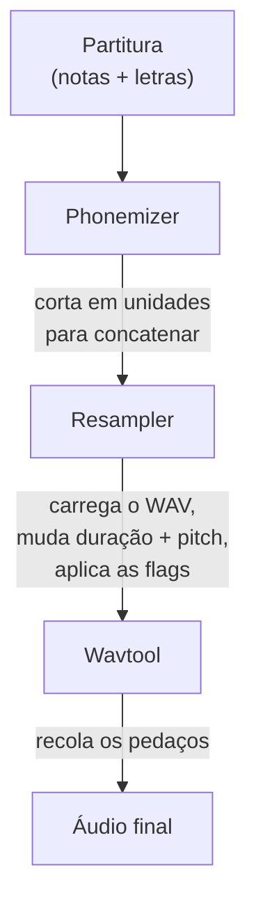

## UTAU : como um software em Visual Basic 6 democratizou a voz sintética

Eu já tinha mencionado de passagem na minha página principal : gosto de UTAU. Eis o porquê.

Em 2008, se você queria fazer uma voz sintética cantar, tinha uma opção : VOCALOID. O software da Yamaha. Caro, proprietário, com vozes oficiais que você não podia criar sozinho.

E aí um cara japonês, Ameya/Ayame, lançou um programa por conta própria. Um software codado em **Visual Basic 6**. Gratuito. Que deixava você criar sua própria voz com... arquivos WAV que você mesmo gravava.

Esse software se chama **UTAU** (歌う, "cantar" em japonês). E para a época, era magia.

Sempre achei fascinante mais pela ideia inicial do que pela limpeza técnica (o princípio de codificação continua bem esperto, mesmo que a implementação doa nos olhos) : ele abriu a síntese vocal para o público geral. Você, eu, qualquer um com um microfone.

Deixa eu te explicar por que era genial.

---

## Primeiro, por que síntese de canto é complicada

Uma voz cantada não são notas. Tem a consoante que ataca, a vogal que sustenta, a respiração, as transições entre as duas. O "sa" de "salut" é um "s" que assobia deslizando para um "a" aberto, e é esse deslizamento que soa humano ou não.

Hoje resolvemos isso com deep learning : você treina um modelo em horas de canto e ele gera a voz (Synthesizer V, DiffSinger). Mas isso é 2020+. Em 2008, nada disso.

O UTAU usa o método de antes, mais velho e mais esperto : a **síntese concatenativa**.

---

## A síntese concatenativa : copiar e colar pedaços de voz

A ideia é boba de tão simples : você grava pedacinhos de voz e cola tudo para formar palavras. "salut" = amostra "sa" + "lu" + "to", encadeados. Um quebra-cabeça sonoro guiado por uma partitura.

É o princípio dos YouTube Poop em que recortam as palavras de um personagem para fazê-lo dizer qualquer coisa, só que aqui é certinho e automatizado.

E o UTAU veio literalmente daí. Antes dele existia o **"Jinriki Vocaloid"** (人力ボーカロイド, "Vocaloid manual") : pessoas recortavam à mão faixas vocais, extraíam os fonemas, mudavam o pitch, e remontavam tudo em um editor de áudio para imitar uma voz VOCALOID. À mão. Imagina o trabalho.

Ameya olhou essa epopeia e codou a ferramenta para automatizar. No início o UTAU era só isso : um assistente para Vocaloid manual.

---

## Por que foi revolucionário : VOCÊ cria a voz

É isso que muda tudo.

No VOCALOID, você comprava uma voz. Miku, Luka, etc. Criadas por profissionais, vendidas pela Yamaha. A criação continuava reservada à Yamaha. Com o UTAU, **qualquer um grava sua voz e transforma em um instrumento que canta**.

O modo CV (o mais simples) é : você grava as ~100 sílabas base do japonês ("a", "ka", "sa", "ta"...), configura os pontos de corte, e pronto sua voicebank. Algumas horas de trabalho.

Resultado : o ecossistema explodiu. Milhares de voicebanks criadas pela comunidade, vozes de fãs, de amigos, de personagens inventados. Um universo inteiro de cantores virtuais, de graça. E o software vinha com **Defoko** (Utane Uta), uma voz padrão gerada via o motor TTS AquesTalk, então você podia começar mesmo sem microfone.

---

## O oto.ini : o coração do sistema

Como o UTAU sabe onde cortar e colar os sons ? Via um arquivo de config por voicebank : o **`oto.ini`**. Para cada WAV, ele define os pontos de corte (em milissegundos) :

- **Offset** → silêncio para remover no início
- **Preutterance** → o ponto em que a consoante passa para a vogal (a fronteira "s"→"a" em "sa")
- **Overlap** → quanto a nota anterior invade esta
- **Fixed region** → a parte que NÃO deve ser esticada em uma nota longa (tipicamente a consoante)
- **Cutoff** → onde cortar o fim

A **preutterance** é o parâmetro mais esperto. Uma sílaba sempre tem um pedaço de consoante antes da vogal. Para sua nota cair no tempo, é a *vogal* que tem que cair certinho, não a consoante. Então o UTAU desloca a amostra para trás : o "a" de "sa" cai no tempo, o "s" vaza um pouco antes. Como um baterista que antecipa a batida para o som cair certo, só que aqui é em um `.ini`.

Visualmente, em uma amostra "ka", as zonas do `oto.ini` se dividem assim :

```mermaid
flowchart LR
    A["🔇 silêncio<br/>(offset)"] --> B["🅺 consoante<br/>(fixed region,<br/>não esticada)"]
    B --> C["🅰 vogal<br/>(zona esticável)"]
    C --> D["🔇 fim cortado<br/>(cutoff)"]
    style B fill:#3b4a6b
    style C fill:#5b3b6b
```



A fronteira entre consoante e vogal é a preutterance. A vogal é a zona que esticamos para notas longas ; a consoante fica intacta, senão seu "k" duraria dois segundos e soaria horrível.

```ini
# oto.ini (simplificado)
# arquivo=alias,offset,consonant,cutoff,preutterance,overlap
_ka.wav=ka,120,80,-200,90,40
```

Cinco valores por som, em todas as suas amostras, e o UTAU monta qualquer palavra direitinho.

---

## CV, VCV, CVVC : a corrida pelo realismo

O modo base, **CV** (Consoante-Vogal), é um som por sílaba. Simples mas um pouco robótico : as junções entre sílabas são brutas.

Em 2010 a comunidade inventa o **VCV** (Vogal-Consoante-Vogal). Em vez de gravar "ka" sozinho, você grava "a ka", com o rabo da vogal anterior. A transição fica natural porque está *na* gravação, não calculada depois.

O detalhe que dói : **o VOCALOID não teve VCV antes do VOCALOID3, em 2011.** O freeware em VB6 codado por um cara sozinho passou a Yamaha em um ano no realismo das transições. Uma comunidade de fãs mais rápida que a multinacional.

Depois vieram **CVVC**, **ARPAsing** (inglês), **VCCV**... cada método levando o realismo mais longe, todos inventados e documentados pela comunidade.

---

## O pipeline completo : como uma palavra vira som

Quando você coloca uma nota e digita uma letra, eis o que acontece nos bastidores :



O **resampler** é a peça principal : ele pega sua amostra "ka" gravada em uma altura dada e reestica/remuda o pitch para casar com a nota desejada, esticando só a zona esticável e mantendo a consoante intacta (daí o `oto.ini`).

E ele é **modular**. O UTAU vinha com um resampler base, mas a comunidade produziu outros (moresampler, TIPS...), cada um com sua textura sonora. Você trocava de motor de síntese como um plugin. Em 2008. Em um freeware.

---

## A obra por baixo do capô (e por que é cativante)

Preciso ser honesto sobre o estado técnico do software :

- **Codado em Visual Basic 6.** Uma linguagem já morta em 2008. Precisa do runtime VB6 para rodar.
- **Só Windows na base** (o porte para Mac, UTAU-Synth, veio em 2011).
- **Codificação Shift-JIS obrigatória.** Se seus arquivos não estiverem codificados em Shift-JIS japonês, o UTAU não entende nada. Ainda hoje muitas vezes é preciso colocar o PC em locale japonês ou usar AppLocale para rodar.
- **Interface austera**, documentação quase 100% em japonês na época.

E mesmo assim. Mesmo assim esse software criou um movimento mundial. Dezenas de milhares de voicebanks. Músicas ouvidas milhões de vezes.

O melhor exemplo : **Kasane Teto**. Uma personagem criada em 2008 e lançada como uma pegadinha de 1º de abril, se passando por uma VOCALOID. Era uma piada. Só que as pessoas adoraram a personagem, uma voicebank UTAU de verdade foi criada depois, e Teto virou uma das cantoras virtuais mais famosas do mundo. Em 2023 ela até ganhou uma voz oficial Synthesizer V. Uma personagem nascida de uma pegadinha de 1º de abril em um software gratuito.

---

## Por que ainda importa

UTAU é o exemplo perfeito de uma tecnologia "pobre" que vence pela abertura.

O VOCALOID era tecnicamente superior, melhor financiado, mais profissional. Mas fechado. O UTAU era improvisado, feio, em VB6, mas deixava todo mundo participar. Criar vozes, criar resamplers, criar plugins, criar métodos de gravação. A comunidade fez o resto.

E o conceito sobrevive totalmente hoje. **OpenUtau**, um sucessor open source moderno, retoma a ideia e atualiza (multiplataforma, UTF-8, suporte a resamplers modernos E IA). A síntese concatenativa continua de pé ao lado dos modelos de deep learning, porque tem uma vantagem que eles não têm : você entende exatamente o que acontece, e controla cada milissegundo.

É isso que sempre gostei no UTAU. Você vê exatamente o que acontece. Não é uma IA que cospe um resultado mágico que você não entende : você tem seus WAVs, seus pontos de corte, e é você que decide tudo. Quando soa mal, você sabe por quê e pode corrigir. Gosto desse tipo de controle.

---

**Os 3 pontos para lembrar :**

1. **Síntese concatenativa = quebra-cabeça de voz**, o UTAU cola pedacinhos de amostras WAV para formar palavras. O `oto.ini` define onde cortar e colar cada som. Você controla tudo, ao milissegundo, sem caixa-preta.

2. **A abertura vence a técnica**, o VOCALOID era melhor mas fechado. O UTAU era improvisado mas deixava todo mundo criar suas vozes. A comunidade fez o ecossistema explodir, e até passou a Yamaha no VCV.

3. **Uma boa ideia sobrevive ao código**, VB6, Shift-JIS, só Windows... e mesmo assim o conceito continua rodando via OpenUtau. Uma tecnologia genial pode ser codada de qualquer jeito.

Sinceramente, só por Kasane Teto nascida de uma pegadinha de 1º de abril, esse software merece respeito.
