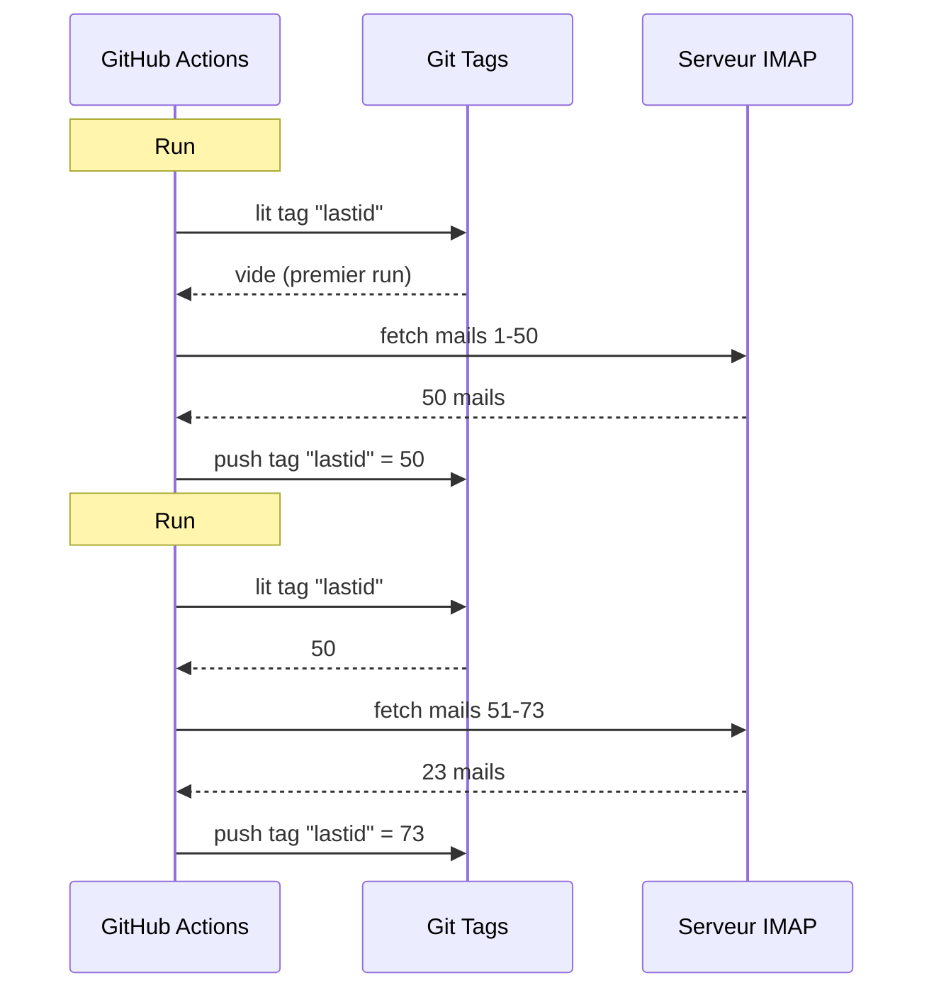

# Я использовал git как базу данных, чтобы крутить бота бесплатно на GitHub Actions

У меня есть автоматический email-ответчик, крутящийся 24/7.

Он читает мои письма, понимает, о чём речь, и сам отвечает с ИИ. Он помнит предыдущие разговоры. Он игнорирует рассылки и `noreply@`. Он форвардит человеку, когда слишком горячо.

Месячная стоимость : **0€**.

Обхожусь без сервера, без VPS и без базы данных. Только GitHub Actions и больной хак : **использовать git как базу данных**.

Видишь, к чему веду? Нет? Ладно, пристегнись, это и тупо, и гениально одновременно.

---

## Проблема : GitHub Actions stateless

GitHub Actions бесплатный. Можешь запускать cron каждые 5 минут, крутить свой код, бесплатно.

Но есть загвоздка : он **stateless**.

Каждый запуск стартует на чистой машине. Ничего не сохраняется между двумя запусками. Прошлый запуск? Забыт. Стёрт. Будто его никогда не было.

Для email-ответчика это огромная проблема. Типа :

> "Какое последнее письмо я уже обработал?"

Если бот забывает это при каждом запуске, он будет либо отвечать на те же письма по кругу (катастрофа), либо пропускать письма.

Нужно персистентное состояние. А нормально персистентное состояние = база данных. Но база данных это сервер, а сервер это уже не бесплатно.

Здесь становится интересно.

---

## Решение : git-теги как база данных

Твой репозиторий GitHub это уже персистентное хранилище. Бесплатное. Версионированное. Всегда здесь.

Так почему бы не хранить состояние в нём?

Идея : при каждом запуске бот читает последний обработанный UID письма из **git-тега**. Обрабатывает новые письма. Затем перепушивает тег с новым UID.



Git-тег И ЕСТЬ база данных. Одно значение, но это всё, что нужно.

### Читать состояние

В начале джобы забираем значение из тега :

```bash
git fetch origin --tags lastid || true
git show refs/tags/lastid:data/lastId > data/lastId || true
```

`git show refs/tags/lastid:data/lastId` значит : "дай содержимое файла `data/lastId` таким, каким оно было в теге `lastid`".

Бум. У тебя есть значение без базы данных.

### Писать состояние

В конце пересоздаём тег с новым значением :

```bash
git switch --orphan lastid-tmp   # чистая ветка без истории
git rm -rf .                      # всё вычищаем
mkdir -p data
printf "%s\n" "${LAST_ID_CONTENT}" > data/lastId

git add data/lastId
git commit -m "lastId snapshot"
git tag -f lastid                 # форсируем тег на этот коммит
git push --force ...origin lastid # пушим тег
```

Создаём **сиротскую** ветку (без истории), кладём только файл `lastId`, коммитим, тегаем, форспушим.

Почему сиротскую? Чтобы не копить 10 000 коммитов состояния в истории репо. Каждое обновление затирает предыдущее. Тег всегда указывает на ОДИН коммит, содержащий ОДНО значение.

Это чисто. Это бесплатно. Это совершенно криво, и это работает.

---

## Второй хак : снапшот рантайма

Есть другая проблема с GitHub Actions : `npm install`.

Если при каждом запуске (каждые 5 минут) делать `npm install` + `npm run build`, тратишь 60-90 секунд каждый раз. На частом cron это минуты compute, потраченные ни на что.

Решение : прекомпилировать код ОДИН раз и хранить его тоже в git-теге.

Сборочный воркфлоу (крутящийся при push в `master`) делает это :

```bash
# компилируем код
bun install
bun run build

# храним dist/ + node_modules/ в теге "runtime"
git checkout --orphan temp-runtime
git rm -rf .
cp -r "$TMPDIR"/* .
git add dist node_modules package.json bun.lock data
git commit -m "runtime build"
git tag -f runtime
git push --force ...origin runtime
```

Тег `runtime` содержит скомпилированный код И `node_modules`. Всё готово к запуску.

А cron чекаутит прямо этот тег :

```yaml
- name: Checkout runtime snapshot
  uses: actions/checkout@v4
  with:
    ref: refs/tags/runtime    # предсобранный код, не исходник
    fetch-depth: 1

# никакого npm install, никакой сборки !
- name: Process emails
  run: node dist/index.js --action
```

Cron стартует мгновенно и просто выполняет `node dist/index.js`, без install и сборки.

Типа, у тебя два тега на двух работах :
- `runtime` = готовый к запуску код (обновляется, когда пушишь код)
- `lastid` = персистентное состояние (обновляется при каждом запуске)

Это элегантно как чёрт.

---

## Сам бот : ИИ-автоответчик

Ладно, git-хак это круто, но что именно делает бот?

Он читает твои письма через IMAP, понимает их с ИИ (Groq + Llama 3.3 70B) и отвечает автоматически.

Архитектура из чистых сервисов с инъекцией зависимостей (InversifyJS) :

```
App
├── ImapService      → читает письма (IMAP)
├── SmtpService      → отправляет ответы (SMTP)
├── ParserService    → парсит содержимое писем
├── ReplyService     → генерирует ИИ-ответ
├── SummaryService   → память разговоров
├── AccountsService  → управляет несколькими email-аккаунтами
└── ConfigService    → конфиг / env vars
```

### Два режима работы

Бот может крутиться двумя способами :

**Режим listener** (реальное время) : постоянное IMAP-подключение с экспоненциальным переподключением. Для VPS.

```typescript
this.imapService.on("exists", async (data) => {
  console.log(`[MAIL] Nouveau mail ! Total: ${data.count}`);
  // обрабатываем новое письмо сразу
});
```

**Режим action** (батч) : обрабатывает новые письма начиная с `lastId`, затем закрывается. Для cron GitHub Actions.

```bash
node dist/index.js --action
```

Режим `--action` это тот, что использует git-хак. Он читает `lastId`, обрабатывает новое, пишет новый `lastId`, конец.

### НЕ отвечать роботам

Если твой бот отвечает на ВСЕ письма, он будет отвечать на рассылки, уведомления, `noreply@`. Катастрофа. Хуже : если два бота отвечают друг другу, получаешь бесконечный цикл писем. Кошмар.

Поэтому агрессивная фильтрация :

```typescript
export function isAutomatedSender(address) {
  const automatedPatterns = [
    "noreply", "no-reply", "donotreply",
    "mailer-daemon", "postmaster", "bounce",
    "newsletter", "notification", "marketing",
    "billing", "receipt", "promo", ...
  ];
  const local = address.split("@")[0].toLowerCase();
  return automatedPatterns.some(p => local.includes(p));
}
```

А также детект по заголовкам писем :

```typescript
export function isAutomatedByHeaders(headers) {
  return (
    ["bulk", "list", "junk"].includes(headers.precedence) ||
    headers["auto-submitted"] !== "no" ||
    headers["list-unsubscribe"] !== "" ||   // рассылки имеют это
    /mailchimp|sendgrid|mailgun|brevo/i.test(headers["x-mailer"])
  );
}
```

`List-Unsubscribe` в заголовках? Это рассылка. `Precedence: bulk`? Массовая рассылка. `X-Mailer: Mailchimp`? Понимаешь. Игнорируем.

Это как вышибала в клубе : роботы не проходят.

### Магические триггеры

ИИ может решить вообще не отвечать или передать человеку. Как? Специальными триггерами в своём ответе.

Системный промпт ему говорит :

> Если это автоматическое письмо/рассылка → отвечай `<no_reply>`
> Если это слишком важное/чувствительное (легальное, финансовое...) → отвечай `<manual_reply_required>`
> Иначе → пиши настоящий ответ

А код это читает :

```typescript
const aiReply = completion.choices[0].message.content.trim();
const manualTrigger = aiReply.includes(MANUAL_REPLY_TRIGGER);
const noReply = aiReply.includes(NO_REPLY_TRIGGER);

if (noReply) {
  console.log("[MAIL] L'IA a décidé d'ignorer. Skip.");
  return;
}

if (manualTrigger) {
  console.log("[MAIL] Trop chaud, je forward à un humain.");
  await this.smtpService.sendManualForward(...);
  return;
}

// иначе отправляем ИИ-ответ
await this.smtpService.sendReply(...);
```

Типа ИИ имеет право сказать "нет, сюда не лезу, зови настоящего человека". Это мудрость.

---

## Память разговоров

Деталь, меняющая всё : бот **помнит** разговоры.

Когда он отвечает кому-то, он сохраняет резюме обмена. В следующий раз, когда этот человек пишет, резюме реинжектится в промпт.

Хранение : JSON-файл на контакт.

```
data/customers/
├── moi%40gmail.com/
│   ├── alice%40example.com.json
│   └── bob%40client.fr.json
```

А резюме генерируется самим ИИ, смердживающим старое резюме с новым сообщением :

```typescript
const completion = await groq.chat.completions.create({
  model: "llama-3.3-70b-versatile",
  messages: [
    { role: "system", content: "Tu es un assistant de mémoire. Merge l'ancien résumé avec le nouveau message sans perdre d'info." },
    { role: "user", content: `Résumé existant:\n${existing}\n\nNouveau message:\n${incomingContent}` }
  ],
  temperature: 0.0,  // детерминированно, без креатива
  max_tokens: 800,
});
```

Так бот строит сжимающуюся память со временем. Умно растущего резюме достаточно, без хранения всех писем.

А эти JSON-файлы? Ну... они тоже хранятся в git, в теге runtime. Git повсюду.

---

## Хитрый момент с длиной промпта

Маленькая техническая деталь, заставившая меня улыбнуться.

У моделей есть лимит токенов. Если твоё письмо + резюме + persona-промпт превышают, API возвращает ошибку.

Код разруливает это **каскадным урезанием** + ретраем :

```typescript
try {
  // первая попытка с нормальными лимитами
  completion = await groq.chat.completions.create({...});
} catch (error) {
  if (!this.isLengthError(error)) throw error;

  // это была ошибка длины : пробуем заново с более жёсткими лимитами
  ({ systemContent, userContent } = this.buildPromptPayload({
    ...,
    limits: {
      systemPromptChars: 2200,  // вместо 3000
      summaryChars: 1800,       // вместо 4000
      personaChars: 900,        // вместо 1500
      userContentChars: 2200,   // вместо 8000
    },
  }));
  completion = await groq.chat.completions.create({...});  // retry
}
```

Если не проходит, режем короче и пробуем заново. Просто, эффективно, без краша.

---

## Ладно, а конкретно как это крутится?

Полный флоу одного запуска cron :

```
1. GitHub Actions триггерится (cron каждые 5 мин)
2. Checkout тега "runtime" (предсобранный код)
3. git show refs/tags/lastid → забирает последний обработанный UID
4. node dist/index.js --action
   ├── IMAP-подключение
   ├── fetch писем начиная с lastId+1
   ├── на каждое письмо :
   │   ├── парсит содержимое
   │   ├── фильтрует роботов (skip если automated)
   │   ├── матчит аккаунт-получатель
   │   ├── забирает память разговора
   │   ├── генерирует ИИ-ответ (Groq)
   │   ├── <no_reply> ? skip
   │   ├── <manual_reply_required> ? форвард человеку
   │   ├── иначе : отправляет ответ (SMTP)
   │   └── обновляет память разговора
   └── пишет новый lastId
5. git push --force тега "lastid" с новым значением
```

И это повторяется через 5 минут. Всегда. Бесплатно.

---

**3 пункта запомнить :**

1. **Git = бесплатная база данных** -- Сиротский тег может хранить твоё персистентное состояние между двумя stateless-запусками. `git show refs/tags/X:файл` для чтения, force-push для записи. Экономишь целую БД.

2. **Прекомпилируй в тег runtime** -- Вместо `npm install` при каждом запуске cron храни скомпилированный код + node_modules в git-теге. Cron стартует мгновенно.

3. **ИИ-бот должен уметь молчать** -- Триггеры `<no_reply>` и `<manual_reply_required>` дают ИИ решать не отвечать или передать человеку. Плюс антиробот-фильтрация. Иначе создашь бесконечный цикл писем.

Serverless cron с персистентным состоянием, ИИ, памятью, всё за 0€/мес. Это совершенно сломано, и я обожаю эту конструкцию.
