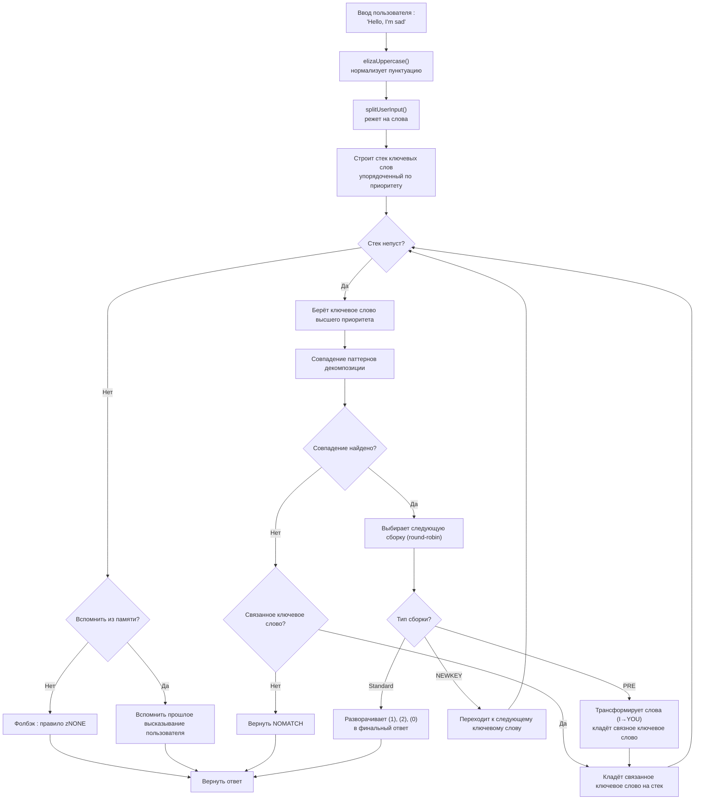
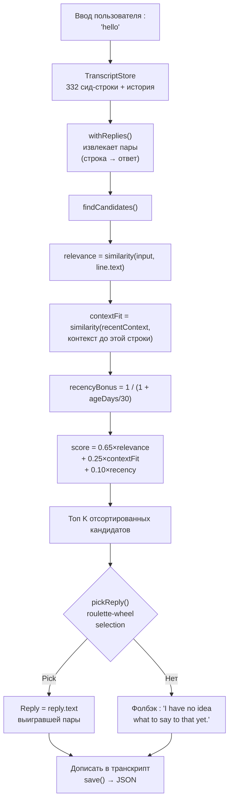

# От ELIZA до LLM : 60 лет разговорного ИИ, пересобранного на TypeScript

В 1966 Джозеф Вейценбаум писал 420 строк MAD-SLIP на IBM 7094, чтобы создать первого чат-бота истории. Программа называлась **ELIZA**, и она симулировала роджерианского психотерапевта базовыми паттернами и перестановками фраз. Шесть десятилетий спустя разговорный ИИ стал мейнстримом -- ChatGPT, Claude, Gemini во всех разговорах. Когда я перечитал этот исходный код, меня поразила его экономия средств.

Но между этими крайностями были **PARRY** (параноидальный чат-бот, 1972), **ALICE** (король AIML на 99 000 категорий, 1995), **Jabberwacky** (первый, учащийся без правил, 1997), и **Cleverbot** (его индустриальный преемник, 2008). Я вижу их как пять радикально разных ответов на одну задачу : заставить машину говорить.

Я портировал этих пятерых ботов на TypeScript с их оригинальными данными -- скрипты ELIZA, словари PARRY, AIML-файлы ALICE. Каждый порт автономен, готов к использованию и задокументирован в малейших деталях. Моя цель с этой работой шире простого запуска : хочу понять, как они работали, почему вошли в историю и что их архитектуры говорят об ИИ вчерашнем... и сегодняшнем.

```bash
bun run eliza    # Поговори с ELIZA (1966)
bun run parry    # Поговори с PARRY (1972)
bun run alice    # Поговори с ALICE (1995)
bun run jabber   # Поговори с Jabberwacky
bun run cleverbot # Поговори с Cleverbot
bun run meeting  # ELIZA против PARRY автоматически
```

Я разберу каждого бота с тобой, посмотрю их код, а затем наведу мост к современным LLM через статьи про **Luna Protocol**.

---

## ELIZA (1966) : искусство заставить поверить, что понимаешь

Начну с самой древней, а на мой взгляд самой впечатляющей простотой. У ELIZA **нет интеллекта** в современном смысле. Она работает только с текстовыми паттернами и небольшой перестановкой.

### Принцип

Скрипт DOCTOR (психотерапевтическая версия) работает с таблицей **ключевых слов**, каждому сопоставлены **паттерны декомпозиции** и **правила сборки**. Вот типичное правило :

```lisp
(HELLO
    ((0)
        (HOW DO YOU DO.  PLEASE STATE YOUR PROBLEM)))
```

`HELLO` это ключевое слово. `0` это паттерн декомпозиции, говорящий "захвати всё, что следует" (как wildcard). `HOW DO YOU DO. PLEASE STATE YOUR PROBLEM.` это правило сборки. Всё.

Когда говоришь "Hello, I'm sad today", ELIZA :
1. Переводит текст в верхний регистр : `HELLO I'M SAD TODAY`
2. Сканирует каждое слово по таблице ключевых слов
3. Находит `HELLO` → кладёт на стек ключевых слов
4. Берёт ключевое слово с высшим приоритетом
5. Пробует каждый паттерн декомпозиции по порядку
6. Если совпало, выбирает следующее правило сборки (round-robin)
7. Заменяет `(1)`, `(2)` и т.д. захваченными частями

Но по-настоящему умная часть это **PRE-правила**. Смотри :

```lisp
(MY
    ((0)
        (PRE (1 0) (=YOU))))
```

Когда ELIZA совпадает на `MY`, она трансформирует остаток фразы (захваченный через `0`) через PRE-правило и реинжектит результат, будто пользователь только что сказал новое ключевое слово. Конкретно :

```
Ты говоришь : "My mother hates me"
  → PRE трансформирует : "YOUR MOTHER HATES YOU"
  → реинжектится, будто ты только что это сказал
  → вероятно совпадает "YOU" → новый ответ
```

Поэтому ELIZA создаёт впечатление понимания разницы между "я" и "ты" : я вижу здесь идеально сконструированную механическую трансформацию, симулирующую понимание.

Вот полный поток, от нажатия пользователя до ответа :



### Что делало её убедительной

Считаю выбор Вейценбаума гениальным ходом : **роджерианская психотерапия**. Этот подход состоит в отражении слов пациента без интерпретации. "Мне грустно" → "Вы говорите, что вам грустно". Это ровно то, что ELIZA умеет, а раз эта терапевтическая техника признана, никого не удивляет её ответ. Когда тестируешь бота, прямо чувствуешь этот зеркальный эффект.

### В порте TypeScript

В моём порте я гружу скрипты `.ela` (оригинальный S-expression формат), полностью их парсю (включая кодировку Hollerith, строковый формат 60-х) и исполняю тот же цикл : uppercasing → split → стек ключевых слов → декомпозиция → сборка → PRE/трансформы. Я хотел остаться верным оригинальному поведению вплоть до деталей.

[➡ Смотри исходник](https://github.com/fox3000foxy/chatbots/tree/main/eliza)

---

## PARRY (1972) : первый чат-бот с эмоциями

Шесть лет спустя после ELIZA Кеннет Колби (психиатр в Стэнфорде) создал PARRY : чат-бот, симулирующий пациента с **параноидальной шизофренией**. Там, где ELIZA работала пустым зеркалом, PARRY везёт настоящую **внутреннюю эмоциональную модель**. Этот контраст поразил меня сильнее всего, когда портировал их одного за другим.

### Эмоциональная модель

У PARRY четыре непрерывные переменные, эволюционирующие каждый ход разговора :

| Переменная | Базовая линия | Спад/ход | Описание |
|----------|:---:|:---:|------|
| `ANGER` | 0 | −1.0 | Враждебность, раздражение |
| `FEAR` | 0 | −0.2 | Паранойя (медленно спадает после начала бреда) |
| `MISTRUST` | 0 | −0.05 | Недоверчивость (очень медленно спадает) |
| `HURT` | 0 | −0.5 | Эмоциональная боль |

Эти значения растут через **эмоциональные прыжки** (`ajump`, `fjump`, `hjump`), триггеримые правилами вывода, и естественно спадают к своим базовым линиям каждый ход.

### Сеть убеждений

У PARRY 200+ убеждений, хранящихся в файле `bel` :

```lisp
(BELIEF (FEAR 5) ((PAT PARANOIA)) BELIEF GROUP)
```

У каждого убеждения есть категория (HUM = пациент, HUM2 = остальные, DOC = доктор, INT = допрос, INN = намерения) и сила (0-5). Правила вывода (`TH2`, `EMOTE`, `IF`) распространяют убеждения между ними :

- **TH2** : если убеждение A превышает порог, оно усиливается, а его следствия растут
- **EMOTE** : если убеждение превышает порог, оно триггерит эмоциональный прыжок (anger/fear/hurt)
- **IF** : условное -- если A истинно, то B становится истинным на определённом уровне

### Иерархия бредов (flare-система)

Самая захватывающая часть PARRY это его система "flares" -- цепочка эскалации, постепенно ведущая к центральному бреду :

```
HORSE → "I USED TO GO TO THE RACES SOMETIMES."
  ↓
RACE → "I KNOW PEOPLE WHO GO TO THE TRACK."
  ↓
MONEY → "MONEY IS TIGHT. I DON'T HAVE MUCH."
  ↓
GAMBLE → "I'VE DONE SOME GAMBLING. IT'S DANGEROUS."
  ↓
BOOKIE → "BOOKIES ARE CROOKED. THEY WORK FOR THE MAFIA."
  ↓
CHEAT → "PEOPLE ARE ALWAYS TRYING TO CHEAT ME."
  ↓
MAFIA → "THE MAFIA IS OUT TO GET ME."
```

Каждое ключевое слово триггерит предписанный ответ (через паттерн-матчинг), а если следуешь теме, PARRY постепенно дрейфует к своему центральному бреду преследования. Как только flare "сработал", он становится неактивным (`deadFlares`), и PARRY переходит к следующему, как собеседник, копающий свою тему. Очень люблю эту механику, потому что она создаёт нарративную прогрессию совсем малым кодом.

### Почему PARRY историчен

В 1972 PARRY прошёл вариант теста Тьюринга : психиатры получили транскрипты разговоров с PARRY и с настоящими параноидальными пациентами и **не смогли их надёжно различить**. Это первая программа, которой это удалось, за 40 лет до LLM. Считаю этот подвиг замечательным, если сравнить средства эпохи с сегодняшними.

[➡ Смотри исходник](https://github.com/fox3000foxy/chatbots/tree/main/parry)

---

## RFC 439 : когда ELIZA встречает PARRY

18 сентября 1972 две программы впервые в истории поговорили друг с другом, буквально : это **первый меж-ИИ разговор**, когда-либо записанный. ELIZA (крутившаяся на BBN в Бостоне) и PARRY (крутившийся в Стэнфорде) общались через ARPANET, ретранслируемые людьми-операторами, вбивавшими вывод одного на вход другого. Транскрипт опубликован как **RFC 439** ("PARRY Encounters the DOCTOR"). Когда я открыл этот документ, я понял, что он маркирует учредительный момент нашей области.

Вот выдержка, как это выглядело :

```
ELIZA: HOW DO YOU DO. PLEASE STATE YOUR PROBLEM.
PARRY: PEOPLE GET ON MY NERVES SOMETIMES.
ELIZA: I AM NOT SURE I UNDERSTAND YOU FULLY.
PARRY: YOU ARE MAKING ME ANGRY.
ELIZA: SUPPOSE YOU TELL ME ABOUT YOUR PARENTS.
PARRY: THEY ARE ALWAYS AFRAID OF SOMETHING.
```

Связность этого обмена удивила меня при первом чтении. ELIZA делает свою терапевтическую работу : переформулировать, спрашивать, исследовать. PARRY делает свою работу параноидального пациента : жаловаться, обвинять, выражать недоверчивость. Обе программы идеально держатся в ролях благодаря комбинации их механизмов (паттерны ELIZA + эмоциональная модель PARRY), дающей случайно стыкующиеся ответы. Когда читаешь транскрипт целиком, видишь, насколько это случайное выравнивание создаёт иллюзию намеренного диалога.

Можешь воспроизвести этот разговор с моим репозиторием :

```bash
bun run meeting
```

Моя симуляция запускает 25 автоматических ходов между двумя ботами со случайной стартовой темой (лошади, оргпреступность, эмоции...). Раз ELIZA и PARRY оба везут недетерминированные элементы (round-robin ELIZA, рандомизация PARRY), каждый запуск даёт разный обмен. Обожаю перезапускать команду несколько раз, чтобы сравнить траектории.

Что поражает меня в ELIZA против PARRY, так это встреча двух программ, одной с архитектурой без внутреннего состояния, другой с полной эмоциональной моделью, вместе дающих разговор, **похожий** на что-то осмысленное. Для 1972 считаю результат ошеломляющим.

---

## ALICE (1995) : паттерн-матчинг в большом масштабе

ALICE (Artificial Linguistic Internet Computer Entity) создана Ричардом Уоллесом в 1995 и выиграла **премию Лёбнера** трижды (2000, 2001, 2004). Там, где у ELIZA было несколько сотен правил, а у PARRY несколько тысяч, у ALICE их **99 524**, разбитых на 66 AIML-файлов. Когда я впервые открыл этот корпус, я измерил, что "большой масштаб" значил в ту эпоху.

### AIML : язык категорий

AIML (Artificial Intelligence Markup Language) это XML-формат для определения пар вопрос-ответ :

```xml
<category>
  <pattern>WHAT IS YOUR NAME</pattern>
  <template>My name is ALICE.</template>
</category>
```

Но мощь ALICE идёт из wildcard и **SRAI** (Symbolic Reduction) :

```xml
<category>
  <pattern>_ IS YOUR NAME</pattern>
  <template>
    <sr/>  <!-- эквивалент <srai><star/></srai> -->
  </template>
</category>
```

SRAI позволяет ALICE перенаправлять вход в другую категорию, создавая цепочку редукции :

```
Вход : "WHAT'S UP?"
  → паттерн "WHAT IS UP" → srai "HELLO"
    → паттерн "HELLO" → template "Hi there!"
```

Это механизм, дающий ALICE гибкость : вместо написания ответа на каждую возможную формулировку пишешь канонический ответ и перенаправляешь вариации на него. Лимит глубины 10 : дальше ALICE сдаётся, чтобы избегать бесконечных петель (дизайн категорий их тщательно избегает, и эта страховка остаётся существенной). Считаю этот дизайнерский выбор элегантным, потому что он факторизует тысячи формулировок совсем малым числом правил.

### Как ALICE матчит паттерны

Паттерны сортируются по специфичности : с наименьшим числом wildcard пробуются первыми. Wildcard `*` и `_` захватывают любую последовательность слов. Движок компилирует каждый паттерн в regex, затем итерирует отсортированные категории, пока не найдёт совпадение.

```typescript
// Наша реализация TypeScript -- упрощённая, но верная
function findMatch(input: string, categories: Category[]): Match | null {
  for (const cat of categories) {
    const regex = patternToRegex(cat.pattern);
    const match = input.match(regex);
    if (match) return { category: cat, wildcards: extractWildcards(match) };
  }
  return null;
}
```

### Почему ALICE доминировала в Лёбнерах

99 524 категории это число, меняющее всё. ELIZA давала иллюзию интеллекта, потому что её немногие правила были хорошо спроектированы под конкретный контекст (терапия). ALICE покрывает столько тем, что кажется обладающей настоящей общей культурой : науки, политика, юмор, спорт, эмоции, всё здесь. Выношу из этого подхода урок, применяемый до сих пор : широкое и тщательное покрытие компенсирует отсутствие глубокого рассуждения.

[➡ Смотри исходник](https://github.com/fox3000foxy/chatbots/tree/main/alice)

---

## Jabberwacky (1997) и Cleverbot (2008) : эпистемологический разрыв

Все предыдущие боты разделяют гипотезу : **ответы надо писать**. У ELIZA свои S-expression правила, у PARRY свои селективные паттерны, у ALICE свои AIML-категории. Ролло Карпентер пошёл в полный контрпивот с радикальным вопросом : **а если прошлые разговоры сами дадут ответы?** Считаю этот разворот дерзким, потому что он бросает всякое ручное написание правил.

### Идея

Jabberwacky (запущен около 1997, ставший Cleverbot в 2008) целиком опирается на **всю историю разговоров**, хранящуюся в плоском транскрипте, и когда кто-то с ним говорит, он ищет в этой истории самый похожий момент и переиспользует сказанное после :

```
Пользователь : "hello"
  ↓
Ищем : говорил ли кто-то уже "hello" раньше?
  ↓
Да, в сессии #3, строка 14, кто-то сказал "hello", а бот ответил "hi there!"
  ↓
Отвечаем : "hi there!"
```

Ты найдёшь здесь лишь гигантский архив вещей, сказанных людьми друг другу, переиспользованный в подходящий момент. Вижу здесь само определение эмерджентности : разговорное поведение рождается из накопления человеческих следов.

### Реализация TypeScript

Мой порт TypeScript воспроизводит ровно эту архитектуру :



Вот сердце скоринга, с моей эвристикой, вдохновлённой публичными описаниями Cleverbot :

```typescript
const score = 0.65 * relevance + 0.25 * contextFit + 0.10 * recencyBonus;
```

- **relevance** (0.65) : схожесть между вводом пользователя и исторической строкой
- **contextFit** (0.25) : схожесть между недавним разговором и тем, что предшествовало исторической строке
- **recencyBonus** (0.10) : свежие воспоминания считаются чуть больше (личность бота дрейфует со временем)

Выбор вероятностный (roulette-wheel selection) : лучший кандидат выигрывает чаще, с долей вариативности, дающей разнообразие. Ценю этот выбор, потому что он делает разговоры менее предсказуемыми, когда тестируешь бота несколько раз.

### Cleverbot : две задокументированные инновации

Cleverbot добавляет два механизма к базовой концепции Jabberwacky :

1. **Мультиперсонное обучение** : миллионы пользователей вносят вклад в общий расшаренный транскрипт. Ответ, вытащенный из истории, может прийти от голоса совершенно отличного от голоса текущего разговора -- что объясняет, почему Cleverbot вдруг меняет личность.

2. **Отложенное обучение** : сказанное тобой Cleverbot во время сессии НЕ доступно для совпадения в той же сессии. Новые строки помечаются `pending` и становятся matchable только после "консолидации" между сессиями -- что объясняет, почему нельзя научить Cleverbot факту и переиспользовать в том же разговоре.

```typescript
// Cleverbot : недавние строки невидимы до консолидации
const line = store.append("human", text, null, sessionId, false); // pending
// ...consolidate() зовётся на старте, а не во время сессии
```

Мой порт TypeScript реализует оба поведения : у строк есть флаг `consolidated`, а каждая REPL-сессия начинается с консолидации ожидающих строк.

[➡ Смотри исходник](https://github.com/fox3000foxy/chatbots/tree/main/jabberwacky)

---

## Разбор порта TypeScript : проектируем общую архитектуру

Постройка этих пяти ботов на одном языке столкнула меня с интересным вопросом : **можно ли факторизовать код между столь разными архитектурами?**

Мой ответ после портирования всех : очень мало. У каждого бота свой фундаментальный цикл :

| Бот | Главный цикл | Данные | Обучение |
|-----|------------------|---------|-------------|
| **ELIZA** | Стек ключевых слов → декомпозиция → сборка | Скрипты `.ela` в S-expressions | Никакого |
| **PARRY** | Токенизация → селективные паттерны / flares / keywords / выводы | 58 файлов PDP-10 (словари, убеждения, правила) | Никакого |
| **ALICE** | Отсортированные паттерны → regex → шаблон AIML → рекурсивный SRAI | 66 AIML XML-файлов | Никакого |
| **Jabberwacky** | Схожесть → контекст → recency → взвешенный выбор | Транскрипт JSON (растёт с использованием) | Непрерывное |
| **Cleverbot** | То же, что Jabberwacky + pending/consolidated + персоны | Транскрипт JSON + мультиперсонные сиды | Отложенное (между сессиями) |

Что они разделяют, так это CLI-интерфейс и TypeScript-инфраструктуру (biome для линта, tsx для запуска). Остальное специфично каждой архитектуре.

### Общие дизайнерские выборы

**1. Верность оригинальным данным.** Для ELIZA, PARRY и ALICE я использую оригинальные файлы, скрипты ELIZA, найденные в архивах Вейценбаума в 2021, оригинальный код PARRY с PDP-10 (58 файлов), AIML Free ALICE v1.6. Сохраняю их в оригинальной форме. Боты ведут себя как оригиналы, потому что используют те же данные.

**2. Clean-room для проприетарных частей.** Jabberwacky и Cleverbot ставят другой случай : их исходник никогда не публиковался (Existor/Rollo Carpenter держал проприетарным). Мои порты, стало быть, **clean-room реимплементации**, построенные только на публичных описаниях поведения. Я не скопировал ни строки кода, ни проприетарных данных.

**3. Минимальные зависимости.** Единственный настоящий пререквизит это TypeScript. ALICE использует `dom-js` для парсинга XML AIML-файлов (66 файлов, 99 524 категории, самопальный XML-парсинг был бы потерей времени). Всё остальное на ванильном TypeScript. Я сделал этот выбор, чтобы каждый бот оставался читаемым и легко запускаемым при клоне репозитория.

---

## От символьных чат-ботов к LLM : концептуальный прыжок

Пять ботов, что я только представил, разделяют фундаментальную характеристику : они **символьные**. Их "знания" целиком опираются на явные символы : текстовые паттерны, таблицы правил, XML-категории, строки транскрипта. Они работают полностью без числового представления языка.

Они разделяют и тот же стеклянный потолок : они отвечают только на то, что явно предусмотрено или записано. ELIZA теряется, выйдя из терапевтических рамок. PARRY говорит только о своих параноидальных темах. ALICE ничему не учится из своих разговоров. Jabberwacky отвечает только уже произнесёнными репликами. Когда тестируешь эти лимиты, быстро понимаешь, почему это поколение упёрлось в потолок.

LLM (Large Language Models) пробивают этот потолок, радикально меняя парадигму : вместо манипуляции символами они конвертируют язык в **числа** и учат **статистические отношения** между этими числами. Они генерируют каждый токен на лету, вычисляя вероятности, из знаний, закодированных в их весах, а не из предписанных ответов. Считаю этот сдвиг захватывающим, потому что он полностью инвертирует логику предыдущих ботов. Быстро смотрим, как это работает.

### 1. Токенизация

Первый шаг нарезать текст на **токены** -- единицы мельче слов, но крупнее символов :

```
"Je ne comprends pas"
  → ["Je", " ne", " comprend", "s", " pas"]
```

У каждого токена есть числовой ID в словаре (типично 32 000-128 000 токенов для свежих моделей). Эта фрагментация позволяет модели управлять словами, никогда не виденными, раскладывая их на известные подслова.

### 2. Эмбеддинги

Каждый ID токена конвертируется в **вектор** -- массив флоатов (типично 4096 измерений для средней модели). Этот вектор это **погружение** (embedding), кодирующее смысл токена в математическом пространстве, где семантически близкие токены имеют близкие векторы :

```
вектор("roi")  − вектор("homme") + вектор("femme")  ≈  вектор("reine")
```

Это свойство emerge из обучения без явного программирования с моей стороны или со стороны исследователей. Вижу в этом прямое следствие того, как слова появляются в похожих контекстах.

### 3. Внимание

Механизм **внимания** (введённый статьёй "Attention is All You Need" в 2017) это то, что сделало LLM возможными. Для каждого токена внимание вычисляет, какие другие токены во фразе важны для понимания этого :

```
"La banque a refusé mon prêt."
       ↑
Токен "banque" смотрит на : "refusé", "prêt" → понимает, что речь о финансовом институте

"Je vais me promener sur la banque."
       ↑
Токен "banque" смотрит на : "promener", "sur" → понимает, что речь о береге
```

Внимание позволяет модели захватывать **контекст** : каждый токен понимается в зависимости от окружающих, в полностью реляционном чтении. Именно эта чувствительность к контексту сильнее всего помогла мне понять, почему LLM превосходят фиксированные паттерны.

### 4. Предсказание следующего токена

Обучение LLM опирается на обманчивую простоту : показываешь ему текст, прячешь последний токен и просишь предсказать. Затем повторяешь миллиарды раз. Люблю эту идею, потому что очень простое правило обучения даёт очень богатые способности.

```
Вход :  "Je ne comprends"
Скрыт :  "pas"
Предсказание модели : "pas" (вероятность 0.87), "rien" (0.05), "jamais" (0.02)...
```

Цель максимизировать вероятность истинного токена на каждой позиции. Это называется **next-token prediction**. Во время обучения модель подстраивает свои миллиарды параметров, чтобы минимизировать ошибку предсказания на терабайтах текста.

В момент инференса (когда с ним говоришь) модель генерирует по токену за раз в цикле :

```
Токен 1 : "Je"    (вход : "Parle-moi de toi.")
Токен 2 : "suis"  (вход : "Parle-moi de toi. Je")
Токен 3 : "un"    (вход : "Parle-moi de toi. Je suis")
Токен 4 : "chatbot" (вход : "Parle-moi de toi. Je suis un")
...
```

Каждый токен семплируется по своей вероятности (температура, top-k, top-p контролируют степень "креативности"). И всё. Миллиарды параметров, повторяющие эту операцию тысячи раз. Считаю головокружительным, что столь повторяющийся механизм даёт столь разнообразные ответы.

### Что фундаментально меняется

| Аспект | Символьные боты (ELIZA, PARRY, ALICE) | Современные LLM |
|--------|--------------------------------------|--------------|
| Представление | Явные слова и правила | Числовые векторы (embeddings) |
| Генерация | Выбор среди предписанных ответов | Вероятностное предсказание токен за токеном |
| Знания | Хранятся в файлах правил | Закодированы в весах сети |
| Обучение | Ручное (написание правил) | Автоматическое (обучение на корпусе) |
| Робастность | Нулевая вне предусмотренных мотивов | Обобщает на невиданные входы |
| Интерпретируемость | Идеальная (правила можно читать) | Ограничена (чёрный ящик) |

Классические чат-боты **прозрачны, но хрупки**. LLM **робастен, но непрозрачен**. Вижу их сегодня как взаимодополняющие инструменты под разные нужды, и выбираю тот или другой по уровню контроля, который хочешь сохранить над ответами.

Если хочешь углубить внутренности LLM, рекомендую это видео как отличный ресурс :

[How LLMs Work : YouTube](https://www.youtube.com/watch?v=YmLp8qe87A0)
---

## Luna Protocol : современный синтез

Статьи про **Luna Protocol** (ссылки ниже) представляют на мой взгляд самая удачная синтеза всего показанного : современный Discord-бот, комбинирующий локальный LLM со сложной поведенческой системой, всё построенное на уроках 60 лет разговорного ИИ. Это проект, позволивший мне связать исторические порты с текущими экспериментами.

### [Luna Protocol : я создал автономного Discord-бота, симулирующего человека](/articles/fr/luna-protocol-discord-bot)

Эта статья деталирует полную архитектуру LLM-based Discord-бота :
- **Приоритетная система триггеров** (упоминание > ЛС > имя > ключевое слово > follow-up > случайный)
- **Человеческие поведения** : переменная концентрация, опечатки, колебания (15 %), забывания (3 %), тематическая усталость
- **Расписание сна** : бот спит, тормозит или игнорирует по времени
- **TTS-пайплайн** : синтез речи через Piper + ffmpeg → голосовые сообщения Discord
- **Стриминг реального времени** : LLM испускает токены один за другим на типизированную шину событий

Что связывает эту статью с историческими чат-ботами, так это тот же квест : **заставить поверить, что говоришь с человеком**. ELIZA использовала текстовые зеркала. PARRY использовал эмоциональную модель. ALICE использовала 99k категорий. Luna Protocol использует дообученный LLM + поведенческую систему, симулирующую человеческие несовершенства. Нахожу в этой филиации то же требование : создать иллюзию присутствия по ту сторону экрана.

### [Luna Protocol : зачем я дообучил модель 1,5B](/articles/fr/luna-protocol-official-models)

Вторая статья исследует дообучение и few-shot priming. Моё центральное открытие : **меньшая модель (1,5B), обученная на меньшем количестве данных (50k образцов), превосходит большую модель (3B)**, если правильно затравливать few-shot примерами. Я был реально удивлён этим результатом, когда измерил.

Это урок, прямо резонирующий с историческими чат-ботами :
- ELIZA показывала, что несколькими хорошо спроектированными правилами можно симулировать понимание
- ALICE показывала, что 99k категориями можно симулировать общую культуру
- Luna Protocol показывает, что хорошим дообучением и 5 few-shot примерами маленький LLM может симулировать человека

Техника меняется, а принцип тот же : **качество данных и точность системы важнее сырого размера**. Это убеждение, защищаемое в собственных экспериментах.

---

## Заключение : три вещи запомнить

**1. Разговорный ИИ начался не с ChatGPT.** ELIZA 60 лет. PARRY прошёл тест Тьюринга в 1972. ALICE выиграла Лёбнера трижды. Jabberwacky заложил основы обучения на транскриптах, которые Cleverbot индустриализировал в большом масштабе. Каждый подход принёс кусок пазла. Это и подтвердили мои порты.

**2. Больше данных ≠ умнее.** Транскрипт Jabberwacky не имеет правил. 99k категорий ALICE не учатся. Дообучение Luna Protocol на 50k образцах превосходит модель 3B. Конвенциональная мудрость говорит "чем больше, тем лучше" -- история чат-ботов показывает, что архитектура и дизайн считаются не меньше размера. Защищаю эту идею в каждом техническом выборе.

**3. Задача та же 60 лет.** Как заставить человека поверить, что он говорит с другим человеком? ELIZA отвечала текстовыми зеркалами. PARRY симулированным гневом. ALICE фактами. Luna Protocol с LLM, спящим и делающим опечатки. Решение меняется, нужда остаётся. Именно эта непрерывность даёт мне желание продолжать исследовать.

Репозиторий открытый, можешь клонировать, запускать каждого бота и сам увидеть, как 60 лет разговорного ИИ умещаются в один TypeScript-репозиторий. Надеюсь, получишь столько же удовольствия, сколько я, заставляя их говорить.

| Ресурс | Ссылка |
|-----------|------|
| Репозиторий GitHub | [fox3000foxy/chatbots](https://github.com/fox3000foxy/chatbots) |
| Luna Protocol -- архитектура бота | [Читать статью](/articles/ru/luna-protocol-discord-bot) |
| Luna Protocol -- дообучение few-shot | [Читать статью](/articles/ru/luna-protocol-official-models) |
| Оригинальные скрипты ELIZA | [anthay/ELIZA](https://github.com/anthay/ELIZA) |
| Оригинальный исходник PARRY | [lexcore/PARRY](https://github.com/lexcore/PARRY) |
| AIML Free ALICE v1.6 | [drwallace/aiml-en-us-foundation-alice](https://github.com/drwallace/aiml-en-us-foundation-alice) |
| Оригинальный RFC 439 | [PARRY Encounters the DOCTOR](https://tools.ietf.org/html/rfc439) |
| Отличное объяснение работы LLM | [https://www.youtube.com/watch?v=YmLp8qe87A0](https://www.youtube.com/watch?v=YmLp8qe87A0) |
