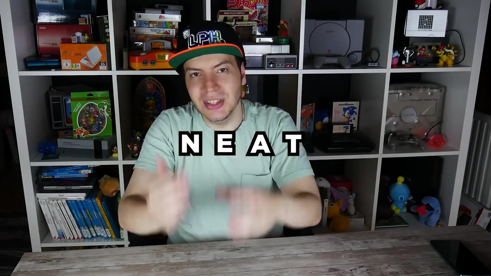
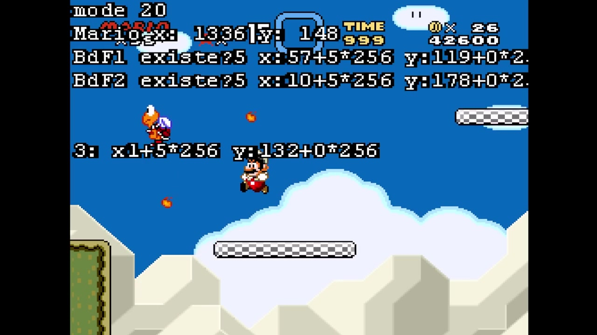
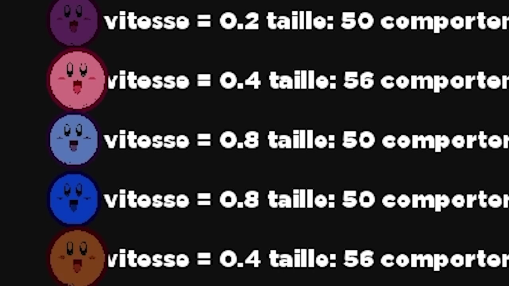
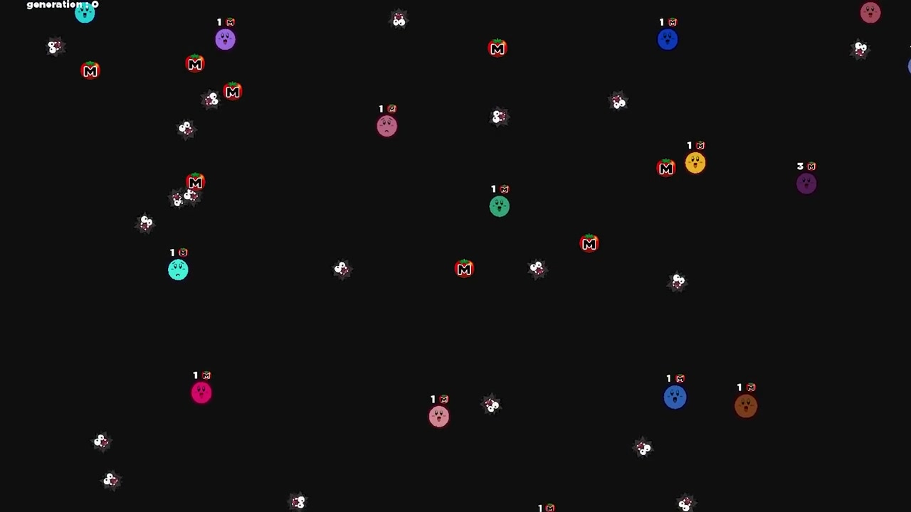
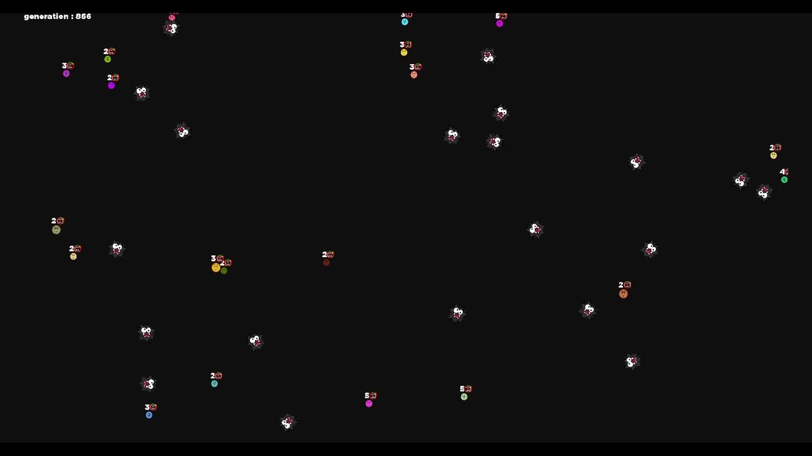
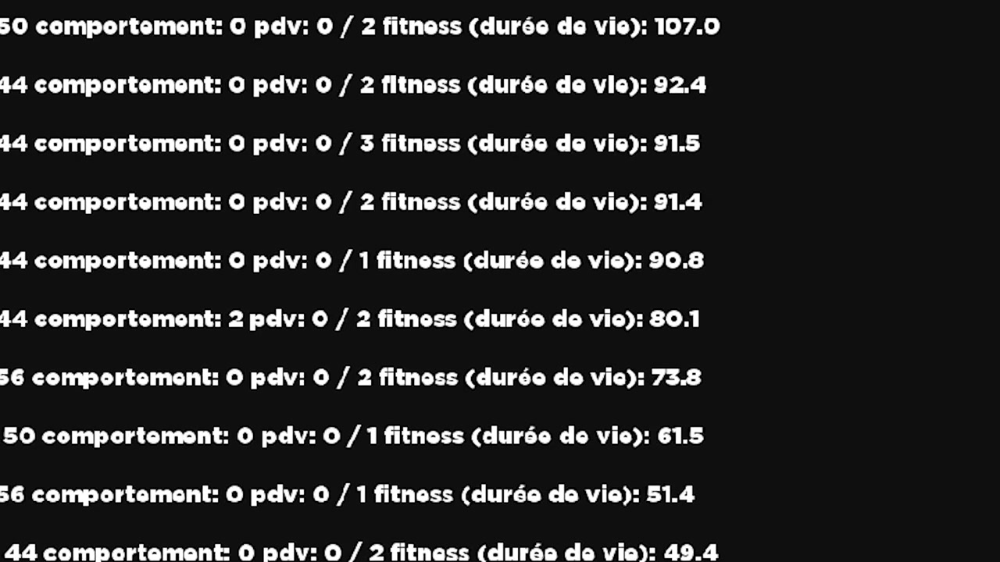
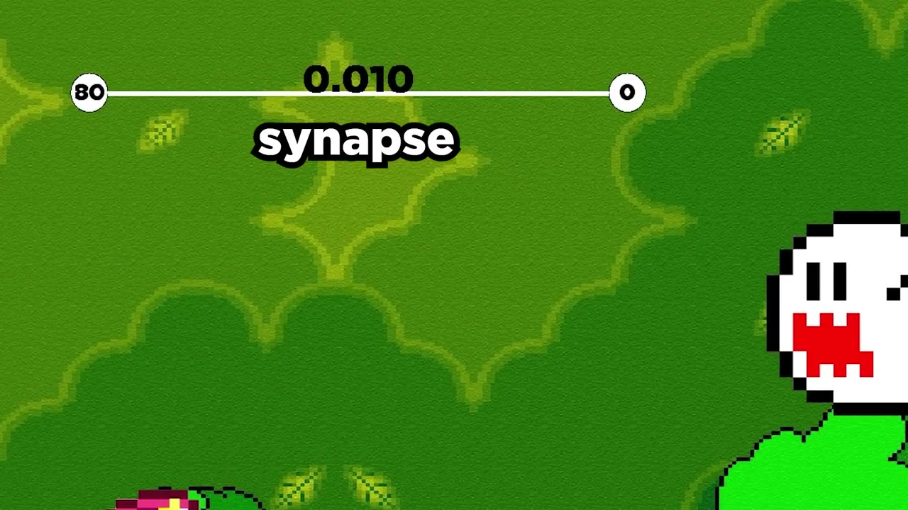
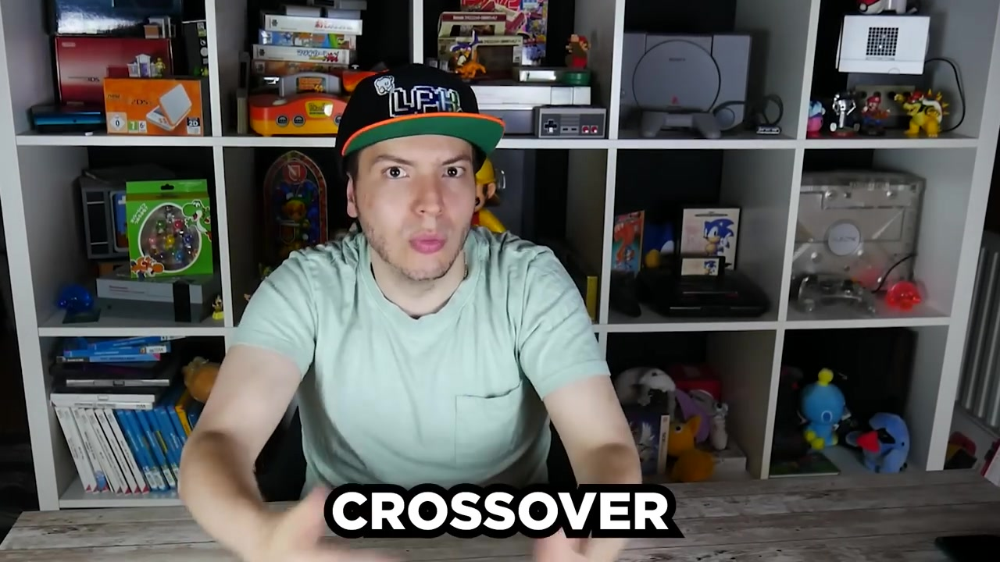
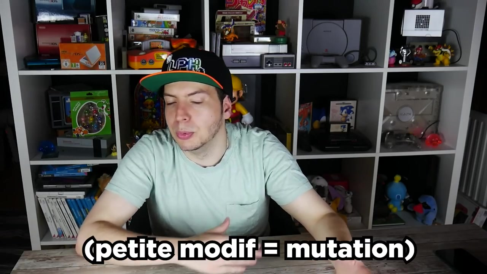
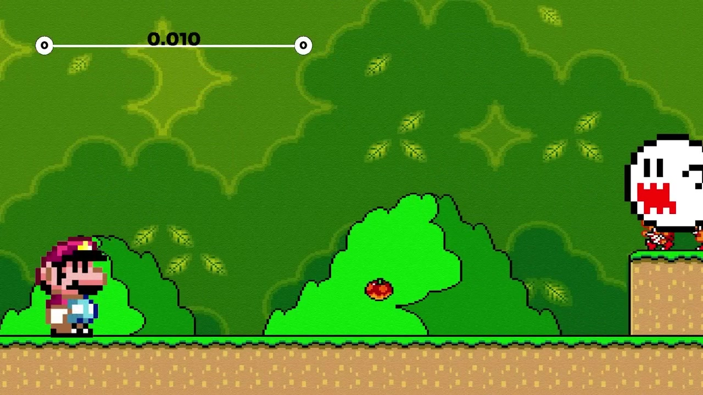

# Laupok создал ИИ, играющий в Super Mario World сам -- как это работает

Laupok создал искусственный интеллект, играющий в **Super Mario World** полностью автономно. Он стартует с нуля : никаких предписанных скриптов, никаких записанных кадров. ИИ учится сам, рывками случайных мутаций и естественным отбором, проходить уровни игры. Проект крутится на **BizHawk**, мультиплатформенном эмуляторе, через Lua-скрипт примерно на **4200 строк**.

Захватывает в этом проекте то, что он опирается на биологические концепции, приложенные к информатике : **теорию эволюции Дарвина**, **искусственные нейросети** и особенно специфический алгоритм под названием **NEAT** (NeuroEvolution of Augmenting Topologies). ИИ ничего не знает про игру на старте. Он тестирует случайные действия, проваливается тысячи раз и понемногу понимает, как двигаться, прыгать и выживать.

В этой статье разберём всё это -- концепцию за концепцией, строку кода за строкой.



---

## Сетап : BizHawk, Lua и Super Mario World

### Эмулятор BizHawk

BizHawk это опенсорсный эмулятор, поддерживающий тонну консолей -- NES, SNES, Genesis, PS1, Game Boy и многие другие. Его особенность в том, что он позволяет запускать **Lua-скрипты** параллельно игре. Эти скрипты имеют доступ к **оперативной памяти** (RAM) эмуляции, а значит могут читать -- и менять -- любые данные игры в реальном времени.

Конкретно это значит, что можно :
- Читать позицию Марио в уровне
- Знать, какие спрайты (враги, предметы) на экране
- Знать состояние каждого тайла (блока) вокруг Марио
- Управлять геймпадом -- жать любую кнопку

Это ровно то, что нужно, чтобы заставить играть ИИ.

### Адреса памяти Super Mario World

В RAM Super Mario World каждая данная хранится по конкретному адресу. Это немного как квартал : каждый адрес соответствует "дому", содержащему информацию. Например :

| Adresse | Donnée |
|---------|--------|
| `0x94`-`0x95` | Position X de Mario (16 bits, little-endian) |
| `0x96`-`0x97` | Position Y de Mario |
| `0x14C8`+`i` | État du sprite `i` (>7 = vivant) |
| `0xE4`+`i` | Position X basse du sprite `i` |
| `0x14E0`+`i` | Position X haute du sprite `i` |
| `0xD8`+`i` | Position Y basse du sprite `i` |
| `0x14D4`+`i` | Position Y haute du sprite `i` |
| `0x170B`+`i` | Type de l'extended sprite `i` |
| `0x0100` | État du jeu (12 = niveau fini) |
| `0x13D4` | Pause active |
| `0x0071` | Animation de mort de Mario (9 = mort) |
| `0x1C800`+... | Table des tiles du niveau |

Позиция спрайтов использует два байта : младший байт и старший байт, потому что позиция может превышать 255 пикселей. Формула всегда `младший + старший × 256`.

Для тайлов сложнее : базовый адрес `0x1C800`, а офсет вычисляется по координатам `x` и `y` тайла в мире с шагом 16 пикселей на тайл.



---

## Основы : генетические алгоритмы и нейросети

Прежде чем нырять в код, надо понять две фундаментальные концепции. Без них остальное бессмысленно.

### Генетические алгоритмы

Генетический алгоритм это симуляция **теории эволюции**. Центральная идея : создаём **популяцию** индивидов, у каждого слегка разные характеристики ("гены"). Заставляем их "жить" в среде. Те, что справляются лучше, выживают и размножаются. Те, что справляются плохо, исчезают.

Laupok иллюстрирует это аналогией с **Kirby** :
- Популяция Kirby появляется на поле с шипами и помидорами
- Шипы отнимают жизни, помидоры возвращают
- У каждого Kirby гены : размер, скорость, жизни, поведение (бежать, искать помидоры, переть куда попало)



- Через 15 секунд смотрим, кто выжил дольше всех
- Лучший Kirby размножается с остальными : малыши наследуют половину генов лучшего и половину "худшего"
- Малыши претерпевают случайные **мутации** (чуть больше, чуть быстрее...)
- Старые Kirby заменяются новыми
- Перезапускаем

После 180 поколений (~15 часов) Kirby переходят с 15 секунд выживания к **15 минутам**. Они стали маленькими (уменьшенная зона коллизии), быстрыми и постоянно убегают от опасности.







Ключевой момент : **мы не определяем решение**. Алгоритм **находит его сам**. И ровно это делает его мощным для задач, где неизвестно, какая комбинация параметров была бы оптимальной.

### Искусственные нейросети

Нейросеть это упрощённая математическая модель человеческого мозга. Она состоит из :
- **Входных нейронов** (inputs) : что сеть "видит"
- **Выходных нейронов** (outputs) : что сеть "решает"
- **Связей** (веса) : у каждой связи есть **вес**, усиливающий или ослабляющий сигнал

Принцип прост : каждый входной нейрон отправляет своё значение. Оно умножается на вес связи, затем суммируется с остальными сигналами. Если результат превышает порог (**функция активации**), выходной нейрон активируется.

В аналогии Laupok с Марио и кончиком мыши :
- Входной нейрон = дистанция между Марио и кончиком
- Вес связи = чувствительность Марио
- Выходной нейрон = Марио кричит или нет

Чем ближе кончик, тем выше входное значение. Если вес сильный, посылаемый на выход сигнал сильный, и Марио закричал бы. Меняя вес, меняешь чувствительность Марио.



В настоящей нейросети ИИ та же логика, но в массивном масштабе :
- **99 входных нейронов** (11×9 тайлов вида Марио)
- **8 выходных нейронов** (A, B, X, Y, Вверх, Вниз, Влево, Вправо)
- **Скрытые нейроны** (hidden) между ними
- Сотни связей с разными весами

---

## NEAT : алгоритм, меняющий всё

### Проблема классических генетических алгоритмов

Если скомбинировать генетический алгоритм с нейросетью наивно, будет проблема : создаём 100 совершенно разных нейросетей, и не знаем, как их сравнивать. У каждой свои нейроны, свои связи, свои веса. Как понять, "близки" две сети или "далеки"?

Здесь входит **NEAT** -- NeuroEvolution of Augmenting Topologies. Изобретённый **Кеннетом Стэнли** и **Ристо Мииккулайненом** в 2002, это алгоритм, решающий ровно эту проблему.

### Виды

Первый ключевой механизм NEAT это **виды**. Когда нейросеть становится слишком отличной от другой, она классифицируется в другой вид. Схожесть вычисляется через три параметра :

1. **Excess** (`EXCES_COEF = 0.50`) : число связей, никак не соотносящихся между двумя сетями (разные инновации)
2. **Disjoint** : то же, но для связей, находящихся в середине
3. **Разница весов** (`POIDSDIFF_COEF = 0.92`) : средняя разница весов между связями, разделяющими одну инновацию

Формула балла :

```
score = (EXCES_COEF × disjoint) / max(nbConnexions1 + nbConnexions2, 1)
      + POIDSDIFF_COEF × diffPoids
```

Если этот балл ниже `DIFF_LIMITE` (1.0), обе сети в одном виде. Иначе создаём новый вид.

### Инновации

В этом гениальность NEAT. Каждый раз, когда создаётся связь, она получает уникальный глобальный номер **инновации**. Этот номер следует за нейросетью, даже когда она размножается.

Конкретно, когда малыш создаётся скрещиванием, он наследует инновации родителей. Если две сети разделяют одну инновацию, это значит, у них есть связь от одного предка. Именно это позволяет сравнивать сети разных размеров.

### Скрещивание

Когда две нейросети размножаются, **скрещивание** работает так :



1. Более результативная сеть становится "доминантным родителем"
2. Малыш наследует все связи доминанта
3. Для каждой связи, разделяющей одну инновацию, другой родитель может её заменить (50 % шансов)
4. Заменять могут только активные связи недоминантного родителя

Это гарантирует, что малыш всегда как минимум не хуже лучшего родителя.

### Мутации

После скрещивания малыш претерпевает мутации с настраиваемыми вероятностями :



| Mutation | Probabilité | Effet |
|----------|------------|-------|
| Reset poids connexion | 25% | Le poids est totalement randomisé |
| Mutation poids | 95% | Le poids varie de ±0.80 |
| Ajout connexion | 85% | Nouvelle connexion entre deux neurones pas encore liés |
| Ajout neurone | 39% | Un neurone caché est inséré entre deux neurones connectés |

Частота добавления нейронов важна : именно она позволяет сети **расти**. На старте есть только входы и выходы. Постепенно появляются скрытые нейроны, делая сеть всё сложнее.

---

## Код : полный walkthrough

### Константы

Скрипт начинается с блока констант, задающих всю параметризацию :

```lua
-- Вид Марио вокруг него
TAILLE_TILE = 16
TAILLE_VUE_W = TAILLE_TILE * 11  -- 176 пикселей в ширину
TAILLE_VUE_H = TAILLE_TILE * 9   -- 144 пикселя в высоту
NB_TILE_W = TAILLE_VUE_W / TAILLE_TILE  -- 11 тайлов
NB_TILE_H = TAILLE_VUE_H / TAILLE_TILE  -- 9 тайлов

-- Нейросеть
NB_INPUT = NB_TILE_W * NB_TILE_H  -- 99 входов (видимые тайлы)
NB_OUTPUT = 8  -- A, B, X, Y, Вверх, Вниз, Влево, Вправо
NB_INDIVIDU_POPULATION = 100  -- индивидов на популяцию
NB_NEURONE_MAX = 100000  -- лимит скрытых нейронов

-- Fitness
FITNESS_LEVEL_FINI = 1000000  -- значение при завершении уровня
NB_FRAME_RESET_BASE = 33  -- кадров без прогресса до сброса
NB_FRAME_RESET_PROGRES = 300  -- кадров при детекте прогресса

-- Виды
EXCES_COEF = 0.50
POIDSDIFF_COEF = 0.92
DIFF_LIMITE = 1.00

-- Мутации
CHANCE_MUTATION_RESET_CONNEXION = 0.25
POIDS_CONNEXION_MUTATION_AJOUT = 0.80
CHANCE_MUTATION_POIDS = 0.95
CHANCE_MUTATION_CONNEXION = 0.85
CHANCE_MUTATION_NEURONE = 0.39
```

`NB_INPUT` равен 99, потому что вид Марио 11×9 тайлов. Каждый тайл это входной нейрон. Если тайл пуст, он равен 0. Если блок, равен 1. Если враг, равен -1.

8 выходов соответствуют кнопкам геймпада SNES : A, B, X, Y, Вверх, Вниз, Влево, Вправо. Start, Select, L и R исключаем, чтобы лимитировать его решения существенным.

### Структуры данных

Скрипт определяет три главные структуры :

```lua
function newNeurone()
    local neurone = {}
    neurone.valeur = 0    -- текущее значение нейрона
    neurone.id = 0        -- уникальный идентификатор
    neurone.type = ""     -- "input", "output" или "hidden"
    return neurone
end

function newConnexion()
    local connexion = {}
    connexion.entree = 0     -- ID исходного нейрона
    connexion.sortie = 0     -- ID нейрона назначения
    connexion.actif = true   -- может деактивироваться, если вставлен скрытый нейрон
    connexion.poids = 0      -- вес связи
    connexion.innovation = 0 -- уникальный номер инновации
    connexion.allume = false -- для отображения : true, если сигнал проходит
    return connexion
end

function newReseau()
    local reseau = {
        nbNeurone = 0,        -- число скрытых нейронов
        fitness = 1,          -- результат (пройденная дистанция)
        idEspeceParent = 0,   -- к какому виду принадлежит
        lesNeurones = {},     -- таблица нейронов
        lesConnexions = {}    -- таблица связей
    }
    -- Инициализация входами
    for j = 1, NB_INPUT, 1 do
        ajouterNeurone(reseau, j, "input", 1)
    end
    -- Затем выходы
    for j = NB_INPUT + 1, NB_INPUT + NB_OUTPUT, 1 do
        ajouterNeurone(reseau, j, "output", 0)
    end
    return reseau
end
```

На старте каждая сеть содержит только входы и выходы : никаких скрытых нейронов, никаких связей. Именно алгоритм решит, нужны ли они.

### Мутации в деталях

#### Мутация весов

```lua
function mutationPoidsConnexions(unReseau)
    for i = 1, #unReseau.lesConnexions, 1 do
        if unReseau.lesConnexions[i].actif then
            if math.random() < CHANCE_MUTATION_RESET_CONNEXION then
                -- 25% : полный сброс веса
                unReseau.lesConnexions[i].poids = genererPoids()
            else
                -- 75% : вариация ±0.80
                if math.random() >= 0.5 then
                    unReseau.lesConnexions[i].poids =
                        unReseau.lesConnexions[i].poids - POIDS_CONNEXION_MUTATION_AJOUT
                else
                    unReseau.lesConnexions[i].poids =
                        unReseau.lesConnexions[i].poids + POIDS_CONNEXION_MUTATION_AJOUT
                end
            end
        end
    end
end
```

Начальный вес всегда 1 или -1 (`genererPoids()`). Вариация ±0.80 может качать его между отрицательными и положительными значениями, радикально меняя поведение сети.

#### Добавление связи

```lua
function mutationAjouterConnexion(unReseau)
    local liste = {}
    -- Рандомизация списка нейронов
    for i, v in ipairs(unReseau.lesNeurones) do
        local pos = math.random(1, #liste+1)
        table.insert(liste, pos, v)
    end

    local traitement = false
    for i = 1, #liste, 1 do
        for j = 1, #liste, 1 do
            if i ~= j then
                local n1 = liste[i]
                local n2 = liste[j]
                -- Валидная связь : input→output, hidden→hidden, hidden→output
                if (n1.type == "input" and n2.type == "output") or
                   (n1.type == "hidden" and n2.type == "hidden") or
                   (n1.type == "hidden" and n2.type == "output") then
                    -- Проверить, что связи ещё нет
                    local dejaConnexion = false
                    for k = 1, #unReseau.lesConnexions, 1 do
                        if unReseau.lesConnexions[k].entree == n1.id
                            and unReseau.lesConnexions[k].sortie == n2.id then
                            dejaConnexion = true
                            break
                        end
                    end
                    if dejaConnexion == false then
                        traitement = true
                        ajouterConnexion(unReseau, n1.id, n2.id)
                    end
                end
            end
            if traitement then break end
        end
        if traitement then break end
    end
end
```

Нельзя соединять выход со входом (это создало бы цикл), и нельзя соединять два уже связанных нейрона. Рандомизация гарантирует исследование разных возможностей каждый раз.

#### Добавление нейрона

Это самая интересная мутация :

```lua
function mutationAjouterNeurone(unReseau)
    if #unReseau.lesConnexions == 0 then return nil end
    if unReseau.nbNeurone == NB_NEURONE_MAX then return nil end

    -- Рандомизация связей
    local listeRandom = {}
    for i = 1, #unReseau.lesConnexions, 1 do
        local pos = math.random(1, #listeRandom+1)
        table.insert(listeRandom, pos, i)
    end

    for i = 1, #listeRandom, 1 do
        if unReseau.lesConnexions[listeRandom[i]].actif then
            -- Деактивировать существующую связь
            unReseau.lesConnexions[listeRandom[i]].actif = false
            unReseau.nbNeurone = unReseau.nbNeurone + 1
            local indice = unReseau.nbNeurone + NB_INPUT + NB_OUTPUT

            -- Создать скрытый нейрон
            ajouterNeurone(unReseau, indice, "hidden", 1)

            -- Соединить вход со скрытым нейроном
            ajouterConnexion(unReseau,
                unReseau.lesConnexions[listeRandom[i]].entree,
                indice, genererPoids())

            -- Соединить скрытый нейрон с выходом
            ajouterConnexion(unReseau,
                indice,
                unReseau.lesConnexions[listeRandom[i]].sortie,
                genererPoids())
            break
        end
    end
end
```

Механизм : берём существующую связь, её **деактивируем** и вставляем скрытый нейрон в середину. Исходная связь заменяется двумя новыми : вход→скрытый и скрытый→выход. Будто "режем" провод, чтобы вставить выключатель.

Именно это делает NEAT "augmenting topologies" : сеть **растёт** со временем. Начинает простой и усложняется, только если нужно.

### FeedForward

Это функция, распространяющая сигналы через сеть :

```lua
function feedForward(unReseau)
    -- Сброс выходных нейронов
    for i = 1, #unReseau.lesConnexions, 1 do
        if unReseau.lesConnexions[i].actif then
            unReseau.lesNeurones[unReseau.lesConnexions[i].sortie].valeur = 0
            unReseau.lesNeurones[unReseau.lesConnexions[i].sortie].allume = false
        end
    end

    -- Распространение
    for i = 1, #unReseau.lesConnexions, 1 do
        if unReseau.lesConnexions[i].actif then
            local avantTraitement = unReseau.lesNeurones[unReseau.lesConnexions[i].sortie].valeur
            unReseau.lesNeurones[unReseau.lesConnexions[i].sortie].valeur =
                unReseau.lesNeurones[unReseau.lesConnexions[i].entree].valeur *
                unReseau.lesConnexions[i].poids +
                unReseau.lesNeurones[unReseau.lesConnexions[i].sortie].valeur

            if avantTraitement ~= unReseau.lesNeurones[unReseau.lesConnexions[i].sortie].valeur then
                unReseau.lesConnexions[i].allume = true
            else
                unReseau.lesConnexions[i].allume = false
            end
        end
    end
end
```

Каждая активная связь отправляет `значение_входа × вес` в нейрон выхода. Значение **кумулируется** (суммируется). Флаг `allume` только для визуального отображения сети.

### Чтение памяти игры

Функция `getLesInputs()` та, что переводит мир Super Mario World в понятные сети данные :

```lua
function getLesInputs()
    local lesInputs = {}
    -- Инициализация в 0 (серый = ничего)
    for i = 1, NB_TILE_W, 1 do
        for j = 1, NB_TILE_H, 1 do
            lesInputs[getIndiceLesInputs(i, j)] = 0
        end
    end

    -- Спрайты (враги) = -1 (чёрный)
    local lesSprites = getLesSprites()
    for i = 1, #lesSprites, 1 do
        local input = convertirPositionPourInput(getLesSprites()[i])
        if input.x > 0 and input.x < (TAILLE_VUE_W / TAILLE_TILE) + 1 then
            lesInputs[getIndiceLesInputs(input.x, input.y)] = -1
        end
    end

    -- Тайлы (блоки) = значение тайла (белый, если > 0)
    local lesTiles = getLesTiles()
    for i = 1, NB_TILE_W, 1 do
        for j = 1, NB_TILE_H, 1 do
            local indice = getIndiceLesInputs(i, j)
            if lesTiles[indice] ~= 0 then
                lesInputs[indice] = lesTiles[indice]
            end
        end
    end

    return lesInputs
end
```

Сетка входов это вид, центрированный на Марио : 11 тайлов в ширину, 9 в высоту. Каждый тайл равен :
- **0** (серый) : ничего
- **1** (белый) : твёрдый блок
- **-1** (чёрный) : враг

Враги читаются из двух списков в RAM : нормальные спрайты (`0x14C8`-`0x14F8`) и extended-спрайты (`0x170B`-`0x173B`). Для каждого живого спрайта (состояние > 7) вычисляем его позицию в тайлах относительно Марио и ставим -1 в соответствующую клетку.

### Fitness : как ИИ знает, прогрессирует ли

```lua
function majReseau(unReseau, marioBase)
    local mario = getPositionMario()

    if not niveauFini and memory.readbyte(0x0100) == 12 then
        -- Уровень завершён !
        unReseau.fitness = FITNESS_LEVEL_FINI
        niveauFini = true
    elseif marioBase.x < mario.x then
        -- Марио движется вправо
        unReseau.fitness = unReseau.fitness + (mario.x - marioBase.x)
        marioBase.x = mario.x
    end

    -- Обновление входов
    local lesInputs = getLesInputs()
    for i = 1, NB_INPUT, 1 do
        unReseau.lesNeurones[i].valeur = lesInputs[i]
    end
end
```

Fitness прост : это **пройденная вправо дистанция**. Если Марио продвинулся на 10 пикселей, fitness растёт на 10. Если Марио отступает, ничего не происходит (без штрафа). Если уровень завершён (адрес `0x0100` == 12), fitness становится 1 000 000.

Это намеренно просто. Считается только прогресс вправо : убийство врагов ничего не даёт, смерть ничего не стоит.

### Умный сброс

Если Марио не двигается 33 кадра, сбрасываем уровень и переходим к следующему индивиду. Но если Марио прогрессировал (текущий fitness отличен от стартового), ждём 300 кадров -- это даёт сети шанс "понять" сделанное хорошо.

```lua
if fitnessAvant == laPopulation[idPopulation].fitness
   and memory.readbyte(0x13D4) == 0 then
    nbFrameStop = nbFrameStop + 1
    local nbFrameReset = NB_FRAME_RESET_BASE
    if fitnessInit ~= laPopulation[idPopulation].fitness
       and memory.readbyte(0x0071) ~= 9 then
        nbFrameReset = NB_FRAME_RESET_PROGRES
    end
    if nbFrameStop > nbFrameReset then
        nbFrameStop = 0
        lancerNiveau()
        idPopulation = idPopulation + 1
        -- ...
    end
end
```

Условие `memory.readbyte(0x0071) ~= 9` проверяет, что Марио не в анимации смерти. Сброс становится бесполезным, когда Марио уже в анимации смерти.

### Главный цикл

Цикл крутится на 30 fps (нормальная скорость Super Mario World) :

```lua
while true do
    local fitnessAvant = laPopulation[idPopulation].fitness

    -- Отображение (сеть, инфо)
    if forms.ischecked(estAccelere) then
        emu.limitframerate(false)  -- ускорить
    else
        emu.limitframerate(true)   -- 30 fps
    end

    -- 3 витальные функции
    majReseau(laPopulation[idPopulation], marioBase)
    feedForward(laPopulation[idPopulation])
    appliquerLesBoutons(laPopulation[idPopulation])

    emu.frameadvance()
    nbFrame = nbFrame + 1

    -- Сброс при отсутствии прогресса
    -- ...
    -- Новое поколение, если все индивиды протестированы
    -- ...
end
```

Три витальные функции это `majReseau`, `feedForward` и `appliquerLesBoutons`. Отключи одну, Марио перестанет двигаться.

### Скрещивание

```lua
function crossover(unReseau1, unReseau2)
    local leReseau = newReseau()
    local leBon = unReseau1
    local leNul = unReseau2

    if leBon.fitness < leNul.fitness then
        leBon = unReseau2
        leNul = unReseau1
    end

    leReseau = copier(leBon)

    for i = 1, #leReseau.lesConnexions, 1 do
        for j = 1, #leNul.lesConnexions, 1 do
            if leReseau.lesConnexions[i].innovation == leNul.lesConnexions[j].innovation
               and leNul.lesConnexions[j].actif then
                if math.random() > 0.5 then
                    leReseau.lesConnexions[i] = leNul.lesConnexions[j]
                end
            end
        end
    end
    leReseau.fitness = 1
    return leReseau
end
```

Малыш наследует лучшего родителя. Для каждой связи, разделяющей одну инновацию, у другого родителя 50 % шансов её заменить -- но **только если связь активна**. Это важный фикс : без него могли создаваться бесполезные скрытые нейроны.

### Отбор по видам

```lua
function nouvelleGeneration(laPopulation, lesEspeces)
    local laNouvellePopulation = newPopulation()
    local nbIndividuACreer = NB_INDIVIDU_POPULATION

    -- Средний fitness на вид
    for i = 1, #lesEspeces, 1 do
        lesEspeces[i].fitnessMoyenne = 0
        for j = 1, #lesEspeces[i].lesReseaux, 1 do
            lesEspeces[i].fitnessMoyenne =
                lesEspeces[i].fitnessMoyenne + lesEspeces[i].lesReseaux[j].fitness
        end
        lesEspeces[i].fitnessMoyenne =
            lesEspeces[i].fitnessMoyenne / #lesEspeces[i].lesReseaux
    end

    -- Каждый вид создаёт детей пропорционально среднему fitness
    for i = 1, #lesEspeces, 1 do
        local nbEnfant = math.ceil(
            #lesEspeces[i].lesReseaux *
            lesEspeces[i].fitnessMoyenne / fitnessMoyenneGlobal)

        for j = 1, nbEnfant, 1 do
            local unReseau = crossover(
                choisirParent(lesEspeces[i].lesReseaux),
                choisirParent(lesEspeces[i].lesReseaux))
            mutation(unReseau)
            laNouvellePopulation[indiceNouvelleEspece] = copier(unReseau)
        end
    end
end
```

Идея : вид со средним fitness 10 000 имеет право создать куда больше детей, чем вид со средним fitness 1. Это **естественный отбор** в действии.

`choisirParent` использует отбор рулеткой : чем выше fitness индивида, тем больше шансов быть выбранным родителем.

### Сохранение и загрузка

Популяции сохраняются в файлы `.pop` :

```lua
function sauvegarderUnReseau(unReseau, fichier)
    io.write(unReseau.nbNeurone .. "\n")
    io.write(#unReseau.lesConnexions .. "\n")
    io.write(unReseau.fitness .. "\n")
    for i = 1, unReseau.nbNeurone, 1 do
        local indice = NB_INPUT + NB_OUTPUT + i
        io.write(unReseau.lesNeurones[indice].id .. "\n")
    end
    for i = 1, #unReseau.lesConnexions, 1 do
        local actif = 1
        if unReseau.lesConnexions[i].actif ~= true then actif = 0 end
        io.write(actif .. "\n" ..
            unReseau.lesConnexions[i].entree .. "\n" ..
            unReseau.lesConnexions[i].sortie .. "\n" ..
            unReseau.lesConnexions[i].poids .. "\n" ..
            unReseau.lesConnexions[i].innovation .. "\n")
    end
end
```

Сохранение включает и лучшего индивида всех предыдущих популяций. Если лучший из старой популяции лучше лучшего из новой, берём старого за основу. Это форма **элитизма** : лучшего не теряем никогда.

### Отрисовка сети

Laupok добавил визуализатор нейросети поверх игры :

```lua
function dessinerUnReseau(unReseau)
    -- Входы : сетка 11×9 вокруг Марио
    for i = 1, NB_TILE_W, 1 do
        for j = 1, NB_TILE_H, 1 do
            local xT = ENCRAGE_X_INPUT + (i - 1) * TAILLE_INPUT
            local yT = ENCRAGE_Y_INPUT + (j - 1) * TAILLE_INPUT
            local couleurFond = "gray"
            if unReseau.lesNeurones[getIndiceLesInputs(i, j)].valeur < 0 then
                couleurFond = "black"   -- враг
            elseif unReseau.lesNeurones[getIndiceLesInputs(i, j)].valeur > 0 then
                couleurFond = "white"   -- блок
            end
            gui.drawRectangle(xT, yT, TAILLE_INPUT, TAILLE_INPUT, "black", couleurFond)
        end
    end

    -- Выходы : 8 кнопок
    for i = 1, NB_OUTPUT, 1 do
        local xT = ENCRAGE_X_OUTPUT
        local yT = ENCRAGE_Y_OUTPUT + ESPACE_Y_OUTPUT * (i - 1)
        if sigmoid(unReseau.lesNeurones[i + NB_INPUT].valeur) then
            gui.drawRectangle(xT, yT, TAILLE_OUTPUT_W, TAILLE_OUTPUT_H, "white", "white")
        else
            gui.drawRectangle(xT, yT, TAILLE_OUTPUT_W, TAILLE_OUTPUT_H, "white", "black")
        end
    end

    -- Связи
    for i = 1, #unReseau.lesConnexions, 1 do
        if unReseau.lesConnexions[i].actif then
            local alpha = 25
            if unReseau.lesConnexions[i].allume then alpha = 255 end
            local couleur = forms.createcolor(255, 255, 255, alpha)
            gui.drawLine(
                lesPositions[unReseau.lesConnexions[i].entree].x,
                lesPositions[lesConnexions[i].entree].y,
                lesPositions[unReseau.lesConnexions[i].sortie].x,
                lesPositions[lesConnexions[i].sortie].y,
                couleur)
        end
    end
end
```

Суперполезно для понимания того, что делает сеть. Активные связи белые, неактивные полупрозрачные. Входы это сетка бело-чёрно-серых клеток. Выходы показывают, какие кнопки нажаты.

---

## Результаты

### Чему научился ИИ

За часы (и дни) прогона ИИ открыл сам :

1. **Двигаться вправо** : самое базовое поведение, но требующее держать кнопку Вправо зажатой
2. **Прыгать через врагов** : соединяя вход "детект врага" с кнопкой A или B
3. **Избегать препятствий** : некоторые сети научились временно отступать, чтобы лучше продвинуться
4. **Проходить уровни** : лучший индивид смог завершить первый уровень Super Mario World



### Лимиты

У проекта есть лимиты :

- **Один уровень** : ИИ обучен на одном конкретном уровне. Он не обобщает автоматически на другие уровни
- **Время обучения** : нужны десятки часов, чтобы достичь удовлетворительных результатов
- **Нет понимания** : ИИ не "понимает", что делает. Он оптимизирует функцию fitness (пройденная дистанция) через случайные мутации
- **T-bagging** : Laupok отмечает, что Марио склонен прыгать на месте при виде врага, просто потому что это растит fitness (он слегка продвигается в прыжке)

---

## Как воспроизвести эксперимент

Laupok всё расшарил. Вот шаги :

1. **Скачать BizHawk** на [tasvideos.org](https://tasvideos.org/BizHawk) (секция Download)
2. **Получить USA ROM Super Mario World** (приватная копия собственного картриджа)
3. **Скачать Lua-скрипт** с [Pastebin](https://pastebin.com/Jcvdqhqm) -- переименовать в `mario.lua`
4. **Положить скрипт в ту же папку, что ROM**
5. **Запустить BizHawk**, открыть ROM
6. **В консоли Lua** : `dofile("mario.lua")` или через меню Script > Open Script
7. **Сохранить state** в начале уровня (меню Savestate > Save State) и назвать `debut.state`
8. **Перезапустить скрипт** -- работает

Скрипт включает форму с опциями :
- **Ускорить** : отключает лимит 30 fps, чтобы идти быстрее
- **Показать сеть** : показывает нейросеть поверх
- **Показать инфо** : показывает баннер с поколением, fitness, числом видов
- **Пауза** : ставит выполнение на паузу
- **Сохранить/Загрузить** : персистит текущую популяцию в файл `.pop`

---

## Источники и отсылки

| Ресурс | Ссылка |
|-----------|------|
| Главное видео Laupok | [я создал ИИ, играющий в марио сам](https://www.youtube.com/watch?v=F63GNXGHVwM) |
| Видео код-ревью + сетап | [как настроить ии + обзор исходника](https://www.youtube.com/watch?v=u5xCl1bSe6o) |
| Полный исходник | [Pastebin Jcvdqhqm](https://pastebin.com/Jcvdqhqm) |
| Оригинальная статья NEAT | Stanley & Miikkulainen, "Evolving Neural Networks through Augmenting Topologies", 2002 |
| Туториал от N8Programs | [NEAT implementation walkthrough](https://n8programs.github.io/) (JavaScript, но концепции идентичны) |
| 16blings (вдохновение Laupok) | [AI plays Super Mario World](https://www.youtube.com/watch?v=qv6IFaOz3bA) |
| BizHawk | [tasvideos.org/BizHawk](https://tasvideos.org/BizHawk) |
| Память Super Mario World | [SMW Central - RAM Map](https://www.smwcentral.net/?p=section&a=details&id=21702) |

---

## Заключение

Сделанное Laupok это взять академический алгоритм (NEAT, 2002), переписать его на Lua для эмулятора (BizHawk) и применить к Super Mario World. Итог : ИИ, учащийся с нуля играть в игру, безо всякого предварительного знания, только случайными мутациями и естественным отбором.

Прекрасный пример мощи генетических алгоритмов. Рецепт в трёх ингредиентах : естественный отбор, немного Lua и много терпения. Никакого deep learning, никакого GPU, никаких массивных обучающих данных.

Код прокомментирован, расшарен, а Laupok сделал два объясняющих видео -- одно про большие концепции, одно про код. Если тема интересна, ныряй. Это доступнее, чем кажется.
