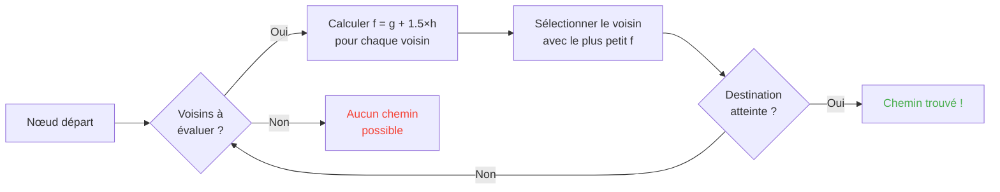

## Введение

Я провёл часы, глядя, как овцы бьются в стены.

И честно? Лучшее вложение в моей жизни.

Потому что чем больше смотришь на этих мобов, тем сильнее понимаешь, что в них нет ничего случайного. Каждое движение закодировано, предсказуемо и главное полностью ломаемо. Я в итоге залез в исходник Minecraft, чтобы понять ровно, как работает патфайндинг, и обнаружил, что можно буквально майнд-контролить мобов. Типа заставлять их идти туда, куда хочешь ТЫ, а не туда, куда решит рандом.

Этот гайд это всё, что я узнал в копании. ИИ, алгоритм A*, скрытые штрафы, эксплойты, которые можно проворачивать в выживании. Точи кирку.

---

## Как работает ИИ мобов (спойлер : он тупой)

### Goals

У каждого моба есть *goals*. Это список действий, которые он МОЖЕТ делать, и насколько ему ХОЧЕТСЯ их делать. Чем меньше число, тем приоритетнее, как todo-список в версии хаоса.

```java
protected void registerGoals() {
   this.goalSelector.addGoal(4, new Zombie.ZombieAttackTurtleEggGoal(this, 1.0, 3));
   this.goalSelector.addGoal(8, new LookAtPlayerGoal(this, Player.class, 8.0F));
   this.goalSelector.addGoal(8, new RandomLookAroundGoal(this));
   this.addBehaviourGoals();
}
```

Видел, как зомби игнорирует черепашье яйцо, чтобы погнаться за тобой? Вот почему : у `ZombieAttackTurtleEggGoal` приоритет 4, а у `ZombieAttackGoal` (гола, говорящего ему жрать твоё лицо) приоритет 2.

Да, зомби предпочитает съесть тебя, а не разбить яйцо. Прекрасна любовь.

Гол, интересующий нас реально, это `WaterAvoidingRandomStrollGoal`, приоритет 7. Гол "мне нечего делать, так что хожу на рандоме". Здесь всё становится интересным.

### Движение (или "как случайное блуждание имеет 1 шанс из 60 случиться")

Каждый тик (каждые 0.05 секунды) игра зовёт `canUse()`, чтобы увидеть, соизволит ли моб двигаться. 1 шанс из 60 на каждый тик. Совершенно тупой дизайн, и я это обожаю.

```java
public boolean canUse() {
   if (this.mob.hasControllingPassenger()) {
      return false;
   } else {
      if (!this.forceTrigger) {
         if (this.checkNoActionTime && this.mob.getNoActionTime() >= 100) {
            return false;
         }
         if (this.mob.getRandom().nextInt(reducedTickDelay(this.interval)) != 0) {
            return false;
         }
      }
      Vec3 $$0 = this.getPosition();
      if ($$0 == null) {
         return false;
      } else {
         this.wantedX = $$0.x;
         this.wantedY = $$0.y;
         this.wantedZ = $$0.z;
         this.forceTrigger = false;
         return true;
      }
   }
}
```

Итого : если ты верхом на мобе -> нет, если моб ничего не делал 5 секунд -> нет, если рандом сказал нет -> нет. Игра РЕАЛЬНО не хочет, чтобы моб двигался.

Но когда он двигается, `getPosition()` берёт эстафету :

```java
protected Vec3 getPosition() {
   if (this.mob.isInWater()) {
      Vec3 $$0 = LandRandomPos.getPos(this.mob, 15, 7);
      return $$0 == null ? super.getPosition() : $$0;
   } else {
      return this.mob.getRandom().nextFloat() >= this.probability
         ? LandRandomPos.getPos(this.mob, 10, 7)
         : super.getPosition();
   }
}
```

Смотри на эти два числа в конце : это радиус XZ и радиус Y. В воде моб ищет дальше (15 вместо 10). Если не находит землю, откатывается на `super.getPosition()`, принимающий воду. **Итог : мобы ХОТЯТ выбраться из воды.** Поэтому твои животные плавают как бешеные к берегу.

Маленькая смачная деталь : есть буквально 0.1 % шанса, что моб возьмёт `super.getPosition()` вместо `LandRandomPos`. Один на тысячу. Типичный Mojang.

### LandRandomPos : гнилая оптимизация, меняющая всё

Это МОЙ любимый шаг. Самая красивая техническая глупость, делающая патфайндинг эксплуатируемым.

```java
public static Vec3 getPos(PathfinderMob $$0, int $$1, int $$2, ToDoubleFunction<BlockPos> $$3) {
   boolean $$4 = GoalUtils.mobRestricted($$0, $$1);
   return RandomPos.generateRandomPos(() -> {
      BlockPos $$4xx = RandomPos.generateRandomDirection($$0.getRandom(), $$1, $$2);
      BlockPos $$5 = generateRandomPosTowardDirection($$0, $$1, $$4, $$4xx);
      return $$5 == null ? null : movePosUpOutOfSolid($$0, $$5);
   }, $$3);
}
```

`movePosUpOutOfSolid`. Имя говорит всё. Если выбранная позиция внутри твёрдого блока, игра толкает её вверх, пока она не окажется в воздухе.

Это оптимизация : вместо траты времени на игнор подземных позиций игра поднимает их на поверхность. Умно? Да. Но это создаёт дикий перекос : **мобы предпочитают высоты**.

Представь. Куча блоков под поверхностью, игра генерирует 10 случайных позиций. Те, что в блоках, толкаются вверх. Плотные зоны (под холмом) дают больше валидных позиций, чем полые зоны. Итог : моб статистически чаще идёт к холму.

Поверь, мы сломаем это за 2 минуты.

### Отбор : конкурс лучшего блока

10 позиций, один победитель, конкурс баллов :

```java
public static Vec3 generateRandomPos(Supplier<BlockPos> $$0, ToDoubleFunction<BlockPos> $$1) {
   double $$2 = Double.NEGATIVE_INFINITY;
   BlockPos $$3 = null;
   for(int $$4 = 0; $$4 < 10; ++$$4) {
      BlockPos $$5 = (BlockPos)$$0.get();
      if ($$5 != null) {
         double $$6 = $$1.applyAsDouble($$5);
         if ($$6 > $$2) {
            $$2 = $$6;
            $$3 = $$5;
         }
      }
   }
   return $$3 != null ? Vec3.atBottomCenterOf($$3) : null;
}
```

Позиция с лучшим баллом ВЫИГРЫВАЕТ. А если знаешь критерии баллов, можешь заставить выиграть нужную позицию. Это как подтасовать выборы.

---

## Предпочтения мобов (или "почему твоя корова переходит дорогу")

У каждого моба свои вкусы. И это меняет всё.

| Mob | Kiffe ça |
| --- | --- |
| **Animaux** (vaches, moutons, cochons) | L'herbe et la lumière (hipsters) |
| **Monstres** (zombies, squelettes) | Le noir (edgelords) |
| **Tortues** | L'eau, sinon le sable, sinon la lumière |
| **Hoglins** | `crimson_nylium` ; détestent `warped_fungus` |
| **Striders** | Que la lave. RIEN d'autre. |
| **Silverfish** | Les blocs infestables (logique) |
| **Guardians** | Eau + lumière (les snobs) |
| **Mooshrooms** | Mycelium + lumière (champignons) |
| **Abeilles** | L'air. Oui, elles préfèrent L'AIR. |

```java
// Animal : regarde en bas, si c'est de l'herbe, score max
public float getWalkTargetValue(BlockPos $$0, LevelReader $$1) {
   return $$1.getBlockState($$0.below()).is(Blocks.GRASS_BLOCK) ? 10.0F : $$1.getPathfindingCostFromLightLevels($$0);
}

// Monstre : exactement l'inverse
public float getWalkTargetValue(BlockPos $$0, LevelReader $$1) {
   return -$$1.getPathfindingCostFromLightLevels($$0);
}
```

Типа монстры это буквально "если освещено, балл отрицательный, иду elsewhere". Они ДЕЛАЮТ РОЖУ свету.

Так что ты можешь, буквально, вести своих животных травой и светом, а монстров темнотой. Это тупо и гениально одновременно.

---

## Алгоритм A* в Minecraft (секретная формула)

Minecraft использует алгоритм A* (A-star) для патфайндинга. Но Mojang приложил лапу :

```
f(n) = g(n) + 1.5 × h(n)
```

- **g(n)** = уже пройденный путь (1 на блок, ~1.41 по диагонали)
- **h(n)** = расстояние по прямой
- **1.5** = потому что Mojang любит чуть сломанные значения

Обычно A* использует `f(n) = g(n) + h(n)`. MOJANG ДОБАВИЛ ФАКТОР 1.5. Зачем? Чтобы алгоритм быстрее шёл к цели и меньше резал ветки поиска. Итог : найденный путь "хороший", но не всегда лучший. Это A* слегка поддатый.



Важная деталь : **моб может патфайндить только на 16 блоков** (его *follow range*). Если цель слишком далеко, он выбирает ближайший блок, который МОЖЕТ достичь. Это значит, что можно создать монолит вне досягаемости, и моб будет патфайндить к ближайшему блоку, приближающему его к этому монолиту, что делает его движения полностью предсказуемыми.

### Два эксплойта, ломающих игру

#### 1. Обновления блоков = принудительный пересчёт

```java
public boolean shouldRecomputePath(BlockPos $$0) {
   if (this.hasDelayedRecomputation) return false;
   if (this.path != null && !this.path.isDone() && this.path.getNodeCount() != 0) {
      Node $$1 = this.path.getEndNode();
      Vec3 $$2 = new Vec3(
         ((double)$$1.x + this.mob.getX()) / 2.0,
         ((double)$$1.y + this.mob.getY()) / 2.0,
         ((double)$$1.z + this.mob.getZ()) / 2.0
      );
      return $$0.closerToCenterThan($$2, (double)(this.path.getNodeCount() - this.path.getNextNodeIndex()));
   }
   return false;
}
```

Каждое обновление блока рядом с путём моба форсирует пересчёт A* с кулдауном в 1 секунду. Ставишь часы на 1 секунду рядом с мобом, и он пересчитывает свой путь ПОСТОЯННО. Это эквивалент GPS, сбрасывающегося каждую секунду.

А если сделать так с 50 мобами одновременно? Lag city. RIP TPS.

#### 2. Штрафы блоков (Pathfinding Malice)

Некоторые блоки пугают мобов. Буквально. У каждого блока есть связанная стоимость, заданная перечислением :

| Bloc / Condition | Malus |
| --- | --- |
| **Bloc de miel** | +8 à traverser |
| **Poudreuse** | Infranchissable |
| **Portes fermées** | Infranchissable |
| **Feu** | +16 à traverser, +8 à longer |
| **Animaux & Villageois** | Feu = -1 (NOPE) |
| **Cactus / Sweet berry** | Infranchissable ; adjacent = +8 |
| **Eau** | +8 à traverser ou longer |
| **Magma** | +8 à longer (ouille) |

Животные ещё экстремальнее :

```java
protected Animal(EntityType<? extends Animal> $$0, Level $$1) {
   super($$0, $$1);
   this.setPathfindingMalus(PathType.DANGER_FIRE, 16.0F);
   this.setPathfindingMalus(PathType.DAMAGE_FIRE, -1.0F);
}
```

DAMAGE_FIRE на -1.0F это буквально "запрещено". Животное предпочтёт броситься в пустоту, чем пройти через огонь. Фух.

### Упражнение : большой конкурс путей

Представь жителя, выбирающего между несколькими путями.

- **Путь A** : 15 блоков, но 6 блоков идут вдоль воды (+8 каждый)
- **Путь B** : 18 блоков с 2 блоками воды (+8) и 1 смежным блоком воды (+8)
- **Путь C** : 14 блоков напрямик... но с огнём -> НЕПРОХОДИМО для жителя
- **Путь D** : 16 блоков с 1 смежным блоком магмы (+8) + 1 смежным блоком мёда (+8)
- **Путь E** : 25 блоков, но кактусы повсюду (+8 повсюду) -> 90.82 общей стоимости

Устный счёт :

- Путь A : 15 блоков + 6×8 за воду = 15 + 48 = **63** ... но надо добавить 1.5×расстояние. Делаем настоящие расчёты.
- Путь B : длиннее, но меньше штрафов. Общая стоимость = накопленная дистанция + штрафы.
- Путь D : магма и мёд стакаются штрафами.

Победитель часто **Путь B** : крюк окупается, потому что вода ДОРОГАЯ.

Житель это по сути калькулятор стоимостей на ногах.

### У каждого моба свои вкусы

Житель : "огонь? НЕТ СПАСИБО ПОКА"
Зомби : "огонь? ОК бумер *идёт горя*"

Буквально есть дороги, которыми одни мобы ходят, а другие нет. Можно делать жительские автобаны, где зомби сгорают.

---

## Жители : ультимативный бардак

Так, жители. Это САМАЯ непонятая система во всём Minecraft. Но как только вцепился в код, понимаешь, что это предсказуемые машины с офисным расписанием.

### Сенсоры и памяти

9 сенсоров, крутящихся каждые 20 тиков (1 секунда). Каждый обшаривает радиус вокруг жителя и хранит результат в памяти. Житель видит всё, помнит всё и действует соответственно.

Типа : "есть враг? предмет на земле? игрок для поговорить?" Он чекает ВСЁ.

### Пакеты (его фазы дня)

Мозг жителя это пакеты активности, включающиеся по времени :

| Package | Horaire | Le villageois... |
| --- | --- | --- |
| **Core** | H24 | Ouvre des portes, nage (80% du temps), et ACQUIERT DES POI |
| **Work** | 8h-15h | "Je vais bosser" -- marche vers son poste |
| **Meet** | 15h-17h | "Apéro !" -- va à la cloche, papote |
| **Rest** | 18h-6h | "Faut dormir" -- va au lit |
| **Idle** | 6h-8h, 17h-18h | "Je glande" -- se balade, fait des bébés, saute sur les lits |
| **Panic** | Blessure/hostile | "AU SECOURS" -- FUITE |

Пакет **Panic** единственный, способный прервать ВСЕ остальные. Даже если житель спит или работает, если рядом зомби, ВСЕОБЩАЯ ПАНИКА.

### Acquire POI : штука, дающая беспроводную редстоун

```java
Set<Pair<Holder<PoiType>, BlockPos>> $$12 = (Set)$$10xx.findAllClosestFirstWithType(
   $$0, $$11, $$8x.blockPosition(), 48, PoiManager.Occupancy.HAS_SPACE
)
```

`Acquire POI` сканирует в радиусе 48 блоков все POI (точки интереса). Оставляет 5 ближайших, проверяет, что путь существует, и приобретает первый доступный.

У каждого POI ограниченное число слотов :
- **Рабочие места** : 1 слот
- **Кровати** : 1 слот
- **Колокола** : 32 слота

ДИКИЙ момент : **слот резервируется в момент приобретения, А НЕ по прибытии**. Житель может заблокировать компостер с другого конца карты, ни разу его не достигнув.

Сечёшь мощь?

### Беспроводная редстоун. Да, БЕЗ ПРОВОДОВ.

1. Сажаешь жителя в вагонетку с путём к компостеру
2. Он приобретает компостер (слот занят, никто больше не может его использовать)
3. Житель слишком далеко, чтобы кликнуть, костная мука остаётся
4. КАТАЕШЬ этого жителя куда угодно в мире, он держит слот
5. Когда хочешь активировать штуку, У Б И В А Е Ш Ь жителя
6. Слот освобождается, другой житель приобретает компостер, забирает костную муку
7. ОБНОВЛЕНИЕ БЛОКА -> активируется любая редстоун-цепь

Ты буквально создал беспроводной редстоун-сигнал, передаваемый по всему миру, с нулевой нуждой прогрузки чанков по пути. Можешь повесить это на стазис-камеру эндер-пёрла, телепортироваться откуда угодно, убив жителя.

Моё любимое применение? Мини-игра "охотник за головами" : ставишь нескольких жителей с компостерами, игрок должен убить НУЖНОГО жителя, чтобы активировать выход. Совершенно wtf-механика.

### Pathfinding Deadlock (или "житель, фризящийся навсегда")

Есть СЛИШКОМ хороший баг между `Acquire POI` (видящим путь) и реальной навигацией (отказывающейся его использовать). Случается, когда блок над рабочим местом непроходим. Итог :

- Core-пакет : "хочу приобрести POI"
- Навигация : "не могу туда ходить"
- Итог : житель остаётся ЗАМОРОЖЕННЫМ, навсегда, борясь с собой.

Буквально замороженные на месте жители, usable как декорация или как "реквизит" в билдах. Стойка для брони в виде танка? Да. Неподвижный страж? Да. Макабр? Может. Но эффективно.

---

## Заключение

Патфайндинг мобов Minecraft это не рандом. Это детерминированная система на баллах, предсказуемая И ломаемая.

**Три пункта запомнить :**

1. **Блоки под ногами = высотный перекос** : заполняй или опустошай недра, чтобы вести мобов
2. **Штрафы разные для каждого моба** : создавай дороги, которыми ходят одни и не ходят другие
3. **Слоты POI резервируются дистанционно** : бесплатная беспроводная редстоун, телепортация, всё такое

Исходник Minecraft это золотая жила недоэксплуатируемых механик. Я провёл часы за чтением декомпилированной Java и честно? Каждая строка это функциональная пасхалка. Только эти используешь в выживании, чтобы делать беспроводную редстоун с жителями. Лучшая игра подтверждена.
