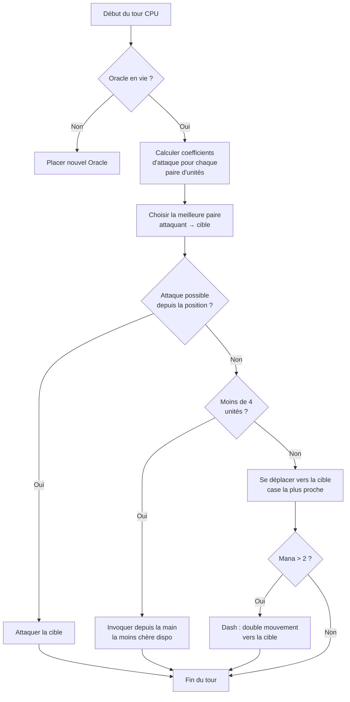

## Мой дурацкий ИИ для Nausicaa

Есть проекты, которые начинаются с "а что если сделать шахматы с мифологиями?" и заканчиваются системой с ИИ, который сам решает свои гиперпараметры каждые 5 ходов.

Nausicaa это оно. Пошаговая настольная игра, где ты строишь колоду мифологических существ, управляешь маной, выставляешь юнитов на поле 10x8. И есть ИИ с кризисами личности.

Я провозился с этим ИИ немало, и результат до сих пор иногда от меня ускользает, и это мне нравится больше всего.

## Игра вживую

Прежде чем говорить о мозге, надо понять тело :

- Поле 10x8, зона высадки в 2 ряда на игрока
- Мана начинается с 1, +1 за ход, макс 6. Тратишь на призыв, атаку, использование способностей
- Цель : убить чужого Оракула

12 юнитов, разные стоимости и паттерны движения :

| Unit | Coût | Mouvement | PV |
| --- | --- | --- | --- |
| Oracle | 0 | Roi (8 directions) | 1 |
| Gobelin | 1 | Avant 3 cases | 1 |
| Harpie | 1 | Roi (8 directions) | 1 |
| Naïade | 1 | Diagonale | 1 |
| Griffin | 2 | Hop 2 cases | 2 |
| Sirène | 2 | Latéral | 1 |
| Centaure | 2 | Cavalier (en L) | 2 |
| Archer | 3 | Latéral | 1 |
| Phénix | 3 | Diagonale (cases sombres) | 1 |
| Métamorphe | 4 | Échange de place | 1 |
| Voyant | 4 | Aucun (genère du mana) | 1 |
| Titan | 6 | Limité (attaque zone) | 3 |

У каждого юнита свой паттерн атаки. Сирена бьёт по 4 диагоналям, Лучник бьёт дистанционно на 3 клетки, Титан уничтожает всё вокруг при призыве. Короче, шахматы с мифологией и построением колоды.

## Как я заставил CPU думать

Базовая идея глупо проста : **у каждого вражеского юнита есть коэффициент привлекательности**. Чем он опаснее, тем сильнее ИИ хочет им заняться.

```javascript
const UNITS_ATTRACTIVENESS = {
    "oracle": 100,
    "titan": 95,
    "shapeshifter": 90,
    "phoenix": 80,
    "siren": 70,
    "archer": 70,
    "seer": 70,
    "griffin": 60,
    "centaur": 60,
    "harpy": 50,
    "naiad": 30,
    "gobelin": 20
};
```

Оракул на 100 -- логично, это условие победы. Титан на 95, потому что он ваншотит всё рядом при призыве. Гоблин на 20, это пехотинец, наплевать.

Дальше для каждой пары юнитов (один свой, один вражеский) я считаю :

```
interet = attractivite × coeff_attract / (distance × coeff_dist)
```

Грубо : чем ты опаснее и ближе, тем сильнее ИИ хочет тебя разнести.

```javascript
calculateAttackCoefficient(x1, y1, x2, y2) {
    const distance = this.calculateEuclideanDistance(x1, y1, x2, y2);
    if (distance === 0) return Infinity;
    return (UNITS_ATTRACTIVENESS[unit.type] * COEFFICIENTS_IMPORTANCE["attractiveness"]) / distance;
}
```

### Фокус с меняющимися коэффициентами

Важный момент : коэффициенты важности **случайно меняются каждые 5 ходов**.

```javascript
if (this.turnCount % 5 === 0) {
    const distanceCoefficient = parseInt(Math.random() * 100);
    const attractivenessCoefficient = parseInt(Math.random() * 100);
    this.regulateImportanceCoefficients({
        distance: distanceCoefficient,
        attractiveness: attractivenessCoefficient
    });
}
```

То ИИ прёт в гиперагрессию (привлекательность на 95, дистанция на 5), он идёт через всё, чтобы убить твоего Оракула. В следующий раз он приоритизирует дистанцию и перестраивается.

Это содрано с призраков Pac-Man -- Блинки охотится, Пинки устраивает засаду. Здесь ИИ меняет "личность" каждую фазу.

**Итог : предсказать ИИ на целую партию невозможно.** CPU никогда не играет два одинаковых матча.

### Оракул трус

Вражеский Оракул убегает. Буквально.

```javascript
const awayFromTarget = {
    row: Math.max(0, Math.min(7, botUnitElement.row + (botUnitElement.row - targetUnitElement.row))),
    col: Math.max(0, Math.min(9, botUnitElement.col + (botUnitElement.col - targetUnitElement.col)))
};
```

Он вычисляет направление от угрозы и сваливает. Если там стена, ищет ближайшую свободную клетку в этом направлении.

Ты тратишь 3 хода, чтобы подойти к Оракулу, и бац, он уже убежал на другой конец.

### Цикл решения

Вот как ИИ решает :

1. Если Оракула больше нет (умер), поставить нового
2. Посчитать коэффициент для каждой пары свой юнит → вражеский юнит
3. Выбрать лучшую пару
4. Если юнит может атаковать цель со своей позиции → атака
5. Если юнитов меньше 4 → призвать самого дешёвого доступного из руки
6. Иначе двигаться к цели (клетка движения, ближайшая к врагу)
7. Если маны достаточно (> 2), рывок (двойное движение), чтобы подойти ещё ближе
8. Если юнит это Оракул → бежать



```javascript
async makeAction(dash=false) {
    // всё это по порядку
    // CPU делает рывок, если маны достаточно
    if(botPlayer.mana > 2) {
        this.makeAction(true);
    }
}
```

### Почему евклидово расстояние

Я использую евклидово расстояние :

```javascript
calculateEuclideanDistance(x1, y1, x2, y2) {
    const deltaX = Math.pow(x1 - x2, 2);
    const deltaY = Math.pow(y1 - y2, 2);
    return Math.sqrt(deltaX + deltaY) * COEFFICIENTS_IMPORTANCE["distance"];
}
```

Почему не Манхэттен? Потому что у юнитов разные паттерны движения (Г как конь, диагональ и т.д). Расстояние по прямой лучше приближает опасность.

## Почему не минимакс

Я мог бы закодить классический минимакс. Но с 12 типами юнитов, разными паттернами движения, особыми способностями... дерево игры взрывается так быстро, что играть становится невозможно. Эвристический подход делает умные выборы, не исследуя 10 миллионов состояний.

## Что круто

Система привлекательности создаёт забавные дилеммы :

- Провидец (70) генерирует ману. Если оставить его жить, у противника больше ресурсов. Но Титан (95) ещё опаснее.
- Метаморф (90) может поменяться местом с любым юнитом. Он может украсть твоего Оракула.
- Гарпия (50) имеет взрывную атаку, которая убивает и её саму. Она остаётся второстепенной... пока не окажется рядом с 3 твоими юнитами.

ИИ оценивает глобальную опасность по позициям, а не только по голым статам.

Есть ещё функция `activateSimulation()` для проверки сценариев без переигрывания партии :

```javascript
activateSimulation() {
    // Расставляет конкретных юнитов на поле
    // Удобно для отладки ИИ
    this.game.board = simulation.board;
    this.game.players = simulation.players;
}
```

## Чего не хватает

Если бы было больше времени :

- ИИ реагирует на текущее состояние, он не предсказывает, что сделает игрок
- Он не планирует руку на несколько ходов
- Способности Метаморфа и Кентавра он недоиспользует
- Обучение с подкреплением : заставить его играть против себя, чтобы подстроить коэффициенты

Но для браузерной игры держится достойно. Друзья умудряются ему проигрывать, так что валидировано.

## Тестируй

Доступно на [nausicaa-game.github.io](https://nausicaa-game.github.io/). Жмёшь "JOUER", режим CPU включён, и смотришь, как играет ИИ.

Совет : дай ИИ поиграть против себя. Увидишь агрессивные фазы, а потом пффф, он всё отводит.

Код на [GitHub](https://github.com/nausicaa-game/nausicaa-game.github.io) в `js/cpu.js`.

**3 пункта запомнить :**

1. **Эвристические коэффициенты** -- никакого минимакса, у каждого юнита своя привлекательность
2. **Коэффициенты меняются каждые 5 ходов** -- ИИ чередует агрессию и контроль, в духе Pac-Man
3. **Оракул убегает** -- он вычисляет направление от угрозы и сваливает

Если есть идеи, как сделать ИИ ещё злее, открывай issue. У меня есть планы на версию, которая учится на поражениях, но это будет в следующей статье.
