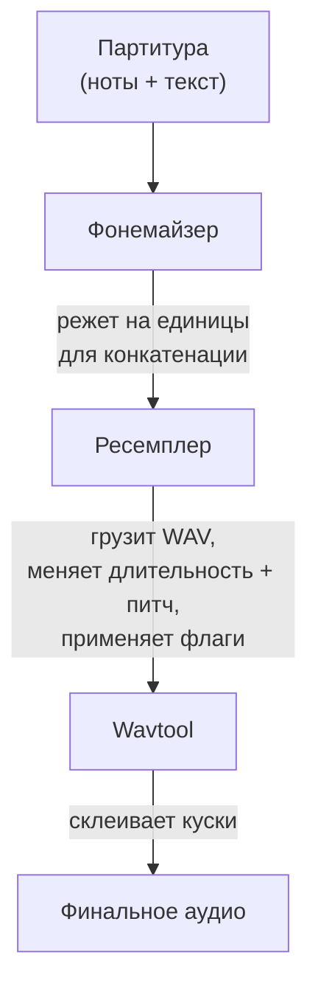

## UTAU : как софт на Visual Basic 6 демократизировал синтез голоса

Я упоминал мимоходом на главной странице : я люблю UTAU. Вот почему.

В 2008, если хотел заставить синтетический голос петь, был один вариант : VOCALOID. Софт Yamaha. Дорогой, проприетарный, с официальными голосами, которые нельзя было создать самому.

А потом один японский парень, Ameya/Ayame, выпустил программу в своём углу. Софт, закоденный на **Visual Basic 6**. Бесплатный. Позволявший создать собственный голос с помощью... WAV-файлов, записанных тобой самим.

Этот софт называется **UTAU** (歌う, "петь" по-японски). И для своей эпохи это была магия.

Он всегда казался мне увлекательным скорее своей исходной идеей, чем технической чистотой (принцип кодирования остаётся реально остроумным, хотя реализация режет глаз) : он открыл вокальный синтез широкой публике. Тебе, мне, кому угодно с микрофоном.

Дай объясню, почему это было гениально.

---

## Сначала, почему синтез пения сложный

Поющий голос это не ноты. Есть согласная в атаке, гласная в держании, дыхание, переходы между ними. "sa" в "salut" это свистящее "s", скользящее к открытому "a", и именно это скольжение звучит человечно или нет.

Сегодня это решается дип-лёрнингом : обучаешь модель на часах пения, и она генерирует голос (Synthesizer V, DiffSinger). Но это 2020+. В 2008 ничего.

UTAU использует метод прежний, более старый и более хитрый : **конкатенативный синтез**.

---

## Конкатенативный синтез : копипаста кусков голоса

Идея тупа как пробка : записываешь маленькие куски голоса и клеишь вместе, чтобы собрать слова. "salut" = сэмпл "sa" + "lu" + "to" друг за другом. Звуковой пазл, управляемый партитурой.

Это принцип YouTube Poop, где перекраивают слова персонажа, чтобы заставить говорить что угодно -- только здесь ровно и автоматизированно.

И UTAU буквально оттуда. До него существовал **"Jinriki Vocaloid"** (人力ボーカロイド, "ручной Vocaloid") : люди вручную резали вокальные дорожки, извлекали фонемы, репитчили и пересобирали всё в аудиоредакторе, чтобы имитировать голос VOCALOID. Вручную. Представляешь работу.

Ameya посмотрел на эту мороку и закодил инструмент для автоматизации. Изначально UTAU был просто этим : ассистентом для ручного Vocaloid.

---

## Почему это было революционно : голос создаёшь ТЫ

Вот что меняет всё.

VOCALOID : покупаешь голос. Miku, Luka и т.д. Созданные профи, продаваемые Yamaha. Создание оставалось за Yamaha. С UTAU **кто угодно записывает свой голос и делает из него поющий инструмент**.

Режим CV (самый простой) это : записываешь ~100 базовых слогов японского ("a", "ka", "sa", "ta"...), настраиваешь точки резки, и вот твой войсбанк. Несколько часов работы.

Итог : экосистема взорвалась. Тысячи войсбанков, созданных сообществом -- голоса фанатов, друзей, придуманных персов. Целая вселенная виртуальных певцов, бесплатно. А софт шёл с **Defoko** (Utane Uta), дефолтным голосом, сгенерированным через TTS-движок AquesTalk, так что начинать можно было даже без микрофона.

---

## Oto.ini : сердце системы

Как UTAU знает, где резать и клеить звуки? Через конфиг-файл на войсбанк : **`oto.ini`**. Для каждого WAV он определяет точки резки (в миллисекундах) :

- **Offset** → тишина для выкидывания в начале
- **Preutterance** → точка перехода согласной в гласную (граница "s"→"a" в "sa")
- **Overlap** → насколько предыдущая нота наезжает на эту
- **Fixed region** → часть, которая НЕ должна тянуться на длинной ноте (обычно согласная)
- **Cutoff** → где резать конец

**Preutterance** самый умный параметр. У слога всегда кусок согласной перед гласной. Чтобы твоя нота легла на долю, ровно должна лечь *гласная*, а не согласная. Так что UTAU сдвигает сэмпл назад : "a" из "sa" приземляется на долю, "s" лишь слегка наезжает до. Как барабанщик, предвосхищающий удар, чтобы звук лёг точно -- только здесь в `.ini`.

Визуально на сэмпле "ka" зоны `oto.ini` режутся так :

```mermaid
flowchart LR
    A["🔇 тишина<br/>(offset)"] --> B["🅺 согласная<br/>(fixed region,<br/>не тянется)"]
    B --> C["🅰 гласная<br/>(тянущаяся зона)"]
    C --> D["🔇 обрезанный конец<br/>(cutoff)"]
    style B fill:#3b4a6b
    style C fill:#5b3b6b
```



Граница между согласной и гласной это preutterance. Гласная это зона, тянущаяся для длинных нот ; согласная остаётся нетронутой, иначе твоё "k" длилось бы две секунды и звучало ужасно.

```ini
# oto.ini (упрощённо)
# файл=алиас,offset,consonant,cutoff,preutterance,overlap
_ka.wav=ka,120,80,-200,90,40
```

Пять значений на звук, на всех твоих сэмплах, и UTAU чисто собирает любое слово.

---

## CV, VCV, CVVC : гонка за реализмом

Базовый режим **CV** (Consonne-Voyelle) это звук на слог. Просто, но слегка роботизированно : стыки между слогами грубые.

В 2010 сообщество изобретает **VCV** (Voyelle-Consonne-Voyelle). Вместо записи "ka" отдельно записываешь "a ka" -- с хвостом предыдущей гласной. Переход становится естественным, потому что он *в* записи, а не вычислен задним числом.

Колючая деталь : **у VOCALOID не было VCV до VOCALOID3 в 2011.** Фривар на VB6, закоденный одним парнем, опередил Yamaha на год в реализме переходов. Сообщество фанатов быстрее мультинационала.

Затем пришли **CVVC**, **ARPAsing** (английский), **VCCV**... каждый метод двигал реализм дальше, все изобретены и задокументированы сообществом.

---

## Полный пайплайн : как слово становится звуком

Когда ставишь ноту и вбиваешь текст, вот что происходит за кулисами :



**Ресемплер** центральная деталь : он берёт твой сэмпл "ka", записанный на данной высоте, и перетягивает/перепитчивает под нужную ноту -- тяня только тянущуюся зону и сохраняя согласную нетронутой (отсюда `oto.ini`).

И он **модульный**. UTAU шёл с базовым ресемплером, но сообщество наплодило других (moresampler, TIPS...), каждый со своим звуковым зерном. Ты менял движок синтеза как плагин. В 2008. На фриваре.

---

## Стройка под капотом (и почему это мило)

Должен быть честен про техническое состояние софта :

- **Закодено на Visual Basic 6.** Языке, уже мёртвом в 2008. Нужен рантайм VB6, чтобы крутить.
- **Изначально только Windows** (порт Mac, UTAU-Synth, пришёл в 2011).
- **Обязательная кодировка Shift-JIS.** Если файлы не закодированы в японский Shift-JIS, UTAU ничего не понимает. До сих пор часто надо ставить ПК в японскую локаль или использовать AppLocale для запуска.
- **Аскетичный интерфейс**, документация тогда почти на 100 % на японском.

И всё же. Всё же этот софт создал мировое движение. Десятки тысяч войсбанков. Песни, слушаемые миллионы раз.

Лучший пример : **Kasane Teto**. Персонаж, созданный в 2008 и вброшенный как первоапрельская шутка, притворяясь VOCALOID. Это была шутка. Только люди полюбили персонажа, позади создали настоящий войсбанк UTAU, и Teto стала одной из знаменитейших виртуальных певиц мира. В 2023 она даже получила официальный голос Synthesizer V. Персонаж, рождённый первоапрельской шуткой на бесплатном софте.

---

## Почему это важно до сих пор

UTAU идеальный пример "бедной" технологии, выигрывающей открытостью.

VOCALOID был технически лучше, лучше профинансирован, профессиональнее. Но закрыт. UTAU был кустарным, страшным, на VB6 -- но давал всем участвовать. Создавать голоса, создавать ресемплеры, создавать плагины, создавать методы записи. Сообщество сделало остальное.

А концепция полностью живёт сегодня. **OpenUtau**, современный опенсорсный преемник, берёт идею и освежает её (мультиплатформа, UTF-8, поддержка современных ресемплеров И ИИ). Конкатенативный синтез до сих пор держится рядом с дип-лёрнинг моделями, потому что у него есть преимущество, которого нет у них : ты ровно понимаешь, что происходит, и контролируешь каждую миллисекунду.

Это мне всегда нравилось в UTAU. Видишь ровно, что происходит. Это не ИИ, выплёвывающий магический результат, который не понимаешь : у тебя твои WAV, твои точки резки, и всё решаешь ты. Когда звучит плохо, знаешь почему и можешь исправить. Люблю такой контроль.

---

**3 пункта запомнить :**

1. **Конкатенативный синтез = пазл из голоса** -- UTAU клеит маленькие WAV-сэмплы вместе, чтобы собрать слова. `oto.ini` определяет, где резать и клеить каждый звук. Ты контролируешь всё, до миллисекунды, без чёрного ящика.

2. **Открытость бьёт технику** -- VOCALOID был лучше, но закрыт. UTAU был кустарным, но давал всем создавать свои голоса. Сообщество взорвало экосистему и даже опередило Yamaha с VCV.

3. **Хорошая идея переживает свой код** -- VB6, Shift-JIS, только Windows... а концепция до сих пор крутится через OpenUtau. Гениальная технология может быть закодена ногами.

Честно, уже за Kasane Teto, рождённую из первоапрельской шутки, этот софт заслуживает уважения.
