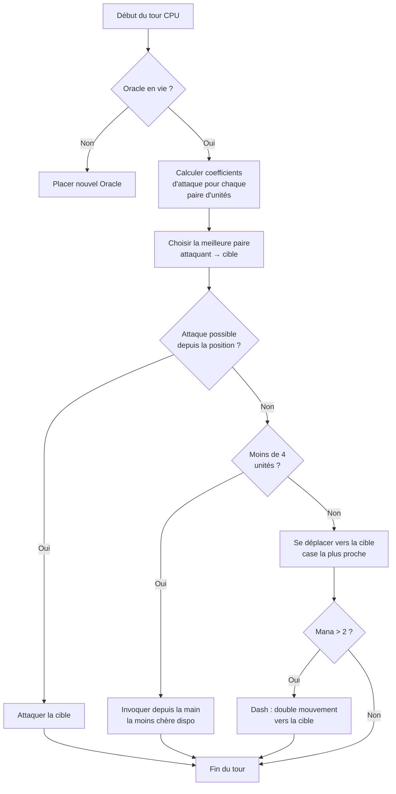

## เอไอของฉันที่โง่สำหรับ Nausicaa

มีโครงการที่เริ่มต้นด้วย “เอ๊ะ ถ้าฉันทำเกมหมากรุกกับตำนานต่าง ๆ” และสิ้นสุดด้วยระบบที่มีเอไอที่ตัดสินค่าพารามิเตอร์สูงของตัวเองทุก ๆ 5 เทิร์น.

นาซิไซอา นั่นแหละ เหมือนเกมกระดานแบบเดินเปลี่ยนเป็นสลับที่คุณสร้างดัก์ของสิ่งมีชีวิตตำนาน, คุณจัดการมานา, คุณประจุหน่วยบนกระดาน 10x8. และมีเอไอที่มีปัญหาสุขภาพจิต.

ฉันใช้เวลาหลายชั่วโมงกับเอไอนี้ ผลลัพธ์บางครั้งยังคงหลุดไป และฉันชอบแบบนั้น

## เกมจริง

ก่อนที่จะพูดถึงสมอง, ต้องเข้าใจร่างกาย:

- กระดาน 10x8, โซนประจุน 2 แถวต่อผู้เล่น
- มานาเริ่มที่ 1, เพิ่ม 1 ต่อเทิร์น, สูงสุด 6. คุณใช้จ่ายเพื่อเรียก, โจมตี, ใช้ความสามารถ
- เป้าหมาย: ฆ่า Oracle ของฝ่ายตรงข้าม

12 หน่วย, ค่าใช้จ่ายและรูปแบบการเคลื่อนที่ต่าง ๆ :

| หน่วย | ค่าใช้จ่าย | ความเคลื่อนไหว | HP |
| --- | --- | --- | --- |
| โอรเคิล | 0 | ราชา (8 ทิศ) | 1 |
| กาบลิน | 1 | เดินหน้า 3 ช่อง | 1 |
| ฮาร์ปี้ | 1 | ราชา (8 ทิศ) | 1 |
| นาไอยด์ | 1 | ทางทแยง | 1 |
| กรีฟฟิน | 2 | กระโดด 2 ช่อง | 2 |
| ซิเรน | 2 | ข้างเคียง | 1 |
| เซนตัวร์ | 2 | ขี่ (รูป L) | 2 |
| อาร์เชอร์ | 3 | ข้างเคียง | 1 |
| เฟนิกซ์ | 3 | ทแยง (ช่องมืด) | 1 |
| เมตามอร์เฟ | 4 | แลกตำแหน่ง | 1 |
| โวอียน | 4 | ไม่มี (สร้างมานา) | 1 |
| ไททัน | 6 | จำกัด (โจมตี

แต่ละหน่วยมีรูปแบบการโจมตีของตนเอง. Sirène โค่นใน 4 แนวทแยง, Archer ยิงจากระยะไกลใน 3 ช่อง, Titan ทำลายทุกสิ่งรอบๆ เมื่อนำมาเรียก. สรุปแล้ว เป็นเกมหมากรุกผสมเทพนิยายและการสร้างชุดไพ่.

## วิธีที่ฉันทำให้ CPU คิด

แนวคิดหลักธรรมดาที่ตลกขนาด: **แต่ละหน่วยศัตรูมีค่าความดึงดูด**. ยิ่งมันอันตรายมากเท่าไหร่ AI ก็อยากจัดการกับมันมากขึ้น

```javascript
const UNITS_ATTRACTIVENESS = {
    "oracle": 100,
    "titan": 95,
    "shapeshifter": 90,
    "phoenix": 80,
    "siren": 70,
    "archer": 70,
    "seer": 70,
    "griffin": 60,
    "centaur": 60,
    "harpy": 50,
    "naiad": 30,
    "gobelin": 20
};
```

Oracle มีค่า 100 -- ลอจิกนั้นคือเงื่อนไขชนะ. Titan มีค่า 95 เพราะเขา OS ทุกอย่างข้าง ๆ การเรียก. Gobelin มีค่า 20, มันเป็นกองทัพฐาน, เราไม่สนใจ

```
interet = attractivite × coeff_attract / (distance × coeff_dist)
```

สรุป: ยิ่งคุณอันตรายและใกล้ชิดมากขึ้น, ยิ่ง AI จะอยากทำลายคุณ.

```javascript
calculateAttackCoefficient(x1, y1, x2, y2) {
    const distance = this.calculateEuclideanDistance(x1, y1, x2, y2);
    if (distance === 0) return Infinity;
    return (UNITS_ATTRACTIVENESS[unit.type] * COEFFICIENTS_IMPORTANCE["attractiveness"]) / distance;
}
```

### เคล็ดลับของค่าตัวกำหนดที่เปลี่ยนแปลง

ประเด็นสำคัญคือค่าตัวกำหนดความสำคัญ **เปลี่ยนแบบสุ่มทุก 5 วง**.

```javascript
if (this.turnCount % 5 === 0) {
    const distanceCoefficient = parseInt(Math.random() * 100);
    const attractivenessCoefficient = parseInt(Math.random() * 100);
    this.regulateImportanceCoefficients({
        distance: distanceCoefficient,
        attractiveness: attractivenessCoefficient
    });
}
```

Un coup l'IA va hyper agressive (attract à 95, distance à 5), elle traverse tout pour buter ton Oracle. Le coup d'après elle priorise la distance et se repositionne.  

C'est piqué aux fantômes de Pac-Man -- Blinky chasse, Pinky embusque. Ici l'IA change de "personnalité" toutes les phases.  

**Résultat : impossible de prédire l'IA sur une partie entière.** Le CPU fait jamais deux fois le même match.  

### L'Oracle est une lopette  

L'Oracle ennemi fuit. Littéralement.

```javascript
const awayFromTarget = {
    row: Math.max(0, Math.min(7, botUnitElement.row + (botUnitElement.row - targetUnitElement.row))),
    col: Math.max(0, Math.min(9, botUnitElement.col + (botUnitElement.col - targetUnitElement.col)))
};
```

เขาคำนวณทิศทางตรงข้ามกับอันตรายและลุยออกไป ถ้ามีกำแพงฉันจะหาเซลล์ว่างที่ใกล้ที่สุดในทิศทางนั้น

คุณใช้เวลา 3 เทิร์นเพื่อเข้าใกล้ออแลกส์ แล้วอืม หนีไปด้านหนึ่งแล้ว

### วนลูปรับการตัดสินใจ

นี่คือวิธีที่ปัญญาประดิษฐ์ตัดสินใจ :

1. ถ้าฉันมีอัลคล็อคที่ตายหลายตัว ให้สร้างอัลคล็อคใหม่
2. คำนวณค่าสัมประสิทธิ์สำหรับแต่ละคู่ยูนิตพันธมิตร → ยูนิตศัตร



```javascript
async makeAction(dash=false) {
    // ทั้งหมดนี้เป็นลำดับ
    // CPU dash ถ้ามีมานาเพียงพอ
    if(botPlayer.mana > 2) {
        this.makeAction(true);
    }
}
```

### ทำไมต้องใช้ระยะห่างยูคลิด

ฉันใช้ระยะห่างยูคลิด :

```javascript
calculateEuclideanDistance(x1, y1, x2, y2) {
    const deltaX = Math.pow(x1 - x2, 2);
    const deltaY = Math.pow(y1 - y2, 2);
    return Math.sqrt(deltaX + deltaY) * COEFFICIENTS_IMPORTANCE["distance"];
}
```

ทำไมไม่ใช้ Manhattan? เพราะหน่วยมีรูปแบบการเคลื่อนที่หลากหลาย (รูป L เช่น ชี่พนง, แนวทแยง ฯลฯ) ระยะทางระหว่างจุดเป็นการประมาณความเสี่ยงที่ดีกว่า

## ทำไมไม่ใช้ Minimax

ฉันอาจเขียน Minimax แบบคลาสสิกได้ แต่ด้วยหน่วย 12 ประเภท, แบบเคลื่อนที่ต่าง ๆ, ความสามารถพิเศษ... ต้นไม้เกมระเบิดออกเร็วจนมากเกินไปจึงไม่ได้น่าเล่น วิธีเฮอร์วิสติกทำการเลือกอย่างฉลาดโดยไม่ต้องสำรวจ 10 ล้านสถานะ

## สิ่งที่น่าตื่นเต้น

- ผู้มอง (70) สร้างมานา ถ้าคุณปล่อยให้มันอยู่ต่อ ผู้เล่นฝ่ายตรงข้ามจะมีทรัพยากรมากขึ้น แต่ไททัน (95) เป็นอันตรายยิ่งกว่า

- เมทาโมฟ์ (90) สามารถแลกเปลี่ยนตำแหน่งกับหน่วยใด ๆ ได้ เขาอาจขโมยโอโรคของคุณ

- ฮาร์ปี้ (50) มีการโจมตีระเบิดที่ทำให้ตัวมันก็เสียชีวิตด้วย แต่ยังมีบทบาทรอง... จนกว่ามันจะอยู่ข้าง ๆ หน่วยของคุณ 3 ตัว

ระบบ AI ประเมินความเสี่ยงโดยรวมตามตำแหน่ง ไม่ใช่แค่สถิติเข้เปรียบ

ยังมีฟังก์ชัน `activateSimulation()` เพื่อทดสอบสถานการณ์โดยไม่ต้องเล่นใหม่ :

```javascript
activateSimulation() {
    // วางหน่วยเฉพาะบนกระดาน
    // ใช้เพื่อ debug AI
    this.game.board = simulation.board;
    this.game.players = simulation.players;
}
```

## สิ่งที่ขาดหายไป

ถ้าฉันมีเวลามากขึ้น :

- ปัญญาประดิษฐ์ตอบสนองต่อสถานะปัจจุบัน แต่ไม่ทำนายสิ่งที่ผู้เล่นจะทำ
- ไม่วางแผนมือของมันบนหลายเทิร์น
- เมตามอร์ฟและเซนทาอุเรมีมีความสามารถที่ฉันยังไม่ใช้เต็มที่
- การเรียนรู้แบบพลังกำลังให้: ทำให้มันเล่นต่อตัวเองเพื่อปรับค่าความสัมพันธ์

แต่สำหรับเกมในบราวเซอร์ก็ยังครอบได้ ร่างกายผู้เล่นบางคนกำลังได้พ่าย ถ้าใช่ก็ได้ยืนยันแล้ว

## ทดสอบ

พร้อมใช้งานที่ [nausicaa-game.github.io](https://nausicaa-game.github.io/). คุณคลิก "เล่น", เปิดโหมด CPU แล้วดูปัญญาประดิษฐ์ทำงาน

คำแนะนำ : ให้ปัญญาประดิษฐ์เล่นต่อตัวเอง คุณจะเห็นช่วงที่กระทำอย่างบุกเร้า จากนั้นเสียงแพร่หลังแต่ละแรง

โค้ดอยู่ที่ [GitHub](https://github.com/nausicaa-game/nausicaa-game.github.io) ไว้ใน `js/cpu.js`

**3 จุดสำคัญที่ต้องจำ** :

1. **ค่าความสัมพันธ์แบบอัลกอริทึม** -- ไม่มี minimax แต่ทุกยูนิตมีค่าที่น่าดึงดูด
2. **ค่าความสัมพันธ์ที่เปลี่ยนทุก 5 เทิร์น** -- ปัญญาประดิษฐ์สลับระหว่างความหวาดกลัวและการควบคุม เหมือน Pac‑Man
3. **ออราเคิลหลบหนี** -- มันคำนวณทิศทางตรงกันข้ามกับอันตรายแล้วก้าวออก

ถ้าคุณมีความคิดเพื่อให้ปัญญาประดิษฐ์หยิ่งยิ่งขึ้น ให้เปิดประเด็นใหม่ ฉันมีแผนสำหรับเวอร์ชันที่เรียนรู้จากความพ่ายแพ้ของมัน แต่จะเป็นเรื่องของบทความถัดไปเท่านั้น
