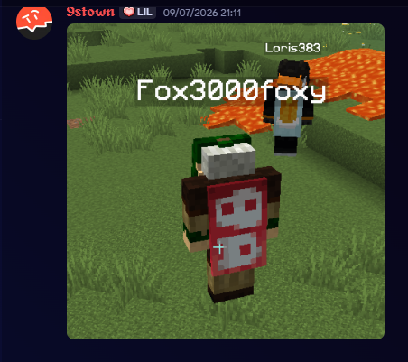
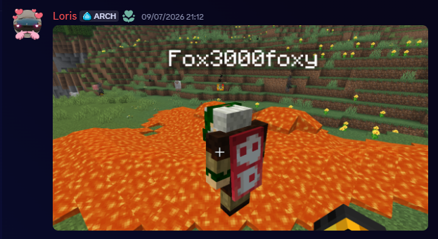
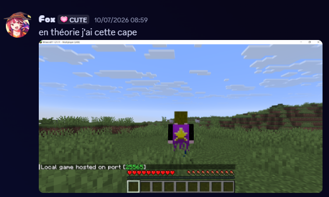
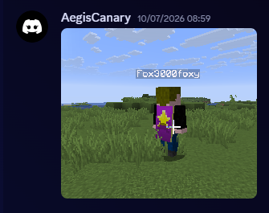

# Cape Mod: RSA imzası enjeksiyonuyla Jeb_'in pelerini nasıl çalınır


Sana arkadaşlarına resmi Mojang pelerini taktığına inandırmak için **yanlış hesap** için geçerli bir RSA imzasının yettiğini söylesem? Minecraftın imzaya güvenip onun gerçekten sana ait profile ait olduğunu doğrulamayı unuttuğunu gösteren bir Fabric exploit olan `cape-mod`a hoş geldin.

## Bağlam: Minecraft görünümleri ve pelerinleri nasıl yönetir

Java Editionda nadiren sorulan bir soru vardır: **bir oyuncunun görünümünü ve pelerinini göstermekten kim sorumludur: istemci mi sunucu mu?**

Yanıt inceliklidir:

| Bileşen | Kim gönderir? | Kim indirir? |
|---|---|---|
| **Görünüm dokusu** | Sunucu imzalı URL gönderir | İstemci `textures.minecraft.net` adresinden indirir |
| **Pelerin dokusu** | Sunucu imzalı URL gönderir | İstemci `textures.minecraft.net` adresinden indirir |
| **`textures` özelliği** | Sunucu Mojang kimlik doğrulamadan `GameProfile` gönderir | İstemci RSA imzasını doğrular |

Kilit nokta: her şey `GameProfile`ın `textures` adlı bir özelliğinde bulunur. Bu özellik şunları içerir:
- Dokuların URLleriyle base64 bir JSON yükü
- Mojangın özel anahtarıyla yapılmış bir **RSA imzası**

## RSA imzası duvarı

Her `textures` özelliği kodu çözülünce şuna benzer:

```json
{
  "timestamp": 1783666316269,
  "profileId": "d90b68bc81724329a047f1186dcd4336",
  "profileName": "akronman1",
  "signatureRequired": true,
  "textures": {
    "SKIN": {
      "url": "http://textures.minecraft.net/texture/3e6defcb7de5a0e05c75525c6cd46e4b9b416b92e0cf4baa1e0a9e212a887f3f7"
    },
    "CAPE": {
      "url": "http://textures.minecraft.net/texture/70efffaf86fe5bc089608d3cb297d3e276b9eb7a8f9f2fe6659c23a2d8b18edf"
    }
  }
}
```

İstemci RSA imzasını jara gömülü **açık anahtara** karşı doğrular (`yggdrasil_session_pubkey.der`):

```java
// Property.java (authlib)
public boolean isSignatureValid(PublicKey publicKey) {
    Signature sig = Signature.getInstance("SHA1withRSA");
    sig.initVerify(publicKey);
    sig.update(this.value.getBytes());
    return sig.verify(Base64.decodeBase64(this.signature));
}
```

Uzak oyuncular için (yerel oyun dışında) istemci yalnızca **güvenli** olarak işaretli görünümleri kabul eder: yani geçerli imzalı olanları:

```java
// SkinManager.createLookup() -- basitleştirilmiş
PlayerSkin skin = optional
    .filter(ps -> !isRemote || ps.secure())  // ← uzak oyuncular güvenli olmalı
    .orElse(defaultSkin);
```

Bu kontrol teoride sahteciliği engeller. Ama doğrulama burada durur ve saldırı tam olarak burada başlar.

## Açık: imza tekrarı

İstemci RSA imzasının **geçerli** olduğunu doğrular. JSON içindeki `profileId`nin oyuncunun gerçek UUIDsiyle eşleştiğini doğrulamayı sistematik olarak unutur.

Başka deyişle: mevcut bir **Mojang hesabından** (örneğin bir Mojang çalışanının hesabı) alınmış bir `textures` özelliği başka herhangi bir oyuncuda tekrar oynatılabilir. İmza geçerli kalır: gerçekten Mojang tarafından üretilmiştir, sadece başka bir hesaptan gelir.

### Gerçek bir imza nasıl çıkarılır?

Jeb_ (UUID `853c80ef-3c37-49fd-aa49-938b674adae6`) Mojang Studios pelerinine sahiptir. Mojang oturum sunucusundan:

```bash
curl -s "https://sessionserver.mojang.com/session/minecraft/profile/853c80ef-3c37-49fd-aa49-938b674adae6?unsigned=false"
```

Yanıt:

```json
{
  "id": "853c80ef-3c37-49fd-aa49-938b674adae6",
  "name": "jeb_",
  "properties": [
    {
      "name": "textures",
      "value": "ewogICJ0aW1lc3RhbXAiIDogMTc4MzYxOTcyNjAxMSwKICAicHJvZmlsZUlkIiA6ICI4NTNjODBl...",
      "signature": "RgIPF4d/iTDWJV..."
    }
  ]
}
```

Bu `value` alanının `signature` değeri Mojang tarafından üretilmiştir. RSA-2048 SHA-1dir. Başka bir UUID üzerinde tekrar oynatsan bile **kesinlikle** geçerlidir: çünkü Jeb_in imzası Jeb_in imzası olarak kalır ve istemci kime yönelik olduğunu kontrol etmeyi unutur.

## Kod: mod nasıl çalışır

`cape-mod` modu miniciktir: 65 satır Java. İşte özü:

```java
@Mixin(Player.class)
public class ServerPlayerMixin {
    private static final String TEXTURES_VALUE =
        "ewogICJ0aW1lc3RhbXAiIDogMTc4MzY2NjMxNjI2OSwKICAicHJvZmlsZUlkIiA6ICJkOTBi...";
    
    private static final String TEXTURES_SIGNATURE =
        "oxoAfZRLVNSfXYFMNbDKZ9XxrTHmz/k2yxzOxksXY3f6aDhY3gCyFCCtDreEWI7fpG9...";

    @Inject(method = "getGameProfile()Lcom/mojang/authlib/GameProfile;", 
            at = @At("RETURN"), cancellable = true)
    private void injectCape(CallbackInfoReturnable<GameProfile> cir) {
        Player self = (Player) (Object) this;
        if (!(self instanceof ServerPlayer serverPlayer)) return;
        MinecraftServer server = ((ServerPlayerAccessor) serverPlayer).getServer();
        if (!(server instanceof IntegratedServer)) return;

        GameProfile host = server.getSingleplayerProfile();
        GameProfile original = cir.getReturnValue();
        if (host == null || !host.name().equals(original.name())) return;

        // textures özelliğini Jeb_inkiyle değiştir
        ImmutableMultimap.Builder<String, Property> b = ImmutableMultimap.builder();
        for (Property p : original.properties().values()) {
            if (!p.name().equals("textures")) {
                b.put(p.name(), p);
            }
        }
        b.put("textures", new Property("textures", TEXTURES_VALUE, TEXTURES_SIGNATURE));
        cir.setReturnValue(new GameProfile(original.id(), original.name(), 
                                           new PropertyMap(b.build())));
    }
}
```

**Adımlar**:
1. `Player.getGameProfile()` üzerinde **Mixin**: oyuncu profilinin döndürüldüğü nokta
2. Yerel bir sunucu olduğunu doğrular (Integrated Server)
3. Host olduğunu doğrular (LAN dünyası)
4. `textures` özelliğini Jeb_inkiyle **değiştirir** (sabit kodlanmış)
5. Enjekte edilmiş dokularla yeni bir `GameProfile` döndürür

`GameProfile` bu yüzden **sahtedir**: gerçek oyuncuya karşılık gelmeyen yapay inşa edilmiş bir profildir. `textures` özellikleri Jeb_den **tekrar oynatılmıştır**: RSA imzası gerçektir ama yanlış profile uygulanmıştır. Ağ paketi ise meşrudur: sunucu değiştirilmiş profille `ClientboundPlayerInfoUpdatePacket`i normal gönderir. Sahte olan profildir; paket meşru kalır.

Hostun arkadaşları LAN üzerinden katıldığında değiştirilmiş profille `ClientboundPlayerInfoUpdatePacket` alırlar. İstemci:
1. base64 yükü çözer
2. RSA imzasını doğrular → ✅ geçerli (gerçekten Jeb_inki)
3. Görünümü `secure=true` olarak işaretler (imza geçerli olduğu için)
4. `!isRemote || ps.secure()` filtresinden geçer → ✅ geçer
5. Jeb_in pelerinini **indirip gösterir**

## Oyunda sonuç: görünümünde pelerin

İşte oyun içinde verdiği sonuç. Önce host üzerinde gösterilen Jeb_ peleriniyle önden görünüm:



Resmi Mojang Studios pelerininin kırmızı/beyaz deseni açıkça görülüyor. Render gerçek Jeb_in kendi pelerinini takmasıyla aynı kalır: istemci `textures.minecraft.net` adresinden tam aynı dokuyu indirir.

Ve sürükleyici görünümde, gerçek bir oyunda:



Pelerin oyuncunun arkasında dalgalanır, hareketle salınır. Resmi pelerinli gerçek bir görünümden mükemmel ayırt edilemez.

Başka bir açı, lavlı ve arazili bir dünyada:



Ve pelerini aksiyonda gördüğümüz klasik Minecraft oynanışına yakından son bir bakış:



Hostun bir mod kullandığını bilmeden bir LANa katılacak biri için pelerin görsel olarak gerçek bir Mojang peleriniyle aynı kalır. Nokta tam olarak budur: **imza geçerlidir**, istemci onu meşru sayar.

## Neden bir açıktır (ve neden değildir)

İroniktir: exploit **tam olarak imza geçerli olduğu için** çalışır. Kriptografik bir bypass söz konusu değildir: daha kötüdür, güven modelinde **mantıksal bir açık**.

| Kontrol | Sonuç |
|---|---|
| **RSA imzasının geçerliliği** | ✅ Geçerli (Mojang tarafından Jeb_ için imzalı) |
| **Yükteki `profileId` hostun UUIDsiyle eşleşiyor mu?** | ❌ Hayır (Jeb_in UUIDsi ≠ hostun UUIDsi) |
| **İstemci eşleşmeyi doğruluyor mu?** | ❌ **Hayır. Yalnızca RSA imzası doğrulanır.** |

Minecraft onu taşıyanın kimliğinden çok **imzaya** güvenir. İmza Mojangdan geldiği sürece istemci kabul eder. Bu devletçe mühürlü sahte bir pasaport göstermek gibidir: ait olmasa bile mühür meşrudur.

## Güvenlik etkileri

### Kapsam LAN ile sınırlı

Mod yalnızca entegre bir sunucuda (LAN) çalışır. Saldırgan şunları yapmalıdır:
- Kurulu bir Fabric moduna sahip olmak
- Bir LAN dünyasının hostu olmak
- Arkadaşları modsuz (vanilla) bağlanır

### Ama olasılıklar genişler

Teoride aynı teknikle şunlar yapılabilir:
- **Diğer imzalı verileri yeniden enjekte etmek**: kafalar, yasa dışı büyüler, kötü niyetli sohbet bileşenleri
- İnternetteki oyuncuları etkilemek için bir LAN tüneliyle (NGROK, playit.gg, Radmin VPN) **birleştirmek**
- İmzaya bağlı profilin diğer özelliklerine **genişletmek**

### Mojang muhtemelen yamalamayacak, neden

Katın anlamıyla bir "güvenlik açığı" söz konusu değildir: imza geçerlidir. Bunu yamalamak Mojangın tüm kimlik doğrulama modelini değiştirmesini gerektirir ki bu karmaşıktır. Şimdilik bu bir sınır durumudur: LAN oyuncularının birbirine güvendiği varsayılır.

## Felsefi tuzak

Cape Mod daha geniş bir gerçeğin mükemmel bir **kavram kanıtıdır**: **bir veriye güvenmeden önce onu kimin imzaladığını ve hangi konu için olduğunu hep doğrulamalısın**.

Bu temel bir kriptografi dersidir. RSA bir **mesajı** imzalar; alıcının **kimliği** imzanın dışında kalır. Sana Mojangdan geçerli bir RSA imzası verirsem, yalnızca Mojangın *bir şeyi* imzaladığını bilirsin, yalnızca mesaja bakarak alıcı hakkında güvenilir belirti olmadan.

2000lerde CAlar alanı doğru doğrulamadan sertifika imzaladığında SSL/TLS sertifikalarında tam olarak olan buydu: imza geçerliydi ama yanlış alana uygulanıyordu.

## Sonuç

Cape Mod klasik anlamda bir hackten başka şeydir: Minecrafttaki mantıksal doğrulama eksikliğinin zarif bir suistimalidir. Şunu gösterir:

1. **Geçerli bir imza onu taşıyanın kimliğini garanti etmez**
2. **LANda güven** sanılandan daha zayıftır
3. Minecraftın `textures` özellikleri esasen enjekte edilmiş içeriktir: onları taşıyan oyuncuya karşılık geldikleri doğrulanmalıdır

"bilinmeyen" bir LAN dünyasına katılırsan (daha doğrusu hostunda şüpheli bir mod olan) pelerinden çok önce bir güvenlik sorunun vardır. Ama açıklayıcıdır: Minecraft LANdaki herkesin birbirine güvendiğini varsayar. Bu doğrudur... bu güveni suistimal eden ilk hosta kadar.

---

**Kaynaklar**

- **GitHub**: [fox3000foxy/cape-mod](https://github.com/fox3000foxy/cape-mod)
- **Minecraft auth**: [Yggdrasil protocol](https://wiki.vg/Authentication) (wiki.vg)
- **RSA kriptografi**: [RFC 3447](https://tools.ietf.org/html/rfc3447) (PKCS #1)

**3 kilit nokta**

1. RSA imzaları kimlikten çok bir mesajı doğrular: birçok sisteme pahalıya mal olmuş bir detay.
2. Minecraft oyuncu profilinin aldığı imzayla eşleştiğini doğrulamayı unutur: kriptografisi bozulmamış, doğrulamada mantıksal bir açık.
3. LANda ya da tünelde entegre sunucuyu kontrol eden bir mod için her şey serbesttir.
