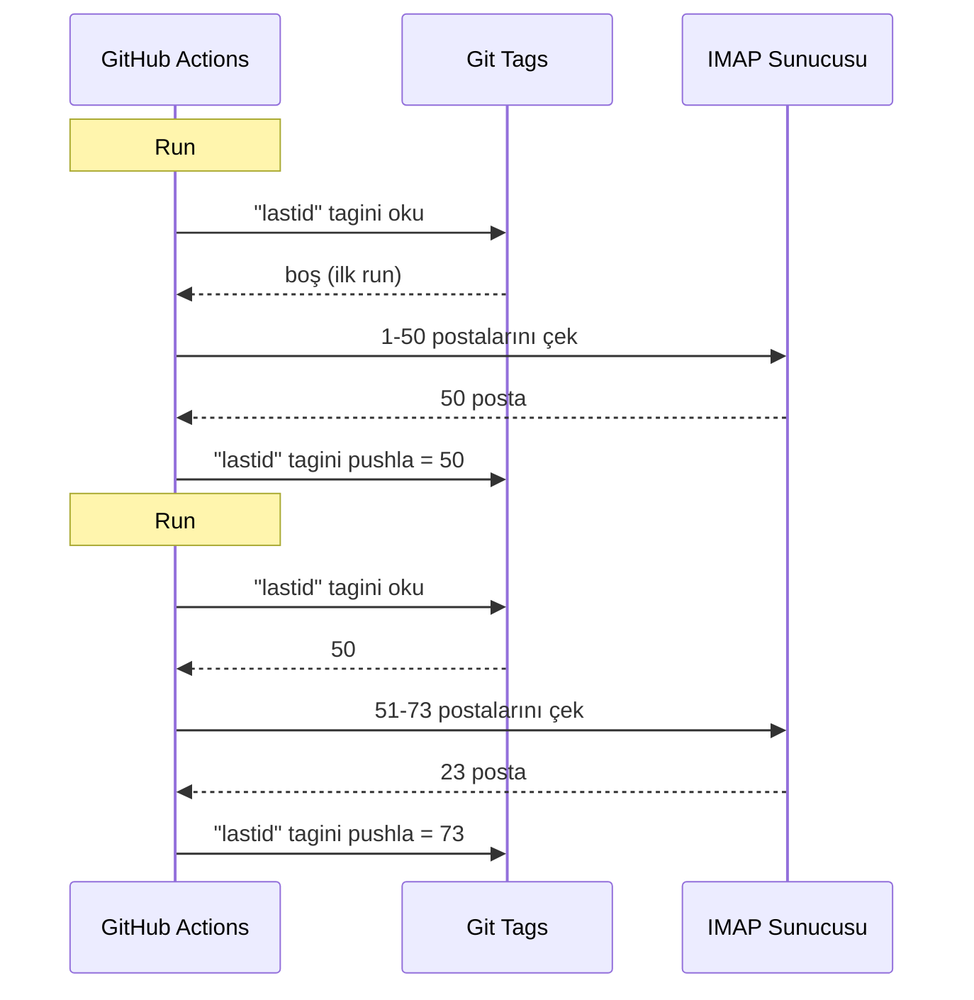

# GitHub Actions üzerinde bedava bot çalıştırmak için giti veritabanı olarak kullandım

7/24 çalışan otomatik bir e-posta yanıtlayıcım var.

Postalarımı okur, ne hakkında olduğunu anlar ve bir yapay zekâyla kendi kendine yanıtlar. Önceki konuşmaları hatırlar. Bültenleri ve `noreply@` adreslerini görmezden gelir. İş çok kızışınca bir insana iletir.

Aylık maliyet: **0 €**.

Sunucusuz, VPSsiz ve veritabanısız idare ediyorum. Sadece GitHub Actions ve hasta bir hack: **giti veritabanı olarak kullanmak**.

Nereye varmak istediğimi görüyor musun? Hayır mı? Tamam, sıkı tutun, hem aptalca hem harika.

---

## Sorun: GitHub Actions stateless çalışır

GitHub Actions bedava. Her 5 dakikada bir cron çalıştırıp kodunu döndürebilirsin, bedava.

Ama bir sorun var: **stateless**.

Her run tertemiz bir makinede başlar. İki çalıştırma arasında hiçbir şey kaydedilmez. Önceki run mı? Unutuldu. Silindi. Hiç var olmamış gibi.

Bir e-posta yanıtlayıcı için bu devasa bir sorun. Şöyle bir şey:

> "Zaten işlediğim son posta hangisiydi?"

Bot bunu her run unutursa ya aynı postalara döngüde tekrar yanıt verir (felaket) ya da postaları kaçırır.

Kalıcı duruma ihtiyaç var. Ve normalde kalıcı durum = veritabanı. Ama veritabanı bir sunucudur ve sunucu artık bedava değildir.

İşin ilginçleştiği yer burası.

---

## Çözüm: veritabanı olarak git tagleri

GitHub depon zaten kalıcı depolamadır. Bedava. Sürümlü. Hep orada.

O zaman durumu neden orada saklamayalım?

Fikir: her run bot işlenmiş son e-posta UIDini bir **git taginden** okur. Yeni postaları işler. Sonra tagi yeni UID ile tekrar pushlar.



Git tagi veritabanının TA kendisidir. Tek bir değer ama ihtiyacımız olan her şey bu.

### Durumu okumak

İşin başında değer tagden alınır:

```bash
git fetch origin --tags lastid || true
git show refs/tags/lastid:data/lastId > data/lastId || true
```

`git show refs/tags/lastid:data/lastId` şu demektir: "bana `lastid` tagindeki haliyle `data/lastId` dosyasının içeriğini ver".

Bum. Veritabanısız değerin elinde.

### Durumu yazmak

Sonda tag yeni değerle yeniden oluşturulur:

```bash
git switch --orphan lastid-tmp   # tarihsiz tertemiz dal
git rm -rf .                      # her şeyi boşalt
mkdir -p data
printf "%s\n" "${LAST_ID_CONTENT}" > data/lastId

git add data/lastId
git commit -m "lastId snapshot"
git tag -f lastid                 # tagi bu commite zorla
git push --force ...origin lastid # tagi pushla
```

**Öksüz** bir dal oluşturuyoruz (tarihsiz), sadece `lastId` dosyasını koyuyoruz, commitliyoruz, tagliyoruz, force pushluyoruz.

Neden öksüz? Deponun tarihçesinde 10.000 durum commiti biriktirmemek için. Her güncelleme öncekinin üzerine yazar. Tag her zaman TEK değer içeren TEK bir commiti gösterir.

Temiz. Bedava. Tamamen çarpık ve çalışıyor.

---

## İkinci hack: runtime anlık görüntüsü

GitHub Actions ile başka bir sorun var: `npm install`.

Her run (5 dakikada bir) `npm install` + `npm run build` yaparsan her seferinde 60-90 saniye harcarsın. Sık bir cronda bu hiç yoktan harcanmış işlem dakikalarıdır.

Çözüm: kodu BİR kez önceden derleyip onu da bir git taginde saklamak.

Derleme workflowu (`master` üzerine pushlayınca çalışan) şunu yapar:

```bash
# kodu derle
bun install
bun run build

# dist/ + node_modules/ içeriğini "runtime" taginde sakla
git checkout --orphan temp-runtime
git rm -rf .
cp -r "$TMPDIR"/* .
git add dist node_modules package.json bun.lock data
git commit -m "runtime build"
git tag -f runtime
git push --force ...origin runtime
```

`runtime` tagi derlenmiş kodu VE `node_modules` içeriğini taşır. Çalışmaya tamamen hazır.

Ve cron doğrudan bu tagi checkout eder:

```yaml
- name: Checkout runtime snapshot
  uses: actions/checkout@v4
  with:
    ref: refs/tags/runtime    # önceden derlenmiş kod, kaynak değil
    fetch-depth: 1

# npm install yok, derleme yok!
- name: Process emails
  run: node dist/index.js --action
```

Cron anında başlar ve kurulum ya da derleme olmadan sadece `node dist/index.js` çalıştırır.

Yani iki tag iki iş yapar:
- `runtime` = çalışmaya hazır kod (kod pushlayınca güncellenir)
- `lastid` = kalıcı durum (her run güncellenir)

Pisliğine zarif.

---

## Botun kendisi: yapay zekâlı otomatik yanıtlayıcı

Tamam, git hacki havalı ama bot tam olarak ne yapıyor?

Postalarını IMAP üzerinden okur, bir yapay zekâyla anlar (Groq + Llama 3.3 70B) ve otomatik yanıtlar.

Bağımlılık enjeksiyonlu temiz servislerle mimari (InversifyJS):

```
App
├── ImapService      → postaları okur (IMAP)
├── SmtpService      → yanıtları gönderir (SMTP)
├── ParserService    → posta içeriğini ayrıştırır
├── ReplyService     → yapay zekâ yanıtı üretir
├── SummaryService   → konuşma belleği
├── AccountsService  → birden çok e-posta hesabını yönetir
└── ConfigService    → yapılandırma / ortam değişkenleri
```

### İki çalışma modu

Bot iki şekilde dönebilir:

**Dinleyici modu** (gerçek zamanlı): üstel yeniden bağlanmalı kalıcı IMAP bağlantısı. VPS için.

```typescript
this.imapService.on("exists", async (data) => {
  console.log(`[MAIL] Yeni posta! Toplam: ${data.count}`);
  // yeni postayı hemen işle
});
```

**Aksiyon modu** (toplu): `lastId` sonrasındaki yeni postaları işler, sonra kapanır. GitHub Actions cronu için.

```bash
node dist/index.js --action
```

`--action` modu git hackini kullanan moddur. `lastId` okur, yeni olanı işler, yeni `lastId` yazar, biter.

### Robotlara yanıt VERME

Botun TÜM postalara yanıt verirse bültenlere, bildirimlere, `noreply@` adreslerine yanıt verir. Felaket. Daha kötüsü: iki bot birbirine yanıt verirse sonsuz bir posta döngün olur. Kâbus.

O yüzden agresif filtreleme:

```typescript
export function isAutomatedSender(address) {
  const automatedPatterns = [
    "noreply", "no-reply", "donotreply",
    "mailer-daemon", "postmaster", "bounce",
    "newsletter", "notification", "marketing",
    "billing", "receipt", "promo", ...
  ];
  const local = address.split("@")[0].toLowerCase();
  return automatedPatterns.some(p => local.includes(p));
}
```

Ve e-posta başlıkları üzerinden tespit de var:

```typescript
export function isAutomatedByHeaders(headers) {
  return (
    ["bulk", "list", "junk"].includes(headers.precedence) ||
    headers["auto-submitted"] !== "no" ||
    headers["list-unsubscribe"] !== "" ||   // bültenlerde bu vardır
    /mailchimp|sendgrid|mailgun|brevo/i.test(headers["x-mailer"])
  );
}
```

Başlıklarda `List-Unsubscribe` mi var? O bir bültendir. `Precedence: bulk` mı? Toplu postadır. `X-Mailer: Mailchimp` mi? Anladın. Görmezden geliyoruz.

Gece kulübü fedaisi gibi: robotlar geçemez.

### Sihirli tetikleyiciler

Yapay zekâ hiç yanıt vermemeye ya da işi bir insana bırakmaya karar verebilir. Nasıl? Yanıtındaki özel tetikleyicilerle.

Sistem istemi ona şunu söyler:

> Otomatik posta/bültense → `<no_reply>` yanıtla
> Çok önemli/hassassa (hukuki, finansal...) → `<manual_reply_required>` yanıtla
> Yoksa → gerçek bir yanıt yaz

Ve kod bunu okur:

```typescript
const aiReply = completion.choices[0].message.content.trim();
const manualTrigger = aiReply.includes(MANUAL_REPLY_TRIGGER);
const noReply = aiReply.includes(NO_REPLY_TRIGGER);

if (noReply) {
  console.log("[MAIL] Yapay zekâ görmezden gelmeye karar verdi. Atla.");
  return;
}

if (manualTrigger) {
  console.log("[MAIL] Çok sıcak, bir insana iletiyorum.");
  await this.smtpService.sendManualForward(...);
  return;
}

// yoksa yapay zekâ yanıtını gönder
await this.smtpService.sendReply(...);
```

Yani yapay zekânın "yok buna dokunmuyorum, gerçek bir insan çağır" deme hakkı var. Bu bilgelik.

---

## Konuşma belleği

Her şeyi değiştiren bir detay: bot konuşmaları **hatırlar**.

Birine yanıt verdiğinde alışverişin bir özetini kaydeder. Bu kişi bir dahaki sefere yazdığında özet isteme geri enjekte edilir.

Depolama: kişi başına bir JSON dosyası.

```
data/customers/
├── moi%40gmail.com/
│   ├── alice%40example.com.json
│   └── bob%40client.fr.json
```

Ve özetin kendisi de eski özeti yeni mesajla birleştiren yapay zekâ tarafından üretilir:

```typescript
const completion = await groq.chat.completions.create({
  model: "llama-3.3-70b-versatile",
  messages: [
    { role: "system", content: "Tu es un assistant de mémoire. Merge l'ancien résumé avec le nouveau message sans perdre d'info." },
    { role: "user", content: `Résumé existant:\n${existing}\n\nNouveau message:\n${incomingContent}` }
  ],
  temperature: 0.0,  // deterministik, yaratıcılık yok
  max_tokens: 800,
});
```

Yani bot zamanla sıkıştırılmış bir bellek inşa eder. Tüm postaları saklamadan akıllıca büyüyen bir özet yeter.

Ve bu JSON dosyaları mı? Onlar da gitte saklanır, runtime taginde. Her yerde git.

---

## İstemin uzunluğundaki kurnaz nokta

Beni gülümseten küçük bir teknik detay.

Modellerin bir jeton limiti vardır. Postan + özet + persona istemi aşarsa API bir hata döndürür.

Kod bunu **basamaklı kırpma** + yeniden deneme ile yönetir:

```typescript
try {
  // normal limitlerle ilk deneme
  completion = await groq.chat.completions.create({...});
} catch (error) {
  if (!this.isLengthError(error)) throw error;

  // uzunluk hatasıydı: daha sıkı limitlerle yeniden dene
  ({ systemContent, userContent } = this.buildPromptPayload({
    ...,
    limits: {
      systemPromptChars: 2200,  // 3000 yerine
      summaryChars: 1800,       // 4000 yerine
      personaChars: 900,        // 1500 yerine
      userContentChars: 2200,   // 8000 yerine
    },
  }));
  completion = await groq.chat.completions.create({...});  // yeniden deneme
}
```

Geçmezse daha kısa kesip yeniden deniyoruz. Basit, etkili, çökme yok.

---

## Peki somut olarak nasıl dönüyor?

Bir cron runının tam akışı:

```
1. GitHub Actions tetiklenir (5 dakikada bir cron)
2. "runtime" taginin checkoutu (önceden derlenmiş kod)
3. git show refs/tags/lastid → işlenmiş son UIDyi alır
4. node dist/index.js --action
    ├── IMAP bağlantısı
    ├── lastId+1 sonrasındaki postaları çek
    ├── her posta için:
    │   ├── içeriği ayrıştır
    │   ├── robotları filtrele (otomatikse atla)
    │   ├── alıcı hesabı eşleştir
    │   ├── konuşma belleğini al
    │   ├── yapay zekâ yanıtını üret (Groq)
    │   ├── <no_reply> mi? atla
    │   ├── <manual_reply_required> mi? insana ilet
    │   ├── yoksa: yanıtı gönder (SMTP)
    │   └── konuşma belleğini güncelle
    └── yeni lastId yazar
5. yeni değerle "lastid" taginin git push --force ile pushu
```

Ve 5 dakika sonra yeniden başlar. Sonsuza dek. Bedava.

---

**Akılda tutulacak 3 nokta:**

1. **Git = bedava veritabanı**: Öksüz bir tag, stateless iki run arasında kalıcı durumunu saklayabilir. Okumak için `git show refs/tags/X:dosya`, yazmak için force-push. Tam bir veritabanından tasarruf edersin.

2. **Runtime taginde ön derleme**: Cronun her runında `npm install` yerine derlenmiş kodu + node_modules içeriğini bir git taginde sakla. Cron anında başlar.

3. **Yapay zekâlı bir bot susmayı bilmeli**: `<no_reply>` ve `<manual_reply_required>` tetikleyicileri yapay zekânın yanıt vermemesine ya da işi bırakmasına izin verir. Anti-robot filtrelemeyle birlikte. Yoksa sonsuz bir posta döngüsü yaratırsın.

Kalıcı durumlu sunucusuz cron, yapay zekâ, bellek, hepsi 0 €/ay. Tamamen kırık ve bu düzeneğe bayılıyorum.
