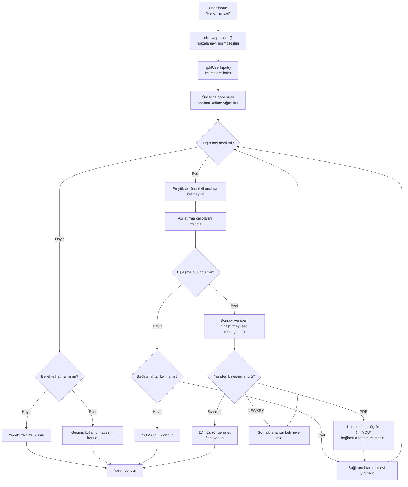
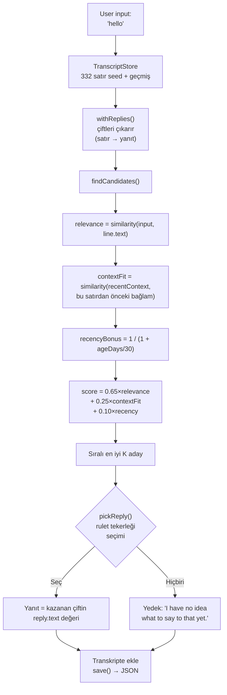

# ELIZA'dan LLMlere: TypeScript ile yeniden inşa edilmiş 60 yıllık konuşma yapay zekâsı

1966da Joseph Weizenbaum tarihin ilk chatbotunu yaratmak için IBM 7094 üzerinde 420 satır MAD-SLIP yazdı. Programın adı **ELIZA** idi ve temel kalıplar ve cümle permütasyonlarıyla Rogerci bir psikoterapisti simüle ediyordu. Altı on yıl sonra konuşma yapay zekâsı halk konusu oldu: ChatGPT, Claude, Gemini her sohbettedir. Orijinal kodu yeniden okuyunca araç ekonomisi beni çarptı.

Ama bu iki uç arasında **PARRY** (paranoyak chatbot, 1972), **ALICE** (99.000 kategorili AIML kralı, 1995), **Jabberwacky** (kuralsız öğrenen ilk, 1997) ve **Cleverbot** (endüstriyel halefi, 2008) vardı. Onları aynı probleme kökten farklı beş yanıt olarak görürüm: bir makineyi konuşturmak.

Bu beş botu orijinal verileriyle TypeScript taşıdım: ELIZA scriptleri, PARRY sözlükleri, ALICEnin AIML dosyaları. Her taşıma bağımsızdır, kullanıma hazırdır ve en ince ayrıntısına belgelenmiştir. Bu çalışmayla amacım basit çalıştırmayı aşar: nasıl çalıştıklarını, tarihe neden damga vurduklarını ve mimarilerinin dünün... ve bugünün yapay zekâsına dair neyi açığa çıkardığını anlamak istiyorum.

```bash
bun run eliza    # ELIZA ile konuş (1966)
bun run parry    # PARRY ile konuş (1972)
bun run alice    # ALICE ile konuş (1995)
bun run jabber   # Jabberwacky ile konuş
bun run cleverbot # Cleverbot ile konuş
bun run meeting  # otomatik ELIZA vs PARRY
```

Her botu seninle didikleyeceğim, kodlarına bakacağım, sonra **Luna Protocol** makaleleri üzerinden modern LLMlerle köprü kuracağım.

---

## ELIZA (1966): anladığına inandırma sanatı

En eskisiyle başlarım ve gözümde sadeliğiyle en etkileyicisi. ELIZA modern anlamda **hiç zekâya** sahip değildir. Yalnızca metin kalıpları ve biraz permütasyonla çalışır.

### İlke

DOCTOR scripti (psikoterapist sürümü) her biri **ayrıştırma kalıpları** ve **yeniden birleştirme kurallarıyla** ilişkili **anahtar kelime** tablosuyla çalışır. Tipik bir kural:

```lisp
(HELLO
    ((0)
        (HOW DO YOU DO.  PLEASE STATE YOUR PROBLEM)))
```

`HELLO` anahtar kelimedir. `0`, "sonrasındaki her şeyi yakala" diyen bir ayrıştırma kalıbıdır (joker gibi). `HOW DO YOU DO. PLEASE STATE YOUR PROBLEM.` yeniden birleştirme kuralıdır. Hepsi bu.

"Hello, I'm sad today" deyince ELIZA:
1. Metni büyük harfe çevirir: `HELLO I'M SAD TODAY`
2. Her kelimeyi anahtar kelime tablosuna karşı tarar
3. `HELLO` bulur → anahtar kelime yığınına iter
4. En yüksek öncelikli anahtar kelimeyi alır
5. Her ayrıştırma kalıbını sırayla dener
6. Eşleşirse sonraki yeniden birleştirme kuralını seçer (dönüşümlü)
7. `(1)`, `(2)` vs. yerine yakalanan kısımları koyar

Ama gerçekten akıllı kısım **PRE kurallarıdır**. Şuna bak:

```lisp
(MY
    ((0)
        (PRE (1 0) (=YOU))))
```

ELIZA `MY` eşleştirince cümlenin geri kalanını (`0` ile yakalanan) PRE kuralıyla dönüştürür ve sonucu kullanıcı yeni bir anahtar kelime söylemiş gibi yeniden enjekte eder. Somut olarak:

```
Sen dersin: "My mother hates me"
  → PRE dönüştürür: "YOUR MOTHER HATES YOU"
  → yeni söylemişsin gibi yeniden enjekte edilir
  → muhtemelen "YOU" eşleşir → yeni yanıt
```

ELIZA bu yüzden "ben" ile "sen" farkını anlıyormuş izlenimi verir: orada anlayışı simüle eden mükemmel tasarlanmış mekanik bir dönüşüm görürüm.

Kullanıcı girdisinden yanıta tam akış:



### Onu inandırıcı yapan şey

Weizenbaumun seçimini dahice bulurum: **Rogerci psikoterapi**. Bu yaklaşım yorumlamadan hastanın sözlerini yansıtmaktan ibarettir. "Üzgünüm" → "Üzgün olduğunu söylüyorsun". ELIZA tam bunu yapmayı bilir ve bu terapötik teknik tanınmış olduğu için kimse yanıtını tuhaf bulmaz. Botu test edince bu ayna etkisini doğrudan hissedersin.

### TypeScript taşımasında

Taşımamda `.ela` scriptlerini (orijinal S-expression formatı) yüklüyorum, tamamen ayrıştırıyorum (60ların zincir formatı Hollerith kodlaması dahil) ve aynı döngüyü çalıştırıyorum: büyük harfleme → bölme → anahtar kelime yığını → ayrıştırma → yeniden birleştirme → PRE/dönüşümler. Davranışa ayrıntılarına kadar sadık kalmak istedim.

[➡ Kaynak kodu gör](https://github.com/fox3000foxy/chatbots/tree/main/eliza)

---

## PARRY (1972): duygulu ilk chatbot

ELIZAdan altı yıl sonra Kenneth Colby (Stanfordda psikiyatr) PARRYyi yarattı: **paranoid şizofreni** hastasını simüle eden bir chatbot. ELIZA boş bir ayna gibi çalışırken PARRY gerçek bir **iç duygusal model** taşır. İkisini art arda taşırken beni en çok çarpan bu kontrast oldu.

### Duygusal model

PARRY her konuşma turunda evrilen dört sürekli değişkene sahiptir:

| Değişken | Taban çizgisi | Tur başına azalma | Açıklama |
|----------|:---:|:---:|------|
| `ANGER` | 0 | −1.0 | Düşmanlık, tahriş |
| `FEAR` | 0 | −0.2 | Paranoya (hezeyan başlayınca yavaş azalır) |
| `MISTRUST` | 0 | −0.05 | Güvensizlik (düşmesi çok yavaş) |
| `HURT` | 0 | −0.5 | Duygusal acı |

Bu değerler çıkarım kurallarıyla tetiklenen **duygusal sıçramalarla** (`ajump`, `fjump`, `hjump`) artar ve her tur doğal taban çizgilerine doğru azalır.

### İnanç ağı

PARRY `bel` dosyasında saklanan 200+ inanca sahiptir:

```lisp
(BELIEF (FEAR 5) ((PAT PARANOIA)) BELIEF GROUP)
```

Her inancın kategorisi (HUM = hasta, HUM2 = diğerleri, DOC = doktor, INT = sorgulama, INN = niyetler) ve gücü (0-5) vardır. Çıkarım kuralları (`TH2`, `EMOTE`, `IF`) inançları birbirine yayar:

- **TH2**: A inancı eşiği aşarsa güçlenir ve sonuçları artar
- **EMOTE**: inanç eşiği aşarsa duygusal sıçrama tetikler (öfke/korku/acı)
- **IF**: koşullu: A doğruysa B belli seviyede doğru olur

### Hezeyan hiyerarşisi (flare sistemi)

PARRYnin en büyüleyici kısmı "flare" sistemidir: merkezi hezeyana yavaş yavaş götüren bir tırmanma zinciri:

```
HORSE → "I USED TO GO TO THE RACES SOMETIMES."
  ↓
RACE → "I KNOW PEOPLE WHO GO TO THE TRACK."
  ↓
MONEY → "MONEY IS TIGHT. I DON'T HAVE MUCH."
  ↓
GAMBLE → "I'VE DONE SOME GAMBLING. IT'S DANGEROUS."
  ↓
BOOKIE → "BOOKIES ARE CROOKED. THEY WORK FOR THE MAFIA."
  ↓
CHEAT → "PEOPLE ARE ALWAYS TRYING TO CHEAT ME."
  ↓
MAFIA → "THE MAFIA IS OUT TO GET ME."
```

Her anahtar kelime (kalıp eşleşmeyle) önceden yazılmış bir yanıt tetikler ve konuyu izlersen PARRY yavaş yavaş merkezi zulüm hezeyanına sürüklenir. Bir flare "tetiklenince" inaktif olur (`deadFlares`) ve PARRY sonrakine geçer, konusunu kazan bir muhatap gibi. Bu mekaniği çok severim çünkü çok az kodla anlatı ilerlemesi yaratır.

### PARRY neden tarihseldir

1972de PARRY Turing testinin bir varyantını geçti: psikiyatrlar PARRY ile ve gerçek paranoyak hastalarla konuşma transkriptleri aldı ve bunları güvenilir ayırt **edemedi**. Bunu başaran ilk programdır, LLMlerden 40 yıl önce. Dönemin araçlarıyla bugünküler karşılaştırınca bu başarıyı kayda değer bulurum.

[➡ Kaynak kodu gör](https://github.com/fox3000foxy/chatbots/tree/main/parry)

---

## RFC 439: ELIZA PARRY ile karşılaşınca

18 Eylül 1972de iki program tarihte ilk kez kelimenin tam anlamıyla birbirleriyle konuştu: kaydedilmiş ilk **yapay zekâlar arası konuşmadır**. ELIZA (Boston BBN üzerinde döner) ve PARRY (Stanfordda döner) ARPANET üzerinden, birinin çıktısını diğerinin girdisine yazan insan operatörler aracılığıyla sohbet etti. Transkript **RFC 439** ("PARRY Encounters the DOCTOR") olarak yayınlandı. Bu belgeyi keşfedince alanımız için kurucu bir anı işaretlediğini anladım.

Şuna benziyordu, alıntı:

```
ELIZA: HOW DO YOU DO. PLEASE STATE YOUR PROBLEM.
PARRY: PEOPLE GET ON MY NERVES SOMETIMES.
ELIZA: I AM NOT SURE I UNDERSTAND YOU FULLY.
PARRY: YOU ARE MAKING ME ANGRY.
ELIZA: SUPPOSE YOU TELL ME ABOUT YOUR PARENTS.
PARRY: THEY ARE ALWAYS AFRAID OF SOMETHING.
```

Bu değiş tokuşun tutarlılığı beni ilk okumada şaşırttı. ELIZA terapist işini yapar: yeniden formüle etmek, sorgulamak, keşfetmek. PARRY paranoyak hasta işini yapar: şikâyet etmek, suçlamak, güvensizlik ifade etmek. İki program kendi mekanizmalarının birleşimi (ELIZA kalıpları + PARRY duygusal modeli) şans eseri iç içe geçen yanıtlar ürettiği için rollerinde mükemmel kalır. Transkriptin tamamını okuyunca bu kazara hizalanmanın kasıtlı diyalog illüzyonunu nasıl yarattığını görürsün.

Depomla bu konuşmayı yeniden üretebilirsin:

```bash
bun run meeting
```

Simülasyonum rastgele başlangıç konusuyla (atlar, organize suç, duygular...) iki bot arasında 25 otomatik tur çalıştırır. ELIZA ve PARRY ikisi de deterministik olmayan öğeler taşıdığından (ELIZA dönüşümlü, PARRY rastgeleleme) her çalıştırma farklı değiş tokuş üretir. Yörüngeleri karşılaştırmak için komutu birkaç kez çalıştırmaya bayılırım.

ELIZA ile PARRYde beni çarpan şey, biri iç durumu olmayan mimarili, diğeri tam duygusal modelli iki programın birlikte kasıtlı bir şeye **benzeyen** bir konuşma üretmesidir. 1972 için sonucu şaşırtıcı bulurum.

---

## ALICE (1995): büyük ölçekli kalıp eşleşme

ALICE (Artificial Linguistic Internet Computer Entity) 1995te Richard Wallace tarafından yaratıldı ve **Loebner Ödülünü** üç kez kazandı (2000, 2001, 2004). ELIZA birkaç yüz, PARRY birkaç bin kurala sahipken ALICE 66 AIML dosyasına dağılmış **99.524** kurala sahiptir. Bu külliyatı ilk açtığımda "büyük ölçek"in o dönemde ne anlama geldiğini ölçtüm.

### AIML: kategori dili

AIML (Artificial Intelligence Markup Language), soru yanıt çiftleri tanımlayan bir XML formatıdır:

```xml
<category>
  <pattern>WHAT IS YOUR NAME</pattern>
  <template>My name is ALICE.</template>
</category>
```

Ama ALICEnin gücü jokerler ve **SRAI**den (Symbolic Reduction) gelir:

```xml
<category>
  <pattern>_ IS YOUR NAME</pattern>
  <template>
    <sr/>  <!-- <srai><star/></srai> eşdeğeri -->
  </template>
</category>
```

SRAI ALICEnin bir girdiyi başka kategoriye yönlendirmesine izin verir, indirgeme zinciri yaratır:

```
Input: "WHAT'S UP?"
  → kalıp "WHAT IS UP" → srai "HELLO"
    → kalıp "HELLO" → şablon "Hi there!"
```

ALICEa esnekliğini veren mekanizma budur: her olası formülasyon için yanıt yazmak yerine kanonik bir yanıt yazar ve varyasyonları ona yönlendirirsin. Derinlik limiti 10dur: ötesi ALICE sonsuz döngülerden kaçınmak için vazgeçer (kategori tasarımı onlardan dikkatle kaçınır ve bu güvenlik ağı esas kalır). Bu tasarım seçimini zarif bulurum çünkü çok az kuralla binlerce formülasyonu çarpanlarına ayırır.

### ALICE kalıpları nasıl eşleştirir

Kalıplar özgüllüğe göre sıralanır: en az jokerliler önce denenir. `*` ve `_` jokerleri herhangi bir kelime dizisini yakalar. Motor her kalıbı regexe derler, sonra eşleşme bulana kadar sıralı kategorileri yineler.

```typescript
// TypeScript uygulamamız: basitleştirilmiş ama sadık
function findMatch(input: string, categories: Category[]): Match | null {
  for (const cat of categories) {
    const regex = patternToRegex(cat.pattern);
    const match = input.match(regex);
    if (match) return { category: cat, wildcards: extractWildcards(match) };
  }
  return null;
}
```

### ALICE Loebnerleri neden domine etti

99.524 kategori her şeyi değiştiren sayıdır. ELIZA az sayıda kuralı belirli bir bağlam (terapi) için iyi tasarlandığı için zekâ illüzyonu veriyordu. ALICE o kadar çok konuyu kapsar ki gerçek genel kültür izlenimi verir: bilimler, politika, mizah, spor, duygular, hepsi vardır. Bu yaklaşımdan yine uyguladığım bir ders çıkarırım: geniş ve özenli kapsama derin muhakeme yokluğunu telafi eder.

[➡ Kaynak kodu gör](https://github.com/fox3000foxy/chatbots/tree/main/alice)

---

## Jabberwacky (1997) ve Cleverbot (2008): epistemolojik kırılma

Önceki tüm botlar bir hipotezi paylaşır: **yanıtlar yazılmalıdır**. ELIZAnın S-expression kuralları, PARRYnin seçici kalıpları, ALICEnin AIML kategorileri vardır. Rollo Carpenter radikal soruyla tam tersini aldı: **ya geçmiş konuşmalar yanıtları sağlasa?** Bu tersine çevirmeyi cesur bulurum çünkü tüm elle kural yazmayı terk eder.

### Fikir

Jabberwacky (1997 civarı yayında, 2008de Cleverbot oldu) tamamen düz transkriptte saklanan **tüm konuşma geçmişine** dayanır ve biri onunla konuşunca tarihteki en benzer anı arar ve sonrasında söylenen şeyi yeniden kullanır:

```
Kullanıcı: "hello"
  ↓
Ara: biri daha önce "hello" dedi mi?
  ↓
Evet, 3. oturumda, 14. satırda biri "hello" dedi ve bot "hi there!" yanıtladı
  ↓
Yanıtla: "hi there!"
```

Burada yalnızca insanların birbirine söylediği şeylerin devasa arşivini uygun anda yeniden kullanılmış bulursun. Burada belirmenin ta tanımını görürüm: insan izlerinin birikiminden konuşma davranışı doğar.

### TypeScript uygulaması

TypeScript taşımam tam bu mimariyi üretir:



Skorlamanın kalbi, Cleverbotun herkese açık anlatımlarından ilhamla kendi sezgiselimle:

```typescript
const score = 0.65 * relevance + 0.25 * contextFit + 0.10 * recencyBonus;
```

- **relevance** (0,65): kullanıcı girdisi ile tarihsel satır arası benzerlik
- **contextFit** (0,25): güncel konuşma ile tarihsel satırdan önceki şey arası benzerlik
- **recencyBonus** (0,10): güncel anılar biraz daha sayılır (botun kişiliği zamanla sürüklenir)

Seçim olasılıklıdır (rulet tekerleği seçimi): en iyi aday daha sık kazanır, çeşitlilik veren değişkenlikle. Bu seçimi severim çünkü botu birkaç kez test edince konuşmaları daha az öngörülebilir yapar.

### Cleverbot: belgelenmiş iki yenilik

Cleverbot Jabberwacky temel kavramına iki mekanizma ekler:

1. **Çok kişili öğrenme**: milyonlarca kullanıcı aynı paylaşılan transkripte katkıda bulunur. Tarihten çekilen yanıt devam eden konuşmadan tamamen farklı bir sesten gelebilir: Cleverbotun birden kişilik değiştirmesini açıklayan budur.

2. **Gecikmeli öğrenme**: oturum sırasında Cleverbota söylediğin şey aynı oturumda eşleşmeye AÇIK DEĞİLDİR. Yeni satırlar `pending` işaretlenir ve oturumlar arası "birleştirme"den sonra eşleşebilir olur: Cleverbota bir olguyu öğretip aynı konuşmada yeniden kullanamamanın sebebi budur.

```typescript
// Cleverbot: güncel satırlar birleştirilene kadar görünmezdir
const line = store.append("human", text, null, sessionId, false); // bekleyen
// ...consolidate() başlangıçta çağrılır, oturum sırasında değil
```

TypeScript taşımam bu iki davranışı uygular: satırların `consolidated` bayrağı vardır ve her REPL oturumu bekleyen satırların birleştirmesiyle başlar.

[➡ Kaynak kodu gör](https://github.com/fox3000foxy/chatbots/tree/main/jabberwacky)

---

## TypeScript taşımasının analizi: ortak mimari tasarlamak

Bu beş botu aynı dilde inşa etmek beni ilginç bir soruyla karşı karşıya bıraktı: **bu kadar farklı mimariler arasında kod çarpanlarına ayrılabilir mi?**

Hepsini taşıdıktan sonraki yanıtım: çok az. Her botun farklı bir temel döngüsü vardır:

| Bot | Ana döngü | Veri | Öğrenme |
|-----|------------------|---------|-------------|
| **ELIZA** | Anahtar kelime yığını → ayrıştırma → yeniden birleştirme | S-expression `.ela` scriptleri | Yok |
| **PARRY** | Jetonleştirme → seçici kalıplar / flareler / anahtar kelimeler / çıkarımlar | 58 PDP-10 dosyası (sözlükler, inançlar, kurallar) | Yok |
| **ALICE** | Sıralı kalıplar → regex → AIML şablonu → özyinelemeli SRAI | 66 XML AIML dosyası | Yok |
| **Jabberwacky** | Benzerlik → bağlam → güncellik → ağırlıklı seçim | JSON transkript (kullanımla büyür) | Sürekli |
| **Cleverbot** | Jabberwacky ile aynı + pending/consolidated + personalar | JSON transkript + çok personalı seedler | Gecikmeli (oturumlar arası) |

Paylaştıkları şey CLI arayüzü ve TypeScript altyapısıdır (lint için biome, çalıştırma için tsx). Geri kalan her mimariye özeldir.

### Ortak tasarım seçimleri

**1. Orijinal verilere sadakat.** ELIZA, PARRY ve ALICE için orijinal dosyaları kullanırım, 2021de Weizenbaum arşivlerinde bulunan ELIZA scriptleri, PDP-10 orijinal PARRY kodu (58 dosya), AIML Free ALICE v1.6. Onları orijinal formlarında korurum. Botlar aynı verileri kullandığı için orijinaller gibi davranır.

**2. Sahipli kısımlar için clean-room.** Jabberwacky ve Cleverbot farklı bir durum koyar: kaynak kodları hiç yayınlanmadı (Existor/Rollo Carpenter sahipli tuttu). Taşımalarım bu yüzden davranışın herkese açık anlatımlarından inşa edilmiş **clean-room yeniden uygulamalarıdır**. Tek satır kod ya da sahipli veri kopyalamadım.

**3. Minimal bağımlılıklar.** Tek gerçek önkoşul TypeScripttir. ALICE AIML dosyalarının XMLini ayrıştırmak için `dom-js` kullanır (66 dosya, 99.524 kategori, ev yapımı XML ayrıştırma zaman kaybı olurdu). Geri kalan vanilla TypeScripttir. Depoyu klonlayınca her botu okunur ve çalıştırılması kolay tutmak için bu seçimi yaptım.

---

## Sembolik chatbotlardan LLMlere: kavramsal sıçrama

Az önce sunduğum beş bot temel bir özelliği paylaşır: **sembolik**tirler. "Bilgileri" tamamen açık sembollere dayanır: metin kalıpları, kural tabloları, XML kategorileri, transkript satırları. Dilin sayısal temsili olmadan tamamen çalışırlar.

O yüzden aynı cam tavanı paylaşırlar: yalnızca açık öngörülmüş ya da kaydedilmiş şeye yanıt verirler. ELIZA terapötik çerçeveden çıkınca kaybolur. PARRY yalnızca paranoyak temalarından konuşur. ALICE konuşmalarından hiçbir şey öğrenmez. Jabberwacky yalnızca zaten söylenmiş repliklerle yanıtlar. Bu limitleri test edince bu neslin neden tavan yaptığını hızlı anlarsın.

LLMler (Large Language Models) paradigmayı kökten değiştirerek bu tavanı aşar: sembolleri manipüle etmek yerine dili **sayılara** dönüştürür ve bu sayılar arası **istatistiksel ilişkileri** öğrenir. Her jetonu olasılıklar hesaplayarak anında üretir, önceden yazılmış yanıtlardan çok ağırlıklarında kodlanmış bilgilerden. Bu kaymayı büyüleyici bulurum çünkü önceki botların mantığını tamamen tersine çevirir. Hızlıca nasıl çalıştığını görelim.

### 1. Jetonleştirme

İlk adım metni **jetonlara** bölmektir: kelimelerden küçük ama karakterlerden büyük birimler:

```
"Je ne comprends pas"
  → ["Je", " ne", " comprend", "s", " pas"]
```

Her jetonun sözlükte sayısal bir IDsi vardır (güncel modeller için tipik 32.000 ila 128.000 jeton). Bu parçalanma modelin hiç görmediği kelimeleri bilinen alt kelimelere bölerek yönetmesine izin verir.

### 2. Gömme

Her jeton IDsi **vektöre** dönüştürülür: kayan sayı dizisi (orta boy bir model için tipik 4096 boyut). Bu vektör jetonun anlamını, anlamsal yakın jetonların yakın vektörlere sahip olduğu matematiksel bir uzayda kodlayan bir **gömmedir** (embedding):

```
vektör("roi")  − vektör("homme") + vektör("femme")  ≈  vektör("reine")
```

Bu özellik benim ya da araştırmacıların açık programlaması olmadan eğitimden belirir. Burada kelimelerin benzer bağlamlarda görünme biçiminin doğrudan sonucu görürüm.

### 3. Dikkat

**Dikkat** mekanizması (2017de "Attention is All You Need" makalesiyle geldi) LLMleri mümkün yapandır. Her jeton için dikkat bunu anlamak için cümledeki hangi diğer jetonların önemli olduğunu hesaplar:

```
"La banque a refusé mon prêt."
      ↑
"banque" jetonu bakar: "refusé", "prêt" → finans kurumu olduğunu anlar

"Je vais me promener sur la banque."
      ↑
"banque" jetonu bakar: "promener", "sur" → kıyı olduğunu anlar
```

Dikkat modelin **bağlamı** yakalamasına izin verir: her jeton onu çevreleyenlere göre anlaşılır, tamamen ilişkisel okumada. LLMlerin sabit kalıpları aşmasını anlamama en çok yardımcı olan bu bağlam hassasiyetidir.

### 4. Sonraki jeton tahmini

LLM eğitimi aldatıcı bir sadeliğe dayanır: ona bir metin gösterirsin, son jetonu gizlersin ve tahmin etmesini istersin. Sonra işlemi milyarlarca kez tekrarlarsın. Bu fikri severim çünkü çok basit bir öğrenme kuralı çok zengin yetenekler üretir.

```
Girdi:  "Je ne comprends"
Gizli:  "pas"
Model tahmini: "pas" (olasılık 0.87), "rien" (0.05), "jamais" (0.02)...
```

Amaç her konumda gerçek jetonun olasılığını maksimize etmektir. Buna **next-token prediction** denir. Eğitimde model terabaytlarca metinde tahmin hatasını minimize etmek için milyarlarca parametresini ayarlar.

Çıkarım anında (onunla konuşunca) model döngüde birer jeton üretir:

```
Jeton 1: "Je"    (girdi: "Parle-moi de toi.")
Jeton 2: "suis"  (girdi: "Parle-moi de toi. Je")
Jeton 3: "un"    (girdi: "Parle-moi de toi. Je suis")
Jeton 4: "chatbot" (girdi: "Parle-moi de toi. Je suis un")
...
```

Her jeton olasılığına göre örneklenir (sıcaklık, top-k, top-p "yaratıcılık" derecesini kontrol eder). Ve hepsi bu. Bu işlemi binlerce kez tekrarlayan milyarlarca parametre. Bu kadar tekrarlayan mekanizmanın bu kadar çeşitli yanıtlar üretmesini baş döndürücü bulurum.

### Temelde değişen şey

| Yön | Sembolik botlar (ELIZA, PARRY, ALICE) | Modern LLMler |
|--------|--------------------------------------|--------------|
| Temsil | Açık kelimeler ve kurallar | Sayısal vektörler (gömmeler) |
| Üretim | Önceden yazılmış yanıtlardan seçim | Jeton jeton olasılıklı tahmin |
| Bilgiler | Kural dosyalarında saklanır | Ağ ağırlıklarında kodlanır |
| Öğrenme | Manuel (kural yazımı) | Otomatik (külliyat eğitimi) |
| Sağlamlık | Öngörülen kalıplar dışında yok | Hiç görülmemiş girdilere geneller |
| Yorumlanabilirlik | Mükemmel (kurallar okunabilir) | Sınırlı (kara kutu) |

Klasik chatbotlar **şeffaf ama kırılgandır**. Bir LLM **sağlam ama opaktır**. Bugün onları farklı ihtiyaçlar için tamamlayıcı araçlar görürüm ve yanıtlar üzerinde tutmak istediğin kontrol seviyesine göre birini ya da diğerini seçerim.

LLMlerin iç işleyişini derinleştirmek istersen bu videoyu mükemmel kaynak öneririm:

[How LLMs Work: YouTube](https://www.youtube.com/watch?v=YmLp8qe87A0)
---

## Luna Protocol: modern sentez

**Luna Protocol** makaleleri (bağlantıları aşağıda) az önce gösterdiğim her şeyin gözümde en olgun sentezini temsil eder: yerel bir LLM ile sofistike davranış sistemini birleştiren modern bir Discord botu, hepsi 60 yıllık konuşma yapay zekâsı dersleri üstüne inşa edilmiş. Tarihsel taşımalarımı güncel deneylerime bağlamama izin veren proje budur.

### [Luna Protocol: insanı simüle eden özerk bir Discord botu yarattım](/articles/tr/luna-protocol-discord-bot)

Bu makale LLM tabanlı bir Discord botunun tam mimarisini detaylandırır:
- Öncelikli **tetikleme sistemi** (bahsetme > DM > ad > anahtar kelime > takip > rastgele)
- **İnsani davranışlar**: değişken konsantrasyon, yazım hataları, tereddütler (%15), unutkanlıklar (%3), tematik yorgunluk
- **Uyku saatleri**: bot saate göre uyur, yavaşlar ya da görmezden gelir
- **TTS pipelineı**: Piper + ffmpeg ile ses sentezi → Discord sesli mesajları
- **Gerçek zamanlı akış**: LLM jetonları tipli olay veriyolunda tek tek yayar

Bu makaleyi tarihsel chatbotlara bağlayan şey aynı arayıştır: **bir insanla konuştuğuna inandırmak**. ELIZA metin aynaları kullanıyordu. PARRY duygusal model kullanıyordu. ALICE 99 bin kategori kullanıyordu. Luna Protocol ince ayarlı bir LLM + insani kusurları simüle eden davranış sistemi kullanır. Bu soyda ekranın öbür tarafında bir mevcudiyet illüzyonu yaratma aynı gereğini bulurum.

### [Luna Protocol: 1,5B modeli neden ince ayarladım](/articles/tr/luna-protocol-official-models)

İkinci makale ince ayar ve few-shot priming keşfeder. Merkezi keşfim: doğru few-shot örneklerle başlatılınca daha az veride (50 bin örnek) eğitilmiş daha küçük bir model (1,5B), daha büyük modeli (3B) geride bırakır. Bu sonucu ölçünce gerçekten şaşırdım.

Doğrudan tarihsel chatbotlarla yankılanan bir derstir:
- ELIZA birkaç iyi tasarlanmış kuralla anlayışın simüle edilebileceğini gösteriyordu
- ALICE 99 bin kategoriyle genel kültürün simüle edilebileceğini gösteriyordu
- Luna Protocol iyi ince ayar ve 5 few-shot örnekle küçük bir LLMnin insanı simüle edebileceğini gösterir

Teknik değişir ve ilke aynı kalır: **veri kalitesi ve sistem hassasiyeti ham boyuttan önemlidir**. Kendi deneylerimde savunduğum kanaat budur.

---

## Sonuç: akılda tutulacak üç şey

**1. Konuşma yapay zekâsı ChatGPT ile başlamadı.** ELIZA 60 yaşındadır. PARRY 1972de Turing testini geçti. ALICE Loebneri üç kez kazandı. Jabberwacky transkriptle öğrenmenin temellerini attı, Cleverbot onu büyük ölçekte endüstrileştirdi. Her yaklaşım yapbozun bir parçasını getirdi. Taşımalarım bana bunu doğruladı.

**2. Daha fazla veri ≠ daha akıllı.** Jabberwacky transkriptinin kuralı yoktur. ALICEnin 99 bin kategorisi öğrenmez. Luna Protocolün 50 bin örnekte ince ayarı 3B modeli geride bırakır. Yaygın bilgelik "ne kadar büyük o kadar iyi" der: chatbot tarihi mimari ve tasarımın boyut kadar önemli olduğunu gösterir. Bu fikri her teknik seçimimde savunurum.

**3. Problem 60 yıldır aynıdır.** Bir insanı başka bir insanla konuştuğuna nasıl inandırırsın? ELIZA metin aynalarıyla yanıtlıyordu. PARRY simüle öfkeyle. ALICE olgularla. Luna Protocol uyuyan ve yazım hatası yapan bir LLM ile. Çözüm değişir, ihtiyaç kalır. Beni keşfetmeye devam ettiren bu sürekliliktir.

Depo açık kaynaktır, klonlayabilir, her botu çalıştırabilir ve 60 yıllık konuşma yapay zekâsının tek TypeScript deposuna nasıl sığdığını kendin görebilirsin. Umarım onları konuştururken benim kadar keyif alırsın.

| Kaynak | Bağlantı |
|-----------|------|
| GitHub deposu | [fox3000foxy/chatbots](https://github.com/fox3000foxy/chatbots) |
| Luna Protocol: bot mimarisi | [Makaleyi oku](/articles/tr/luna-protocol-discord-bot) |
| Luna Protocol: ince ayar few-shot | [Makaleyi oku](/articles/tr/luna-protocol-official-models) |
| Orijinal ELIZA scriptleri | [anthay/ELIZA](https://github.com/anthay/ELIZA) |
| Orijinal PARRY kaynak kodu | [lexcore/PARRY](https://github.com/lexcore/PARRY) |
| AIML Free ALICE v1.6 | [drwallace/aiml-en-us-foundation-alice](https://github.com/drwallace/aiml-en-us-foundation-alice) |
| Orijinal RFC 439 | [PARRY Encounters the DOCTOR](https://tools.ietf.org/html/rfc439) |
| LLMlerin çalışmasının mükemmel açıklaması | [https://www.youtube.com/watch?v=YmLp8qe87A0](https://www.youtube.com/watch?v=YmLp8qe87A0) |
