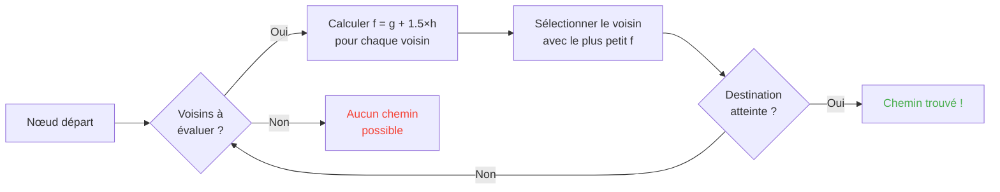

## Giriş

Koyunların duvarlara çarpmasını izleyerek saatler geçirdim.

Ve dürüstçe? Hayatımın en iyi yatırımı.

Çünkü bu moblara ne kadar bakarsan o kadar rastgele hiçbir şeyleri olmadığını fark edersin. Her hareket kodlanmış, tahmin edilebilir ve hepsinden önemlisi tamamen kırılabilir. Tam olarak yol bulmanın nasıl çalıştığını anlamak için Minecraft kaynak koduna daldım ve keşfettiğim şey moblara kelimenin tam anlamıyla mind-control yapabileceğindi. Yani onları şansın karar verdiği yere değil, SENİN istediğin yere gitmeye zorlamak.

Bu rehber kazarak öğrendiğim her şeydir. Yapay zekâ, A* algoritması, gizli cezalar, hayatta kalmada sallayabileceğin exploitler. Kazmanı hazırla.

---

## Mob yapay zekâsı nasıl çalışır (spoiler: aptalca)

### Hedefler

Her mobun *hedefleri* vardır. YapABİLECEĞİ eylemlerin ve onları yapmayı ne kadar İSTEDİĞİNİN bir listesidir. Sayı ne kadar küçükse o kadar önceliklidir, kaos sürümü bir yapılacaklar listesi gibi.

```java
protected void registerGoals() {
   this.goalSelector.addGoal(4, new Zombie.ZombieAttackTurtleEggGoal(this, 1.0, 3));
   this.goalSelector.addGoal(8, new LookAtPlayerGoal(this, Player.class, 8.0F));
   this.goalSelector.addGoal(8, new RandomLookAroundGoal(this));
   this.addBehaviourGoals();
}
```

Bir zombinin üstüne koşmak için bir kaplumbağa yumurtasını görmezden geldiğini gördün mü? Nedeni işte bu: `ZombieAttackTurtleEggGoal` öncelik 4, oysa `ZombieAttackGoal` (ona suratını yemesini söyleyen hedef) öncelik 2dedir.

Evet, bir zombi yumurta kırmak yerine seni yemeyi tercih eder. Aşk güzeldir.

Bizi gerçekten ilgilendiren hedef öncelik 7 olan `WaterAvoidingRandomStrollGoal`. "Yapacak bir şeyim yok o yüzden rastgele yürüyorum" hedefi. İşin ilginçleştiği yer burasıdır.

### Hareket (ya da "rastgele yürüyüş nasıl 60ta 1 şansla olur")

Her tickte (her 0,05 saniyede) oyun mobun hareket etmeye tenezzül edip etmediğini görmek için `canUse()` çağırır. Her tickte 60ta 1 şans. Aptalca bir tasarım ve buna bayılıyorum.

```java
public boolean canUse() {
   if (this.mob.hasControllingPassenger()) {
      return false;
   } else {
      if (!this.forceTrigger) {
         if (this.checkNoActionTime && this.mob.getNoActionTime() >= 100) {
            return false;
         }
         if (this.mob.getRandom().nextInt(reducedTickDelay(this.interval)) != 0) {
            return false;
         }
      }
      Vec3 $$0 = this.getPosition();
      if ($$0 == null) {
         return false;
      } else {
         this.wantedX = $$0.x;
         this.wantedY = $$0.y;
         this.wantedZ = $$0.z;
         this.forceTrigger = false;
         return true;
      }
   }
}
```

Özetlersek: mobun üstüne binmişsen hayır, mob 5 saniyedir bir şey yapmadıysa hayır, zar hayır derse hayır. Oyun mobun hareket etmesini GERÇEKTEN istemiyor.

Ama hareket ettiğinde `getPosition()` devralır:

```java
protected Vec3 getPosition() {
   if (this.mob.isInWater()) {
      Vec3 $$0 = LandRandomPos.getPos(this.mob, 15, 7);
      return $$0 == null ? super.getPosition() : $$0;
   } else {
      return this.mob.getRandom().nextFloat() >= this.probability
         ? LandRandomPos.getPos(this.mob, 10, 7)
         : super.getPosition();
   }
}
```

Sondaki bu iki sayıya bak: XZ yarıçapı ve Y yarıçapıdır. Suda mob daha uzakta arar (10 yerine 15). Toprak bulamazsa suyu kabul eden `super.getPosition()`a düşer. **Sonuç: moblar sudan ÇIKMAK İSTER.** Hayvanlarının kenara deli gibi yüzmesinin sebebi budur.

Çıtır bir detay: mobun `LandRandomPos` yerine `super.getPosition()` alma şansı kelimenin tam anlamıyla %0,1dir. Binde bir. Tipik Mojang.

### LandRandomPos: her şeyi değiştiren çürük optimizasyon

Benim FAVORİ adımım. Yol bulmayı suistimal edilebilir yapan en güzel teknik saçmalık.

```java
public static Vec3 getPos(PathfinderMob $$0, int $$1, int $$2, ToDoubleFunction<BlockPos> $$3) {
   boolean $$4 = GoalUtils.mobRestricted($$0, $$1);
   return RandomPos.generateRandomPos(() -> {
      BlockPos $$4xx = RandomPos.generateRandomDirection($$0.getRandom(), $$1, $$2);
      BlockPos $$5 = generateRandomPosTowardDirection($$0, $$1, $$4, $$4xx);
      return $$5 == null ? null : movePosUpOutOfSolid($$0, $$5);
   }, $$3);
}
```

`movePosUpOutOfSolid`. Adı her şeyi söyler. Seçilen konum katı bir blok içindeyse oyun onu havada olana kadar yukarı iter.

Bu bir optimizasyondur: yer altındaki konumları görmezden gelerek zaman kaybetmek yerine oyun onları yüzeye çıkarır. Zeki mi? Evet. Ama çılgın bir önyargı yaratır: **moblar yükseklikleri tercih eder**.

Hayal et. Yüzeyin altında bir sürü blok var, oyun 10 rastgele konum üretir. Blok içindekiler yukarı itilir. Yoğun bölgeler (bir tepenin altı) seyrek bölgelerden daha fazla geçerli konum üretir. Sonuç: mob istatistiksel olarak daha sık tepeye gider.

Güven bana, bunu 2 dakikada kıracağız.

### Seçim: en iyi blok yarışması

10 konum, tek kazanan, bir skor yarışması:

```java
public static Vec3 generateRandomPos(Supplier<BlockPos> $$0, ToDoubleFunction<BlockPos> $$1) {
   double $$2 = Double.NEGATIVE_INFINITY;
   BlockPos $$3 = null;
   for(int $$4 = 0; $$4 < 10; ++$$4) {
      BlockPos $$5 = (BlockPos)$$0.get();
      if ($$5 != null) {
         double $$6 = $$1.applyAsDouble($$5);
         if ($$6 > $$2) {
            $$2 = $$6;
            $$3 = $$5;
         }
      }
   }
   return $$3 != null ? Vec3.atBottomCenterOf($$3) : null;
}
```

En iyi skorlu konum KAZANIR. Ve skor kriterlerini bilirsek istediğimiz konumun kazanmasını sağlayabiliriz. Bu seçimde hile yapmak gibidir.

---

## Mobların tercihleri (ya da "ineğin neden yoldan geçiyor")

Her mobun farklı zevkleri vardır. Ve bu her şeyi değiştirir.

| Mob | Bunu sever |
| --- | --- |
| **Hayvanlar** (inekler, koyunlar, domuzlar) | Çimen ve ışık (hipsterlar) |
| **Canavarlar** (zombiler, iskeletler) | Karanlık (edgelordlar) |
| **Kaplumbağalar** | Su, yoksa kum, yoksa ışık |
| **Hoglinler** | `crimson_nylium`; `warped_fungus`tan nefret ederler |
| **Striderlar** | Sadece lav. Başka HİÇBİR şey. |
| **Silverfishler** | İstila edilebilir bloklar (mantıklı) |
| **Gardiyanlar** | Su + ışık (züppeler) |
| **Mooshroomlar** | Miselyum + ışık (mantarlar) |
| **Arılar** | Hava. Evet, HAVAyı tercih ederler. |

```java
// Hayvan: aşağı bakar, çimense maksimum skor
public float getWalkTargetValue(BlockPos $$0, LevelReader $$1) {
   return $$1.getBlockState($$0.below()).is(Blocks.GRASS_BLOCK) ? 10.0F : $$1.getPathfindingCostFromLightLevels($$0);
}

// Canavar: tam tersi
public float getWalkTargetValue(BlockPos $$0, LevelReader $$1) {
   return -$$1.getPathfindingCostFromLightLevels($$0);
}
```

Yani canavarlar kelimenin tam anlamıyla "aydınlıksa negatif skor, başka yere gidiyorum"dur. Işığa surat asarlar.

Yani hayvanlarını kelimenin tam anlamıyla çimen ve ışıkla, canavarlarını karanlıkla yönlendirebilirsin. Hem aptalca hem harika.

---

## Minecrafttaki A* algoritması (gizli formül)

Minecraft yol bulma için A* (A-star) algoritmasını kullanır. Ama Mojang imzasını koymuş:

```
f(n) = g(n) + 1.5 × h(n)
```

- **g(n)** = zaten gidilmiş yol (blok başına 1, çaprazda ~1,41)
- **h(n)** = kuş uçuşu mesafe
- **1.5** = çünkü Mojang biraz bozuk değerleri sever

Normalde A* `f(n) = g(n) + h(n)` kullanır. MOJANG 1.5 ÇARPANI EKLEMİŞ. Neden? Algonun hedefe daha hızlı gitmesi ve daha az arama dalı budaması için. Sonuç: bulunan yol "iyi"dir ama hep en iyi değildir. Hafif sarhoş bir A*.



Önemli detay: **bir mob yalnızca 16 blok yol bulabilir** (*takip menzili*). Hedef çok uzaksa ULAŞABİLDİĞİ en yakın bloğu seçer. Bu, menzil dışında bir monolit yaratabileceğin ve mobun ona yaklaştıran en yakın bloğa yol bulacağı anlamına gelir, bu da hareketlerini tamamen tahmin edilebilir yapar.

### Oyunu kıran iki exploit

#### 1. Blok güncellemeleri = zorla yeniden hesaplama

```java
public boolean shouldRecomputePath(BlockPos $$0) {
   if (this.hasDelayedRecomputation) return false;
   if (this.path != null && !this.path.isDone() && this.path.getNodeCount() != 0) {
      Node $$1 = this.path.getEndNode();
      Vec3 $$2 = new Vec3(
         ((double)$$1.x + this.mob.getX()) / 2.0,
         ((double)$$1.y + this.mob.getY()) / 2.0,
         ((double)$$1.z + this.mob.getZ()) / 2.0
      );
      return $$0.closerToCenterThan($$2, (double)(this.path.getNodeCount() - this.path.getNextNodeIndex()));
   }
   return false;
}
```

Mobun yolu yakınındaki her blok güncellemesi 1 saniyelik beklemeyle A* yeniden hesaplamasını zorlar. Bir mobun yanına 1 saniyelik bir saat koyarsın ve yolunu SÜREKLİ yeniden hesaplar. Bu her saniye sıfırlanan bir GPS koymak gibidir.

Ve bunu aynı anda 50 mobla yaparsan? Lag şehri. RIP TPS.

#### 2. Blok cezaları (Yol Bulma Huysuzluğu)

Bazı bloklar mobları korkutur. Kelimenin tam anlamıyla. Her bloğun ilişkili bir maliyeti vardır, bir numaralandırmayla tanımlanır:

| Blok / Durum | Ceza |
| --- | --- |
| **Bal bloğu** | Geçmek +8 |
| **Toz kar** | Geçilemez |
| **Kapalı kapılar** | Geçilemez |
| **Ateş** | Geçmek +16, yanından geçmek +8 |
| **Hayvanlar ve Köylüler** | Ateş = -1 (HAYIR) |
| **Kaktüs / Tatlı orman meyvesi** | Geçilemez; bitişik = +8 |
| **Su** | Geçmek ya da yanından geçmek +8 |
| **Magma** | Yanından geçmek +8 (ayy) |

Hayvanlar daha da uçtur:

```java
protected Animal(EntityType<? extends Animal> $$0, Level $$1) {
   super($$0, $$1);
   this.setPathfindingMalus(PathType.DANGER_FIRE, 16.0F);
   this.setPathfindingMalus(PathType.DAMAGE_FIRE, -1.0F);
}
```

DAMAGE_FIRE -1.0F değeri kelimenin tam anlamıyla "yasak"tır. Bir hayvan ateşten geçmektense boşluğa atlamayı tercih eder. Oh.

### Alıştırma: büyük yol yarışması

Birkaç yol arasında seçim yapması gereken bir köylü hayal et.

- **Yol A**: 15 blok ama 6 blok sudan geçer (+8 her biri)
- **Yol B**: 18 blok, 2 su bloğu (+8) ve 1 bitişik su bloğu (+8) ile
- **Yol C**: 14 blok dümdüz... ama ateşli: bir köylü için GEÇİLEMEZ
- **Yol D**: 1 bitişik magma bloğu (+8) + 1 bitişik bal bloğu (+8) ile 16 blok
- **Yol E**: 25 blok ama her yerde kaktüs (+8 her yerde): toplam maliyet 90,82

Zihinsel hesap:

- Yol A: 15 blok + su için 6×8 = 15 + 48 = **63** ... ama eklenecek 1,5×mesafe var. Gerçek hesapları yapalım.
- Yol B: daha uzun ama daha az ceza. Toplam maliyet = birikmiş mesafe + cezalar.
- Yol D: magma ve bal cezalarını üst üste yığar.

Kazanan genelde **Yol B** olur: sapma kârlıdır çünkü su PAHALIDIR.

Bir köylü esasen bacaklı bir maliyet hesaplayıcıdır.

### Her mobun zevkleri vardır

Bir köylü: "ateş mi? HAYIR TEŞEKKÜRLER HOŞÇA KAL"
Bir zombi: "ateş mi? TAMAM boomer *yanarak geçer*"

Kelimenin tam anlamıyla bazı mobların aldığı, bazılarının almadığı yolların var. Zombilerin yandığı köylü otobanları yapabilirsin.

---

## Köylüler: nihai keşmekeş

Tamam, köylüler. Bu tüm Minecrafttaki EN az anlaşılan sistemdir. Ama kodu çözdüğünde büründüklerini fark edersin: mesai saatli tahmin edilebilir makinelerdir.

### Sensörler ve bellekler

9 sensör, her 20 tickte (1 saniye) döner. Her biri köylünün etrafında bir yarıçapı tarar ve sonucu bellekte saklar. Köylü her şeyi görür, her şeyi hatırlar ve ona göre davranır.

Şöyle: "düşman var mı? Yerde eşya var mı? Konuşulacak bir oyuncu var mı?" HER ŞEYİ kontrol eder.

### Paketler (günün fazları)

Bir köylünün beyni saate göre etkinleşen aktivite paketleridir:

| Paket | Saat | Köylü... |
| --- | --- | --- |
| **Core** | 7/24 | Kapı açar, yüzer (zamanın %80i) ve POI EDİNİR |
| **Work** | 8-15 | "Çalışmaya gidiyorum": istasyonuna yürür |
| **Meet** | 15-17 | "Apero!": çana gider, sohbet eder |
| **Rest** | 18-6 | "Uyumalı": yatağa gider |
| **Idle** | 6-8, 17-18 | "Aylaklık ediyorum": gezinir, bebek yapar, yataklara zıplar |
| **Panic** | Yaralanma/düşman | "İMDAT": KAÇIŞ |

**Panic** paketi TÜM diğerlerini kesebilen tek pakettir. Köylü uyuyor ya da çalışıyor olsa bile, zombi varsa GENEL PANİK.

### Acquire POI: kablosuz redstoneu mümkün kılan şey

```java
Set<Pair<Holder<PoiType>, BlockPos>> $$12 = (Set)$$10xx.findAllClosestFirstWithType(
   $$0, $$11, $$8x.blockPosition(), 48, PoiManager.Occupancy.HAS_SPACE
)
```

`Acquire POI` 48 blok yarıçapta tüm POIleri (ilgi noktaları) tarar. En yakın 5i tutar, bir yol olduğunu doğrular ve erişilebilir ilki edinir.

Her POInin sınırlı slot sayısı vardır:
- **Çalışma istasyonları**: 1 slot
- **Yataklar**: 1 slot
- **Çanlar**: 32 slot

ÇILGIN nokta: **slot varışta DEĞİL, edinim anında rezerve edilir**. Bir köylü haritanın öbür ucundan bir kompostçuyu, ona hiç ulaşmadan kilitleyebilir.

Gücü görüyor musun?

### Kablosuz redstone. Evet, KABLOSUZ.

1. Bir köylüyü kompostçuya giden yolla bir vagonete koyarsın
2. Kompostçuyu edinir (slot alınır, kimse kullanamaz)
3. Köylü tıklayamayacak kadar uzaktadır, kemik tozu kalır
4. Bu köylüyü dünyada istediğin yere GEZDİRİRSİN, slotu tutar
5. Düzeneğini etkinleştirmek istediğinde köylüyü ÖLDÜRÜRSÜN
6. Slot serbest kalır, başka bir köylü kompostçuyu edinir, kemik tozunu alır
7. BLOK GÜNCELLEMESİ: herhangi bir redstone devresi etkinleşir

Kelimenin tam anlamıyla yolda sıfır chunk yüklemeyle tüm dünyaya iletilebilir kablosuz bir redstone sinyali yarattın. Bunu bir ender pearl stasis chambera bağlayabilir, bir köylü öldürerek istediğin yerden ışınlanabilirsin.

Favori kullanımım? "bounty hunter" mini oyunu: birkaç köylüyü kompostçularla koyarsın, oyuncu çıkışı etkinleştirmek için DOĞRU köylüyü öldürmelidir. Mekanik olarak tamamen saçma.

### Yol Bulma Kilidi (ya da "sonsuza dek donan köylü")

`Acquire POI` (bir yol gören) ile gerçek navigasyon (onu almayı reddeden) arasında ÇOK iyi bir hata vardır. Bu çalışma istasyonunun üstündeki blok yürünebilir olmadığında olur. Sonuç:

- Core paketi: "POIyi edinmek istiyorum"
- Navigasyon: "oraya yürüyemem"
- Sonuç: köylü DONMUŞ kalır, sonsuza dek, kendisiyle kavga ederek.

Kelimenin tam anlamıyla yerinde donmuş köylüler, dekorasyon ya da buildlerde "aksesuar" olarak kullanılabilir. Bir zırh standı tankı mı? Evet. Kıpırdamayan bir muhafız mı? Evet. Ürkütücü mü? Belki. Ama etkili.

---

## Sonuç

Minecraft mob yol bulması şans değildir. Puana dayalı, deterministik, tahmin edilebilir VE kırılabilir bir sistemdir.

**Akılda tutulacak üç nokta:**

1. **Ayakların altındaki bloklar = yükseklik önyargısı**: mobları yönlendirmek için yer altını doldur ya da boşalt
2. **Cezalar her mob için farklıdır**: bazılarının aldığı bazılarının almadığı yollar yarat
3. **POI slotları uzaktan rezerve edilir**: bedava kablosuz redstone, ışınlanma, hepsi

Minecraft kaynak kodu az suistimal edilmiş mekaniklerin altın madenidir. Derlenmiş Java okuyarak saatler geçirdim ve dürüstçe? Her satır işlevsel bir Paskalya Yumurtasıdır. Tek fark bunlar hayatta kalmada köylülerle kablosuz redstone yapmak için kullanılır. En iyi oyun onaylandı.
