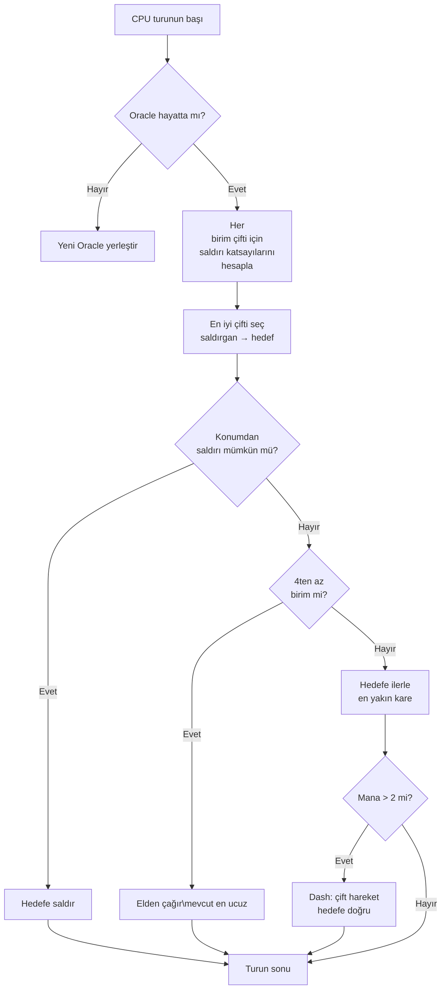

## Nausicaa için saçma yapay zekâm

Bazı projeler "mitolojili bir satranç oyunu yapsam mı?" diye başlar ve her 5 turda bir kendi hiper parametrelerine karar veren bir yapay zekâlı sistemle biter.

Nausicaa bu. Mitolojik yaratıklardan desteni kurduğun, mananı yönettiğin, birimleri 10x8 tahtaya konuşlandırdığın sıra tabanlı bir masa oyunu. Ve kişilik krizleri geçiren bir yapay zekâ var.

Bu yapay zekâya epey zaman harcadım ve sonuç bazen hâlâ beni aşıyor, en sevdiğim şey de bu.

## Oyunun gerçeği

Beyinden bahsetmeden önce bedeni anlamak lazım:

- 10x8 tahta, oyuncu başına 2 sıra konuşlanma bölgesi
- Mana 1den başlar, tur başına +1, maksimum 6. Çağırmak, saldırmak, yetenek kullanmak için harcarsın
- Amaç: rakip Oracleı öldürmek

12 birim, farklı maliyetler ve hareket desenleri:

| Birim | Maliyet | Hareket | Can |
| --- | --- | --- | --- |
| Oracle | 0 | Şah (8 yön) | 1 |
| Gobelin | 1 | İleri 3 kare | 1 |
| Harpie | 1 | Şah (8 yön) | 1 |
| Naïade | 1 | Çapraz | 1 |
| Griffin | 2 | 2 kare zıplama | 2 |
| Sirène | 2 | Yatay | 1 |
| Centaure | 2 | At (L şeklinde) | 2 |
| Archer | 3 | Yatay | 1 |
| Phénix | 3 | Çapraz (koyu kareler) | 1 |
| Métamorphe | 4 | Yer değiştirme | 1 |
| Voyant | 4 | Yok (mana üretir) | 1 |
| Titan | 6 | Sınırlı (alan saldırısı) | 3 |

Her birimin kendine özel saldırı deseni var. Siren 4 çapraza vurur, Okçu 3 kareden menzilli vurur, Titan çağrıldığında etrafındaki her şeyi yok eder. Kısacası mitolojili ve deste kurmalı bir satranç oyunu.

## CPUya düşünmeyi nasıl öğrettim

Temel fikir aptalca basit: **her düşman biriminin bir çekicilik katsayısı vardır**. Ne kadar tehlikeliyse yapay zekâ onunla o kadar ilgilenmek ister.

```javascript
const UNITS_ATTRACTIVENESS = {
    "oracle": 100,
    "titan": 95,
    "shapeshifter": 90,
    "phoenix": 80,
    "siren": 70,
    "archer": 70,
    "seer": 70,
    "griffin": 60,
    "centaur": 60,
    "harpy": 50,
    "naiad": 30,
    "gobelin": 20
};
```

Oracle 100, mantıklı, bu kazanma koşulu. Titan 95 çünkü çağrıldığında yanındakileri tekler. Gobelin 20, piyade işte, umurumuzda değil.

Sonra her birim çifti için (bir dost, bir düşman) şunu hesaplıyorum:

```
interet = attractivite × coeff_attract / (distance × coeff_dist)
```

Kabaca: ne kadar tehlikeli ve yakınsan yapay zekâ seni o kadar pataklamak istiyor.

```javascript
calculateAttackCoefficient(x1, y1, x2, y2) {
    const distance = this.calculateEuclideanDistance(x1, y1, x2, y2);
    if (distance === 0) return Infinity;
    return (UNITS_ATTRACTIVENESS[unit.type] * COEFFICIENTS_IMPORTANCE["attractiveness"]) / distance;
}
```

### Değişen katsayılar numarası

Önemli nokta şu: önem katsayıları **her 5 turda bir rastgele değişir**.

```javascript
if (this.turnCount % 5 === 0) {
    const distanceCoefficient = parseInt(Math.random() * 100);
    const attractivenessCoefficient = parseInt(Math.random() * 100);
    this.regulateImportanceCoefficients({
        distance: distanceCoefficient,
        attractiveness: attractivenessCoefficient
    });
}
```

Bir seferde yapay zekâ hiper agresif olur (çekicilik 95, mesafe 5), Oracleını öldürmek için her şeyi geçer. Sonraki sefer mesafeyi önceler ve yeniden konumlanır.

Bu Pac-Man hayaletlerinden çalıntı: Blinky kovalar, Pinky pusuya yatar. Burada yapay zekâ her fazda "kişilik" değiştiriyor.

**Sonuç: yapay zekâyı bütün bir maç boyunca tahmin etmek imkânsız.** CPU asla iki kez aynı maçı yapmaz.

### Oracle bir korkaktır

Düşman Oracle kaçar. Kelimenin tam anlamıyla.

```javascript
const awayFromTarget = {
    row: Math.max(0, Math.min(7, botUnitElement.row + (botUnitElement.row - targetUnitElement.row))),
    col: Math.max(0, Math.min(9, botUnitElement.col + (botUnitElement.col - targetUnitElement.col)))
};
```

Tehdidin tersi yönü hesaplar ve tüymek için koşar. Duvar varsa o yönde en yakın boş kareyi arar.

Oraclea yaklaşmak için 3 tur harcarsın ve pat, çoktan öbür uca kaçmıştır.

### Karar döngüsü

Yapay zekâ şöyle karar verir:

1. Oraclım kalmadıysa (ölmüşse) yenisini yerleştir
2. Her dost birim → düşman birim çifti için katsayıyı hesapla
3. En iyi çifti seç
4. Birim konumundan hedefe saldırabiliyorsa → saldır
5. 4ten az birimim varsa → elden mevcut en ucuzu çağır
6. Yoksa hedefe doğru ilerle (düşmana en yakın hareket karesi)
7. Yeterli mana varsa (> 2), daha da yaklaşmak için dash (çift hareket)
8. Birim Oracle ise → kaç



```javascript
async makeAction(dash=false) {
    // hepsi sırayla
    // CPU yeterli manası varsa dash yapar
    if(botPlayer.mana > 2) {
        this.makeAction(true);
    }
}
```

### Neden öklid mesafesi

Öklid mesafesini kullanıyorum:

```javascript
calculateEuclideanDistance(x1, y1, x2, y2) {
    const deltaX = Math.pow(x1 - x2, 2);
    const deltaY = Math.pow(y1 - y2, 2);
    return Math.sqrt(deltaX + deltaY) * COEFFICIENTS_IMPORTANCE["distance"];
}
```

Neden Manhattan değil? Çünkü birimlerin çeşitli hareket desenleri var (at gibi L, çapraz vs.). Kuş uçuşu mesafe tehlikenin daha iyi bir yaklaşımı.

## Neden minimax değil

Klasik bir minimax kodlayabilirdim. Ama 12 birim türü, farklı hareket desenleri, özel yeteneklerle oyun ağacı o kadar hızlı patlar ki oynanamaz olur. Sezgisel yaklaşım 10 milyon durumu keşfetmeden akıllı seçimler yapar.

## Havalı olan şey

Çekicilik sistemi eğlenceli ikilemler yaratır:

- Kâhin (70) mana üretir. Yaşamasına izin verirsen rakibin daha fazla kaynağı olur. Ama Titan (95) daha da tehlikelidir.
- Biçim değiştiren (90) herhangi bir birimle yer değiştirebilir. Oracleını çalabilir.
- Harpi (50) kendini de öldüren patlayıcı bir saldırıya sahiptir. 3 biriminin yanında bitene kadar ikincil kalır.

Yapay zekâ küresel tehlikeyi konumlara göre değerlendirir, sadece ham istatistiklere göre değil.

Senaryoları bütün bir maçı tekrarlamadan test etmek için bir `activateSimulation()` fonksiyonu da var:

```javascript
activateSimulation() {
    // Tahtaya belirli birimleri yerleştirir
    // Yapay zekâyı hata ayıklamak için kullanışlıdır
    this.game.board = simulation.board;
    this.game.players = simulation.players;
}
```

## Eksik olan şey

Daha fazla zamanım olsaydı:

- Yapay zekâ mevcut duruma tepki verir, oyuncunun ne yapacağını tahmin etmez
- Elini birkaç tur ileriden planlamaz
- Biçim değiştiren ve Sentorun yeteneklerini az kullanır
- Pekiştirmeli öğrenme: katsayıları ayarlamak için kendine karşı oynatmak

Ama bir tarayıcı oyunu için iş görür. Kaybeden arkadaşlarım var, yani onaylandı.

## Dene

[nausicaa-game.github.io](https://nausicaa-game.github.io/) adresinde mevcut. "JOUER" düğmesine tıkla, CPU modunu aç ve yapay zekâyı izle.

Tavsiye: yapay zekâyı kendine karşı oynat. Agresif fazlar göreceksin, sonra pfft her şeyi geri çeker.

Kod [GitHub](https://github.com/nausicaa-game/nausicaa-game.github.io) üzerinde, `js/cpu.js` içinde.

**Akılda tutulacak 3 nokta:**

1. **Sezgisel katsayılar**: minimax yok, her birimin bir çekiciliği var
2. **Her 5 turda bir değişen katsayılar**: yapay zekâ Pac-Man tarzı agresiflik ve kontrol arasında geçiş yapar
3. **Oracle kaçar**: tehdidin tersi yönünü hesaplar ve tüyer

Yapay zekâyı daha da gaddar yapmak için fikirlerin varsa bir issue aç. Yenilgilerinden öğrenen bir sürüm için planlarım var ama o sonraki bir yazıya kalacak.
