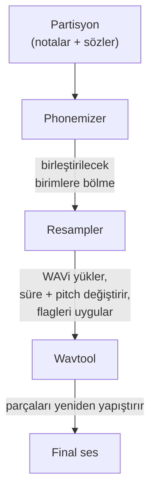

## UTAU: Visual Basic 6 ile yazılmış bir yazılım sentetik sesi nasıl demokratikleştirdi

Ana sayfamda kısaca değinmiştim: UTAUyu seviyorum. İşte nedeni.

2008de sentetik bir sesi şarkı söyletmek isteseydin bir seçeneğin vardı: VOCALOID. Yamahanın yazılımı. Pahalı, sahipli, kendin yaratamadığın resmi seslerle.

Sonra bir Japon adam, Ameya/Ayame, köşesinde bir program çıkardı. **Visual Basic 6** ile kodlanmış bir yazılım. Ücretsiz. Kendi sesini... kendin kaydettiğin WAV dosyalarıyla yaratmana izin veriyordu.

Bu yazılımın adı **UTAU** (歌う, Japoncada "şarkı söylemek"). Ve dönemi için bu resmen sihirdi.

Onu teknik temizliğinden çok çıkış fikri için her zaman büyüleyici bulmuşumdur (kodlama prensibi gerçekten çok zekice kalıyor, uygulaması gözleri kanatsa da): vokal sentezi halka açtı. Sen, ben, mikrofonu olan herkes.

Neden harika olduğunu açıklayayım.

---

## Önce, şarkı sentezi neden dertli bir iş

Şarkı söyleyen bir ses notalardan ibaret değildir. Saldıran ünsüz, tutulan ünlü, nefes, ikisi arasındaki geçişler var. "selam"daki "se" ıslık çalan bir "s"nin açık bir "e"ye kaymasıdır ve insansı duyulup duyulmadığını belirleyen bu kaymadır.

Bugün bunu derin öğrenmeyle çözüyoruz: modeli saatlerce şarkı üzerinde eğitiyorsun ve sesi üretiyor (Synthesizer V, DiffSinger). Ama bu 2020 sonrası. 2008de hiçbir şey yoktu.

UTAU daha eski, daha yaşlı ve daha kurnaz bir yöntem kullanır: **birleştirmeli sentez**.

---

## Birleştirmeli sentez: ses parçalarının kopyala yapıştırı

Fikir çocuk oyuncağı kadar basit: küçük ses parçaları kaydedip kelimeler oluşturmak için birbirine yapıştırıyorsun. "selam" = "se" + "la" + "m" örneği, art arda dizilmiş. Bir partisyonun sürdüğü bir ses yapbozu.

YouTube Poop prensibi, bir karakterin kelimelerini ona her şeyi söyletmek için yeniden kesersin, tek fark burada bunun düzgün ve otomatik olması.

Ve UTAU tam olarak buradan geliyor. Ondan önce **"Jinriki Vocaloid"** (人力ボーカロイド, "manuel Vocaloid") vardı: insanlar vokal parçalarını elle kesiyor, fonemleri çıkarıyor, perdesini değiştiriyor ve VOCALOID sesini taklit etmek için hepsini bir ses editöründe yeniden birleştiriyordu. Elle. İşin büyüklüğünü hayal et.

Ameya bu eziyete baktı ve onu otomatikleştiren aracı kodladı. Başlangıçta UTAU sadece buydu: manuel Vocaloid için bir asistan.

---

## Neden devrimciydi: sesi SEN yaratıyorsun

Her şeyi değiştiren bu.

VOCALOIDde bir ses satın alıyordun. Miku, Luka vs. Profesyonellerce yaratılmış, Yamaha tarafından satılan sesler. Yaratım Yamahada kalıyordu. UTAU ile **herkes sesini kaydedip şarkı söyleyen bir enstrümana dönüştürüyor**.

En basit mod olan CV modu şu: Japoncanın ~100 temel hecesini kaydediyorsun ("a", "ka", "sa", "ta"...), kesme noktalarını yapılandırıyorsun ve işte ses bankan hazır. Birkaç saatlik iş.

Sonuç: ekosistem patladı. Topluluk tarafından yaratılmış binlerce ses bankası: hayran sesleri, arkadaş sesleri, icat edilmiş karakterler. Tam bir sanal şarkıcı evreni, ücretsiz. Ve yazılım **Defoko** (Utane Uta) ile geliyordu, AquesTalk TTS motoruyla üretilmiş varsayılan bir ses, yani mikrofonsuz bile başlayabiliyordun.

---

## oto.ini: sistemin kalbi

UTAU sesleri nerede kesip yapıştıracağını nereden biliyor? Ses bankası başına bir yapılandırma dosyası üzerinden: **`oto.ini`**. Her WAV için kesme noktalarını (milisaniye cinsinden) tanımlar:

- **Offset** → baştaki silinecek sessizlik
- **Preutterance** → ünsüzün ünlüye geçtiği nokta ("sa" içindeki "s"den "a"ya sınır)
- **Overlap** → önceki notanın bunun üzerine ne kadar taştığı
- **Fixed region** → uzun bir notada esnetilmemesi GEREKEN kısım (tipik olarak ünsüz)
- **Cutoff** → sonun kesildiği yer

**Preutterance** en zeki parametre. Bir hecenin ünlüden önce her zaman bir ünsüz parçası vardır. Notanın zamana denk gelmesi için denk gelmesi gereken *ünlüdür*, ünsüz değil. Bu yüzden UTAU örneği geriye kaydırır: "sa"daki "a" tam zamana düşer, "s" hemen öncesine taşar. Sesin tam düşmesi için vuruşunu önceden tahmin eden bir davulcu gibi, tek fark bunun bir `.ini` içinde olması.

Görsel olarak, bir "ka" örneğinde `oto.ini` bölgeleri şöyle bölünür:

```mermaid
flowchart LR
    A["🔇 sessizlik<br/>(offset)"] --> B["🅺 ünsüz<br/>(fixed region,<br/>esnetilmez)"]
    B --> C["🅰 ünlü<br/>(esnetilebilir bölge)"]
    C --> D["🔇 kesilmiş son<br/>(cutoff)"]
    style B fill:#3b4a6b
    style C fill:#5b3b6b
```



Ünsüz ile ünlü arasındaki sınır preutterance. Ünlü, uzun notalar için esnetilen bölgedir; ünsüz bozulmadan kalır, yoksa "k"n iki saniye sürer ve berbat duyulur.

```ini
# oto.ini (basitleştirilmiş)
# dosya=takma-ad,offset,consonant,cutoff,preutterance,overlap
_ka.wav=ka,120,80,-200,90,40
```

Tüm örneklerinde ses başına beş değer ve UTAU herhangi bir kelimeyi düzgünce birleştirir.

---

## CV, VCV, CVVC: gerçekçilik yarışı

Temel mod **CV** (Ünsüz-Ünlü), hece başına bir sestir. Basit ama biraz robotik: heceler arası birleşimler hamdır.

2010da topluluk **VCV**yi (Ünlü-Ünsüz-Ünlü) icat eder. "ka"yı tek başına kaydetmek yerine "a ka" kaydedersin, önceki ünlünün kuyruğuyla. Geçiş doğal olur çünkü *kaydın içindedir*, sonradan hesaplanmaz.

Can acıtan detay: **VOCALOID, 2011de VOCALOID3e kadar VCVye sahip olmadı.** Tek başına bir adamın kodladığı VB6 freeware, geçişlerin gerçekçiliğinde Yamahayı bir yıl geride bıraktı. Çokulusludan daha hızlı bir hayran topluluğu.

Sonra **CVVC**, **ARPAsing** (İngilizce), **VCCV** geldi... her yöntem gerçekçiliği daha ileri taşıdı, hepsi topluluk tarafından icat edilip belgelendi.

---

## Tam pipeline: bir kelime sese nasıl dönüşür

Bir nota yerleştirip bir söz yazdığında, perde arkasında şunlar olur:



**Resampler** başyapıttır: belli bir perdede kaydettiğin "ka" örneğini alıp istenen notaya uyması için yeniden esnetir/perdesini değiştirir, sadece esnetilebilir bölgeyi esnetip ünsüzü bozulmadan tutarak (oto.ini bu yüzden var).

Ve **modülerdir**. UTAU temel bir resampler ile geliyordu ama topluluk başka resamplerlar çıkardı (moresampler, TIPS...), her birinin kendi ses dokusu var. Sentez motorunu bir eklenti gibi değiştiriyordun. 2008de. Bir freeware üzerinde.

---

## Kaputun altındaki şantiye (ve neden sevimli)

Yazılımın teknik durumu hakkında dürüst olmalıyım:

- **Visual Basic 6 ile kodlanmış.** 2008de bile ölmüş bir dil. Çalıştırmak için VB6 çalışma zaman ortamı gerekir.
- Başlangıçta **sadece Windows** (Mac portu, UTAU-Synth, 2011de geldi).
- **Zorunlu Shift-JIS kodlaması.** Dosyaların Japonca Shift-JIS ile kodlanmamışsa UTAU hiçbir şey anlamaz. Hâlâ bugün bile bilgisayarı Japonca yerele almak ya da başlatmak için AppLocale kullanmak gerekir.
- **Sade arayüz**, o dönemde neredeyse %100 Japonca belgeleme.

Ve yine de. Yine de bu yazılım küresel bir hareket yarattı. On binlerce ses bankası. Milyonlarca kez dinlenen şarkılar.

En iyi örnek: **Kasane Teto**. 2008de yaratılan ve 1 Nisan şakası olarak atılan, kendini VOCALOID gibi gösteren bir karakter. Şakaydı bu. Ama insanlar karakteri sevdi, arkasında gerçek bir UTAU ses bankası yaratıldı ve Teto dünyanın en ünlü sanal şarkıcılarından biri oldu. 2023te resmi bir Synthesizer V sesi bile aldı. Ücretsiz bir yazılım üzerindeki 1 Nisan balığından doğan bir karakter.

---

## Neden hâlâ önemli

UTAU, açıklıkla kazanan "yoksul" bir teknolojinin mükemmel örneği.

VOCALOID teknik olarak üstündü, daha iyi finanse edilmişti, daha profesyoneldi. Ama kapalıydı. UTAU el yapımıydı, çirkindi, VB6 ile yazılmıştı, ama herkesin katılmasına izin veriyordu. Sesler yaratmak, resamplerlar yaratmak, eklentiler yaratmak, kayıt yöntemleri yaratmak. Geri kalanını topluluk yaptı.

Ve konsept bugün tamamen hayatta. Modern açık kaynak bir halef olan **OpenUtau**, fikri alıp yeniliyor (çok platformlu, UTF-8, modern resamplerların VE yapay zekânın desteği). Birleştirmeli sentez derin öğrenme modellerinin yanında hâlâ ayakta, çünkü onların sahip olmadığı bir avantajı var: tam olarak ne olduğunu anlıyorsun ve her milisaniyeyi kontrol ediyorsun.

UTAUda hep sevdiğim şey bu. Tam olarak ne olduğunu görüyorsun. Anlamadığın sihirli bir sonucu sana tüküren bir yapay zekâ değil: WAVların, kesme noktaların var ve her şeye karar veren sensin. Kötü duyulduğunda nedenini biliyorsun ve düzeltebilirsin. Bu tür kontrolü seviyorum.

---

**Akılda tutulacak 3 nokta:**

1. **Birleştirmeli sentez = ses yapbozu**: UTAU kelimeler oluşturmak için küçük WAV örneklerini birbirine yapıştırır. `oto.ini` her sesi nerede kesip yapıştıracağını tanımlar. Kara kutu olmadan, milisaniyesine kadar her şeyi kontrol edersin.

2. **Açıklık tekniği yener**: VOCALOID daha iyiydi ama kapalıydı. UTAU el yapımıydı ama herkesin kendi seslerini yaratmasına izin veriyordu. Topluluk ekosistemi patlattı ve VCVde Yamahayı bile geride bıraktı.

3. **İyi bir fikir kodundan sağ çıkar**: VB6, Shift-JIS, sadece Windows... ama konsept OpenUtau üzerinden hâlâ dönüyor. Harika bir teknoloji özensiz kodlanabilir.
 
Dürüstçe söyleyeyim, sadece 1 Nisan balığından doğan Kasane Teto için bile bu yazılım saygıyı hak ediyor.
