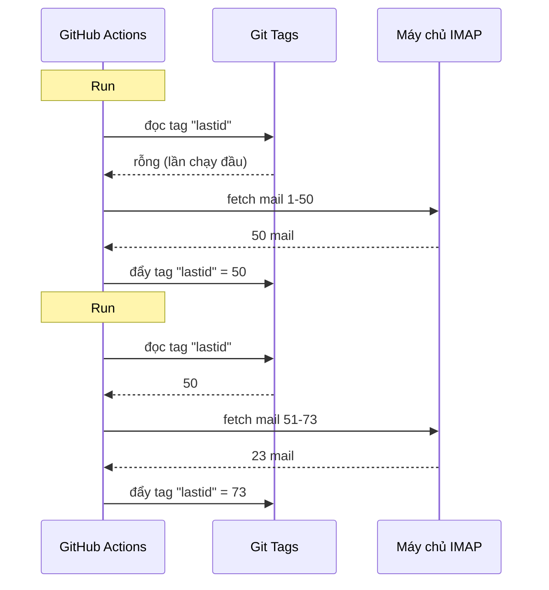

# Tôi đã dùng git làm cơ sở dữ liệu để chạy bot miễn phí trên GitHub Actions

Tôi có một bot tự trả lời email chạy 24/7.

Nó đọc mail của tôi, hiểu nội dung nói về gì, và tự trả lời bằng AI. Nó nhớ các cuộc trò chuyện trước. Nó bỏ qua newsletter và `noreply@`. Nó chuyển cho con người khi chuyện quá nóng.

Chi phí hằng tháng : **0€**.

Tôi bỏ qua máy chủ, VPS và cơ sở dữ liệu. Chỉ GitHub Actions và một mẹo điên rồ : **dùng git làm cơ sở dữ liệu**.

Bạn thấy tôi định đi đâu chứ? Không à? Được, bám chắc vào, vừa ngớ ngẩn vừa thiên tài.

---

## Vấn đề : GitHub Actions là stateless

GitHub Actions miễn phí. Bạn có thể chạy cron mỗi 5 phút, chạy mã của mình, miễn phí.

Nhưng có vấn đề : nó **stateless**.

Mỗi lần chạy khởi động trong máy trống. Không gì được lưu giữa hai lần thực thi. Lần chạy trước? Quên đi. Xóa sạch. Như thể chưa từng tồn tại.

Với bot trả lời email, đó là vấn đề khổng lồ. Kiểu :

> "Mail cuối cùng tôi đã xử lý là mail nào?"

Nếu bot quên điều đó mỗi lần chạy, nó sẽ hoặc trả lời lại cùng mail vòng lặp (thảm họa), hoặc bỏ sót mail.

Cần trạng thái bền vững. Và bình thường, trạng thái bền vững = cơ sở dữ liệu. Nhưng cơ sở dữ liệu là máy chủ, và máy chủ thì không còn miễn phí.

Đó là lúc chuyện trở nên thú vị.

---

## Giải pháp : tag git làm cơ sở dữ liệu

Repo GitHub của bạn vốn đã là lưu trữ bền vững. Miễn phí. Có phiên bản. Luôn ở đó.

Vậy sao không lưu trạng thái vào đó?

Ý tưởng : mỗi lần chạy, bot đọc UID email đã xử lý cuối từ một **tag git**. Nó xử lý mail mới. Rồi đẩy lại tag với UID mới.



Tag git CHÍNH LÀ cơ sở dữ liệu. Một giá trị duy nhất, nhưng đó là tất cả những gì ta cần.

### Đọc state

Đầu job, ta lấy giá trị từ tag :

```bash
git fetch origin --tags lastid || true
git show refs/tags/lastid:data/lastId > data/lastId || true
```

`git show refs/tags/lastid:data/lastId` nghĩa là : "đưa tôi nội dung tệp `data/lastId` như nó từng có trong tag `lastid`".

Bùm. Bạn có giá trị, không cần cơ sở dữ liệu.

### Ghi state

Cuối cùng, ta tạo lại tag với giá trị mới :

```bash
git switch --orphan lastid-tmp   # nhánh trống không lịch sử
git rm -rf .                      # dọn sạch mọi thứ
mkdir -p data
printf "%s\n" "${LAST_ID_CONTENT}" > data/lastId

git add data/lastId
git commit -m "lastId snapshot"
git tag -f lastid                 # ép tag lên commit này
git push --force ...origin lastid # đẩy tag
```

Ta tạo một nhánh **mồ côi** (không lịch sử), chỉ đặt tệp `lastId`, commit, tag, force push.

Vì sao mồ côi? Để không tích 10 000 commit state trong lịch sử repo. Mỗi lần cập nhật ghi đè lần trước. Tag luôn trỏ tới ĐÚNG MỘT commit chứa ĐÚNG MỘT giá trị.

Sạch sẽ. Miễn phí. Hoàn toàn quái đản mà chạy được.

---

## Mẹo thứ hai : snapshot runtime

Còn một vấn đề nữa với GitHub Actions : `npm install`.

Nếu mỗi lần chạy (mỗi 5 phút) bạn làm `npm install` + `npm run build`, bạn phí 60-90 giây mỗi lần. Trên cron dày, đó là phút compute đổ sông đổ biển.

Giải pháp : tiền biên dịch mã MỘT lần, và lưu nó trong một tag git nữa.

Workflow build (chạy khi bạn đẩy lên `master`) làm việc này :

```bash
# biên dịch mã
bun install
bun run build

# lưu dist/ + node_modules/ vào tag "runtime"
git checkout --orphan temp-runtime
git rm -rf .
cp -r "$TMPDIR"/* .
git add dist node_modules package.json bun.lock data
git commit -m "runtime build"
git tag -f runtime
git push --force ...origin runtime
```

Tag `runtime` chứa mã đã biên dịch VÀ `node_modules`. Sẵn sàng chạy.

Và cron thì checkout trực tiếp tag này :

```yaml
- name: Checkout runtime snapshot
  uses: actions/checkout@v4
  with:
    ref: refs/tags/runtime    # mã tiền build, không phải mã nguồn
    fetch-depth: 1

# không npm install, không build!
- name: Process emails
  run: node dist/index.js --action
```

Cron khởi động tức thì và chỉ chạy `node dist/index.js`, không install hay build.

Kiểu, bạn có hai tag làm hai việc :
- `runtime` = mã sẵn sàng chạy (cập nhật khi bạn đẩy mã)
- `lastid` = trạng thái bền vững (cập nhật mỗi lần chạy)

Thanh lịch như quỷ.

---

## Bản thân bot : bot tự trả lời bằng AI

Được, mẹo git hay đấy, nhưng bot thực sự làm gì?

Nó đọc mail của bạn qua IMAP, hiểu chúng bằng AI (Groq + Llama 3.3 70B), và tự trả lời.

Kiến trúc thành các service sạch với tiêm phụ thuộc (InversifyJS) :

```
App
├── ImapService      → đọc mail (IMAP)
├── SmtpService      → gửi trả lời (SMTP)
├── ParserService    → phân tích nội dung mail
├── ReplyService     → sinh trả lời AI
├── SummaryService   → trí nhớ hội thoại
├── AccountsService  → quản lý nhiều tài khoản email
└── ConfigService    → cấu hình / biến env
```

### Hai chế độ vận hành

Bot có thể chạy hai cách :

**Chế độ listener** (thời gian thực) : kết nối IMAP thường trực với reconnect lũy thừa. Cho VPS.

```typescript
this.imapService.on("exists", async (data) => {
  console.log(`[MAIL] Nouveau mail ! Total: ${data.count}`);
  // xử lý mail mới ngay lập tức
});
```

**Chế độ action** (batch) : xử lý mail mới từ `lastId`, rồi đóng. Cho cron GitHub Actions.

```bash
node dist/index.js --action
```

Chế độ `--action` là chế độ dùng mẹo git. Nó đọc `lastId`, xử lý cái mới, ghi `lastId` mới, xong.

### KHÔNG trả lời robot

Nếu bot của bạn trả lời MỌI mail, nó sẽ trả lời newsletter, thông báo, `noreply@`. Thảm họa. Tệ hơn : nếu hai bot trả lời nhau, bạn có vòng lặp mail vô hạn. Cơn ác mộng.

Vì vậy lọc mạnh tay :

```typescript
export function isAutomatedSender(address) {
  const automatedPatterns = [
    "noreply", "no-reply", "donotreply",
    "mailer-daemon", "postmaster", "bounce",
    "newsletter", "notification", "marketing",
    "billing", "receipt", "promo", ...
  ];
  const local = address.split("@")[0].toLowerCase();
  return automatedPatterns.some(p => local.includes(p));
}
```

Và cả phát hiện qua header email :

```typescript
export function isAutomatedByHeaders(headers) {
  return (
    ["bulk", "list", "junk"].includes(headers.precedence) ||
    headers["auto-submitted"] !== "no" ||
    headers["list-unsubscribe"] !== "" ||   // newsletter có cái này
    /mailchimp|sendgrid|mailgun|brevo/i.test(headers["x-mailer"])
  );
}
```

`List-Unsubscribe` trong header? Đó là newsletter. `Precedence: bulk`? Mail hàng loạt. `X-Mailer: Mailchimp`? Bạn hiểu kiểu rồi. Bỏ qua.

Như bảo vệ hộp đêm : robot không được vào.

### Các trigger kỳ diệu

AI có thể quyết định không trả lời gì cả, hoặc chuyển cho con người. Bằng cách nào? Với các trigger đặc biệt trong phản hồi của nó.

Prompt hệ thống bảo nó :

> Nếu là mail tự động/newsletter → trả lời `<no_reply>`
> Nếu quá quan trọng/nhạy cảm (pháp lý, tài chính...) → trả lời `<manual_reply_required>`
> Ngược lại → viết trả lời thật

Và mã đọc điều đó :

```typescript
const aiReply = completion.choices[0].message.content.trim();
const manualTrigger = aiReply.includes(MANUAL_REPLY_TRIGGER);
const noReply = aiReply.includes(NO_REPLY_TRIGGER);

if (noReply) {
  console.log("[MAIL] AI đã quyết định bỏ qua. Skip.");
  return;
}

if (manualTrigger) {
  console.log("[MAIL] Quá nóng, tôi chuyển cho con người.");
  await this.smtpService.sendManualForward(...);
  return;
}

// ngược lại gửi trả lời AI
await this.smtpService.sendReply(...);
```

Kiểu AI có quyền nói "không, chỗ này tôi không đụng, gọi con người thật đi". Đó là khôn ngoan.

---

## Trí nhớ hội thoại

Một chi tiết thay đổi tất cả : bot **nhớ** các cuộc trò chuyện.

Khi nó trả lời ai đó, nó lưu tóm tắt cuộc trao đổi. Lần tới người đó viết, tóm tắt được bơm lại vào prompt.

Lưu trữ : một tệp JSON cho mỗi liên hệ.

```
data/customers/
├── moi%40gmail.com/
│   ├── alice%40example.com.json
│   └── bob%40client.fr.json
```

Và tóm tắt do chính AI tạo, hợp nhất tóm tắt cũ với tin nhắn mới :

```typescript
const completion = await groq.chat.completions.create({
  model: "llama-3.3-70b-versatile",
  messages: [
    { role: "system", content: "Tu es un assistant de mémoire. Merge l'ancien résumé avec le nouveau message sans perdre d'info." },
    { role: "user", content: `Résumé existant:\n${existing}\n\nNouveau message:\n${incomingContent}` }
  ],
  temperature: 0.0,  // xác định, không sáng tạo
  max_tokens: 800,
});
```

Vậy bot xây trí nhớ nén dần theo thời gian. Một tóm tắt phình ra thông minh là đủ, không cần lưu mọi mail.

Còn các tệp JSON này? Thì... chúng cũng lưu trong git, trong tag runtime. Git khắp nơi.

---

## Điểm láu về độ dài prompt

Chi tiết kỹ thuật nhỏ khiến tôi mỉm cười.

Model có giới hạn token. Nếu mail + tóm tắt + prompt persona vượt quá, API trả lỗi.

Mã xử lý việc đó bằng **cắt ngắn tầng** + retry :

```typescript
try {
  // lần thử đầu với giới hạn bình thường
  completion = await groq.chat.completions.create({...});
} catch (error) {
  if (!this.isLengthError(error)) throw error;

  // lỗi độ dài : thử lại với giới hạn chặt hơn
  ({ systemContent, userContent } = this.buildPromptPayload({
    ...,
    limits: {
      systemPromptChars: 2200,  // thay vì 3000
      summaryChars: 1800,       // thay vì 4000
      personaChars: 900,        // thay vì 1500
      userContentChars: 2200,   // thay vì 8000
    },
  }));
  completion = await groq.chat.completions.create({...});  // thử lại
}
```

Nếu không qua, ta cắt ngắn hơn và thử lại. Đơn giản, hiệu quả, không crash.

---

## Được, cụ thể nó chạy thế nào?

Flow đầy đủ của một lần chạy cron :

```
1. GitHub Actions kích hoạt (cron mỗi 5 phút)
2. Checkout tag "runtime" (mã tiền build)
3. git show refs/tags/lastid → lấy UID đã xử lý cuối
4. node dist/index.js --action
   ├── kết nối IMAP
   ├── fetch mail từ lastId+1
   ├── với mỗi mail :
   │   ├── phân tích nội dung
   │   ├── lọc robot (skip nếu tự động)
   │   ├── khớp tài khoản nhận
   │   ├── lấy trí nhớ hội thoại
   │   ├── sinh trả lời AI (Groq)
   │   ├── <no_reply> ? skip
   │   ├── <manual_reply_required> ? chuyển con người
   │   ├── ngược lại : gửi trả lời (SMTP)
   │   └── cập nhật trí nhớ hội thoại
   └── ghi lastId mới
5. git push --force tag "lastid" với giá trị mới
```

Và lặp lại sau 5 phút. Mãi mãi. Miễn phí.

---

**3 điểm cần nhớ :**

1. **Git = cơ sở dữ liệu miễn phí** -- Một tag mồ côi có thể lưu trạng thái bền vững giữa hai lần chạy stateless. `git show refs/tags/X:tệp` để đọc, force-push để ghi. Bạn tiết kiệm cả một DB.

2. **Tiền biên dịch trong tag runtime** -- Thay vì `npm install` mỗi lần chạy cron, lưu mã đã biên dịch + node_modules trong tag git. Cron khởi động tức thì.

3. **Bot AI phải biết im lặng** -- Các trigger `<no_reply>` và `<manual_reply_required>` để AI quyết định không trả lời hay chuyển cho người. Cộng thêm lọc chống robot. Nếu không bạn tạo vòng lặp mail vô hạn.

Cron serverless với trạng thái bền vững, AI, trí nhớ, tất cả với 0€/tháng. Hoàn toàn điên rồ và tôi mê cách dựng này.
