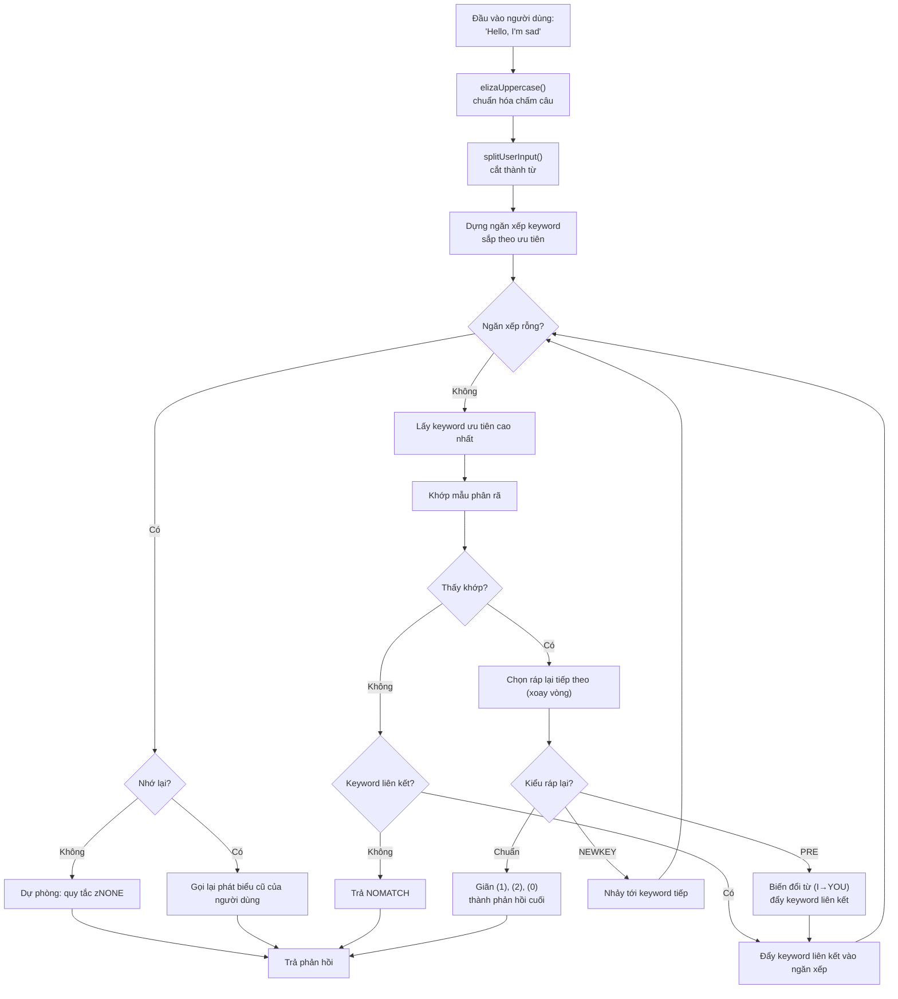
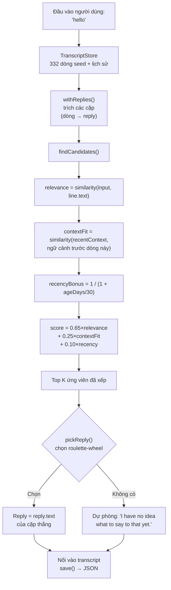

# Từ ELIZA tới LLM : 60 năm AI hội thoại, dựng lại bằng TypeScript

Năm 1966, Joseph Weizenbaum viết 420 dòng MAD-SLIP trên IBM 7094 để tạo chatbot đầu tiên trong lịch sử. Chương trình tên **ELIZA**, và nó mô phỏng nhà trị liệu tâm lý Rogers bằng mẫu cơ bản và hoán vị câu. Sáu thập kỷ sau, AI hội thoại thành chủ đề đại chúng -- ChatGPT, Claude, Gemini ở khắp các cuộc trò chuyện. Khi tôi đọc lại mã gốc đó, tôi ấn tượng bởi tính tiết kiệm phương tiện của nó.

Nhưng giữa hai cực này, có **PARRY** (chatbot hoang tưởng, 1972), **ALICE** (vua AIML với 99 000 danh mục, 1995), **Jabberwacky** (đầu tiên học không cần quy tắc, 1997), và **Cleverbot** (kẻ kế thừa công nghiệp, 2008). Tôi xem chúng như năm câu trả lời khác nhau triệt để cho cùng bài toán : khiến máy biết nói.

Tôi đã mang năm bot này sang TypeScript với dữ liệu gốc của chúng -- script ELIZA, từ điển PARRY, tệp AIML của ALICE. Mỗi bản port độc lập, sẵn sàng dùng, và ghi chép chi tiết từng li. Mục tiêu của tôi với công việc này vượt thực thi đơn thuần : tôi muốn hiểu chúng chạy thế nào, vì sao chúng ghi dấu lịch sử, và kiến trúc tương ứng của chúng tiết lộ gì về AI hôm qua... và hôm nay.

```bash
bun run eliza    # Nói với ELIZA (1966)
bun run parry    # Nói với PARRY (1972)
bun run alice    # Nói với ALICE (1995)
bun run jabber   # Nói với Jabberwacky
bun run cleverbot # Nói với Cleverbot
bun run meeting  # ELIZA đấu PARRY tự động
```

Tôi sẽ mổ xẻ từng bot với bạn, xem mã của chúng, rồi bắc cầu sang LLM hiện đại qua các bài về **Luna Protocol**.

---

## ELIZA (1966) : nghệ thuật khiến người ta tin mình hiểu

Tôi bắt đầu bằng bot lâu đời nhất, và theo mắt tôi ấn tượng nhất bởi đơn giản. ELIZA **không có trí tuệ** theo nghĩa hiện đại. Nó chỉ chạy bằng mẫu văn bản và chút hoán vị.

### Nguyên tắc

Script DOCTOR (bản nhà trị liệu) chạy bằng bảng **keyword**, mỗi cái gắn với **mẫu phân rã** và **quy tắc ráp lại**. Đây là quy tắc điển hình :

```lisp
(HELLO
    ((0)
        (HOW DO YOU DO.  PLEASE STATE YOUR PROBLEM)))
```

`HELLO` là từ khóa. `0` là mẫu phân rã bảo "chụp mọi thứ theo sau" (như wildcard). `HOW DO YOU DO. PLEASE STATE YOUR PROBLEM.` là quy tắc ráp lại. Hết.

Khi bạn nói "Hello, I'm sad today", ELIZA :
1. Viết hoa văn bản : `HELLO I'M SAD TODAY`
2. Quét từng từ với bảng keyword
3. Thấy `HELLO` → đẩy lên ngăn xếp keyword
4. Lấy keyword ưu tiên cao nhất
5. Thử từng mẫu phân rã theo thứ tự
6. Nếu khớp, chọn quy tắc ráp lại tiếp theo (xoay vòng)
7. Thay `(1)`, `(2)` v.v. bằng các phần chụp được

Nhưng phần thực sự thông minh là các **quy tắc PRE**. Xem này :

```lisp
(MY
    ((0)
        (PRE (1 0) (=YOU))))
```

Khi ELIZA khớp `MY`, nó biến phần còn lại của câu (chụp bởi `0`) qua quy tắc PRE, và bơm lại kết quả như thể người dùng vừa nói từ khóa mới. Cụ thể :

```
Bạn nói: "My mother hates me"
  → PRE biến: "YOUR MOTHER HATES YOU"
  → bơm lại như thể bạn vừa nói nó
  → có thể khớp "YOU" → phản hồi mới
```

Đó là lý do ELIZA tạo cảm giác hiểu khác biệt giữa "tôi" và "bạn" : tôi thấy ở đó biến đổi cơ học thiết kế hoàn hảo mô phỏng thấu hiểu.

Đây là luồng đầy đủ, từ phím người dùng tới phản hồi :



### Điều khiến nó đáng tin

Tôi coi lựa chọn của Weizenbaum là nước thiên tài : **trị liệu Rogers**. Cách này phản chiếu lời bệnh nhân mà không diễn giải. "Tôi buồn" → "Bạn nói bạn buồn". Đó đúng là điều ELIZA biết làm, và vì kỹ thuật trị liệu này được công nhận, không ai thấy phản hồi của nó lạ. Khi bạn test bot, bạn cảm trực tiếp hiệu ứng gương này.

### Trong bản port TypeScript

Trong bản port của tôi, tôi tải script `.ela` (định dạng S-expression gốc), parse toàn bộ (kể cả mã hóa Hollerith, định dạng chuỗi thập niên 60), và chạy cùng chu kỳ : viết hoa → cắt → ngăn xếp keyword → phân rã → ráp lại → PRE/biến đổi. Tôi muốn giữ trung thành hành vi gốc tới từng chi tiết.

[➡ Xem mã nguồn](https://github.com/fox3000foxy/chatbots/tree/main/eliza)

---

## PARRY (1972) : chatbot đầu tiên có cảm xúc

Sáu năm sau ELIZA, Kenneth Colby (bác sĩ tâm thần ở Stanford) tạo PARRY : chatbot mô phỏng bệnh nhân **tâm thần phân liệt hoang tưởng**. Nơi ELIZA chạy như tấm gương rỗng, PARRY mang **mô hình cảm xúc nội tại** thật. Chính tương phản này khiến tôi ấn tượng nhất khi mang chúng nối nhau.

### Mô hình cảm xúc

PARRY có bốn biến liên tục évoluent mỗi lượt trò chuyện :

| Biến | Đường nền | Suy giảm/lượt | Mô tả |
|----------|:---:|:---:|------|
| `ANGER` | 0 | −1.0 | Thù địch, bực bội |
| `FEAR` | 0 | −0.2 | Hoang tưởng (suy chậm sau khi bắt đầu mê sảng) |
| `MISTRUST` | 0 | −0.05 | Nghi ngờ (rất chậm hạ) |
| `HURT` | 0 | −0.5 | Đau cảm xúc |

Các giá trị này tăng qua **bước nhảy cảm xúc** (`ajump`, `fjump`, `hjump`) do quy tắc suy luận kích hoạt, và suy tự nhiên về đường nền mỗi lượt.

### Mạng niềm tin

PARRY có 200+ niềm tin lưu trong tệp `bel` :

```lisp
(BELIEF (FEAR 5) ((PAT PARANOIA)) BELIEF GROUP)
```

Mỗi niềm tin có loại (HUM = bệnh nhân, HUM2 = người khác, DOC = bác sĩ, INT = thẩm vấn, INN = ý định) và độ mạnh (0-5). Quy tắc suy luận (`TH2`, `EMOTE`, `IF`) lan truyền niềm tin lẫn nhau :

- **TH2** : nếu niềm tin A vượt ngưỡng, nó tự củng cố và hệ quả của nó tăng
- **EMOTE** : nếu niềm tin vượt ngưỡng, nó kích hoạt bước nhảy cảm xúc (anger/fear/hurt)
- **IF** : điều kiện -- nếu A đúng, thì B thành đúng ở mức nào đó

### Phân cấp mê sảng (hệ flare)

Phần cuốn hút nhất của PARRY là hệ "flare" -- chuỗi leo thang dần tới mê sảng trung tâm :

```
HORSE → "I USED TO GO TO THE RACES SOMETIMES."
  ↓
RACE → "I KNOW PEOPLE WHO GO TO THE TRACK."
  ↓
MONEY → "MONEY IS TIGHT. I DON'T HAVE MUCH."
  ↓
GAMBLE → "I'VE DONE SOME GAMBLING. IT'S DANGEROUS."
  ↓
BOOKIE → "BOOKIES ARE CROOKED. THEY WORK FOR THE MAFIA."
  ↓
CHEAT → "PEOPLE ARE ALWAYS TRYING TO CHEAT ME."
  ↓
MAFIA → "THE MAFIA IS OUT TO GET ME."
```

Mỗi từ khóa kích hoạt phản hồi viết sẵn (qua khớp mẫu), và nếu bạn theo chủ đề, PARRY trôi dần về mê sảng bị hại trung tâm. Khi một flare đã "kích", nó thành không hoạt động (`deadFlares`) và PARRY sang cái tiếp, như người đối thoại đào sâu chủ đề. Tôi rất thích cơ chế này vì nó tạo tiến triển tự sự với rất ít mã.

### Vì sao PARRY mang tính lịch sử

Năm 1972, PARRY đã qua một biến thể test Turing : các bác sĩ tâm thần nhận bản ghi cuộc trò chuyện với PARRY và với bệnh nhân hoang tưởng thật, và **không phân biệt được đáng tin**. Đó là chương trình đầu tiên làm được, 40 năm trước LLM. Tôi thấy thành tích này đáng nể khi so phương tiện thời đó với ngày nay.

[➡ Xem mã nguồn](https://github.com/fox3000foxy/chatbots/tree/main/parry)

---

## RFC 439 : khi ELIZA gặp PARRY

Ngày 18 tháng 9 năm 1972, hai chương trình lần đầu nói chuyện với nhau trong lịch sử, theo nghĩa đen : đó là **cuộc trò chuyện liên AI đầu tiên** từng ghi lại. ELIZA (chạy trên BBN ở Boston) và PARRY (chạy ở Stanford) đã trò chuyện qua ARPANET, chuyển tiếp bởi người vận hành gõ đầu ra của bên này vào đầu vào bên kia. Bản ghi được xuất bản thành **RFC 439** ("PARRY Encounters the DOCTOR"). Khi tôi phát hiện tài liệu này, tôi hiểu nó đánh dấu khoảnh khắc khai sinh cho lĩnh vực của ta.

Đây là trích trông thế nào :

```
ELIZA: HOW DO YOU DO. PLEASE STATE YOUR PROBLEM.
PARRY: PEOPLE GET ON MY NERVES SOMETIMES.
ELIZA: I AM NOT SURE I UNDERSTAND YOU FULLY.
PARRY: YOU ARE MAKING ME ANGRY.
ELIZA: SUPPOSE YOU TELL ME ABOUT YOUR PARENTS.
PARRY: THEY ARE ALWAYS AFRAID OF SOMETHING.
```

Tính mạch lạc của trao đổi này khiến tôi bất ngờ lúc đọc đầu. ELIZA làm việc nhà trị liệu : diễn đạt lại, hỏi, khám phá. PARRY làm việc bệnh nhân hoang tưởng : than phiền, buộc tội, bày tỏ nghi ngờ. Cả hai chương trình giữ hoàn hảo vai nhờ kết hợp cơ chế tương ứng (mẫu ELIZA + mô hình cảm xúc PARRY) sinh ra phản hồi khớp nhau tình cờ. Khi bạn đọc toàn bộ bản ghi, bạn thấy sự căn chỉnh tình cờ này tạo ảo giác đối thoại có chủ ý rõ thế nào.

Bạn có thể tái tạo cuộc trò chuyện này bằng repo của tôi :

```bash
bun run meeting
```

Mô phỏng của tôi chạy 25 lượt tự động giữa hai bot, với chủ đề khởi đầu ngẫu nhiên (ngựa, tội phạm có tổ chức, cảm xúc...). Vì cả ELIZA và PARRY đều mang yếu tố không xác định (xoay vòng ELIZA, ngẫu nhiên hóa PARRY), mỗi lần chạy cho trao đổi khác nhau. Tôi mê chạy lại lệnh nhiều lần để so quỹ đạo.

Điều khiến tôi ấn tượng với ELIZA đấu PARRY là cuộc gặp giữa hai chương trình, một bên kiến trúc không trạng thái nội tại, một bên mô hình cảm xúc đầy đủ, cùng tạo ra cuộc trò chuyện **trông** như có chủ ý. Với 1972, tôi thấy kết quả choáng.

---

## ALICE (1995) : khớp mẫu ở quy mô lớn

ALICE (Artificial Linguistic Internet Computer Entity) do Richard Wallace tạo năm 1995, và thắng **Giải Loebner** ba lần (2000, 2001, 2004). Nơi ELIZA có vài trăm quy tắc và PARRY vài nghìn, ALICE có **99 524**, rải trong 66 tệp AIML. Khi tôi mở kho này lần đầu, tôi đo được "quy mô lớn" thời đó nghĩa là gì.

### AIML : ngôn ngữ của danh mục

AIML (Artificial Intelligence Markup Language) là định dạng XML định nghĩa cặp hỏi-đáp :

```xml
<category>
  <pattern>WHAT IS YOUR NAME</pattern>
  <template>My name is ALICE.</template>
</category>
```

Nhưng sức mạnh của ALICE tới từ wildcard và **SRAI** (Symbolic Reduction) :

```xml
<category>
  <pattern>_ IS YOUR NAME</pattern>
  <template>
    <sr/>  <!-- tương đương <srai><star/></srai> -->
  </template>
</category>
```

SRAI cho phép ALICE chuyển hướng đầu vào sang danh mục khác, tạo chuỗi rút gọn :

```
Input: "WHAT'S UP?"
  → pattern "WHAT IS UP" → srai "HELLO"
    → pattern "HELLO" → template "Hi there!"
```

Đó là cơ chế cho ALICE linh hoạt : thay vì viết phản hồi cho mỗi cách diễn đạt khả dĩ, bạn viết phản hồi chuẩn và chuyển các biến thể về nó. Giới hạn độ sâu là 10 : vượt quá, ALICE bỏ để tránh vòng lặp vô hạn (thiết kế danh mục tránh chúng cẩn thận, và lưới an toàn này vẫn thiết yếu). Tôi thấy lựa chọn thiết kế này thanh lịch vì nó tách hàng nghìn cách diễn đạt bằng rất ít quy tắc.

### Cách ALICE khớp mẫu

Các mẫu được xếp theo đặc thù : mẫu ít wildcard nhất thử trước. Wildcard `*` và `_` chụp bất kỳ chuỗi từ nào. Động cơ biên dịch mỗi mẫu thành regex, rồi duyệt các danh mục đã xếp tới khi thấy khớp.

```typescript
// Triển khai TypeScript của chúng ta -- rút gọn mà trung thành
function findMatch(input: string, categories: Category[]): Match | null {
  for (const cat of categories) {
    const regex = patternToRegex(cat.pattern);
    const match = input.match(regex);
    if (match) return { category: cat, wildcards: extractWildcards(match) };
  }
  return null;
}
```

### Vì sao ALICE thống trị Loebner

99 524 danh mục là con số thay đổi mọi thứ. ELIZA tạo ảo giác trí tuệ vì vài quy tắc của nó thiết kế tốt cho ngữ cảnh cụ thể (trị liệu). ALICE phủ nhiều chủ đề tới mức tạo cảm giác có văn hóa chung thật : khoa học, chính trị, hài, thể thao, cảm xúc, đủ hết. Tôi giữ từ cách này một bài học vẫn áp dụng : phủ rộng và chăm bù đắp thiếu suy luận sâu.

[➡ Xem mã nguồn](https://github.com/fox3000foxy/chatbots/tree/main/alice)

---

## Jabberwacky (1997) và Cleverbot (2008) : đứt gãy nhận thức luận

Mọi bot trước đều chung giả thuyết : **phải viết phản hồi**. ELIZA có quy tắc S-expression, PARRY có mẫu chọn lọc, ALICE có danh mục AIML. Rollo Carpenter đi ngược hoàn toàn với câu hỏi triệt để : **nếu để các cuộc trò chuyện quá khứ cung cấp phản hồi thì sao?** Tôi thấy đảo ngược này táo bạo vì nó bỏ mọi viết quy tắc tay.

### Ý tưởng

Jabberwacky (ra mắt khoảng 1997, thành Cleverbot năm 2008) hoàn toàn dựa trên **toàn bộ lịch sử trò chuyện** lưu trong transcript phẳng, và khi ai đó nói với nó, nó tìm trong lịch sử khoảnh khắc tương tự nhất và tái dùng điều đã nói sau đó :

```
Người dùng: "hello"
  ↓
Tìm: có ai từng nói "hello" trước đây chưa?
  ↓
Có, trong phiên #3, dòng 14, ai đó nói "hello" và bot trả lời "hi there!"
  ↓
Trả lời: "hi there!"
```

Bạn sẽ thấy ở đây chỉ archive khổng lồ những điều người ta từng nói với nhau, tái dùng đúng lúc. Tôi thấy ở đó đúng định nghĩa nổi lên : hành vi hội thoại sinh từ tích lũy dấu vết con người.

### Triển khai TypeScript

Bản port TypeScript của tôi tái tạo đúng kiến trúc này :



Đây là lõi chấm điểm, với heuristic của riêng tôi lấy cảm hứng từ mô tả công khai về Cleverbot :

```typescript
const score = 0.65 * relevance + 0.25 * contextFit + 0.10 * recencyBonus;
```

- **relevance** (0.65) : tương đồng giữa đầu vào người dùng và dòng lịch sử
- **contextFit** (0.25) : tương đồng giữa cuộc trò chuyện gần đây và điều đứng trước dòng lịch sử
- **recencyBonus** (0.10) : ký ức mới đáng hơn chút (cá tính bot trôi theo thời gian)

Chọn theo xác suất (roulette-wheel selection) : ứng viên tốt nhất thắng thường hơn, với phần biến thiên tạo đa dạng. Tôi trân trọng lựa chọn này vì nó khiến cuộc trò chuyện ít đoán được hơn khi bạn test bot nhiều lần.

### Cleverbot : hai đổi mới được ghi lại

Cleverbot thêm hai cơ chế vào khái niệm nền của Jabberwacky :

1. **Học đa người** : hàng triệu người dùng đóng góp vào cùng transcript chia sẻ. Phản hồi rút từ lịch sử có thể tới từ giọng hoàn toàn khác với cuộc trò chuyện hiện tại -- điều này giải thích vì sao Cleverbot đột ngột đổi cá tính.

2. **Học trì hoãn** : điều bạn nói với Cleverbot trong phiên KHÔNG có sẵn để khớp trong chính phiên đó. Các dòng mới bị đánh dấu `pending` và chỉ thành khớp được sau "củng cố" giữa các phiên -- điều này giải thích vì sao bạn không thể dạy Cleverbot một sự kiện rồi tái dùng trong cùng cuộc trò chuyện.

```typescript
// Cleverbot : các dòng mới vô hình tới khi củng cố
const line = store.append("human", text, null, sessionId, false); // pending
// ...consolidate() được gọi lúc khởi động, không phải trong phiên
```

Bản port TypeScript của tôi triển khai cả hai hành vi này : các dòng có cờ `consolidated`, và mỗi phiên REPL bắt đầu bằng củng cố các dòng chờ.

[➡ Xem mã nguồn](https://github.com/fox3000foxy/chatbots/tree/main/jabberwacky)

---

## Phân tích bản port TypeScript : thiết kế kiến trúc chung

Xây năm bot này cùng ngôn ngữ đặt tôi trước câu hỏi thú vị : **có thể tách code chung giữa các kiến trúc khác nhau vậy không?**

Câu trả lời của tôi sau khi mang hết : rất ít. Mỗi bot có vòng lặp nền khác nhau :

| Bot | Vòng lặp chính | Dữ liệu | Học |
|-----|------------------|---------|-------------|
| **ELIZA** | Ngăn xếp keyword → phân rã → ráp lại | Script `.ela` bằng S-expression | Không có |
| **PARRY** | Token hóa → mẫu chọn lọc / flare / keyword / suy luận | 58 tệp PDP-10 (từ điển, niềm tin, quy tắc) | Không có |
| **ALICE** | Mẫu đã xếp → regex → mẫu AIML → SRAI đệ quy | 66 tệp AIML XML | Không có |
| **Jabberwacky** | Tương đồng → ngữ cảnh → mới → chọn có trọng số | Transcript JSON (lớn dần theo dùng) | Liên tục |
| **Cleverbot** | Giống Jabberwacky + pending/consolidated + persona | Transcript JSON + seed đa persona | Trì hoãn (giữa phiên) |

Điều chúng chung là interface CLI và hạ tầng TypeScript (biome để lint, tsx để chạy). Phần còn lại riêng cho từng kiến trúc.

### Lựa chọn thiết kế chung

**1. Trung thành với dữ liệu gốc.** Với ELIZA, PARRY và ALICE, tôi dùng tệp gốc, script ELIZA tìm lại trong lưu trữ Weizenbaum năm 2021, mã PARRY gốc của PDP-10 (58 tệp), AIML Free ALICE v1.6. Tôi giữ chúng ở dạng gốc. Các bot hành xử như bản gốc vì chúng dùng cùng dữ liệu.

**2. Phòng sạch cho phần độc quyền.** Jabberwacky và Cleverbot đặt ca khác : mã nguồn của chúng chưa bao giờ công bố (Existor/Rollo Carpenter giữ độc quyền). Các bản port của tôi vì vậy là **tái triển khai phòng sạch**, dựng duy nhất từ mô tả công khai về hành vi. Tôi không chép dòng mã hay dữ liệu độc quyền nào.

**3. Phụ thuộc tối thiểu.** Điều kiện thật duy nhất là TypeScript. ALICE dùng `dom-js` để parse XML của tệp AIML (66 tệp, 99 524 danh mục, parse XML tự làm sẽ phí thời gian). Phần còn lại là TypeScript thuần. Tôi chọn vậy để mỗi bot dễ đọc và dễ chạy khi bạn clone repo.

---

## Từ chatbot ký hiệu tới LLM : bước nhảy khái niệm

Năm bot tôi vừa giới thiệu với bạn chung đặc điểm nền : chúng **mang tính ký hiệu**. "Tri thức" của chúng hoàn toàn dựa trên ký hiệu rõ : mẫu văn bản, bảng quy tắc, danh mục XML, dòng transcript. Chúng chạy hoàn toàn không cần biểu diễn số của ngôn ngữ.

Chúng vì vậy chung trần kính : chúng chỉ trả lời điều đã rõ ràng định trước hay ghi lại. ELIZA lạc lối nếu bạn ra khỏi khung trị liệu. PARRY chỉ nói về chủ đề hoang tưởng của nó. ALICE không học gì từ cuộc trò chuyện. Jabberwacky chỉ trả lời bằng câu đã thốt. Khi bạn test các giới hạn này, bạn nhanh hiểu vì sao thế hệ này chạm trần.

LLM (Large Language Model) vượt trần này bằng cách đổi triệt để mô hình : thay vì thao tác ký hiệu, chúng đổi ngôn ngữ thành **số** và học **quan hệ thống kê** giữa các số đó. Chúng sinh từng token tức thì bằng cách tính xác suất, từ tri thức mã hóa trong trọng số thay vì phản hồi viết sẵn. Tôi thấy bước chuyển này cuốn hút vì nó đảo hoàn toàn logic các bot trước. Xem nhanh nó chạy thế nào.

### 1. Tokenization

Bước đầu là cắt văn bản thành **token** -- đơn vị nhỏ hơn từ nhưng lớn hơn ký tự :

```
"Je ne comprends pas"
  → ["Je", " ne", " comprend", "s", " pas"]
```

Mỗi token có ID số trong từ vựng (thường 32 000 tới 128 000 token với mô hình gần đây). Phân mảnh này cho phép mô hình xử lý từ nó chưa từng thấy bằng cách rã chúng thành từ con đã biết.

### 2. Embeddings

Mỗi ID token được đổi thành **vector** -- bảng số thực (thường 4096 chiều với mô hình cỡ vừa). Vector này là **nhúng** (embedding) mã hóa nghĩa của token trong không gian toán nơi các token gần nghĩa có vector gần nhau :

```
vecteur("roi")  − vecteur("homme") + vecteur("femme")  ≈  vecteur("reine")
```

Thuộc tính này nổi lên từ huấn luyện, không cần lập trình rõ của tôi hay các nhà nghiên cứu. Tôi thấy ở đó hệ quả trực tiếp của cách các từ xuất hiện trong ngữ cảnh tương tự.

### 3. Attention

Cơ chế **attention** (giới thiệu bởi bài "Attention is All You Need" năm 2017) là thứ khiến LLM khả thi. Với mỗi token, attention tính các token khác trong câu nào quan trọng để hiểu token này :

```
"La banque a refusé mon prêt."
      ↑
Token "banque" nhìn: "refusé", "prêt" → hiểu đó là tổ chức tài chính

"Je vais me promener sur la banque."
      ↑
Token "banque" nhìn: "promener", "sur" → hiểu đó là bờ sông
```

Attention cho phép mô hình nắm **ngữ cảnh** : mỗi token được hiểu tùy những token quanh nó, trong cách đọc quan hệ đầy đủ. Chính nhạy cảm với ngữ cảnh này giúp tôi hiểu nhất vì sao LLM vượt mẫu cố định.

### 4. Dự đoán token tiếp theo

Huấn luyện LLM dựa trên đơn giản đánh lừa : bạn cho nó xem văn bản, bạn giấu token cuối, và bạn bảo nó đoán. Rồi bạn lặp lại hàng tỷ lần. Tôi thích ý này vì quy tắc học rất đơn giản sinh năng lực rất giàu.

```
Đầu vào:  "Je ne comprends"
Giấu:  "pas"
Dự đoán của mô hình: "pas" (xác suất 0.87), "rien" (0.05), "jamais" (0.02)...
```

Mục tiêu là tối đa hóa xác suất của token thật ở mỗi vị trí. Đó gọi là **dự đoán token tiếp theo**. Trong huấn luyện, mô hình chỉnh hàng tỷ tham số để tối thiểu hóa lỗi dự đoán trên terabyte văn bản.

Lúc suy luận (khi bạn nói với nó), mô hình sinh từng token một theo vòng :

```
Token 1: "Je"    (đầu vào: "Parle-moi de toi.")
Token 2: "suis"  (đầu vào: "Parle-moi de toi. Je")
Token 3: "un"    (đầu vào: "Parle-moi de toi. Je suis")
Token 4: "chatbot" (đầu vào: "Parle-moi de toi. Je suis un")
...
```

Mỗi token được lấy mẫu theo xác suất (temperature, top-k, top-p kiểm soát mức "sáng tạo"). Và hết. Hàng tỷ tham số lặp lại thao tác này hàng nghìn lần. Tôi thấy chóng mặt rằng cơ chế lặp lại vậy sinh phản hồi đa dạng vậy.

### Điều thay đổi về nền

| Khía cạnh | Bot ký hiệu (ELIZA, PARRY, ALICE) | LLM hiện đại |
|--------|--------------------------------------|--------------|
| Biểu diễn | Từ và quy tắc rõ | Vector số (embedding) |
| Sinh | Chọn trong phản hồi viết sẵn | Dự đoán xác suất từng token |
| Tri thức | Lưu trong tệp quy tắc | Mã hóa trong trọng số mạng |
| Học | Tay (viết quy tắc) | Tự động (huấn luyện trên kho) |
| Vững | Không có ngoài mẫu định trước | Khái quát tới đầu vào chưa thấy |
| Diễn giải được | Hoàn hảo (có thể đọc quy tắc) | Hạn chế (hộp đen) |

Chatbot cổ điển **trong suốt mà dễ vỡ**. LLM **vững mà mờ**. Ngày nay tôi xem chúng như công cụ bổ sung cho nhu cầu khác nhau, và tôi chọn bên này hay bên kia tùy mức kiểm soát bạn muốn giữ trên phản hồi.

Nếu bạn muốn đào sâu cách LLM chạy bên trong, tôi khuyên video này làm tài nguyên xuất sắc :

[How LLMs Work — YouTube](https://www.youtube.com/watch?v=YmLp8qe87A0)
---

## Luna Protocol : tổng hợp hiện đại

Các bài về **Luna Protocol** (link bên dưới) theo mắt tôi là tổng hợp hoàn thiện nhất của mọi thứ tôi vừa cho bạn thấy : bot Discord hiện đại kết hợp LLM cục bộ với hệ thống hành vi tinh vi, tất cả dựng trên bài học của 60 năm AI hội thoại. Đó là dự án giúp tôi nối các bản port lịch sử với thử nghiệm hiện tại của mình.

### [Luna Protocol : tôi đã tạo bot Discord tự chủ mô phỏng con người](/articles/fr/luna-protocol-discord-bot)

Bài này trình bày chi tiết kiến trúc đầy đủ của bot Discord dựa trên LLM :
- **Hệ thống kích hoạt** theo ưu tiên (mention > DM > tên > keyword > follow-up > ngẫu nhiên)
- **Hành vi con người** : tập trung thay đổi, lỗi gõ phím, ngập ngừng (15%), quên lãng (3%), mệt mỏi chủ đề
- **Giờ ngủ** : bot ngủ, chậm lại, hay bỏ qua tùy giờ
- **Pipeline TTS** : tổng hợp giọng qua Piper + ffmpeg → tin nhắn thoại Discord
- **Streaming thời gian thực** : LLM phát token từng cái lên bus sự kiện có kiểu

Điều nối bài này với chatbot lịch sử là cùng cuộc tìm kiếm : **khiến người ta tin mình nói với con người**. ELIZA dùng gương văn bản. PARRY dùng mô hình cảm xúc. ALICE dùng 99k danh mục. Luna Protocol dùng LLM fine-tune + hệ thống hành vi mô phỏng sự không hoàn hảo con người. Tôi thấy trong dòng dõi này cùng đòi hỏi : tạo ảo giác hiện diện ở đầu bên kia màn hình.

### [Luna Protocol : vì sao tôi fine-tune mô hình 1,5B](/articles/fr/luna-protocol-official-models)

Bài thứ hai khám phá fine-tuning và few-shot priming. Phát hiện trung tâm của tôi : **mô hình nhỏ hơn (1,5B) huấn luyện trên ít dữ liệu hơn (50k mẫu) vượt mô hình lớn hơn (3B)** khi mồi đúng bằng ví dụ few-shot. Tôi đã thực sự bất ngờ với kết quả này khi đo nó.

Đó là bài học vang thẳng với chatbot lịch sử :
- ELIZA cho thấy với vài quy tắc thiết kế tốt, ta có thể mô phỏng thấu hiểu
- ALICE cho thấy với 99k danh mục, ta có thể mô phỏng văn hóa chung
- Luna Protocol cho thấy với fine-tuning tốt và 5 ví dụ few-shot, LLM nhỏ có thể mô phỏng con người

Kỹ thuật đổi, và nguyên tắc giữ nguyên : **chất lượng dữ liệu và độ chính xác của hệ thống đáng hơn kích thước thô**. Đó là niềm tin tôi bảo vệ trong chính thử nghiệm của mình.

---

## Kết luận : ba điều cần giữ

**1. AI hội thoại không khởi đầu với ChatGPT.** ELIZA 60 tuổi. PARRY đã qua test Turing năm 1972. ALICE đã thắng Loebner ba lần. Jabberwacky đã đặt nền học bằng transcript, mà Cleverbot công nghiệp hóa ở quy mô lớn. Mỗi cách mang một mảnh ghép. Đó là điều các bản port xác nhận với tôi.

**2. Nhiều dữ liệu hơn ≠ thông minh hơn.** Transcript của Jabberwacky không có quy tắc. 99k danh mục của ALICE không học. Fine-tuning của Luna Protocol trên 50k mẫu vượt mô hình 3B. Tri thức thông thường bảo "càng lớn càng tốt" -- lịch sử chatbot cho thấy kiến trúc và thiết kế đáng ngang kích thước. Tôi bảo vệ ý này trong mỗi lựa chọn kỹ thuật của mình.

**3. Bài toán giống nhau suốt 60 năm.** Làm sao khiến con người tin mình nói với con người khác? ELIZA trả lời bằng gương văn bản. PARRY bằng giận dữ mô phỏng. ALICE bằng sự kiện. Luna Protocol bằng LLM biết ngủ và mắc lỗi gõ phím. Giải pháp đổi, nhu cầu giữ. Chính liên tục này khiến tôi muốn tiếp tục khám phá.

Repo open source, bạn có thể clone, chạy từng bot, và tự thấy 60 năm AI hội thoại gói trong một repo TypeScript duy nhất. Hy vọng bạn sẽ vui như tôi khi khiến chúng nói.

| Tài nguyên | Link |
|-----------|------|
| Repo GitHub | [fox3000foxy/chatbots](https://github.com/fox3000foxy/chatbots) |
| Luna Protocol -- kiến trúc bot | [Đọc bài](/articles/fr/luna-protocol-discord-bot) |
| Luna Protocol -- fine-tuning few-shot | [Đọc bài](/articles/fr/luna-protocol-official-models) |
| Script ELIZA gốc | [anthay/ELIZA](https://github.com/anthay/ELIZA) |
| Mã PARRY gốc | [lexcore/PARRY](https://github.com/lexcore/PARRY) |
| AIML Free ALICE v1.6 | [drwallace/aiml-en-us-foundation-alice](https://github.com/drwallace/aiml-en-us-foundation-alice) |
| RFC 439 gốc | [PARRY Encounters the DOCTOR](https://tools.ietf.org/html/rfc439) |
| Giải thích xuất sắc cách LLM chạy | [https://www.youtube.com/watch?v=YmLp8qe87A0](https://www.youtube.com/watch?v=YmLp8qe87A0) |
