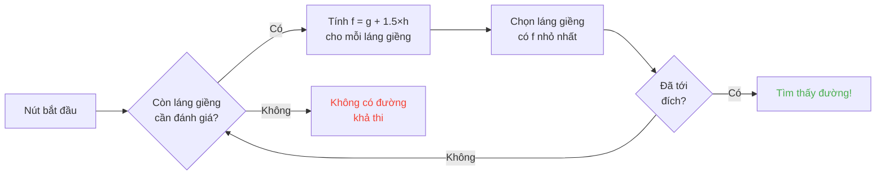

## Giới thiệu

Tôi từng dành hàng giờ nhìn cừu húc đầu vào tường.

Và thật lòng? Khoản đầu tư tốt nhất đời tôi.

Vì càng nhìn các mob này, bạn càng nhận ra chúng chẳng có gì ngẫu nhiên. Mỗi chuyển động đều được code, đoán được, và nhất là phá được hoàn toàn. Cuối cùng tôi lặn vào mã nguồn Minecraft để hiểu chính xác pathfinding chạy thế nào, và điều tôi phát hiện là bạn có thể mind-control mob theo nghĩa đen. Kiểu, ép chúng đi nơi BẠN muốn, không phải nơi ngẫu nhiên quyết định.

Hướng dẫn này là mọi thứ tôi học được khi bới móc. AI, thuật toán A*, các điểm phạt ẩn, các exploit bạn có thể tung ra trong survival. Chuẩn bị cuốc đi.

---

## AI của mob chạy thế nào (tiết lộ : nó ngớ ngẩn)

### Các Goal

Mỗi mob có các *goal*. Đó là danh sách hành động nó CÓ THỂ làm và mức độ nó MUỐN làm. Số càng nhỏ càng ưu tiên, như todo list phiên bản hỗn loạn.

```java
protected void registerGoals() {
   this.goalSelector.addGoal(4, new Zombie.ZombieAttackTurtleEggGoal(this, 1.0, 3));
   this.goalSelector.addGoal(8, new LookAtPlayerGoal(this, Player.class, 8.0F));
   this.goalSelector.addGoal(8, new RandomLookAroundGoal(this));
   this.addBehaviourGoals();
}
```

Bạn từng thấy zombie lờ trứng rùa để đuổi theo bạn chưa? Đó là lý do : `ZombieAttackTurtleEggGoal` ưu tiên 4, trong khi `ZombieAttackGoal` (goal bảo nó cắn mặt bạn) ở ưu tiên 2.

Đúng, zombie thích ăn bạn hơn đập trứng. Tình yêu thật đẹp.

Goal thực sự khiến ta quan tâm là `WaterAvoidingRandomStrollGoal`, ưu tiên 7. Goal kiểu "chẳng có gì làm nên đi bừa". Chính ở đó mọi thứ thành thú vị.

### Chuyển động (hay "random march có 1/60 cơ hội xảy ra thế nào")

Mỗi tick (mỗi 0.05 giây), game gọi `canUse()` để xem mob có thèm di chuyển không. 1/60 cơ hội mỗi tick. Thiết kế hoàn toàn ngớ ngẩn, và tôi mê nó.

```java
public boolean canUse() {
   if (this.mob.hasControllingPassenger()) {
      return false;
   } else {
      if (!this.forceTrigger) {
         if (this.checkNoActionTime && this.mob.getNoActionTime() >= 100) {
            return false;
         }
         if (this.mob.getRandom().nextInt(reducedTickDelay(this.interval)) != 0) {
            return false;
         }
      }
      Vec3 $$0 = this.getPosition();
      if ($$0 == null) {
         return false;
      } else {
         this.wantedX = $$0.x;
         this.wantedY = $$0.y;
         this.wantedZ = $$0.z;
         this.forceTrigger = false;
         return true;
      }
   }
}
```

Tóm lại : nếu bạn đang cưỡi mob -> không, nếu mob chẳng làm gì 5 giây rồi -> không, nếu random nói không -> không. Game THỰC SỰ không muốn mob di chuyển.

Nhưng khi nó di chuyển, `getPosition()` tiếp quản :

```java
protected Vec3 getPosition() {
   if (this.mob.isInWater()) {
      Vec3 $$0 = LandRandomPos.getPos(this.mob, 15, 7);
      return $$0 == null ? super.getPosition() : $$0;
   } else {
      return this.mob.getRandom().nextFloat() >= this.probability
         ? LandRandomPos.getPos(this.mob, 10, 7)
         : super.getPosition();
   }
}
```

Nhìn hai số cuối : đó là bán kính XZ và bán kính Y. Trong nước, mob tìm xa hơn (15 thay vì 10). Nếu không thấy đất, nó quay về `super.getPosition()` chấp nhận nước. **Kết quả : mob MUỐN ra khỏi nước.** Đó là lý do thú của bạn bơi điên cuồng về bờ.

Chi tiết nhỏ giòn tan : có đúng 0.1% cơ hội mob lấy `super.getPosition()` thay vì `LandRandomPos`. Một phần nghìn. Đúng chất Mojang.

### LandRandomPos : tối ưu lởm thay đổi tất cả

Đây là bước tôi thích NHẤT. Mẩu ngớ ngẩn kỹ thuật đẹp nhất khiến pathfinding khai thác được.

```java
public static Vec3 getPos(PathfinderMob $$0, int $$1, int $$2, ToDoubleFunction<BlockPos> $$3) {
   boolean $$4 = GoalUtils.mobRestricted($$0, $$1);
   return RandomPos.generateRandomPos(() -> {
      BlockPos $$4xx = RandomPos.generateRandomDirection($$0.getRandom(), $$1, $$2);
      BlockPos $$5 = generateRandomPosTowardDirection($$0, $$1, $$4, $$4xx);
      return $$5 == null ? null : movePosUpOutOfSolid($$0, $$5);
   }, $$3);
}
```

`movePosUpOutOfSolid`. Tên nói hết. Nếu vị trí chọn nằm trong khối đặc, game đẩy nó lên tới khi ra ngoài không khí.

Đó là tối ưu : thay vì phí thời gian bỏ qua vị trí dưới đất, game nâng chúng lên mặt đất. Khôn? Có. Nhưng nó tạo thiên lệch khủng : **mob thích chỗ cao**.

Tưởng tượng. Bạn có đống khối dưới mặt đất, game sinh 10 vị trí ngẫu nhiên. Những cái trong khối bị đẩy lên trên. Vùng đặc (dưới đồi) cho nhiều vị trí hợp lệ hơn vùng rỗng. Kết quả : mob về mặt thống kê đi về đồi thường hơn.

Tin tôi đi, ta sẽ phá cái này trong 2 phút.

### Lựa chọn : cuộc thi khối giỏi nhất

10 vị trí, một người thắng, cuộc thi chấm điểm :

```java
public static Vec3 generateRandomPos(Supplier<BlockPos> $$0, ToDoubleFunction<BlockPos> $$1) {
   double $$2 = Double.NEGATIVE_INFINITY;
   BlockPos $$3 = null;
   for(int $$4 = 0; $$4 < 10; ++$$4) {
      BlockPos $$5 = (BlockPos)$$0.get();
      if ($$5 != null) {
         double $$6 = $$1.applyAsDouble($$5);
         if ($$6 > $$2) {
            $$2 = $$6;
            $$3 = $$5;
         }
      }
   }
   return $$3 != null ? Vec3.atBottomCenterOf($$3) : null;
}
```

Vị trí điểm cao nhất THẮNG. Và nếu ta biết tiêu chí chấm, ta có thể cho vị trí mình muốn thắng. Như gian lận bầu cử.

---

## Sở thích của mob (hay "vì sao bò của bạn băng qua đường")

Mỗi mob có gu khác nhau. Và điều đó thay đổi tất cả.

| Mob | Khoái cái này |
| --- | --- |
| **Thú** (bò, cừu, lợn) | Cỏ và ánh sáng (hipster) |
| **Quái** (zombie, skeleton) | Bóng tối (edgelord) |
| **Rùa** | Nước, không thì cát, không thì ánh sáng |
| **Hoglin** | `crimson_nylium` ; ghét `warped_fungus` |
| **Strider** | Chỉ dung nham. KHÔNG gì khác. |
| **Silverfish** | Khối nhiễm được (hợp lý) |
| **Guardian** | Nước + ánh sáng (sang chảnh) |
| **Mooshroom** | Mycelium + ánh sáng (nấm) |
| **Ong** | Không khí. Đúng, chúng thích KHÔNG KHÍ. |

```java
// Thú : nhìn xuống, nếu là cỏ, điểm tối đa
public float getWalkTargetValue(BlockPos $$0, LevelReader $$1) {
   return $$1.getBlockState($$0.below()).is(Blocks.GRASS_BLOCK) ? 10.0F : $$1.getPathfindingCostFromLightLevels($$0);
}

// Quái : đúng ngược lại
public float getWalkTargetValue(BlockPos $$0, LevelReader $$1) {
   return -$$1.getPathfindingCostFromLightLevels($$0);
}
```

Kiểu quái đúng nghĩa "nếu có sáng, điểm âm, tôi đi chỗ khác". Chúng LÊN MẶT với ánh sáng.

Nên bạn có thể, theo nghĩa đen, dẫn thú bằng cỏ và ánh sáng, và dẫn quái bằng bóng tối. Vừa ngớ ngẩn vừa thiên tài.

---

## Thuật toán A* trong Minecraft (công thức bí mật)

Minecraft dùng thuật toán A* (A-star) cho pathfinding. Nhưng Mojang đã đặt dấu ấn :

```
f(n) = g(n) + 1.5 × h(n)
```

- **g(n)** = đường đã đi (1 mỗi khối, ~1.41 theo đường chéo)
- **h(n)** = khoảng cách chim bay
- **1.5** = vì Mojang thích giá trị hơi điên

Bình thường A* dùng `f(n) = g(n) + h(n)`. MOJANG THÊM HỆ SỐ 1.5. Vì sao? Để thuật toán lao nhanh hơn về đích và cắt bớt nhánh tìm kiếm. Kết quả : đường tìm được "ổn" nhưng không luôn tốt nhất. Đó là A* hơi say.



Chi tiết quan trọng : **mob chỉ pathfinder được trên 16 khối** (*follow range* của nó). Nếu đích quá xa, nó chọn khối gần nhất mà nó CÓ THỂ tới. Nghĩa là bạn có thể tạo khối nguyên thạch ngoài tầm với, và mob sẽ pathfinder về khối gần nhất đưa nó lại gần khối đó, khiến chuyển động của nó hoàn toàn đoán được.

### Hai exploit phá game

#### 1. Block update = ép tính lại

```java
public boolean shouldRecomputePath(BlockPos $$0) {
   if (this.hasDelayedRecomputation) return false;
   if (this.path != null && !this.path.isDone() && this.path.getNodeCount() != 0) {
      Node $$1 = this.path.getEndNode();
      Vec3 $$2 = new Vec3(
         ((double)$$1.x + this.mob.getX()) / 2.0,
         ((double)$$1.y + this.mob.getY()) / 2.0,
         ((double)$$1.z + this.mob.getZ()) / 2.0
      );
      return $$0.closerToCenterThan($$2, (double)(this.path.getNodeCount() - this.path.getNextNodeIndex()));
   }
   return false;
}
```

Mỗi cập nhật khối gần đường của mob ép tính lại A* với cooldown 1 giây. Bạn đặt đồng hồ 1 giây cạnh mob, và nó tính lại đường LIÊN TỤC. Tương đương đặt GPS reset mỗi giây.

Và nếu bạn làm vậy với 50 mob cùng lúc? Lag city. RIP TPS.

#### 2. Điểm phạt khối (Pathfinding Malice)

Vài khối khiến mob sợ. Theo nghĩa đen. Mỗi khối có chi phí kèm theo, định nghĩa bởi enum :

| Khối / Điều kiện | Điểm phạt |
| --- | --- |
| **Khối mật ong** | +8 để đi qua |
| **Tuyết bột** | Không thể vượt |
| **Cửa đóng** | Không thể vượt |
| **Lửa** | +16 để đi qua, +8 để đi men theo |
| **Thú và Dân làng** | Lửa = -1 (KHÔNG) |
| **Xương rồng / Berry ngọt** | Không thể vượt ; kề bên = +8 |
| **Nước** | +8 để đi qua hay men theo |
| **Magma** | +8 để men theo (ui da) |

Thú còn cực đoan hơn :

```java
protected Animal(EntityType<? extends Animal> $$0, Level $$1) {
   super($$0, $$1);
   this.setPathfindingMalus(PathType.DANGER_FIRE, 16.0F);
   this.setPathfindingMalus(PathType.DAMAGE_FIRE, -1.0F);
}
```

DAMAGE_FIRE ở -1.0F, đúng nghĩa "cấm". Thú thà lao xuống vực còn hơn băng qua lửa. Phù.

### Bài tập : cuộc thi đường lớn

Tưởng tượng một dân làng phải chọn giữa nhiều đường.

- **Đường A** : 15 khối nhưng 6 khối men theo nước (+8 mỗi cái)
- **Đường B** : 18 khối với 2 khối nước (+8) và 1 khối kề nước (+8)
- **Đường C** : 14 khối thẳng tắp... nhưng có lửa -> KHÔNG THỂ QUA với dân làng
- **Đường D** : 16 khối với 1 khối kề magma (+8) + 1 khối kề mật ong (+8)
- **Đường E** : 25 khối nhưng xương rồng khắp nơi (+8 khắp nơi) -> tổng chi phí 90.82

Nhẩm :
- Đường A : 15 khối + 6×8 cho nước = 15 + 48 = **63** ... nhưng còn phải cộng 1.5×khoảng cách. Tính thật đi.
- Đường B : dài hơn nhưng ít phạt hơn. Tổng cost = khoảng cách cộng dồn + điểm phạt.
- Đường D : magma và mật ong cộng dồn điểm phạt.

Thắng thường là **Đường B** : đi vòng đáng vì nước ĐẮT.
Dân làng về cơ bản là máy tính chi phí có chân.

### Mỗi mob có gu riêng

Dân làng : "lửa á? KHÔNG CẢM ƠN TẠM BIỆT"
Zombie : "lửa á? OK boomer *đi xuyên qua trong lửa cháy*"

Bạn có đúng nghĩa những con đường mob này đi mà mob khác không. Bạn có thể làm xa lộ cho dân làng nơi zombie tự thiêu.

---

## Dân làng : mớ hỗn độn tột cùng

OK, dân làng. Đó là hệ thống ít được hiểu nhất cả Minecraft. Nhưng khi đã nắm mã, bạn nhận ra chúng là cỗ máy đoán được với giờ hành chính.

### Cảm biến và trí nhớ

9 cảm biến, chạy mỗi 20 tick (1 giây). Mỗi cái quét bán kính quanh dân làng và lưu kết quả vào trí nhớ. Dân làng thấy hết, nhớ hết, và hành động theo.

Kiểu : "có kẻ thù không? có vật phẩm rơi không? có người chơi để nói chuyện không?" Nó kiểm tra TẤT CẢ.

### Các package (pha trong ngày của nó)

Não dân làng là các package hoạt động kích hoạt theo giờ :

| Package | Giờ | Dân làng... |
| --- | --- | --- |
| **Core** | 24/24 | Mở cửa, bơi (80% thời gian), và THU THẬP POI |
| **Work** | 8h-15h | "Tôi đi làm" -- đi về trạm làm việc |
| **Meet** | 15h-17h | "Nhậu thôi!" -- ra chuông, tám chuyện |
| **Rest** | 18h-6h | "Phải ngủ" -- đi ngủ |
| **Idle** | 6h-8h, 17h-18h | "Tôi lông bông" -- đi dạo, sinh em bé, nhảy lên giường |
| **Panic** | Thương tích/thù địch | "CỨU VỚI" -- CHẠY |

Package **Panic** là duy nhất có thể ngắt TẤT CẢ các package khác. Dù dân làng đang ngủ hay đang làm, nếu có zombie, HOẢNG LOẠN TOÀN DIỆN.

### Acquire POI : thứ cho phép redstone không dây

```java
Set<Pair<Holder<PoiType>, BlockPos>> $$12 = (Set)$$10xx.findAllClosestFirstWithType(
   $$0, $$11, $$8x.blockPosition(), 48, PoiManager.Occupancy.HAS_SPACE
)
```

`Acquire POI` quét trong bán kính 48 khối mọi POI (điểm quan tâm). Nó giữ 5 cái gần nhất, kiểm tra đường tồn tại, và thu thập cái đầu tiên tới được.

Mỗi POI có số slot giới hạn :
- **Trạm làm việc** : 1 slot
- **Giường** : 1 slot
- **Chuông** : 32 slot

Điểm ĐIÊN : **slot được giữ lúc thu thập, KHÔNG phải lúc tới nơi**. Dân làng có thể khóa composter từ đầu bên kia bản đồ, mà không bao giờ tới nơi.

Bạn nắm sức mạnh chưa?

### Redstone không dây. Đúng, KHÔNG DÂY.

1. Bạn nhốt dân làng trong minecart với đường tới composter
2. Nó thu thập composter (slot chiếm, không ai dùng được nữa)
3. Dân làng quá xa để bấm vào, bone meal còn nguyên
4. Bạn DẮT dân làng này đi bất cứ đâu trên thế giới, nó giữ slot
5. Khi muốn kích hoạt đồ của mình, bạn G I Ế T dân làng
6. Slot giải phóng, dân làng khác thu thập composter, lấy bone meal
7. BLOCK UPDATE -> bất kỳ mạch redstone nào kích hoạt

Bạn vừa tạo tín hiệu redstone không dây, truyền được khắp thế giới, không cần load chunk nào trên đường. Bạn có thể móc nó vào buồng stasis ender pearl, tự dịch chuyển từ bất cứ đâu bằng cách giết dân làng.

Cách dùng tôi thích nhất? Mini-game "thợ săn tiền thưởng" : bạn đặt nhiều dân làng với composter, người chơi phải giết ĐÚNG dân làng để kích hoạt lối ra. Cơ chế hoàn toàn wtf.

### Pathfinding Deadlock (hay "dân làng đứng hình mãi mãi")

Có bug QUÁ hay giữa `Acquire POI` (thấy đường) và điều hướng thật (từ chối đi). Xảy ra khi khối trên trạm làm việc không đi được. Kết quả :

- Package Core : "tôi muốn thu thập POI"
- Điều hướng : "tôi không đi đó được"
- Kết quả : dân làng ĐỨNG HÌNH, mãi mãi, tự giằng co với chính mình.

Đúng nghĩa dân làng đông cứng tại chỗ, dùng được làm trang trí hay "đạo cụ" trong build. Xe tăng giá giáp? Có. Lính gác không động? Có. Bệnh hoạn? Có thể. Nhưng hiệu quả.

---

## Kết luận

Pathfinding của mob Minecraft không phải ngẫu nhiên. Đó là hệ thống xác định, dựa trên điểm, đoán được VÀ phá được.

**Ba điểm cần nhớ :**

1. **Khối dưới chân = thiên lệch độ cao** : lấp đầy hay dọn sạch lòng đất để dẫn mob
2. **Điểm phạt khác nhau cho mỗi mob** : tạo đường mob này đi mà mob khác không
3. **Slot POI giữ từ xa** : redstone không dây miễn phí, dịch chuyển, đủ thứ

Mã nguồn Minecraft là mỏ vàng cơ chế ít khai thác. Tôi đã dành hàng giờ đọc Java dịch ngược và thật lòng? Mỗi dòng là Easter Egg chức năng. Chỉ có điều mấy cái này, bạn dùng trong survival để làm redstone không dây với dân làng. Game hay nhất xác nhận.
