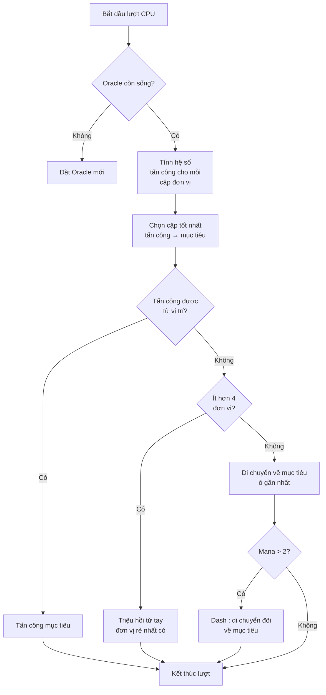

## AI ngu ngốc của tôi cho Nausicaa

Có những dự án khởi đầu bằng "hay làm game cờ kiểu thần thoại nhỉ?" và kết thúc bằng hệ thống có AI tự quyết siêu tham số của chính nó mỗi 5 lượt.

Nausicaa là vậy. Game cờ theo lượt nơi bạn xây deck sinh vật thần thoại, quản lý mana, triển khai đơn vị trên bàn 10x8. Và có AI lên cơn đa nhân cách.

Tôi đã dành khá nhiều thời gian cho AI này, và kết quả đôi khi vẫn vượt khỏi tôi, và đó là điều tôi thích nhất.

## Game thật

Trước khi nói về bộ não, phải hiểu cơ thể :

- Bàn 10x8, vùng triển khai 2 hàng cho mỗi người chơi
- Mana bắt đầu ở 1, +1 mỗi lượt, tối đa 6. Bạn tiêu để triệu hồi, tấn công, dùng kỹ năng
- Mục tiêu : giết Oracle đối phương

12 đơn vị, chi phí và mẫu di chuyển khác nhau :

| Đơn vị | Giá | Di chuyển | Máu |
| --- | --- | --- | --- |
| Oracle | 0 | Vua (8 hướng) | 1 |
| Gobelin | 1 | Tiến 3 ô | 1 |
| Harpie | 1 | Vua (8 hướng) | 1 |
| Naïade | 1 | Chéo | 1 |
| Griffin | 2 | Nhảy 2 ô | 2 |
| Sirène | 2 | Ngang | 1 |
| Centaure | 2 | Mã (chữ L) | 2 |
| Archer | 3 | Ngang | 1 |
| Phénix | 3 | Chéo (ô tối) | 1 |
| Métamorphe | 4 | Đổi chỗ | 1 |
| Voyant | 4 | Không (sinh mana) | 1 |
| Titan | 6 | Hạn chế (tấn công vùng) | 3 |

Mỗi đơn vị có mẫu tấn công riêng. Sirène đánh 4 đường chéo, Archer đánh xa 3 ô, Titan phá mọi thứ xung quanh khi triệu hồi. Tóm lại, game cờ kiểu thần thoại kèm deckbuilding.

## Cách tôi khiến CPU suy nghĩ

Ý tưởng nền ngớ ngẩn đơn giản : **mỗi đơn vị địch có hệ số hấp dẫn**. Nó càng nguy hiểm, AI càng muốn xử lý nó.

```javascript
const UNITS_ATTRACTIVENESS = {
    "oracle": 100,
    "titan": 95,
    "shapeshifter": 90,
    "phoenix": 80,
    "siren": 70,
    "archer": 70,
    "seer": 70,
    "griffin": 60,
    "centaur": 60,
    "harpy": 50,
    "naiad": 30,
    "gobelin": 20
};
```

Oracle ở 100 -- hợp lý, đó là điều kiện thắng. Titan ở 95 vì nó oneshot mọi thứ bên cạnh khi triệu hồi. Gobelin ở 20, đó là lính bộ, kệ nó.

Rồi với mỗi cặp đơn vị (một phe ta, một phe địch), tôi tính :

```
hứng_thú = hấp_dẫn × hệ_số_hấp_dẫn / (khoảng_cách × hệ_số_khoảng_cách)
```

Đại khái : bạn càng nguy hiểm và gần, AI càng muốn đập bạn.

```javascript
calculateAttackCoefficient(x1, y1, x2, y2) {
    const distance = this.calculateEuclideanDistance(x1, y1, x2, y2);
    if (distance === 0) return Infinity;
    return (UNITS_ATTRACTIVENESS[unit.type] * COEFFICIENTS_IMPORTANCE["attractiveness"]) / distance;
}
```

### Chiêu hệ số thay đổi

Điểm quan trọng là các hệ số tầm quan trọng **đổi ngẫu nhiên mỗi 5 lượt**.

```javascript
if (this.turnCount % 5 === 0) {
    const distanceCoefficient = parseInt(Math.random() * 100);
    const attractivenessCoefficient = parseInt(Math.random() * 100);
    this.regulateImportanceCoefficients({
        distance: distanceCoefficient,
        attractiveness: attractivenessCoefficient
    });
}
```

Lúc AI cực hiếu chiến (hấp dẫn 95, khoảng cách 5), nó băng qua mọi thứ để giết Oracle của bạn. Lúc sau nó ưu tiên khoảng cách và tái bố trí.

Việc này chôm từ ma Pac-Man -- Blinky săn, Pinky phục kích. Ở đây AI đổi "nhân cách" mỗi pha.

**Kết quả : không thể đoán AI suốt cả ván.** CPU không bao giờ chơi hai trận giống nhau.

### Oracle là kẻ nhát

Oracle địch bỏ chạy. Theo nghĩa đen.

```javascript
const awayFromTarget = {
    row: Math.max(0, Math.min(7, botUnitElement.row + (botUnitElement.row - targetUnitElement.row))),
    col: Math.max(0, Math.min(9, botUnitElement.col + (botUnitElement.col - targetUnitElement.col)))
};
```

Nó tính hướng ngược mối đe dọa và chuồn. Nếu có tường, nó tìm ô trống gần nhất theo hướng đó.

Bạn mất 3 lượt áp sát Oracle, và paf nó đã chạy sang đầu bên kia.

### Vòng lặp quyết định

Đây là cách AI quyết định :

1. Nếu tôi mất Oracle (chết), đặt cái mới
2. Tính hệ số cho mỗi cặp đơn vị phe ta → đơn vị phe địch
3. Chọn cặp tốt nhất
4. Nếu đơn vị có thể tấn công mục tiêu từ vị trí của nó → tấn công
5. Nếu tôi có dưới 4 đơn vị → triệu hồi đơn vị rẻ nhất có từ tay
6. Ngược lại, di chuyển về mục tiêu (ô di chuyển gần địch nhất)
7. Nếu đủ mana (> 2), dash (di chuyển đôi) để áp sát thêm
8. Nếu đơn vị là Oracle → bỏ chạy



```javascript
async makeAction(dash=false) {
    // tất cả nối tiếp
    // CPU dash nếu đủ mana
    if(botPlayer.mana > 2) {
        this.makeAction(true);
    }
}
```

### Vì sao khoảng cách Euclid

Tôi dùng khoảng cách Euclid :

```javascript
calculateEuclideanDistance(x1, y1, x2, y2) {
    const deltaX = Math.pow(x1 - x2, 2);
    const deltaY = Math.pow(y1 - y2, 2);
    return Math.sqrt(deltaX + deltaY) * COEFFICIENTS_IMPORTANCE["distance"];
}
```

Vì sao không phải Manhattan? Vì các đơn vị có mẫu di chuyển đa dạng (L như mã, chéo, v.v.). Khoảng cách chim bay là xấp xỉ nguy hiểm tốt hơn.

## Vì sao không minimax

Tôi có thể code minimax cổ điển. Nhưng với 12 kiểu đơn vị, mẫu di chuyển khác nhau, kỹ năng đặc biệt... cây game nổ nhanh tới mức không chơi được. Cách heuristic đưa ra lựa chọn thông minh mà không duyệt 10 triệu trạng thái.

## Điều hay

Hệ thống hấp dẫn tạo ra các thế khó vui :

- Voyant (70) sinh mana. Nếu bạn để nó sống, đối thủ có thêm tài nguyên. Nhưng Titan (95) còn nguy hiểm hơn.
- Métamorphe (90) có thể đổi chỗ với bất kỳ đơn vị nào. Nó có thể cướp Oracle của bạn.
- Harpie (50) có đòn nổ tự sát. Nó vẫn thứ yếu... tới khi nó đứng cạnh 3 đơn vị của bạn.

AI đánh giá nguy hiểm tổng thể theo vị trí, không chỉ stat thô.

Ngoài ra có hàm `activateSimulation()` để test kịch bản mà không chơi lại ván :

```javascript
activateSimulation() {
    // Đặt các đơn vị cụ thể lên bàn
    // Hữu ích để gỡ lỗi AI
    this.game.board = simulation.board;
    this.game.players = simulation.players;
}
```

## Điều thiếu

Nếu tôi có thêm thời gian :

- AI phản ứng với trạng thái hiện tại, nó không đoán điều người chơi sẽ làm
- Nó không lập kế hoạch tay bài nhiều lượt
- Métamorphe và Centaure có kỹ năng nó khai thác chưa hết
- Học tăng cường : cho nó tự đấu với chính nó để chỉnh hệ số

Nhưng với game trình duyệt thế là ổn. Bạn bè tôi thua được nó, nên coi như đạt.

## Thử

Có trên [nausicaa-game.github.io](https://nausicaa-game.github.io/). Bạn bấm "JOUER", bật CPU mode ON, và xem AI làm.

Lời khuyên : để AI tự đấu với chính nó. Bạn sẽ thấy các pha hiếu chiến, rồi pfft nó rút hết.

Mã trên [GitHub](https://github.com/nausicaa-game/nausicaa-game.github.io) trong `js/cpu.js`.

**3 điểm cần nhớ :**

1. **Hệ số heuristic** -- không minimax, mỗi đơn vị có độ hấp dẫn
2. **Hệ số đổi mỗi 5 lượt** -- AI luân phiên hiếu chiến và kiểm soát, kiểu Pac-Man
3. **Oracle bỏ chạy** -- nó tính hướng ngược mối đe dọa và chuồn

Nếu bạn có ý tưởng khiến AI nham hiểm hơn, hãy mở issue. Tôi có kế hoạch cho phiên bản học từ thất bại, nhưng đó sẽ là bài sau.
