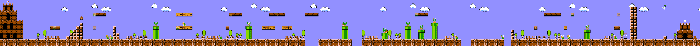

## Giới thiệu

Super Mario Bros. là 40 kilobyte ROM. Tám thế giới, 32 màn, kẻ thù, nhạc, power-up, tất cả vừa trong đó.

Nhưng nếu bạn mở trình giả lập và chọc đúng byte, bạn có thể tải màn 36-1. Hay 255-1. Hay đáp xuống thế giới mọi thứ làm bằng sprite Bowser và ống dẫn tới hư vô.

Các glitch world này tồn tại vì lý do đơn giản : hệ thống lưu màn của SMB1 là kỳ quan tối ưu 8-bit, và khi ta ép game đọc nơi không nên, nó cho kết quả cuốn hút.

Retro Game Mechanics Explained đã làm series 4 video về chuyện này -- ta sẽ gom chúng thành một lần lặn vào mã 6502 của game bán chạy nhất thời của nó.


## Warm start : vì sao RAM của Tennis sống sót trong SMB1

Trước khi nói lưu màn, phải hiểu SMB1 khởi động thế nào. Vì glitch cart swap NES Tennis hoàn toàn dựa trên **hệ thống phát hiện warm start / cold start** của game.

### 41 byte được giữ

Khi SMB1 phát hiện **cold start** (bật nguồn lần đầu hay tắt/bật nguồn), nó xóa sạch RAM. Nhưng khi nó phát hiện **warm start** (nút reset, không cắt nguồn), nó giữ vùng bộ nhớ **41 byte** :

```asm
; 41 byte được giữ trong RAM lúc warm start
; Địa chỉ $075F-$0787
;
; $075F : byte khởi động (world - 1)    [1 byte]
; $0760 : cờ chọn thế giới (nút B) [1 byte]
; $0761-$0762 : không dùng                    [2 byte]
; $0763-$0768 : timer (6 chữ số, 3 hiện) [6 byte]
; $0769-$076E : xu Luigi                   [6 byte]
; $076F-$0774 : xu Mario                   [6 byte]
; $0775-$077A : điểm Luigi                   [6 byte]
; $077B-$0780 : điểm Mario                   [6 byte]
; $0781-$0786 : điểm cao nhất (6 chữ số, 1 ẩn) [6 byte]
; $0787 : byte kỳ diệu $A5                 [1 byte]
```

41 byte này phục vụ một tính năng duy nhất : cho phép người chơi **tiếp tục ở cùng thế giới sau game over**. Nếu bạn chết ở 6-3, game ghi thế giới 6 vào byte khởi động, và ở màn hình tiêu đề, nếu bạn giữ A + Start, bạn bắt đầu lại ở 6-1.


### Kiểm tra kép warm start


Khi SMB1 boot, nó không kiểm tra một tiêu chí mà **hai** :

```asm
CheckWarmStart:
  ; 1. Kiểm tra byte kỳ diệu $A5 ở $0787
  lda $0787
  cmp #$A5
  bne ColdStart        ; không phải $A5 → cold start

  ; 2. Kiểm tra 6 chữ số của điểm cao nhất ($0781-$0786)
  ;    Mỗi chữ số phải từ 0 tới 9
  ldx #0
CheckLoop:
  lda $0781,x
  cmp #$0A
  bcs ColdStart        ; chữ số >= 10 → cold start
  inx
  cpx #6
  bne CheckLoop

  ; Nếu cả hai điều kiện qua → warm start
  ; RAM không bị xóa, thế giới khởi đầu được giữ
  jmp WarmStartBoot
```


Vì sao kiểm tra kép? Vì byte $A5 có thể tình cờ hiện diện (game khác để lại giá trị này, hay trạng thái nghỉ mặc định của chip RAM). Bằng cách kiểm tra các chữ số điểm cao nhất hợp lệ (0-9), ta đảm bảo dữ liệu nhất quán.

### Vì sao chỉ Tennis mới chạy

Khi ta lắp SMB1 lần đầu (cold start), game :
1. Xóa sạch RAM → điểm cao nhất = 0, byte world = 0
2. Ghi $A5 vào địa chỉ $0787

Rồi, ta swap sang Tennis mà không tắt máy. Tennis :
- **Không dọn RAM lúc khởi động** (ít game NES nào làm)
- **Không ghi lên các byte điểm cao nhất** → chúng vẫn 0 (hợp lệ)
- **Không đụng byte $A5** → nó vẫn ở đó
- **Dùng địa chỉ $075F** cho bộ đếm bước chân của người chơi

```asm
; Tăng footstep trong Tennis :
; Mỗi bước của người chơi trên sân, Tennis tăng byte ở $075F.
; Byte này cũng được SMB1 dùng làm "world number - 1".
;
; 0 bước  → world 0 → SMB1 = world 1
; 1-7 bước → world 1-7 → world thường
; 8+ bước → world 8+ → glitch worlds !
;
; Bộ đếm chỉ tăng khi nhạc dừng
; (tiếng bước chân không phát khi nhạc chạy).
```

Khi ta lắp lại SMB1 :
1. Byte $A5 vẫn đó (Tennis không đụng tới)
2. Các chữ số điểm cao nhất vẫn 0 (hợp lệ)
3. Byte world giờ thành 8+ (tăng bởi bước chân Tennis)
4. SMB1 phát hiện warm start → giữ byte world hỏng
5. Giữ A + Start → world 9-1, world A-1, world 36-1, v.v.

### Vì sao phải boot Mario trước Tennis

Một tinh tế : phải boot SMB1 trước, rồi Tennis, rồi lại SMB1. Nếu bạn khởi đầu trực tiếp bằng Tennis, byte $A5 sẽ không bao giờ ghi (Tennis không ghi $A5), nên phát hiện warm start thất bại và RAM bị xóa.


## Cách SMB1 lưu màn trong 40KB

Nintendo R&D4 phải giải bài toán trông đơn giản : biểu diễn màn cuộn ngang với tile, kẻ thù, vật phẩm, tất cả trong ngân sách ROM siêu chật.

Giải pháp là tách thành hai lớp dữ liệu **hoàn toàn độc lập** :

### Bố cục tile (bản đồ màn)

Mỗi màn định nghĩa bằng con trỏ tới cấu trúc tile nén trong ROM. Nén thô sơ mà thiên tài : byte "điều khiển" theo sau 1-3 byte dữ liệu.

Định dạng tile dùng hệ **run** (kiểu RLE) :

```asm
; Định dạng tile SMB1 (rút gọn)
; Mỗi "lệnh" là byte điều khiển :
;
; $00-$7F : đặt một tile, tiến 1 cột
; $80-$BF : đặt tile lặp N lần (N = byte - $80 + 1)
; $C0-$FF : lệnh đặc biệt (kết dòng, nhảy, đổi palette)

Ví dụ : để vẽ 3 viên gạch liên tiếp :
  $82 $01    ; lặp tile $01 (gạch) 3 lần
```

Mỗi màn chứa 13 hàng 16 cột tile (13×16 = 208 tile thấy được). Nhưng định dạng nén cho phép xuống thấp hơn nhiều -- ví dụ, trời và cột trống gần như không tốn chỗ.

Vòng lặp render bằng 6502 :

```asm
; Giải nén tile - vòng lặp chính
; Đầu vào : con trỏ tile_data ở $XX
; Đầu ra : bản đồ màn trong RAM PPU

DecompressTile:
  lda (tile_ptr),y      ; đọc byte điều khiển
  iny
  cmp #$80
  bcc SingleTile        ; $00-$7F : tile đơn
  cmp #$C0
  bcc RunLength         ; $80-$BF : run-length
  jmp SpecialCommand    ; $C0-$FF : lệnh đặc biệt

SingleTile:
  sta PPU_DATA          ; ghi tile trực tiếp
  jmp Next

RunLength:
  sec
  sbc #$7E              ; N = control - $7E
  tax
  lda (tile_ptr),y      ; đọc tile cần lặp
  iny
: sta PPU_DATA
  dex
  bne :-
  jmp Next
```

### Bố cục sprite (kẻ thù và vật thể)

Song song, kẻ thù và vật thể (khối ?, ống, goomba, koopa) lưu trong cấu trúc hoàn toàn riêng. Mỗi spawn định nghĩa bằng 2 byte :

```asm
; Định dạng sprite SMB1
; Byte 0 : vị trí X (theo cột)
; Byte 1 : kiểu sprite + bit trang Y
; Y suy từ index trong chuỗi

Một chuỗi sprite :
  $01 $4B    ; goomba ở cột 1
  $09 $4B    ; goomba ở cột 9
  $10 $61    ; khối ? ở cột 16 (chứa xu)
  $15 $54    ; koopa xanh ở cột 21
  $FF        ; kết chuỗi
```

Mỗi màn có thể tham chiếu tới 5 trang sprite khác nhau (đúng hơn, 5 "màn hình" 16 cột), nhưng thực tế hầu hết màn chỉ dùng 2-3.

### Bảng con trỏ

Thiên tài thiết kế là bảng con trỏ. Mỗi màn lưu dưới dạng **cặp** địa chỉ ROM :

```c
// Cấu trúc nội bộ (rút gọn) của World Map
struct LevelPointer {
    uint16_t tile_ptr;   // Địa chỉ ROM của dữ liệu tile
    uint16_t sprite_ptr; // Địa chỉ ROM của dữ liệu sprite
};

// 4 bảng riêng, một cho mỗi AreaType :
// 0 = Water, 1 = Overworld, 2 = Underground, 3 = Castle
LevelPointer level_table[4][128];
```

128 mục cho mỗi bảng. 4 kiểu vùng. **512 tổ hợp khả dĩ**, nhưng chỉ một phần được game chính thức dùng. Phần còn lại là RAM chưa khởi tạo hay dữ liệu bị diễn giải thành con trỏ.

Khi game tải màn, nó làm vầy :

```asm
; Tải một màn
; A = AreaType (0-3), X = LevelID (0-127)

LoadLevel:
  sta AREA_TYPE
  asl                  ; *2 cho offset trong bảng 16-bit
  tax
  lda LevelTable_TilePtr, x
  sta TILE_PTR
  lda LevelTable_TilePtr+1, x
  sta TILE_PTR+1       ; con trỏ tới tile
  lda LevelTable_SpritePtr, x
  sta SPRITE_PTR
  lda LevelTable_SpritePtr+1, x
  sta SPRITE_PTR+1     ; con trỏ tới sprite
  jsr DecompressTiles
```

Game đặt niềm tin tuyệt đối vào con trỏ : nó đọc địa chỉ trong bảng và giải nén thứ ở địa chỉ đó, hết.


### 34 màn duy nhất và hệ ID 7-bit


SMB1 không có 32 màn, mà **34 màn duy nhất**. Nhiều màn là trùng (5-3 = 1-3 nhưng có Bullet Bill) đánh dấu bằng cờ "hard mode". Các màn thật :

- **Nước** (Kiểu 0) : 3 màn (2-2, 7-2, vùng thưởng 5-2/6-2)
- **Overworld** (Kiểu 1) : 22 màn (kể cả 2 phòng mây thưởng)
- **Underground** (Kiểu 2) : 3 màn (kể cả phòng thưởng ngầm)
- **Castle** (Kiểu 3) : 6 màn
- \+ 1 phòng cắt cảnh (trước màn ngầm/nước)
- \+ 1 warp zone của 4-2

Mỗi màn có ID trên **7 bit**. 5 bit thấp = số trong nhóm con, 2 bit cao = kiểu vùng :

```asm
; Mã hóa Level ID 7-bit
; Bit 6-5 : Kiểu (00=Water, 01=Overworld, 10=Underground, 11=Castle)
; Bit 4-0 : Số trong nhóm con
;
; Water IDs      : $00-$02  (kiểu 00, số 0-2)
; Overworld IDs  : $20-$35  (kiểu 01, số 0-21)
; Underground IDs: $40-$42  (kiểu 10, số 0-2)
; Castle IDs     : $60-$65  (kiểu 11, số 0-5)
;
; ID $25 = %0100101 → kiểu 01 (Overworld), số 5 → 1-1
; ID $23 = %0100011 → kiểu 01 (Overworld), số 3 → 6-2
```

**128 ID khả dĩ** ($00-$7F), chỉ 34 gán cho màn thật. Các ID không dùng trỏ tới bất cứ gì.

### Bảng con trỏ : hai danh sách, hai thứ tự

Các con trỏ tile và sprite không lưu cùng thứ tự. Mã dùng hai danh sách 16-bit riêng (byte cao / byte thấp trong hai bảng khác) :

```
Thứ tự con trỏ sprite :
  Index 0-5   : Castle (6 màn)
  Index 6-27  : Overworld (22 màn)
  Index 28-30 : Underground (3 màn)
  Index 31-33 : Water (3 màn)

Thứ tự con trỏ tile :
  Index 0-2   : Water (3 màn)
  Index 3-24  : Overworld (22 màn)
  Index 25-27 : Underground (3 màn)
  Index 28-33 : Castle (6 màn)
```

Vì sao thứ tự khác nhau? Không lý do kỹ thuật nào -- có lẽ dữ liệu tổ chức vậy lúc phát triển. Nhưng việc này tạo hậu quả cuốn hút : khi ID màn không hợp lệ, con trỏ tile và sprite tải các màn *khác nhau*, tạo **màn Frankenstein**.

Để đi giữa hai danh sách này, game dùng các **bảng offset** nhỏ (như mục lục) :

```asm
; Bảng offset theo kiểu (Water, Overworld, Underground, Castle)
; Mỗi mục = index bắt đầu trong danh sách tương ứng

SpriteOffsetTable:
  .byte $1F, $06, $1C, $00    ; Water=31, Overworld=6, Underground=28, Castle=0

TileOffsetTable:
  .byte $00, $03, $19, $1C    ; Water=0, Overworld=3, Underground=25, Castle=28
```

Để tải màn 6-2 (ID $23, Overworld số 3) :

```asm
; 1. Kiểu = 01 (Overworld) → index trong bảng offset = 1
; 2. Sprite offset = SpriteOffsetTable[1] = 6
;    Index cuối = 6 + 3 (số màn) = 9 → con trỏ sprite thứ 10
; 3. Tile offset = TileOffsetTable[1] = 3
;    Index cuối = 3 + 3 = 6 → con trỏ tile thứ 7
; 4. Kết quả : con trỏ tile $A619 + con trỏ sprite $9ED0 = 6-2 ✓
```

Giờ, chuyện gì với ID không hợp lệ như $43 (Underground số 3, không tồn tại)?

```asm
; ID $43, Kiểu = 10 (Underground), số = 3
; Sprite offset = SpriteOffsetTable[2] = $1C = 28
;   Index = 28 + 3 = 31 → con trỏ sprite thứ 32 = nước thưởng 5-2 !
; Tile offset = TileOffsetTable[2] = $19 = 25
;   Index = 25 + 3 = 28 → con trỏ tile thứ 29 = 1-4 (Castle) !
;
; Kết quả : màn ngầm với tile của 1-4
; và Blooper của vùng nước 5-2. Frankenstein thật.
```


### Bảng index thế giới : vì sao world 9 tràn

Có bảng ROM 8 byte cho index của màn đầu mỗi thế giới (1-8). Và ngay sau, bảng 36 Level ID của mọi màn theo thứ tự game.

```asm
; WorldIndexTable (8 byte)
  .byte 0, 5, 10, 15, 20, 25, 28, 33
;   -> Thế giới 1 bắt đầu ở màn 0
;   -> Thế giới 2 bắt đầu ở màn 5
;   -> Thế giới 8 bắt đầu ở màn 33

; LevelIDTable (36 byte)
  .byte $25, $28, $29, $26, $24, ... ; 36 Level ID
```

Khi ta cố tải world 9, game đọc byte thứ 9 của WorldIndexTable... không tồn tại. Nó tràn 1 byte vào LevelIDTable, đọc giá trị $25, rồi dùng $25 làm index trong LevelIDTable (mục thứ 37) -- tràn tiếp 2 byte vào SpriteOffsetTable, và đọc giá trị 6.

```asm
; World 9 :
;   1. WorldIndexTable[8] (tràn) → đọc $25 trong LevelIDTable
;   2. LevelIDTable[37] (tràn) → đọc byte thứ 2 của SpriteOffsetTable = 6
;   3. ID = 6 → Water level number 6 (không tồn tại)
;   4. Tile pointer = con trỏ water số 6 = tile của 6-2
;   5. Sprite pointer = index 31+6 = 37 > 33 → con trỏ không hợp lệ
;   6. Kết quả : 6-2 dưới nước với sprite glitch
;      → world 9-1 !
```

Với world G (16), tràn còn xa hơn và rơi vào Level ID $01, tức màn cắt cảnh đứng trước 1-2 :

```asm
; World G (16) :
;   WorldIndexTable[15] → đọc $01 trong LevelIDTable
;   LevelIDTable[1] = $29 (cắt cảnh 1-2)
;   → world G-1 = cắt cảnh vào 1-2
```

## Vì sao glitch world tồn tại

Game có 32 màn "hợp lệ" (8 thế giới × 4 màn). Nhưng bảng con trỏ làm 128 mục cho mỗi kiểu vùng. Các mục vượt màn 32 chứa thứ ở trong ROM tại các địa chỉ đó -- đôi khi màn khác, đôi khi dữ liệu âm thanh, đôi khi RAM, đôi khi bất cứ gì.


### Level ID $01 + AreaType 0 = Minus World

Nổi tiếng nhất trong các glitch world. Level ID $01 ở AreaType 0 (nước) trỏ tới :

- **Tile pointer : $AE45** → vùng dưới nước của 2-2/7-2
- **Sprite pointer : $A171** → sprite của 2-2/7-2

Kết quả : màn nước trông như 2-2, nhưng lặp vô hạn vì cột cờ không tồn tại. Màn quay vòng mãi mãi.

Đó là màn 36-1 (hay 36-1 trong thế giới $-1).


```asm
; Vì sao cột cờ thiếu trong Minus World :
; Sprite của 2-2/7-2 ($A171) không có cột cờ
; trong chuỗi. Game tìm sprite $FD (cột cờ)
; nhưng không bao giờ thấy → vòng lặp vô hạn
;
; Game tiếp tục sinh màn vô hạn
; tới khi timer về không.
```

### Các con trỏ trỏ vào RAM

Khi tile pointer hay sprite pointer trỏ vào địa chỉ RAM ($00-$7F) thay vì ROM, game cố diễn giải các thay đổi liên tục của RAM thành tile :

```asm
; Ví dụ : Level ID $03 ở Water
; Tile Pointer : $A46B (3-3 - hợp lệ)
; Sprite Pointer : $009D (trỏ vào RAM trang 0 !)
;
; RAM trang 0 chứa thanh ghi của game,
; vị trí của Mario, trạng thái bộ đếm...
; Game giải nén nó thành chuỗi sprite,
; và kết quả là màn với kẻ thù
; thực chất là giá trị thanh ghi.
```

Khi trang 0 đổi (vì Mario động, timer chạy, v.v.), "sprite" của màn cũng đổi. Đó là lý do vài glitch world có kẻ thù nhấp nháy và biến hình liên tục.


### Level ID $36 : màn trống (Overworld)

Level ID $36 ở Overworld :

- **Tile pointer : $AC35** (1-2)
- **Sprite pointer : $A0D8** (1-2)

Kết quả : không gì. Game tải màn nhưng nó bị đánh dấu "không màn" trong danh mục của RGMechEx. Các tile có thể hợp lệ nhưng sprite trỏ tới nơi cho ra màn trống hay không chạy được.

### Level ID $1D (Castle) : quán quân crash

Level ID $1D ở Castle :

- **Tile pointer : $A210** (4-4)
- **Sprite pointer : $7EA0** (RAM !)

Sprite pointer trong RAM = sprite không xác định. Game cố hiện Spiny ball hay Bullet Bill blaster trong dòng tile đầu. Crash ngay.

```asm
; Khi sprite pointer trỏ vào RAM,
; game giải nén các byte đổi liên tục
; thành lệnh "spawn". Kết quả :
; - Xuất hiện vật thể không tồn tại (giá trị không xác định)
; - Crash PPU khi sprite NES cố hiện tile không hợp lệ
; - Treo toàn bộ console
```

## 256 glitch world lập danh mục

RGMechEx đã viết script sinh map của **mọi màn**, cho cả 4 kiểu vùng, và 128 ID mỗi cái.

Bộ đếm thế giới trên 8 bit (0-255). Các thế giới 1-8 hợp lệ. Còn lại **248 glitch world** tiềm năng. Mỗi glitch world khớp màn đầu của thế giới đó, và Level ID của nó tính bằng cơ chế tràn của WorldIndexTable.


Trên 128 ID khả dĩ, chỉ **68 là "màn đầu"** của một thế giới (truy cập được qua số glitch world). 60 còn lại là màn 2+ hay không truy cập được.

| Kiểu | ID duy nhất chơi được | ID gây crash | ID trống |
|------|---------------------|---------------|-----------|
| Water (0)    | ~20  | ~60  | ~48  |
| Overworld (1)| ~30  | ~55  | ~43  |
| Underground (2) | ~15 | ~65 | ~48  |
| Castle (3)   | ~25  | ~58  | ~45  |

Nhiều ID dẫn tới cùng màn vì các con trỏ rơi lên cùng địa chỉ ROM. Level ID $28 (Overworld) ví dụ -- tile pointer $A7CD (2-1) -- xuất hiện trong **38 glitch world khác nhau**, vì sprite pointer $9F51 của nó trỏ vào vùng ROM dùng làm đệm/dữ liệu âm thanh tái dùng bởi nhiều ID.




### 6 glitch level thực sự độc đáo

Trong 19 ID glitch level truy cập được, chỉ **6 không crash ngay** lúc tải :

| World | Level ID | Mô tả |
|-------|----------|-------------|
| E-1 (224) | $50 | Một khối ? duy nhất trên vực. Mario chết ngay. |
| W | $57 | Mario spawn kẹt, không động được. |
| 42 (133) | $50 | Đường hầm mây bẫy Mario nếu nó đi đủ xa. |
| 62 (131, 240) | $4D | Lâu đài đông cứng : Mario spawn trên cao, không rơi được → kẹt. |
| 127 | $4B | Đường hầm ngầm, nhưng crash nếu đi quá xa. |
| 137 | $4B | Kích hoạt tự cuộn của cắt cảnh. Mario gặp đúng một khối gạch chặn nó mãi mãi. |


Sáu glitch world trên 248 cho ra thứ thực sự mới. Phần còn lại là màn thường với sai kiểu vùng, hay màn hình đen.

## Định dạng màn chi tiết

Tới định dạng chính xác của dữ liệu màn, để hiểu vì sao glitch level đứng được (hay không).

### Header màn : 2 byte, 6 thuộc tính

Mỗi màn bắt đầu bằng header 2 byte điều khiển 6 thuộc tính :

```asm
; Byte 0 : timer + Y start + modifier
;   Bit 7-6 : timer (00=không đổi, 01=200, 10=300, 11=400)
;   Bit 5-3 : Y start Mario (111/110 = tự đi)
;   Bit 2-0 : bộ sửa kiểu màn
;              000=mặc định, 001=sóng, 010=tường gạch,
;              011=đáy nước, 100=đêm, 101=tuyết,
;              110=đêm tuyết, 111=đêm xám

; Byte 1 : platform + background + floor pattern
;   Bit 7-6 : platform đặc biệt (00=cây, 01=nấm,
;                                 10=Bullet Bill, 11=mây)
;   Bit 5-4 : background (00=không, 01=mây,
;                           10=núi, 11=hàng rào)
;   Bit 3-0 : floor pattern ban đầu (0-15)
```

Bộ sửa kiểu điều khiển biến thể hình ảnh : sóng trên đỉnh màn nước, nền gạch của 8-3, palette đêm của 4-3, tuyết của 6-2, v.v.

### Vật thể tile : 2 byte, Next Screen Flag, hàng đợi 3 slot

Sau header là danh sách **vật thể tile**, mỗi vật thể 2 byte. Byte $FD đánh dấu kết danh sách.

```asm
; Định dạng vật thể tile (16 bit) :
; Byte 0 :
;   Bit 7-4 : vị trí X (cột 0-15)
;   Bit 3-0 : vị trí Y
;     Y=0-11  : vị trí Y thường
;     Y=12    : vật thể đặc biệt (hố, cầu, dây, khối ?)
;     Y=13    : bỏ qua màn hình / vật thể đặc biệt 2
;     Y=14    : đổi modifier/scenery/floor
;     Y=15    : vật thể đặc biệt 3 (lâu đài, cầu thang, ống lớn)

; Byte 1 :
;   Bit  7   : NEXT SCREEN FLAG
;   Bit 6-4 : kiểu vật thể (0-7)
;   Bit 3-0 : chiều rộng/chiều cao / kiểu con
```

Khi bit "next screen" đặt, cột làm việc hiện tại tăng 1. Việc này cho phép đặt vật thể vượt 16 cột đầu. Các vật thể phải liệt kê **theo thứ tự** (trái sang phải) vì game tải chúng tuần tự :

```asm
; Quy trình tải có HAI pha cho mỗi cột :
; Pha 1 : tìm vật thể mới bắt đầu trên cột này
;            và thêm chúng vào hàng đợi (queue)
; Pha 2 : xử lý mỗi vật thể trong hàng đợi bằng cách vẽ tile,
;            và gỡ thứ kết thúc trên cột này
```

Hàng đợi đúng **3 slot**. Hệ quả trực tiếp : không thể có hơn 3 vật thể bắt đầu trên cùng cột. Nếu hàng đợi đầy, vật thể thứ 4 bị lờ và không bao giờ tải.

Đó là lý do các màn thiết kế tốt tránh chồng quá nhiều vật thể. Ví dụ trong 1-2 : cột có khối 1up trong trần + gạch bên cạnh được tách thành hai vật thể riêng để tôn trọng giới hạn 3.

### Vị trí Y đặc biệt : 12, 13, 14, 15

Khi Y=12, vật thể không có vị trí Y (nó ghi cứng theo kiểu) :

```asm
; Y=12 : vật thể không vị trí Y
;   Kiểu 0 : hố (xóa mặt đất)
;   Kiểu 1 : dây của platform di động
;   Kiểu 2-4 : cầu ở Y cố định
;   Kiểu 5 : hố với nước/dung nham
;   Kiểu 6-7 : hàng khối ?
```

Khi Y=13, hai nhóm con. Nếu bit 6 của byte 1 ở 1 :

```asm
; Y=13, bit6=1 : vật thể đặc biệt
;   0 = ống L (cắt cảnh), 1 = cột cờ, 2-3 = cầu/rìu/búa (kết lâu đài)
;   4 = dừng màn hình, 5 = kẻ thù ngẫu nhiên, 6 = vòng lặp màn, 7+ = có thể crash
```

Nếu bit6=0, 5 bit thấp mã hóa **bỏ qua màn hình** (nhảy thẳng tới màn N, không cần next screen flag từng cái một).

Khi Y=14 : cùng nguyên tắc với bit6=1 để đổi bộ sửa kiểu, bit6=0 để đổi nền + floor pattern.

### Floor pattern : 16 mẫu nền

Mặt đất của màn không làm bằng vật thể riêng lẻ. SMB1 dùng **floor pattern**, mẫu nền áp cho mọi cột tới lần đổi tiếp :

```asm
; Floor pattern (4 bit = 16 khả năng)
;   0 = trống hoàn toàn
;   1 = mặt đất dày 2 tile
;   2 = mặt đất dày 1 tile
;   3 = mặt đất + đáy
;   4 = mặt đất + đáy 2
;   5 = mặt đất 1/2 tile
;   6 = 3/4 mặt đất
;   ... tới 15 = lấp đầy (mặt đất + trần)
```

Đó là lý do hố là vật thể : chúng ghi đè floor pattern trên cột cụ thể, mà không phải đổi pattern cho phần còn lại.

### Giới hạn 256 byte và lặp lại

Mọi dữ liệu tile của một màn vừa trong tối đa **256 byte**. Thanh ghi Y của 6502 dùng làm index, và nó 8 bit. Nếu game tới cuối dữ liệu mà không gặp byte $FD, **nó quay lại đầu** và lặp 256 byte vô hạn :

```asm
; Index Y = 8 bit → tối đa 256 byte dữ liệu tile
; Nếu Y tràn (255 → 0) mà không gặp $FD → lặp lại
; Tương tự với sprite, nhưng vật thể ống (3 byte)
; lệch tính chẵn lẻ của index mỗi lần tải.
```

Vài glitch level khai thác lặp này để sinh màn kéo dài "vô hạn".

### Hệ sprite : 2 byte + chuyển ống

Sprite theo định dạng tương tự, nhưng không header và vài khác biệt chính. Byte $FF kết danh sách.

```asm
; Định dạng sprite (2 byte) :
; Byte 0 : vị trí X (cột)
; Byte 1 :
;   Bit 7 : NEXT SCREEN FLAG
;   Bit 6-0 : kiểu sprite
;       Vài kiểu gồm : goomba, koopa, Blooper,
;       Bullet Bill, Lakitu, Spiny, platform,
;       lệnh warp zone, toad/công chúa,
;       lệnh spawn nhóm kẻ thù
```

Bit thấp của byte 1 là cờ **hard level** : nếu ở 1, sprite chỉ xuất hiện trong màn ≥ 5-3. Đó là cách tạo màn "hard mode".

Vị trí Y 15 = **bỏ qua màn hình** (giống tile). Vị trí Y 14 = **chuyển ống** (3 byte) :

```asm
; Sprite Y=14 : chuyển ống/dây (3 byte !)
;   Byte 0 : vị trí X
;   Byte 1 : bit 6-0 = Level ID 7-bit (đích)
;   Byte 2 : bit 4-0 = màn đích
;            bit 7-5 = world nơi chuyển này hợp lệ
;
; Vì sao world? Phòng thưởng tái dùng giữa các thế giới.
; Ví dụ : phòng thưởng của 1-1 cũng dùng cho 2-1 và 7-1.
; Phòng này có 3 chuyển, một cho mỗi thế giới, để Mario
; xuất hiện lại đúng chỗ.
```

Sprite **không có hệ queue**. Giới hạn duy nhất là không thể có hơn 4 sprite tải đồng thời trong vùng spawn (ngay ngoài màn hình bên phải). Vượt quá, sprite bị lờ.

## Cách truy cập glitch world

Có hai phương pháp chính.

### Phương pháp cổ điển : wall clip

Wall clip (đi xuyên tường) cho phép ra khỏi màn thường và đi bộ tới warzone ẩn. Bằng cách thao túng bộ đếm thế giới qua RAM, ta có thể tải bất kỳ Level ID nào.

Kỹ thuật :
1. World 1-2 : đi vào ống kết ẩn
2. Làm wall clip trên tường phải
3. Đi trong khoảng không tới vùng warp
4. Game diễn giải các giá trị thành thế giới

Nhưng phương pháp này chỉ cho một phần nhỏ glitch world.

### Phương pháp cực đoan : cart swap NES Tennis

Xem mục "Warm start" ở trên để biết chi tiết đầy đủ. Tóm lại : bộ đếm bước chân của Tennis ghi lên cùng byte RAM với thế giới khởi đầu của SMB1, và phát hiện warm start giữ giá trị này.

### Góc vọc thủ : mã để khám phá hết

Nếu bạn muốn khám phá mọi glitch tự mình trong trình giả lập, bạn có thể vá Level ID trực tiếp :

```asm
; Vá cho FCEUX / Mesen :
; Địa chỉ RAM $075F = Level ID hiện tại
; Địa chỉ RAM $0760 = Area Type (0=Water, 1=Overworld, 2=Underground, 3=Castle)

; Ví dụ : tải Level 57 (0x39) ở Overworld
; Trong trình giả lập, mở trình theo dõi bộ nhớ và ghi :
; $075F = 0x39
; $0760 = 0x01
; Rồi vào ống warp hay chết và bắt đầu lại
; → Game tải màn ID $39 ở Overworld
```

RGMechEx đã xuất bản danh sách đầy đủ 128 màn × 4 kiểu với map sinh tự động trên [rgmechex.com](https://rgmechex.com/tech/smb1levels/index.html). Mỗi mục hiện tile pointer, sprite pointer, và bản đồ trực quan của màn.

## Các màn dị nhất

### Level ID $1F (Water) : 15 glitch world trong một

Tile pointer $A302 (3-4) kết hợp sprite pointer $02A0 cho ra 15 glitch world khác nhau (D-1, J-1, Y-1, Z-1, 55-1, 73-1...). Giải thích : sprite pointer trỏ vào vùng ROM chứa dữ liệu đủ gần sprite hợp lệ để cho kết quả chơi được, nhưng kết hợp tile lâu đài 3-4 với sprite overworld tạo render phi lý.

### Level ID $28 (Overworld) : 38 glitch world = kỷ lục

Kỷ lục tuyệt đối. 38 mục glitch world trỏ về cùng màn (tile 2-1 + sprite $9F51). Vì sao? Vì sprite pointer $9F51 rơi vào vùng ROM dùng làm đệm/dữ liệu âm thanh tái dùng bởi nhiều ID.

### Level ID $49 (Underground) : màn FDS

Tile pointer $76AE + sprite pointer $1C9D. Tile pointer trỏ vào vùng ROM dành cho bản Famicom Disk System. Kết quả : màn với tile không tồn tại trong băng chuẩn. Đó là màn tạo ra màn 52-1 và 196-1.

### Level ID $00-$02 : các màn thưởng thật

Các ID này được các màn con hợp lệ của game dùng :

- **$00** : vùng dưới nước của 5-2/6-2 (dùng bởi H-1, 39-1)
- **$01** : nước của 2-2/7-2 (Minus World, 36-1)
- **$02** : màn con của 8-4 (136-1, 151-1, 215-1)

Khác biệt giữa màn "thưởng" truy cập bình thường và glitch world là warp zone kiểm tra thế giới hiện tại :

```asm
; Kiểm tra warp zone (rút gọn)
; Game kiểm tra thế giới đích từ 1 tới 8
CheckWarp:
  lda TARGET_WORLD
  cmp #1
  bcc InvalidWarp       ; < 1 → từ chối
  cmp #9
  bcs InvalidWarp       ; > 8 → từ chối
  ; world hợp lệ chỉ từ 1 tới 8
  jmp DoWarp
```

Các glitch world với số > 8 hay 0 không thể tới bằng ống thường. Phải wall clip hay cart swap.

## Vì sao vài màn crash : jump table

Khi game tải vật thể tile, nó dùng kiểu của nó làm index trong **jump table** :

```asm
; Jump table của vật thể tile chuẩn (kiểu 0-11)
JumpTable_TileObjects:
  .word Obj_Special       ; kiểu 0 : khối ?, ẩn, cột cờ...
  .word Obj_Platform      ; kiểu 1 : platform đặc biệt
  .word Obj_BrickRow      ; kiểu 2 : hàng gạch
  .word Obj_BlockRow      ; kiểu 3 : hàng block
  .word Obj_CoinRow       ; kiểu 4 : hàng xu
  .word Obj_BrickCol      ; kiểu 5 : cột gạch
  .word Obj_BlockCol      ; kiểu 6 : cột block
  .word Obj_Pipe          ; kiểu 7 : ống
  .word Obj_8             ; kiểu 8
  .word Obj_9             ; kiểu 9
  .word Obj_10            ; kiểu 10
  .word Obj_11            ; kiểu 11
```


Nếu vật thể có kiểu không hợp lệ (≥12), game nhảy tới con trỏ không tồn tại trong bảng này. **4 kết quả khả dĩ** :

1. **Con trỏ hợp lệ** → vật thể tải bình thường
2. **Con trỏ tới jump table khác** (chồng lấn) → vật thể khác xuất hiện. Ví dụ : kiểu 12 trỏ tới bảng Y=13, cho ra ống L.
3. **Con trỏ tới mã thực thi** → thực thi mã ngẫu nhiên (có thể crash)
4. **Chỗ giữ rõ (NOP)** → vật thể không làm gì (vài sprite như vậy, tạo kẻ thù bay tại chỗ không động)


Glitch level ID $58 (đường hầm crash) : sprite pointer của nó trỏ tới vùng bộ nhớ **không tồn tại trên NES không mapper ROM**. Game cố tải cùng Koopa 5 lần mỗi frame ở vị trí (0,0), làm bão hòa PPU và gây treo.

```asm
; Vì sao ID $58 crash :
; Sprite pointer → địa chỉ không hợp lệ (ngoài không gian NES chuẩn)
; → Game đọc các byte không xác định thành kiểu sprite
; → Koopa $00 (kiểu không hợp lệ không handler) lặp gọi đệ quy
; → Tràn ngăn xếp 6502 → treo
```

### Nghịch lý pipe warp

Nhớ kiểm tra `target_world BETWEEN 1 AND 8`. Ngay cả khi bạn thấy ống trong glitch world, game kiểm tra thế giới đích từ 1 tới 8. Các glitch world có số > 8 (36-1, 255-1...), nên warp thất bại.

Đó cũng là lý do Minus World không có kết : cột cờ không hiện trong sprite, và các ống không dẫn đâu.

### Mẹo 5 vật thể trong một cột

Có trường hợp biên cho phép vượt giới hạn 3 vật thể cho mỗi cột. Khi hàng đợi kẹt (slot đầy + vật thể tiếp thiếu next screen flag), game "tiền xử lý" cột hiện tại vòng lặp tới khi thấy vật thể có next screen flag. Trong mỗi lần tiền xử lý :

```asm
; Trong lúc tiền xử lý cột :
; 1. Các vật thể trong hàng đợi thấy chiều rộng còn lại
;    giảm mỗi "bước tiến giả" của cột
; 2. Nếu vật thể chạm chiều rộng=0, nó rời hàng đợi
; 3. Slot trống có thể lấp bằng vật thể mới
;    thêm trong cùng cột

; Kết quả : tới 5 vật thể xử lý trên cùng cột.
; Kỹ thuật : đặt 2 vật thể vượt biên màn hình
; (slot 1 và 2), 1 vật thể mồi ở X < trước (chặn hàng đợi),
; rồi 3 vật thể ở X=0 của màn tiếp (gồm một có next screen flag).
```

Việc này gọi là "queue skip" và vài romhacker dùng nó để tạo màn đặc hơn định dạng thường cho phép.

## Khác biệt giữa các phiên bản

### Famicom Disk System

Bản FDS của SMB1 có **bản đồ bộ nhớ khác**. Mọi con trỏ màn dịch chuyển, nhưng dữ liệu giống. Điều đổi : index của các glitch world hoàn toàn khác :

```
FDS World 36 → Level ID $09 (bản nước của 5-3)
  → Cột cờ hiện diện ! Có thể qua màn.
  → Sau đó : $27 (7-3 thường) → $44 (4-4 ngầm)
  → $44 qua được → rìu hoạt động → kết game !

Minus World FDS vì vậy là "world thưởng" có thể dẫn
tới hoàn tất game, ngược với bản NES.
```

Màn FDS tôi thích nhất : **ID $5F**, bản ngầm của nửa sau 3-3 ở đường hầm thấp (tiếc là tự cuộn).

### The Lost Levels (Super Mario Bros. 2 Nhật)

Lost Levels đổi nhiều thứ :

1. **Thứ tự tile/sprite giống hệt** : hết màn Frankenstein (tile và sprite tải cùng màn ngay cả với ID không hợp lệ)
2. **Một bảng con trỏ 16-bit duy nhất** thay vì hai bảng riêng cao/thấp
3. **4 tệp đĩa** : ROM chẻ cho FDS :
   - Tệp 1 : world 1-4
   - Tệp 2 : world 5-8
   - Tệp 3 : world 9 + engine âm thanh
   - Tệp 4 : world A-D (bảng con trỏ hoàn toàn khác)
4. **Cùng Level ID = 4 màn khả dĩ** tùy tệp tải
5. **Hết glitch Tennis** : tùy chọn tiếp tục (tiếp tục ở cùng thế giới sau game over) khiến warm start vô ích, và game **reset ngay** nếu world > 9
6. **Vật thể mới** : nấm độc, block vô hình, block vô hình fire flower, ống lộn ngược, gió -- nhưng chèn giữa danh sách hiện có → **không tương thích ngược** với SMB1
7. **Piranha Plant luôn đỏ** sau world 4, **lò xo xanh** chỉ ở world 2/B/3/C/7

### Super Mario All-Stars (SNES)

Port trực tiếp với cùng routine 6502 (SNES chạy mã NES ở chế độ tương thích) :

- **Warp zone sửa** : hết Minus World (vào ống trái trước khi chữ hiện dẫn tới đúng thế giới)
- **Sập** : hầu hết glitch level crash (trừ ID $6A và 9-1)
- **Vật thể lâu đài thêm** : render độc đáo hơn
- **Nhưng** : **4-2 wrong warp** vẫn chạy (chưa vá !)

### 4-2 wrong warp : bug đặt vật thể

Trong 4-2, có hai vật thể chuyển ống : dây leo (warp zone) và ống (phòng xu). Vật thể chuyển đầu (của dây leo) đặt **trước xa** khi dây leo xuất hiện trên màn hình. Cái thứ hai (ống) đặt **quá muộn trong màn**.

```asm
; Thời điểm chuyển trong 4-2 :
; Vật thể chuyển 1 (dây leo → warp zone) : đặt 3 màn hình trước dây leo
; Vật thể chuyển 2 (ống → phòng xu) : đặt 1 màn hình sau ống
;
; Bình thường vật thể đầu bị tắt trước khi Mario
; chạm ống. Nhưng nếu Mario nhanh (hay dùng
; lối tắt của khối B+right), chuyển của dây leo
; vẫn hoạt động khi nó chạm ống !
; → Game tải warp zone thay vì phòng xu.
;
; Nếu vật thể đặt ngay sau dây leo nhưng trước
; ống, bug đã không tồn tại.
```

### Các màn vòng lặp

Vòng lặp chạy thế nào (8-4, 7-4)? Màn có **checkpoint** với số màn hình và vị trí Y ghi cứng :

```asm
; Checkpoint : {số_màn_hình, vị_trí_dọc}
; Nếu Mario qua checkpoint này ở đúng chiều cao → màn tiếp tục
; Ngược lại → warp lùi 4 màn hình (64 block)
;
; Để tạo vòng lặp vô hạn : vị_trí_dọc = $F0
; (dưới đáy màn hình) → không thể đạt.
;
; Checkpoint đơn giản (một cờ) trừ world 7
; dùng bộ ba (3 cờ, phải hỏng ít nhất 1)
;
; Warp lùi gắt : offset dữ liệu tile đặt thành giá trị
; ghi cứng, offset dữ liệu sprite về 0. Kẻ thù hiện diện
; bị dỡ ngay → firebar biến mất.
```

## Đổi định dạng, không đổi mã

Một trong những bài học cuốn hút nhất của kiến trúc này là nhà phát triển SMB1 đã tạo hệ màn rất biểu cảm mà không bao giờ chạm mã render 6502. Mọi biến thiên giữa các màn tới từ **dữ liệu** (con trỏ, vật thể, sprite, floor pattern), không phải mã.

256 glitch world tồn tại vì **bảng con trỏ định cỡ 128 mục × 4 kiểu**, và game không bao giờ kiểm tra giá trị nó đọc. Khi con trỏ rơi vào RAM, game diễn giải thanh ghi của Mario thành tile. Khi con trỏ rơi vào dữ liệu âm thanh, game chơi nhạc dưới dạng thiết kế màn. Và khi jump table tràn, game thực thi bất cứ gì tới khi crash.


## Rút ra được gì từ tất cả

1. **Tách tile/sprite** : độc lập hoàn toàn của hai lớp, với thứ tự lưu khác nhau tạo màn Frankenstein độc đáo
2. **Nén RLE + hệ vật thể** : màn không phải bitmap mà là danh sách vật thể đặt, với floor pattern cho mặt đất
3. **Hàng đợi 3 slot** : giới hạn chặt của phần cứng (và thiết kế màn)
4. **Tin tuyệt đối vào con trỏ** : game tin con trỏ và jump table, tạo glitch chơi được hay crash
5. **Tối đa 256 byte** : giới hạn của thanh ghi Y 6502, khiến dữ liệu lặp nếu đi quá xa
6. **Warm start / cold start** : hệ "tiếp tục" mở ra cart swap Tennis → Mario

Đẹp nhất : tất cả là mã 6502 gói trong 40KB. Mã đối thoại trực tiếp với phần cứng và đặt niềm tin tuyệt đối vào mỗi lần truy cập bộ nhớ. Nếu con trỏ hỏng, game crash. Và các crash, ta gọi là glitch world.

## 3 điều cần giữ

1. **Glitch world là con trỏ rơi sai** -- Game có 128 ID × 4 kiểu vùng, nhưng chỉ 34 màn duy nhất. Khi số world hỏng (bởi Tennis hay wall clip), game tải con trỏ thiết kế cho màn khác, và 512 tổ hợp khả dĩ cho kết quả không đoán được.

2. **Minus World là bug warp cộng hỏng** -- Ống trái trong 1-2, nếu kích hoạt trước khi chữ hiện, tải world 36 (0x24). World này trỏ tới Level ID $01 (nước của 2-2), màn không cột cờ. Và vì không có chuyển ống nào cho world 36, màn lặp vô hạn. Thiếu kiểm tra tạo biểu tượng.

3. **Tennis → Mario, 15 năm trước OoT → Paper Mario** -- RAM của NES sống sót qua swap băng nhờ tụ điện và hệ warm start / cold start của SMB1. Bộ đếm bước chân của Tennis (tăng byte RAM khi phát tiếng bước) rơi đúng địa chỉ của số world. Phải giữ các chữ số điểm cao nhất ở 0, byte $A5 nguyên vẹn, và game phát hiện warm start -- hội tụ hoàn hảo chỉ chạy được với Tennis.

Các video gốc của [Retro Game Mechanics Explained](https://www.youtube.com/c/RetroGameMechanicsExplained) đúng là công trình kiến -- chi tiết về dịch ngược 6502, bản đồ tự động của mọi màn, giải thích cart swap và warm start. Nếu bạn chưa xem series, hãy xem, nó ngắn và mỗi phút đều đặc.
