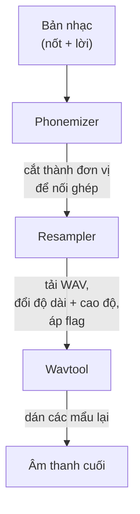

## UTAU : cách một phần mềm Visual Basic 6 dân chủ hóa giọng hát tổng hợp

Tôi từng nhắc qua trên trang chính : tôi thích UTAU. Đây là lý do.

Năm 2008, nếu bạn muốn tạo ra một giọng hát tổng hợp, bạn có một lựa chọn : VOCALOID. Phần mềm của Yamaha. Đắt, độc quyền, với các giọng chính thức mà bạn không thể tự tạo.

Rồi có một anh chàng Nhật Bản, Ameya/Ayame, tung ra một chương trình làm trong góc riêng. Một phần mềm code bằng **Visual Basic 6**. Miễn phí. Cho bạn tạo giọng của chính mình bằng... các tệp WAV do chính bạn thu.

Phần mềm đó tên là **UTAU** (歌う, "hát" trong tiếng Nhật). Và với thời của nó, đó là phép màu.

Tôi luôn thấy nó cuốn hút vì ý tưởng khởi đầu hơn là sự sạch sẽ kỹ thuật (nguyên tắc mã hóa vẫn thực sự khéo, dù triển khai nhìn đau mắt) : nó đã mở tổng hợp giọng nói cho công chúng. Bạn, tôi, bất kỳ ai có micro.

Để tôi giải thích vì sao nó tuyệt vời.

---

## Trước hết, vì sao tổng hợp giọng hát lại khó

Một giọng hát không phải các nốt nhạc. Bạn có phụ âm tấn công, nguyên âm giữ, hơi thở, chuyển tiếp giữa hai thứ. Chữ "sa" trong "salut" là một tiếng "s" rít trượt về một chữ "a" mở, và chính cú trượt đó nghe có giống người hay không.

Ngày nay ta xử lý bằng deep learning : huấn luyện một mô hình trên hàng giờ ca hát và nó tạo ra giọng (Synthesizer V, DiffSinger). Nhưng đó là chuyện 2020+. Năm 2008, chẳng có gì.

UTAU dùng phương pháp của thời trước, cũ hơn và láu hơn : **tổng hợp nối ghép**.

---

## Tổng hợp nối ghép : cắt dán mẩu giọng

Ý tưởng ngớ ngẩn đơn giản : bạn thu các mẩu giọng nhỏ rồi dán chúng lại để tạo từ. "salut" = mẫu "sa" + "lu" + "to", nối tiếp nhau. Một trò xếp hình âm thanh điều khiển bởi bản nhạc.

Đó là nguyên tắc của các YouTube Poop nơi người ta cắt lại lời của một nhân vật để bắt nó nói bất cứ gì -- chỉ khác ở đây nó vuông vắn và tự động.

Và UTAU sinh ra đúng từ đó. Trước nó đã tồn tại **"Jinriki Vocaloid"** (人力ボーカロイド, "Vocaloid thủ công") : mọi người cắt tay các track giọng, trích âm vị, đổi cao độ, rồi ráp lại trong trình chỉnh âm thanh để bắt chước giọng VOCALOID. Bằng tay. Bạn tưởng tượng được công việc đó.

Ameya nhìn cảnh cực khổ đó và code công cụ để tự động hóa. Ban đầu UTAU chỉ là vậy : một trợ lý cho Vocaloid thủ công.

---

## Vì sao nó mang tính cách mạng : BẠN tạo ra giọng

Đây là điều thay đổi tất cả.

VOCALOID, bạn mua một giọng. Miku, Luka, v.v. Do chuyên gia tạo, Yamaha bán. Việc sáng tạo vẫn dành riêng cho Yamaha. Với UTAU, **bất kỳ ai thu giọng mình và biến nó thành nhạc cụ biết hát**.

Chế độ CV (đơn giản nhất) là : bạn thu khoảng 100 âm tiết cơ bản của tiếng Nhật ("a", "ka", "sa", "ta"...), cấu hình điểm cắt, và xong voicebank của bạn. Vài giờ việc.

Kết quả : hệ sinh thái bùng nổ. Hàng nghìn voicebank do cộng đồng tạo -- giọng fan, bạn bè, nhân vật tự nghĩ. Cả một vũ trụ ca sĩ ảo, miễn phí. Và phần mềm đi kèm **Defoko** (Utane Uta), một giọng mặc định tạo qua động cơ TTS AquesTalk, nên bạn có thể bắt đầu ngay cả không có micro.

---

## oto.ini : trái tim hệ thống

UTAU biết cắt và dán âm ở đâu bằng cách nào? Qua một tệp cấu hình cho mỗi voicebank : **`oto.ini`**. Với mỗi WAV, nó định nghĩa điểm cắt (tính bằng mili giây) :

- **Offset** → khoảng lặng cần bỏ ở đầu
- **Preutterance** → điểm phụ âm chuyển sang nguyên âm (ranh giới "s"→"a" trong "sa")
- **Overlap** → nốt trước tràn sang nốt này bao nhiêu
- **Fixed region** → phần KHÔNG được kéo dài trên nốt dài (thường là phụ âm)
- **Cutoff** → cắt cuối ở đâu

**preutterance** là tham số láu nhất. Một âm tiết luôn có mẩu phụ âm trước nguyên âm. Để nốt của bạn rơi đúng nhịp, chính *nguyên âm* phải rơi đúng, không phải phụ âm. Nên UTAU dịch mẫu ngược lại : chữ "a" của "sa" đáp đúng nhịp, chữ "s" chỉ tràn ngay trước đó. Như tay trống đánh trước một nhịp để tiếng rơi đúng chỗ -- chỉ khác ở đây nó nằm trong một `.ini`.

Trực quan, trên mẫu "ka", các vùng của `oto.ini` cắt ra như sau :

```mermaid
flowchart LR
    A["🔇 khoảng lặng<br/>(offset)"] --> B["🅺 phụ âm<br/>(vùng cố định,<br/>không kéo giãn)"]
    B --> C["🅰 nguyên âm<br/>(vùng co giãn)"]
    C --> D["🔇 cuối cắt bỏ<br/>(cutoff)"]
    style B fill:#3b4a6b
    style C fill:#5b3b6b
```



Ranh giới giữa phụ âm và nguyên âm chính là preutterance. Nguyên âm là vùng kéo dài cho nốt dài ; phụ âm giữ nguyên, nếu không chữ "k" của bạn sẽ dài hai giây và nghe kinh khủng.

```ini
# oto.ini (rút gọn)
# tệp=alias,offset,consonant,cutoff,preutterance,overlap
_ka.wav=ka,120,80,-200,90,40
```

Năm giá trị cho mỗi âm, trên mọi mẫu của bạn, và UTAU ráp bất kỳ từ nào sạch sẽ.

---

## CV, VCV, CVVC : cuộc đua hiện thực

Chế độ cơ bản, **CV** (Phụ âm-Nguyên âm), là một âm cho mỗi âm tiết. Đơn giản nhưng hơi robot : chỗ nối giữa các âm tiết còn thô.

Năm 2010 cộng đồng phát minh **VCV** (Nguyên âm-Phụ âm-Nguyên âm). Thay vì thu "ka" đơn, bạn thu "a ka" -- kèm đuôi nguyên âm trước đó. Chuyển tiếp trở nên tự nhiên vì nó *nằm trong* bản thu, không phải tính sau.

Chi tiết đau điếng : **VOCALOID không có VCV trước VOCALOID3, năm 2011.** Phần mềm miễn phí viết bằng VB6 của một anh chàng đơn lẻ đã đi trước Yamaha một năm về độ thật của chuyển tiếp. Một cộng đồng fan nhanh hơn cả tập đoàn đa quốc gia.

Rồi tới **CVVC**, **ARPAsing** (tiếng Anh), **VCCV**... mỗi phương pháp đẩy hiện thực xa hơn, tất cả do cộng đồng phát minh và ghi lại.

---

## Pipeline đầy đủ : một từ thành âm thanh thế nào

Khi bạn đặt một nốt và gõ lời, đây là những gì diễn ra phía sau :



**resampler** là mảnh trung tâm : nó lấy mẫu "ka" của bạn thu ở một cao độ cho trước và kéo lại/đổi cao độ để khớp nốt muốn -- chỉ kéo vùng co giãn và giữ nguyên phụ âm (vì vậy mới có `oto.ini`).

Và nó **dạng module**. UTAU đi kèm resampler cơ bản, nhưng cộng đồng đẻ thêm các resampler khác (moresampler, TIPS...), mỗi cái một chất âm riêng. Bạn đổi động cơ tổng hợp như plugin. Năm 2008. Trên một freeware.

---

## Công trường dưới nắp capo (và vì sao nó đáng mến)

Tôi phải trung thực về tình trạng kỹ thuật của phần mềm :

- **Code bằng Visual Basic 6.** Một ngôn ngữ đã chết từ 2008. Phải có runtime VB6 mới chạy được.
- **Ban đầu chỉ Windows** (bản port Mac, UTAU-Synth, tới năm 2011 mới có).
- **Bắt buộc mã hóa Shift-JIS.** Nếu tệp của bạn không mã hóa bằng Shift-JIS Nhật, UTAU chẳng hiểu gì. Tới nay thường vẫn phải để PC ở locale Nhật hoặc dùng AppLocale để chạy.
- **Giao diện khô khan**, tài liệu thời đó gần như 100% tiếng Nhật.

Ấy vậy mà. Ấy vậy mà phần mềm này đã tạo ra một phong trào toàn cầu. Hàng chục nghìn voicebank. Những bài hát hàng triệu lượt nghe.

Ví dụ hay nhất : **Kasane Teto**. Một nhân vật tạo năm 2008 và tung ra như trò đùa Cá tháng Tư, giả làm VOCALOID. Đó là đùa. Chỉ có điều mọi người mê nhân vật đó, một voicebank UTAU thật được tạo đằng sau, và Teto thành một trong những ca sĩ ảo nổi tiếng nhất thế giới. Năm 2023 cô ấy thậm chí có giọng Synthesizer V chính thức. Một nhân vật sinh từ trò Cá tháng Tư trên phần mềm miễn phí.

---

## Vì sao nó vẫn còn ý nghĩa

UTAU là ví dụ hoàn hảo của công nghệ "nghèo" thắng nhờ mở.

VOCALOID vượt trội kỹ thuật, tài trợ tốt hơn, chuyên nghiệp hơn. Nhưng đóng. UTAU chắp vá, xấu, viết bằng VB6 -- nhưng cho mọi người tham gia. Tạo giọng, tạo resampler, tạo plugin, tạo phương pháp thu. Cộng đồng làm phần còn lại.

Và khái niệm sống sót hoàn toàn tới nay. **OpenUtau**, hậu duệ open-source hiện đại, nối lại ý tưởng và làm mới nó (đa nền tảng, UTF-8, hỗ trợ resampler hiện đại VÀ AI). Tổng hợp nối ghép vẫn đứng vững cạnh các mô hình deep learning, vì nó có một lợi thế chúng không có : bạn hiểu chính xác chuyện gì diễn ra, và bạn kiểm soát từng mili giây.

Đó là điều tôi luôn thích ở UTAU. Bạn thấy chính xác chuyện gì diễn ra. Không phải AI nhả ra kết quả kỳ diệu mà bạn không hiểu : bạn có các WAV, điểm cắt của mình, và chính bạn quyết mọi thứ. Khi nghe dở, bạn biết vì sao và có thể sửa. Tôi thích kiểu kiểm soát đó.

---

**3 điểm cần nhớ :**

1. **Tổng hợp nối ghép = trò xếp hình giọng nói** -- UTAU dán các mẫu WAV nhỏ lại để tạo từ. `oto.ini` định nghĩa cắt và dán mỗi âm ở đâu. Bạn kiểm soát tất cả, tới từng mili giây, không hộp đen.
2. **Mở thắng kỹ thuật** -- VOCALOID giỏi hơn nhưng đóng. UTAU chắp vá nhưng cho mọi người tạo giọng của mình. Cộng đồng làm bùng nổ hệ sinh thái, thậm chí đi trước Yamaha về VCV.
3. **Ý tưởng hay sống lâu hơn mã của nó** -- VB6, Shift-JIS, chỉ Windows... ấy vậy mà khái niệm vẫn chạy qua OpenUtau. Một công nghệ thiên tài có thể được code bằng chân.

Thật lòng, chỉ riêng chuyện Kasane Teto sinh từ trò Cá tháng Tư, phần mềm này đã xứng đáng được tôn trọng.
