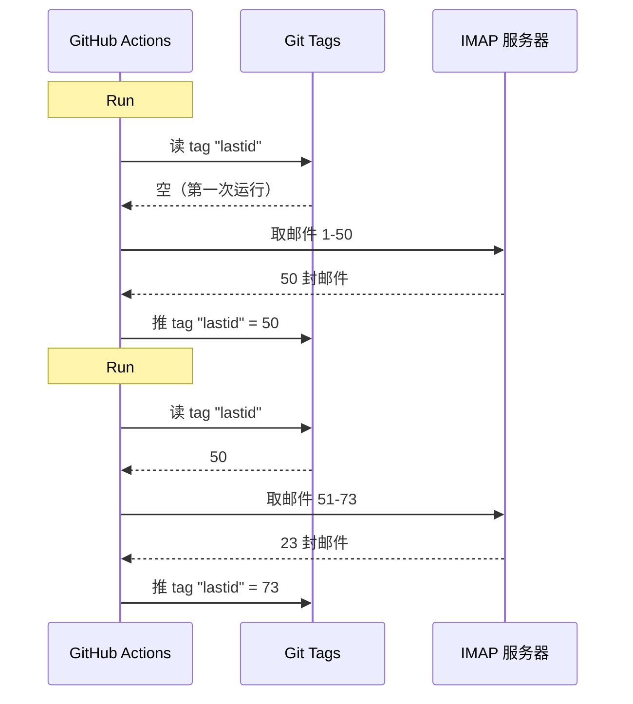

# 我拿 git 当数据库，在 GitHub Actions 上白嫖了一个邮件机器人

我有个 24/7 在线的邮件自动回复机器人。

它读我的邮件，理解在说什么，自己用 AI 回复。记得之前的对话。无视 newsletter 和 `noreply@`。太棘手的就转给人类。

每月成本：**0 元**。

没有服务器，没有 VPS，没有数据库。只有 GitHub Actions，加一个离谱的 hack：**拿 git 当数据库**。

看出我要干嘛了吗？没有？行，坐稳，这又蠢又天才。

---

## 问题：GitHub Actions 是无状态的

GitHub Actions 免费。可以每 5 分钟跑一次 cron，跑你的代码，白嫖。

但有个问题：它是 **stateless** 的。

每次运行都从一台干净的机器启动。上次运行的东西全没了。上一次？忘了。抹掉了。就当没存在过。

对回邮件机器人来说，这是大问题。比如：

> "我上次处理到哪封邮件了？"

如果机器人每次都失忆，它要么把同一封邮件回一百遍（灾难），要么漏邮件。

得有个持久状态。而持久状态一般意味着数据库。数据库意味着服务器。服务器就不免费了。

有意思的地方来了。

---

## 解法：git tag 当数据库

你的 GitHub 仓库本身就是持久存储。免费。带版本。一直在。

那为什么不拿它存状态？

思路：每次运行，机器人从一个 **git tag** 读上次处理到的邮件 UID。处理新邮件。然后把 tag 推上去，带上新的 UID。



git tag 就是数据库。一个值，但够用了。

### 读状态

job 一开始从 tag 取值：

```bash
git fetch origin --tags lastid || true
git show refs/tags/lastid:data/lastId > data/lastId || true
```

`git show refs/tags/lastid:data/lastId` 的意思是："把 tag `lastid` 里 `data/lastId` 文件的内容给我"。

Boom。拿到值了，不要数据库。

### 写状态

结尾用新值重建 tag：

```bash
git switch --orphan lastid-tmp   # 无历史的孤儿分支
git rm -rf .                      # 全清空
mkdir -p data
printf "%s\n" "${LAST_ID_CONTENT}" > data/lastId

git add data/lastId
git commit -m "lastId snapshot"
git tag -f lastid                 # 强制打 tag 到这个提交
git push --force ...origin lastid # 推 tag
```

建一个**孤儿**分支（没有历史），只放 `lastId` 文件，提交，打 tag，强制推。

为什么孤儿？为了不在仓库历史里攒一万个状态提交。每次更新覆盖上一次。tag 永远指向**一个**提交，里面**一个**值。

干净。免费。完全离谱，但能跑。

---

## 第二个 hack：runtime 快照

GitHub Actions 还有个问题：`npm install`。

如果每次运行（每 5 分钟）都 `npm install` + `npm run build`，每次白白烧 60-90 秒。cron 跑这么勤，全是浪费的算力。

解法：代码**一次**预编译好，也存在 git tag 里。

push 到 `master` 时跑的构建工作流做这个：

```bash
# 编译代码
bun install
bun run build

# 把 dist/ + node_modules/ 存进 "runtime" tag
git checkout --orphan temp-runtime
git rm -rf .
cp -r "$TMPDIR"/* .
git add dist node_modules package.json bun.lock data
git commit -m "runtime build"
git tag -f runtime
git push --force ...origin runtime
```

`runtime` tag 里是编译好的代码**加** `node_modules`。开箱即用。

cron 直接 checkout 这个 tag：

```yaml
- name: Checkout runtime snapshot
  uses: actions/checkout@v4
  with:
    ref: refs/tags/runtime    # 预编译好的代码，不是源码
    fetch-depth: 1

# 不用 npm install，不用 build！
- name: Process emails
  run: node dist/index.js --action
```

cron 瞬间启动，直接跑 `node dist/index.js`，不用 install 不用 build。

你看，两个 tag 两个活：
- `runtime` = 能直接跑的代码（push 代码时更新）
- `lastid` = 持久状态（每次运行更新）

优雅得像个脏招。

---

## 机器人本体：AI 自动回信

行，git hack 很酷，但机器人到底干嘛的？

它用 IMAP 读我的邮件，用 AI（Groq + Llama 3.3 70B）理解，自己回。

架构是干净的服务加依赖注入（InversifyJS）：

```
App
├── ImapService      → 读邮件（IMAP）
├── SmtpService      → 发回复（SMTP）
├── ParserService    → 解析邮件内容
├── ReplyService     → 生成 AI 回复
├── SummaryService   → 对话记忆
├── AccountsService  → 管多个邮箱账号
└── ConfigService    → 配置 / 环境变量
```

### 两种运行模式

机器人有两种跑法：

**listener 模式**（实时）：IMAP 长连接加指数重连。给 VPS 用的。

```typescript
this.imapService.on("exists", async (data) => {
  console.log(`[MAIL] 新邮件！总数：${data.count}`);
  // 立刻处理新邮件
});
```

**action 模式**（批处理）：从 `lastId` 开始处理新邮件，然后退出。给 GitHub Actions cron 用的。

```bash
node dist/index.js --action
```

`--action` 模式就是用 git hack 的那个。读 `lastId`，处理新增，写回新 `lastId`，结束。

### 别回机器人

如果机器人**所有**邮件都回，它会回 newsletter、通知、`noreply@`。灾难。更惨：如果两个机器人互回，你就得到无限邮件循环。噩梦。

所以要激进地过滤：

```typescript
export function isAutomatedSender(address) {
  const automatedPatterns = [
    "noreply", "no-reply", "donotreply",
    "mailer-daemon", "postmaster", "bounce",
    "newsletter", "notification", "marketing",
    "billing", "receipt", "promo", ...
  ];
  const local = address.split("@")[0].toLowerCase();
  return automatedPatterns.some(p => local.includes(p));
}
```

还有邮件头检测：

```typescript
export function isAutomatedByHeaders(headers) {
  return (
    ["bulk", "list", "junk"].includes(headers.precedence) ||
    headers["auto-submitted"] !== "no" ||
    headers["list-unsubscribe"] !== "" ||   // newsletter 都有这个
    /mailchimp|sendgrid|mailgun|brevo/i.test(headers["x-mailer"])
  );
}
```

头里有 `List-Unsubscribe`？newsletter。`Precedence: bulk`？群发。`X-Mailer: Mailchimp`？懂的都懂。无视。

就像夜店保安：机器人不让进。

### 魔法触发器

AI 可以决定完全不回，或者把活转给人类。怎么做？靠回复里的特殊触发器。

系统提示词这么告诉它：

> 如果是自动邮件/newsletter → 回 `<no_reply>`
> 如果太重要太敏感（法律、财务……）→ 回 `<manual_reply_required>`
> 否则 → 写个正常回复

代码这么读：

```typescript
const aiReply = completion.choices[0].message.content.trim();
const manualTrigger = aiReply.includes(MANUAL_REPLY_TRIGGER);
const noReply = aiReply.includes(NO_REPLY_TRIGGER);

if (noReply) {
  console.log("[MAIL] AI 决定无视。跳过。");
  return;
}

if (manualTrigger) {
  console.log("[MAIL] 太棘手，转给人类。");
  await this.smtpService.sendManualForward(...);
  return;
}

// 否则发 AI 回复
await this.smtpService.sendReply(...);
```

AI 有权说"这我不碰，叫个人类来"。这叫智慧。

---

## 对话记忆

改变游戏规则的细节：机器人**记得**对话。

它回复某人时会存一份交流摘要。下次这个人来信，摘要重新注入提示词。

存成每联系人一个 JSON 文件：

```
data/customers/
├── moi%40gmail.com/
│   ├── alice%40example.com.json
│   └── bob%40client.fr.json
```

摘要本身也是 AI 生成的，把旧摘要和新消息合并：

```typescript
const completion = await groq.chat.completions.create({
  model: "llama-3.3-70b-versatile",
  messages: [
    { role: "system", content: "你是记忆助手。把旧摘要和新消息合并，不要丢信息。" },
    { role: "user", content: `已有摘要:\n${existing}\n\n新消息:\n${incomingContent}` }
  ],
  temperature: 0.0,  // 确定性，不要 creativity
  max_tokens: 800,
});
```

机器人随时间攒出压缩记忆。一份越长越聪明的摘要就够了，不用存全部邮件。

这些 JSON 文件呢？嗯……也存在 git 里，runtime tag 里。git 无处不在。

---

## 提示词长度的小心机

一个让我笑出来的技术细节。

模型有 token 上限。邮件加摘要加 persona 提示词一超，API 直接报错。

代码用**级联截断**加重试处理：

```typescript
try {
  // 先用正常长度试一次
  completion = await groq.chat.completions.create({...});
} catch (error) {
  if (!this.isLengthError(error)) throw error;

  // 是长度报错：收紧限制再试
  ({ systemContent, userContent } = this.buildPromptPayload({
    ...,
    limits: {
      systemPromptChars: 2200,  // 原来 3000
      summaryChars: 1800,       // 原来 4000
      personaChars: 900,        // 原来 1500
      userContentChars: 2200,   // 原来 8000
    },
  }));
  completion = await groq.chat.completions.create({...});  // 重试
}
```

一次不行就砍短再试。简单，有效，不崩。

---

## 好，具体怎么跑的？

一次 cron 运行的完整流程：

```
1. GitHub Actions 触发（每 5 分钟 cron）
2. Checkout "runtime" tag（预编译代码）
3. git show refs/tags/lastid → 取上次处理到的 UID
4. node dist/index.js --action
│   ├── IMAP 连接
│   ├── 从 lastId+1 开始取新邮件
│   ├── 每封邮件：
│   │   ├── 解析内容
│   │   ├── 机器人过滤（自动的跳过）
│   │   ├── 匹配收件账号
│   │   ├── 取对话记忆
│   │   ├── 生成 AI 回复（Groq）
│   │   ├── <no_reply>？跳过
│   │   ├── <manual_reply_required>？转人类
│   │   ├── 否则：发回复（SMTP）
│   │   └── 更新对话记忆
│   └── 写回新 lastId
5. git push --force tag "lastid"，带新值
```

5 分钟后重来一遍。永远。免费。

---

**三句话总结：**

1. **git = 免费数据库**，一个孤儿 tag 存两次无状态运行之间的持久状态。`git show refs/tags/X:文件` 读，强制推写。省掉整个数据库。

2. **runtime tag 预编译**，cron 每次不用 `npm install`，把编译好的代码加 node_modules 存进 git tag。cron 瞬间启动。

3. **AI 机器人要懂得闭嘴**，`<no_reply>` 和 `<manual_reply_required>` 触发器让 AI 决定不回或转交。加机器人过滤。不然就是无限邮件循环。

带持久状态、记忆、AI 的 serverless cron，每月 0 元。烂得漂亮，我太喜欢这个设计了。
