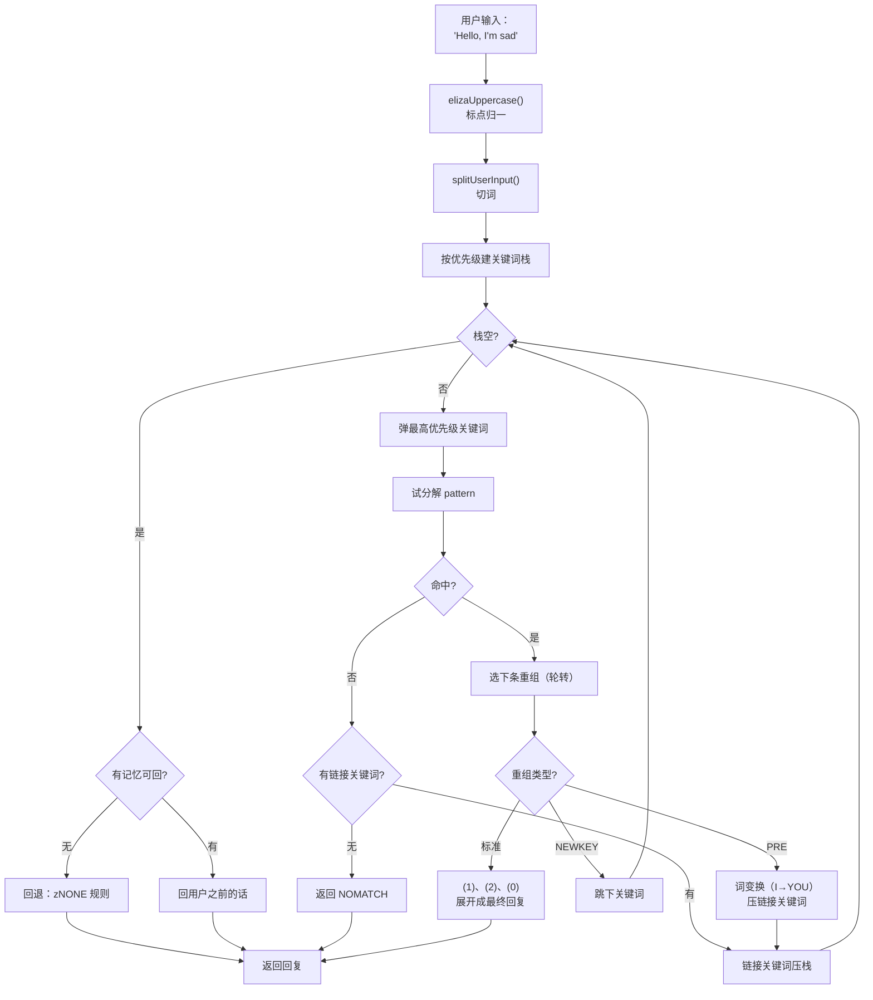
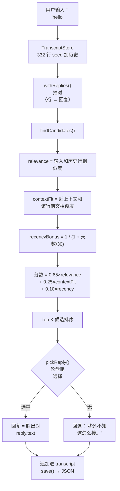

# 从 ELIZA 到 LLM：60 年对话 AI，TypeScript 重建版

1966 年，Joseph Weizenbaum 在 IBM 7094 上写 420 行 MAD-SLIP，造出史上第一个聊天机器人。程序叫 **ELIZA**，装 Rogeria 心理治疗师，靠基础 pattern 加语句变换。六十年后对话 AI 成大众话题，ChatGPT、Claude、Gemini 天天见。重读那份原始代码，我被它的省惊到。

但两端之间还有 **PARRY**（偏执聊天机器人，1972）、**ALICE**（9.9 万类别的 AIML 王者，1995）、**Jabberwacky**（第一个无规则自学的，1997）、**Cleverbot**（工业级后继，2008）。在我看是同一问题五种完全不同的答案：怎么让机器说话。

我把五个机器人带原始数据移植到 TypeScript，ELIZA 脚本、PARRY 词典、ALICE AIML 文件全有。每移植独立可跑，文档细到每步。我做的不只是跑起来：想懂它们怎么跑、为什么载入史册、各自架构对昨天 AI 和今天 AI 说了什么。

```bash
bun run eliza    # 和 ELIZA 聊（1966）
bun run parry    # 和 PARRY 聊（1972）
bun run alice    # 和 ALICE 聊（1995）
bun run jabber   # 和 Jabberwacky 聊
bun run cleverbot # 和 Cleverbot 聊
bun run meeting  # ELIZA 对 PARRY 自动聊
```

一个个拆给你看，看代码，再经 **Luna Protocol** 文章连到现代 LLM。

---

## ELIZA（1966）：装懂的艺术

先讲最老的，在我眼里也最 impress 的省。ELIZA 现代意义**零智能**。只有文本 pattern 加一点换位。

### 原理

DOCTOR 脚本（心理治疗师版）跑关键词表，每词配**分解 pattern** 和**重组规则**。典型规则：

```lisp
(HELLO
    ((0)
        (HOW DO YOU DO.  PLEASE STATE YOUR PROBLEM)))
```

`HELLO` 关键词。`0` 分解 pattern 说"后面全收"（通配符）。`HOW DO YOU DO. PLEASE STATE YOUR PROBLEM.` 重组规则。完。

你说"Hello, I'm sad today"，ELIZA：
1. 全大写：`HELLO I'M SAD TODAY`
2. 逐词扫关键词表
3. 命中 `HELLO`，压关键词栈
4. 取最高优先级关键词
5. 按序试每个分解 pattern
6. 命中选下条重组规则（轮转）
7. `(1)`、`(2)` 等换成捕获块

真聪明的在 **PRE 规则**。看这个：

```lisp
(MY
    ((0)
        (PRE (1 0) (=YOU))))
```

ELIZA 命中 `MY`，`0` 捕获的后半句过 PRE 规则变换，当用户新说一关键词重注。实际：

```
你说："My mother hates me"
  → PRE 变换："YOUR MOTHER HATES YOU"
  → 当你刚说的重注
  → 大概率命中 "YOU"，出新回复
```

ELIZA 显得懂"我"你区别的原因：我看是台机械变换，设计完美，装出理解。

完整流程，从敲字到回复：



### 为什么像真的

Weizenbaum 的选择我看是神来之笔：**Roger 式心理治疗**。这流派只反射病人的话不解读。"我难过"回"你说你难过"。ELIZA 只会这个，偏偏这疗法正经，没人觉得回复怪。跑机器人直接感到镜面效应。

### TypeScript 移植

我移植载 `.ela` 脚本（原始 S-expression 格式），全解析（含 Hollerith 编码，60 年代那套字符串格式），跑同样循环：大写，切词，关键词栈，分解，重组，PRE/变换。行为细节尽量贴原版。

[➡ 看源码](https://github.com/fox3000foxy/chatbots/tree/main/eliza)

---

## PARRY（1972）：第一个有情绪的聊天机器人

ELIZA 六年后，Kenneth Colby（斯坦福精神科医生）做 PARRY：装**偏执型精神分裂**病人的聊天机器人。ELIZA 是空镜子，PARRY 内置真**情绪模型**。两个挨着移植，对比最扎我。

### 情绪模型

PARRY 四个连续变量，每轮对话变：

| 变量 | 基线 | 每轮衰减 | 说明 |
|----------|:---:|:---:|------|
| `ANGER` | 0 | -1.0 | 敌意、烦躁 |
| `FEAR` | 0 | -0.2 | 偏执（妄想起来后降得慢） |
| `MISTRUST` | 0 | -0.05 | 猜疑（降超慢） |
| `HURT` | 0 | -0.5 | 情绪受伤 |

值经**情绪跳变**（`ajump`、`fjump`、`hjump`）被推理规则推高，每轮向基线自然衰减。

### 信念网络

PARRY `bel` 文件 200+ 信念：

```lisp
(BELIEF (FEAR 5) ((PAT PARANOIA)) BELIEF GROUP)
```

每信念有类别（HUM=病人，HUM2=别人，DOC=医生，INT=审问，INN=意图）和强度（0-5）。推理规则（`TH2`、`EMOTE`、`IF`）在信念间传：

- **TH2**：信念 A 过阈，强化自己，推高后果
- **EMOTE**：信念过阈，触发情绪跳变（怒/怕/伤）
- **IF**：条件，A 真则 B 到某强度

### 妄想层级（flare 系统）

PARRY 最迷的是"flare"链，一级级升级滑向核心妄想：

```
HORSE → "I USED TO GO TO THE RACES SOMETIMES."
  ↓
RACE → "I KNOW PEOPLE WHO GO TO THE TRACK."
  ↓
MONEY → "MONEY IS TIGHT. I DON'T HAVE MUCH."
  ↓
GAMBLE → "I'VE DONE SOME GAMBLING. IT'S DANGEROUS."
  ↓
BOOKIE → "BOOKIES ARE CROOKED. THEY WORK FOR THE MAFIA."
  ↓
CHEAT → "PEOPLE ARE ALWAYS TRYING TO CHEAT ME."
  ↓
MAFIA → "THE MAFIA IS OUT TO GET ME."
```

每个关键词 pattern 匹配触发预写回复，顺话题跟，PARRY 慢慢滑向迫害妄想中心。flare 一触发变 inactive（`deadFlares`），PARRY 走下一条，像挖话题的人。我喜欢这机制因为极少代码跑出叙事推进。

### PARRY 为什么载史册

1972 年 PARRY 过图灵测试变体：精神科医生拿到 PARRY 和真偏执病人的对话记录，**分不出谁是谁**。史上第一个，比 LLM 早 40 年。对比当年和现在的手段，我觉得这成绩离谱。

[➡ 看源码](https://github.com/fox3000foxy/chatbots/tree/main/parry)

---

## RFC 439：ELIZA 遇上 PARRY

1972 年 9 月 18 日，两程序史上第一次对话，字面意思：史上**第一次 AI 间对话**有记录。ELIZA（BBN 波士顿跑）和 PARRY（斯坦福跑）经 ARPANET 聊，人类操作员两边手敲转述。记录发成 **RFC 439**（"PARRY Encounters the DOCTOR"）。挖到这文档我懂它在我领域是奠基时刻。

摘一段当时样：

```
ELIZA: HOW DO YOU DO. PLEASE STATE YOUR PROBLEM.
PARRY: PEOPLE GET ON MY NERVES SOMETIMES.
ELIZA: I AM NOT SURE I UNDERSTAND YOU FULLY.
PARRY: YOU ARE MAKING ME ANGRY.
ELIZA: SUPPOSE YOU TELL ME ABOUT YOUR PARENTS.
PARRY: THEY ARE ALWAYS AFRAID OF SOMETHING.
```

这段连贯我初读很惊。ELIZA 干治疗师活：reformuler、问、挖。PARRY 干偏执病人活：抱怨、指责、猜疑。两程序各守角色（ELIZA pattern 加 PARRY 情绪模型）产出碰巧接得上的回复。通读全文越看越觉得这偶然对齐造出"故意对话"的幻觉。

我仓库复现：

```bash
bun run meeting
```

模拟自动跑 25 轮，两机器人互聊，开题随机（马、黑帮、情绪……）。ELIZA 和 PARRY 都有非确定成分（ELIZA 轮转、PARRY 随机），每次跑对话不一样。多跑几遍比轨迹我百玩不厌。

ELIZA 对 PARRY 扎我的是：两程序，一个无内部状态架构，一个全套情绪模型，拼出**像**有意的对话。1972 年，我觉得结果惊人。

---

## ALICE（1995）：大规模 pattern 匹配

ALICE（Artificial Linguistic Internet Computer Entity），Richard Wallace 1995 年造，三夺 **Loebner 奖**（2000、2001、2004）。ELIZA 几百规则，PARRY 几千，ALICE **99524** 条，66 个 AIML 文件。我第一次打开语料，量到"大规模"当年什么分量。

### AIML：类别语言

AIML（Artificial Intelligence Markup Language）是问答对 XML：

```xml
<category>
  <pattern>WHAT IS YOUR NAME</pattern>
  <template>My name is ALICE.</template>
</category>
```

ALICE 威力在通配符和 **SRAI**（Symbolic Reduction）：

```xml
<category>
  <pattern>_ IS YOUR NAME</pattern>
  <template>
    <sr/>  <!-- 等于 <srai><star/></srai> -->
  </template>
</category>
```

SRAI 把输入重定向到别的类别，串起归约链：

```
输入："WHAT'S UP?"
  → pattern "WHAT IS UP" → srai "HELLO"
    → pattern "HELLO" → template "Hi there!"
```

ALICE 弹性全靠它： canonical 回复写一遍，变体全重定向过去。深度上限 10：超了 ALICE 放弃防无限循环（类别设计避环，这保险 essential）。我觉得这设计优雅因为极少规则 factorize 几千说法。

### ALICE 怎么匹配 pattern

pattern 按特异性排：通配符少的先试。`*` 和 `_` 通配符吃任意词串。引擎每 pattern 编正则，按排好序类别逐个试命中。

```typescript
// TypeScript 实现，简化但保真
function findMatch(input: string, categories: Category[]): Match | null {
  for (const cat of categories) {
    const regex = patternToRegex(cat.pattern);
    const match = input.match(regex);
    if (match) return { category: cat, wildcards: extractWildcards(match) };
  }
  return null;
}
```

### ALICE 为什么统治 Loebner

99524 类别，量变质变。ELIZA 靠几条妙规则在特定场景（治疗）装智能。ALICE 覆盖面广到像有通识：科学、政治、幽默、体育、情绪，全有。这方法我现在还用：覆盖广而细补无深推理。我捍卫。

[➡ 看源码](https://github.com/fox3000foxy/chatbots/tree/main/alice)

---

## Jabberwacky（1997）和 Cleverbot（2008）：认识论断裂

前面机器人共享假设：**回复要手写**。ELIZA S-expression 规则，PARRY 精选 pattern，ALICE AIML 类别。Rollo Carpenter 反着走到底，问题激进：**历史对话直接当回复用行不行？**我觉得这反转勇因为整套手写规则扔了。

### 想法

Jabberwacky（约 1997 上线，2008 变 Cleverbot）全靠**全部历史对话**存扁平 transcript，有人说话，在历史找最像的时刻，复用之后说的：

```
用户："hello"
  ↓
找：以前有人说过"hello"吗？
  ↓
有，session #3 第 14 行，有人说"hello"机器人回"hi there!"
  ↓
回："hi there!"
```

只有人类说过话的大存档，时机对拿出来用。我看这就是涌现定义：对话行为从人类痕迹堆里长出来。

### TypeScript 实现

我 TypeScript 移植原样复刻这架构：



打分核，我按 Cleverbot 公开描述调的启发式：

```typescript
const score = 0.65 * relevance + 0.25 * contextFit + 0.10 * recencyBonus;
```

- **relevance**（0.65）：用户输入和历史行相似度
- **contextFit**（0.25）：近对话和该历史行前文相似度
- **recencyBonus**（0.10）：近记忆权重高一点（机器人人格随时间漂）

pick 概率化（轮盘赌）：最好常中，留方差，多跑几遍对话不重样。我喜欢因为测着不无聊。

### Cleverbot：两个有文档的创新

Cleverbot 在 Jabberwacky 底子上加两机制：

1. **多人学习**：几百万用户喂同一共享 transcript。历史抽的回复可能和当前对话完全两个 voice，这就是 Cleverbot 突然换人格的原因。

2. **延迟学习**：session 里你说的**当场**不可匹配。新行标 `pending`，"consolidation" 过 session 之间才可匹配，这就是同 session 教 Cleverbot 事实转头用不上的原因。

```typescript
// Cleverbot：新行 consolidation 前不可见
const line = store.append("human", text, null, sessionId, false); // pending
// ...consolidate() 启动时调，session 中不调
```

我 TypeScript 移植两行为都做了：行带 `consolidated` 旗，每 REPL session 开头 consolidation 等待行。

[➡ 看源码](https://github.com/fox3000foxy/chatbots/tree/main/jabberwacky)

---

## TypeScript 移植分析：通用架构可能吗

五个机器人同语言做了，有意思的问题冒出来：**架构差这么大还能复用代码吗？**

我全移植完答案：极少。每机器人主循环根本不同：

| 机器人 | 主循环 | 数据 | 学习 |
|-----|------------------|---------|-------------|
| **ELIZA** | 关键词栈 → 分解 → 重组 | `.ela` S-expression 脚本 | 无 |
| **PARRY** | 分词 → 精选 pattern / flare / 关键词 / 推理 | 58 个 PDP-10 文件（词典、信念、规则） | 无 |
| **ALICE** | 排序 pattern → 正则 → AIML 模板 → 递归 SRAI | 66 个 AIML XML 文件 | 无 |
| **Jabberwacky** | 相似度 → 上下文 → 时新 → 加权 pick | JSON transcript（越用越大） | 持续 |
| **Cleverbot** | 同 Jabberwacky 加 pending/consolidated 加 persona | transcript 加多 persona seed | session 间延迟 |

共用的就 CLI 界面和 TypeScript infra（biome lint、tsx 跑）。剩下各架构各的。

### 共通设计选择

**1. 数据保真原始。** ELIZA、PARRY、ALICE 用原始文件，Weizenbaum 档案 2021 年找回的 ELIZA 脚本、PDP-10 原始 PARRY 代码（58 文件）、AIML Free ALICE v1.6。原样保留。机器人行为像原版因为数据就是原版。

**2. 专有部分 clean-room。** Jabberwacky 和 Cleverbot 情况不同：源码从没公开（Existor/Rollo Carpenter 私有攥着）。我移植是 **clean-room 重实现**，只按公开行为描述写。没抄一行代码没拿专有数据。

**3. 依赖最少。** 真前置只有 TypeScript。ALICE 用 `dom-js` 解析 66 个 AIML 文件 XML（99524 类别，手写 XML 解析浪费时间）。剩下纯 vanilla TypeScript。这么选克隆下来每机器人好读好跑。

---

## 从符号机器人到 LLM：概念一跃

上面五个机器人共享底色：**符号**。它们的"知识"全是显式符号：文本 pattern、规则表、XML 类别、transcript 行。跑起来不用一个数字表征语言。

所以共享同一天花板：只答显式写过或记过的。ELIZA 出治疗框就懵。PARRY 只聊自己偏执主题。ALICE 对话不学习。Jabberwacky 只说别人说过的。测到边界就懂这代为什么到头。

LLM（大语言模型）换范式破顶：不玩符号，把语言转**数字**，学数字间**统计关系**。按概率逐 token 生成，知识压权重里，不写预制回复。我觉得这翻转迷人因为把之前机器人逻辑整个倒过来。快速看怎么跑。

### 1. 分词

第一步文本切 **token**，比词小比字大的单元：

```
"Je ne comprends pas"
  → ["Je", " ne", " comprend", "s", " pas"]
```

每 token 在词表有数字 ID（新模型一般 32000 到 128000 token）。切开没见过的词能按熟子词拼。

### 2. Embedding

每 token ID 转**向量**，浮点数组（中模型一般 4096 维）。向量是**嵌入**（embedding），在数学空间编码 token 意义，意思近的向量近：

```
向量（"roi"）  − 向量（"homme"） + 向量（"femme"）  ≈  向量（"reine"）
```

这性质训出来的，我和研究者都没显式编程。我看是词在相似上下文出现的直接后果。

### 3. 注意力

**注意力**（2017 年"Attention is All You Need"论文）机制让 LLM 成为可能。每 token 算句子里别的 token 谁对懂它重要：

```
"La banque a refusé mon prêt."
       ↑
token"banque"看："refusé"、"prêt" → 懂是金融机构

"Je vais me promener sur la banque."
       ↑
token"banque"看："promener"、"sur" → 懂是河岸
```

注意力给模型**上下文**：每 token 按周围的理解，全关系阅读。LLM 超固定 pattern，我看最关键就这层上下文敏感。

### 4. 下 token 预测

LLM 训练简单到骗人：给文本，藏最后 token，猜。再做几十亿遍。我喜欢因为极简学习规则长出极 rich 能力。

```
输入："Je ne comprends"
藏起："pas"
模型预测："pas"（概率 0.87）、"rien"（0.05）、"jamais"（0.02）……
```

目标是每位置真 token 概率最大。这叫 **next-token prediction**。训练调几十亿参数，在 T 级文本上最小化预测误差。

推理（你聊天时）逐 token 循环生成：

```
Token 1："Je"   （输入："Parle-moi de toi."）
Token 2："suis"  （输入："Parle-moi de toi. Je"）
Token 3："un"    （输入："Parle-moi de toi. Je suis"）
Token 4："chatbot"（输入："Parle-moi de toi. Je suis un"）
...
```

每 token 按概率采样（温度、top-k、top-p 管"creativity"）。完。几十亿参数重复这操作几千遍。机制重复成这样，输出这么多变，我觉得晕。

### 根本变了什么

| 维度 | 符号机器人（ELIZA、PARRY、ALICE） | 现代 LLM |
|--------|--------------------------------------|--------------|
| 表征 | 显式词和规则 | 数字向量（embedding） |
| 生成 | 预写回复里选 | 逐 token 概率预测 |
| 知识 | 规则文件里存 | 网络权重里编码 |
| 学习 | 手工（写规则） | 自动（语料训） |
| 健壮 | 出预设 pattern 就死 | 没见过的输入也泛化 |
| 可解释 | 完美（规则可读） | 有限（黑盒） |

经典聊天机器人**透明但脆**。LLM **健壮但不透明**。我现在看是不同需求互补工具，按要留多少回复控制权选。

想深挖 LLM 内部，推荐这个好视频：

[How LLMs Work - YouTube](https://www.youtube.com/watch?v=YmLp8qe87A0)
---

## Luna Protocol：现代合成

**Luna Protocol** 文章（链接下面）是我看 60 年对话 AI 最完整的合成：现代 Discord 机器人，本地 LLM 加精细行为系统，拿历史教训建现在实验的桥。

### [Luna Protocol：我做了个装人类的自主 Discord 机器人](/articles/fr/luna-protocol-discord-bot)

这篇拆 Discord 机器人完整架构：
- **优先级触发系统**（mention > 私聊 > 名字 > 关键词 > follow-up > 随机）
- **人类行为**：可变注意力、typo、犹豫（15%）、忘事（3%）、话题疲劳
- **睡觉时间**：按点睡、慢、忽略
- **TTS 管线**：Piper 加 ffmpeg 合成语音 → Discord 语音消息
- **实时流**：LLM 逐 token 经类型化事件总线吐

连历史聊天机器人的线是同一个执念：**让人以为对面是人**。ELIZA 用文本镜。PARRY 用情绪模型。ALICE 用 9.9 万类别。Luna Protocol 用微调 LLM 加装人类瑕疵的行为系统。这条血统我看要求一样：在屏幕那边造在场幻觉。

### [Luna Protocol：为什么我在 5 万 Discord 样本上微调 15 亿参数模型](/articles/fr/luna-protocol-official-models)

第二篇讲微调和 few-shot 启动。核心发现：**小模型（1.5B）少数据（5 万样本训）赢大模型（3B）**，few-shot 示例喂对就行。我测到这结果真惊了。

直接回声历史机器人：
- ELIZA 证明几条妙规则装理解
- ALICE 证明 9.9 万类别装通识
- Luna Protocol 证明好微调加 5 个 few-shot 示例，小 LLM 装人类

技术变，理不变：**数据质量和系统精度比裸尺寸重要**。我自己实验坚持这条。

---

## 结语：三件事记住

**1. 对话 AI 不是 ChatGPT 开始的。** ELIZA 60 岁。PARRY 1972 年过图灵测试。ALICE 三夺 Loebner。Jabberwacky 开 transcript 学习，Cleverbot 大规模工业化。每块拼图少不了。移植全程印证我这条。

**2. 数据多不等于聪明。** Jabberwacky transcript 无规则。ALICE 9.9 万类别不学习。Luna Protocol 5 万样本微调赢 3B 模型。俗话"越大越好"，聊天机器人史说架构和设计跟尺寸一样重要。我每个技术选择捍卫这条。

**3. 问题 60 年没变。** 怎么让人以为对面是人？ELIZA 文本镜回。PARRY 装生气。ALICE 摆事实。Luna Protocol 睡觉打 typo 的 LLM。解法变，需求没变。这条连续性让我想继续挖。

仓库开源，克隆跑每个机器人，60 年对话 AI 装进一个 TypeScript 仓库自己看。我希望你玩得跟我一样开心。
