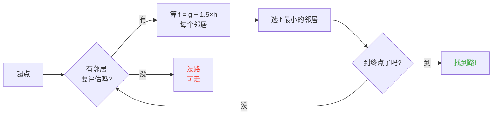

## 引言

我花了几小时看绵羊撞墙。

说实话？这辈子最值的投资。

因为越看这些生物越明白，它们没有一点随机。每个移动都是写好的、可预测的，最重要的是全能 hack。我一头扎进 Minecraft 源码搞清寻路怎么跑，发现你能 mind-control 生物。字面意思，让它们去**你**要它们去的地方，不是随机定的地方。

这篇指南是我翻代码学到的全部。AI、A* 算法、隐藏 penalty、生存能用的 exploit。带上镐。

---

## 生物 AI 怎么跑的（剧透：很蠢）

### Goal

每个生物有一串 *goal*。它**能**做的动作清单，以及多**想**做，数字越小越优先，像混乱版 todo list。

```java
protected void registerGoals() {
    this.goalSelector.addGoal(4, new Zombie.ZombieAttackTurtleEggGoal(this, 1.0, 3));
    this.goalSelector.addGoal(8, new LookAtPlayerGoal(this, Player.class, 8.0F));
    this.goalSelector.addGoal(8, new RandomLookAroundGoal(this));
    this.addBehaviourGoals();
}
```

见过僵尸无视龟蛋追着你咬吗？原因：`ZombieAttackTurtleEggGoal` 优先级 4，叫它咬你的 `ZombieAttackGoal` 优先级 2。

对，僵尸咬你优先于砸蛋。多感人。

真正重要的是 `WaterAvoidingRandomStrollGoal`，优先级 7。"没事瞎逛"goal。有意思的全在这里。

### 移动（或者"随机走 1/60 概率"）

每 tick（每 0.05 秒）游戏调 `canUse()` 看生物赏不赏脸动。1/60 概率。蠢到离谱的设计，我超爱。

```java
public boolean canUse() {
    if (this.mob.hasControllingPassenger()) {
       return false;
    } else {
       if (!this.forceTrigger) {
          if (this.checkNoActionTime && this.mob.getNoActionTime() >= 100) {
             return false;
          }
          if (this.mob.getRandom().nextInt(reducedTickDelay(this.interval)) != 0) {
             return false;
          }
       }
       Vec3 $$0 = this.getPosition();
       if ($$0 == null) {
          return false;
       } else {
          this.wantedX = $$0.x;
          this.wantedY = $$0.y;
          this.wantedZ = $$0.z;
          this.forceTrigger = false;
          return true;
       }
    }
}
```

总结：骑着它不行，5 秒没动静不行，随机数说不行不行。游戏**真**不想让生物动。

动起来 `getPosition()` 接管：

```java
protected Vec3 getPosition() {
    if (this.mob.isInWater()) {
       Vec3 $$0 = LandRandomPos.getPos(this.mob, 15, 7);
       return $$0 == null ? super.getPosition() : $$0;
    } else {
       return this.mob.getRandom().nextFloat() >= this.probability
          ? LandRandomPos.getPos(this.mob, 10, 7)
          : super.getPosition();
    }
}
```

看最后两数字：XZ 半径和 Y 半径。水里找更远（15 而不是 10）。找不到陆地回 `super.getPosition()`，水也接受。**结果：生物拼命想出水。** 这就是你家动物游泳跟逃命一样往岸上冲。

小彩蛋：字面 0.1% 概率生物走 `super.getPosition()` 而不是 `LandRandomPos`。千分之一。Mojang 经典。

### LandRandomPos：改命的烂优化

我最爱的环节。最漂亮的技术蠢事，让寻路可剥削。

```java
public static Vec3 getPos(PathfinderMob $$0, int $$1, int $$2, ToDoubleFunction<BlockPos> $$3) {
    boolean $$4 = GoalUtils.mobRestricted($$0, $$1);
    return RandomPos.generateRandomPos(() -> {
       BlockPos $$4xx = RandomPos.generateRandomDirection($$0.getRandom(), $$1, $$2);
       BlockPos $$5 = generateRandomPosTowardDirection($$0, $$1, $$4, $$4xx);
       return $$5 == null ? null : movePosUpOutOfSolid($$0, $$5);
    }, $$3);
}
```

`movePosUpOutOfSolid`。名如其意。选的位置在实心块里，游戏往上推，推到空气为止。

这是优化：懒得过滤地下位置，直接顶到地面。聪明？是。但带来巨大 bias：**生物偏爱高处**。

想想。地下块多，游戏随机 10 个位置。块里的被顶上来。密的区（山包下）比空的区产出更多合法位置。结果：生物统计上更往山包走。

信我，两分钟就 hack 掉。

### 选拔：方块选美大赛

10 个位置，一个赢家，打分赛：

```java
public static Vec3 generateRandomPos(Supplier<BlockPos> $$0, ToDoubleFunction<BlockPos> $$1) {
    double $$2 = Double.NEGATIVE_INFINITY;
    BlockPos $$3 = null;
    for(int $$4 = 0; $$4 < 10; ++$$4) {
       BlockPos $$5 = (BlockPos)$$0.get();
       if ($$5 != null) {
          double $$6 = $$1.applyAsDouble($$5);
          if ($$6 > $$2) {
             $$2 = $$6;
             $$3 = $$5;
          }
       }
    }
    return $$3 != null ? Vec3.atBottomCenter($$3) : null;
}
```

最高分**赢**。评分标准知道了，想让哪个位置赢就让哪个赢。跟操纵选举一样。

---

## 生物的偏好（或者"牛为什么横穿马路"）

每个生物口味不同。影响巨大。

| 生物 | 好这口 |
| --- | --- |
| **动物**（牛羊猪） | 草和光（hipster） |
| **怪物**（僵尸骷髅） | 黑（edgelord） |
| **海龟** | 水，不然沙，不然光 |
| **疣猪兽** | `crimson_nylium`；恨 `warped_fungus` |
| **炽足兽** | 只要岩浆。别的不要。 |
| **蠹虫** | 能住的块（合理） |
| **守卫者** | 水加光（讲究人） |
| **哞菇** | 菌丝体加光（蘑菇） |
| **蜜蜂** | 空气。对，它们偏爱**空气**。 |

```java
// 动物：往下看，草就满分
public float getWalkTargetValue(BlockPos $$0, LevelReader $$1) {
    return $$1.getBlockState($$0.below()).is(Blocks.GRASS_BLOCK) ? 10.0F : $$1.getPathfindingCostFromLightLevels($$0);
}

// 怪物：正好反过来
public float getWalkTargetValue(BlockPos $$0, LevelReader $$1) {
    return -$$1.getPathfindingCostFromLightLevels($$0);
}
```

怪物字面意思"亮的地方负分，我走"。对光翻白眼。

所以你能字面拿草和光遛动物，拿黑遛怪物。又蠢又天才。

---

## Minecraft 里的 A* 算法（秘密配方）

Minecraft 寻路用 A*（A-star）。Mojang 加了私货：

```
f(n) = g(n) + 1.5 × h(n)
```

- **g(n)** = 已走路程（直 1，对角约 1.41）
- **h(n)** = 直线距离
- **1.5** = 因为 Mojang 就喜欢有点离谱的数

正常 A* 是 `f(n) = g(n) + h(n)`。MOJANG 加了 1.5 倍。为什么？让算法更快扑向目标，少展搜索分支。结果：路"还行"，不总是最优。喝大了的 A*。



细节：**生物只能寻 16 格内**（*follow range*）。目标太远，它寻能到的最近块。意思是你能造个够不着的巨石碑，生物寻最靠近它的块，移动完全可预测。

### 两个打穿游戏的 exploit

#### 1. 方块更新 = 强制重算

```java
public boolean shouldRecomputePath(BlockPos $$0) {
    if (this.hasDelayedRecomputation) return false;
    if (this.path != null && !this.path.isDone() && this.path.getNodeCount() != 0) {
       Node $$1 = this.path.getEndNode();
       Vec3 $$2 = new Vec3(
          ((double)$$1.x + this.mob.getX()) / 2.0,
          ((double)$$1.y + this.mob.getY()) / 2.0,
          ((double)$$1.z + this.mob.getZ()) / 2.0
       );
       return $$0.closerToCenterThan($$2, (double)(this.path.getNodeCount() - this.path.getNextNodeIndex()));
    }
    return false;
}
```

生物路附近每次方块更新强制 A* 重算，1 秒冷却。生物旁边挂 1 秒时钟，它**不停**重算路。等于 GPS 每秒重置。

50 个生物一起搞？Lag city。TPS 再见。

#### 2. 方块 penalty（寻路恶意）

有些块生物害怕。字面害怕。每个块有个代价，枚举定的：

| 方块 / 条件 | Penalty |
| --- | --- |
| **蜂蜜块** | 穿过 +8 |
| **细雪** | 走不过去 |
| **关着的门** | 走不过去 |
| **火** | 穿过 +16，挨着 +8 |
| **动物和村民** | 火 = -1（NOPE） |
| **仙人掌 / 甜浆果** | 走不过去；挨着 +8 |
| **水** | 穿过或挨着 +8 |
| **岩浆** | 挨着 +8（烫） |

动物更极端：

```java
protected Animal(EntityType<? extends Animal> $$0, Level $$1) {
    super($$0, $$1);
    this.setPathfindingMalus(PathType.DANGER_FIRE, 16.0F);
    this.setPathfindingMalus(PathType.DAMAGE_FIRE, -1.0F);
}
```

DAMAGE_FIRE -1.0F，字面"禁行"。动物宁可跳崖不踩火。行吧。

### 练习：寻路大比拼

想象村民要在几条路里选。

- **路 A**：15 格但 6 格挨水（每格 +8）
- **路 B**：18 格，2 格踩水（+8）加 1 格挨水（+8）
- **路 C**：14 格笔直……但有火，村民**禁行**
- **路 D**：16 格，1 格挨岩浆（+8）加 1 格挨蜂蜜（+8）
- **路 E**：25 格但全是仙人掌（到处 +8），总代价 90.82

心算：

- 路 A：15 格加 6x8 水 = 15 + 48 = **63**……还有 1.5x距离。算全的。
- 路 B：更长但 penalty 少。总代价 = 累计距离加 penalty。
- 路 D：岩浆蜂蜜 penalty 叠加。

赢的经常是**路 B**：绕路值，因为水**贵**。

村民本质上是长腿的算价器。

### 每种生物口味不同

村民："火？不了谢谢拜拜"
僵尸："火？OK boomer *踩着火过来*"

字面有些路某些生物走另一些不走。你能修村民高速，僵尸走上来被烧。

---

## 村民：终极乱斗

行，村民。全 Minecraft 最没人懂的系统。但代码啃下来，它们是有作息的可预测机器。

### 传感器和记忆

9 个传感器，每 20 tick（1 秒）转一圈。每个扫周围一圈半径，把结果存记忆。村民全看见，全记住，照着办。

比如："有怪吗？地上有东西吗？有玩家找我说话吗？"全查。

### package（它一天的阶段）

村民大脑是按时间激活的 activity package：

| Package | 时间 | 村民…… |
| --- | --- | --- |
| **Core** | 全天 | 开门、游泳（80% 时间）、**占 POI** |
| **Work** | 8-15 点 | "上班去"，走向工位 |
| **Meet** | 15-17 点 | "喝一杯！"去钟那，聊天 |
| **Rest** | 18-6 点 | "睡觉"，上床 |
| **Idle** | 6-8 点、17-18 点 | "摸鱼"，溜达、生娃、床上蹦 |
| **Panic** | 受伤/有怪 | "救命"，跑 |

**Panic** package 是唯一能打断**全部**别的。睡着上班，有僵尸，全面恐慌。

### Acquire POI：无线红石的钥匙

```java
Set<Pair<Holder<PoiType>, BlockPos>> $$12 = (Set)$$10xx.findAllClosestFirstWithType(
    $$0, $$11, $$8x.blockPosition(), 48, PoiManager.Occupancy.HAS_SPACE
)
```

`Acquire POI` 扫 48 格内全部 POI（兴趣点）。取最近 5 个，验路通不通，拿下第一个通的。

每个 POI 槽位有限：
- **工作站**：1 槽
- **床**：1 槽
- **钟**：32 槽

**变态的点**：槽在** acquire 那刻**就占了，**不是**到地方才占。村民能从地图另一头锁死堆肥桶，一辈子不去。

get 到威力了吗？

### 无线红石。对，无线。

1. 矿车里塞村民，路通向堆肥桶
2. 它 acquire 堆肥桶（槽占了，别人用不了）
3. 村民离太远点不了它，骨粉留里面
4. 你把这村民**拉**到世界任何地方，槽一直占着
5. 想触发时，把村民**杀**了
6. 槽释放，另一个村民 acquire 堆肥桶，拿走骨粉
7. BLOCK UPDATE，任意红石电路触发

你字面造了全世界通用的无线红石信号，路上不用加载 chunk。配末影珍珠 stasis，人从哪都能靠杀村民传回来。

我最爱的玩法？赏金猎人小游戏：摆几个带堆肥桶的村民，玩家杀**对**的那个才开门。神经病 mechanics 味拉满。

### 寻路死锁（或者"村民永远冻住"）

`Acquire POI`（觉得有路）和真实导航（拒绝走）之间有个**绝配** bug。工作站上头那格走不了人时触发。结果：

- Core package："我要占 POI"
- 导航："那走不过去"
- 结果：村民**冻**住，永远，自己和自己打架。

字面冻住的村民，能当装饰当"道具"摆 build 里。盔甲架？不走的守卫？行。缺德？也许。但好用。

---

## 结语

Minecraft 生物寻路不是随机。是确定性、打分制、可预测**可打穿**的系统。

**三点记住：**

1. **脚下块 = 高度 bias**：填满或挖空地下就能遛生物
2. **penalty 每种生物不同**：修某些走某些不走的路
3. **POI 槽远程预占**：免费无线红石，传送，全有

Minecraft 源码是没人挖的机制金矿。我花几小时读反编译 Java，说实话？每行都是能用的复活节彩蛋。只不过这些生存里能用，拿村民做无线红石。最佳游戏实锤。
