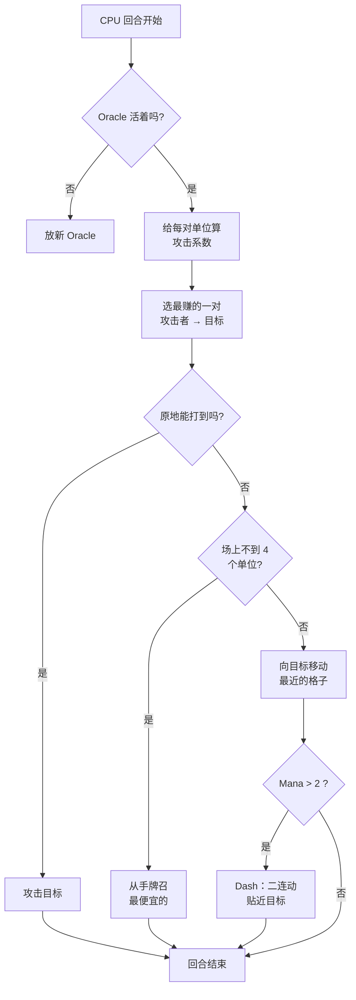

## 我给 Nausicaa 写的憨憨 AI

有些项目一开始是"要不做个神话版国际象棋？"，最后长成一套每 5 回合给自己换超参数的系统。

Nausicaa 就是这个。它是回合制桌游：组一套神话生物卡组，管 mana，在 10x8 的棋盘上布子。还有个会人格分裂的 AI。

我在这个 AI 上花了不少时间，它的结果到现在偶尔还让我意外，而这正是我最喜欢的部分。

## 先看游戏本体，再聊大脑

- 棋盘 10x8，每家 2 排部署区
- Mana 从 1 开始，每回合 +1，上限 6。召唤、攻击、放技能都要花
- 目标：干掉对方的 Oracle

12 种单位，费用和走法各不相同：

| 单位 | 费用 | 移动 | 血量 |
| --- | --- | --- | --- |
| Oracle | 0 | 王（8 方向） | 1 |
| Gobelin | 1 | 向前 3 格 | 1 |
| Harpie | 1 | 王（8 方向） | 1 |
| Naïade | 1 | 对角 | 1 |
| Griffin | 2 | 跳 2 格 | 2 |
| Sirène | 2 | 横向 | 1 |
| Centaure | 2 | 马步（L 形） | 2 |
| Archer | 3 | 横向 | 1 |
| Phénix | 3 | 对角（深色格） | 1 |
| Métamorphe | 4 | 换位 | 1 |
| Voyant | 4 | 不动（产 mana） | 1 |
| Titan | 6 | 受限（范围攻击） | 3 |

每个单位攻击模式不同。Sirène 打四个对角，Archer 射 3 格，Titan 落地炸周围一圈。简单说就是神话版象棋加卡组构筑。

## 我怎么让 CPU 动脑子的

思路简单到离谱：**每个敌方单位都有一个吸引力系数**。越危险，AI 越想处理它。

```javascript
const UNITS_ATTRACTIVENESS = {
    "oracle": 100,
    "titan": 95,
    "shapeshifter": 90,
    "phoenix": 80,
    "siren": 70,
    "archer": 70,
    "seer": 70,
    "griffin": 60,
    "centaur": 60,
    "harpy": 50,
    "naiad": 30,
    "gobelin": 20
};
```

Oracle 100，很合理，它是胜利条件。Titan 95，落地就清场。Gobelin 20，步兵而已，谁在乎。

然后对每一对单位（一个我方，一个敌方）算：

```
兴趣 = 吸引力 × attract 系数 / (距离 × distance 系数)
```

说白了：越危险越近，AI 越想揍它。

```javascript
calculateAttackCoefficient(x1, y1, x2, y2) {
    const distance = this.calculateEuclideanDistance(x1, y1, x2, y2);
    if (distance === 0) return Infinity;
    return (UNITS_ATTRACTIVENESS[unit.type] * COEFFICIENTS_IMPORTANCE["attractiveness"]) / distance;
}
```

### 系数每 5 回合一变

关键在这里，重要性系数**每 5 回合随机换一次**。

```javascript
if (this.turnCount % 5 === 0) {
    const distanceCoefficient = parseInt(Math.random() * 100);
    const attractivenessCoefficient = parseInt(Math.random() * 100);
    this.regulateImportanceCoefficients({
        distance: distanceCoefficient,
        attractiveness: attractivenessCoefficient
    });
}
```

一会儿 AI 极度好战（attract 95，distance 5），全军直扑你的 Oracle。下一阶段它又看重距离，开始走位。

这是从吃豆人幽灵那里偷的，Blinky 追杀，Pinky 埋伏。这里 AI 每几个阶段换一次"人格"。

**结果：整局下来你永远猜不到 AI。** CPU 绝不打两盘一样的。

### Oracle 是个胆小鬼

敌方 Oracle 会跑。字面意思。

```javascript
const awayFromTarget = {
    row: Math.max(0, Math.min(7, botUnitElement.row + (botUnitElement.row - targetUnitElement.row))),
    col: Math.max(0, Math.min(9, botUnitElement.col + (botUnitElement.col - targetUnitElement.col)))
};
```

它算出远离威胁的方向，直接开溜。撞墙就找那个方向上最近的空格。

你花 3 回合摸过去，啪，它已经跑到另一头了。

### 决策循环

AI 是这么决策的：

1. Oracle 没了（死了）就先放一个新的
2. 给每对我方-敌方单位算系数
3. 选出最赚的一对
4. 站原地能打到就打
5. 场上不到 4 个单位就从手牌召最便宜的
6. 否则向目标走（走到离敌人最近的格子）
7. mana 够（> 2）就 dash（二连动）再贴近
8. 如果这个单位是 Oracle 就跑



```javascript
async makeAction(dash=false) {
    // 全按顺序来
    // CPU 的 mana 够就 dash
    if(botPlayer.mana > 2) {
        this.makeAction(true);
    }
}
```

### 为什么用欧几里得距离

我用的是欧几里得距离：

```javascript
calculateEuclideanDistance(x1, y1, x2, y2) {
    const deltaX = Math.pow(x1 - x2, 2);
    const deltaY = Math.pow(y1 - y2, 2);
    return Math.sqrt(deltaX + deltaY) * COEFFICIENTS_IMPORTANCE["distance"];
}
```

为什么不用曼哈顿？因为单位走法五花八门（马步、对角等等）。直线距离更接近真实威胁。

## 为什么不用 minimax

我本可以写经典 minimax。但 12 种单位，走法各异，还有主动技能，博弈树爆炸得太快，根本玩不了。启发式做法不用搜一千万个状态，照样做出聪明的选择。

## 好玩的地方

吸引力系统会造出很好笑的 dilemma：

- Voyant（70）产 mana。放着不管，对面资源越来越多。但 Titan（95）更危险。
- Métamorphe（90）能和任何单位换位。它能偷走你的 Oracle。
- Harpie（50）自爆式攻击，炸完自己也死。平时次要，但它站到你三个单位中间时另说。

AI 看的是结合位置的全局危险，而不是裸数值。

还有个 `activateSimulation()` 可以摆特定局面调试，不用重开一局：

```javascript
activateSimulation() {
    // 在棋盘上摆特定单位
    // 调试 AI 用
    this.game.board = simulation.board;
    this.game.players = simulation.players;
}
```

## 缺的东西

如果有更多时间：

- AI 只看现在，不预测玩家下一步
- 不做多回合的手牌规划
- Métamorphe 和 Centaure 的技能它玩不明白
- 强化学习：让它和自己打，调系数

但对浏览器游戏来说够了。有朋友真能输给它，验证通过。

## 来玩

在 [nausicaa-game.github.io](https://nausicaa-game.github.io/) 上玩。点"JOUER"，打开 CPU 模式，看 AI 操作。

建议：让 AI 自己和自己打。你会看到它一会儿猛攻，一会儿 pfft 又缩回去。

代码在 [GitHub](https://github.com/nausicaa-game/nausicaa-game.github.io) 的 `js/cpu.js` 里。

**三句话总结：**

1. **启发式系数**，不用 minimax，每个单位一个吸引力
2. **系数每 5 回合一变**，AI 在好战和控场之间切换，吃豆人式
3. **Oracle 会跑**，算出远离威胁的方向就溜

如果你有让 AI 更阴的点子，开个 issue。我还有个让它从失败中学习的版本的计划，下篇文章再说。
