## 引言

超级马里奥 40KB ROM。八世界，32 关，敌人、音乐、道具，全塞里面。

但模拟器里拨对字节，能载 36-1 关。或 255-1。或掉进全是 Bowser sprite 和通向虚无水管的世界。

glitch 世界存在理由简单：SMB1 关卡存储是 8-bit 优化的艺术品，逼游戏读不该读的地方，结果很迷人。

Retro Game Mechanics Explained 做了 4 期视频讲这个，合一篇 6502 深潜，当年最畅销游戏的代码。

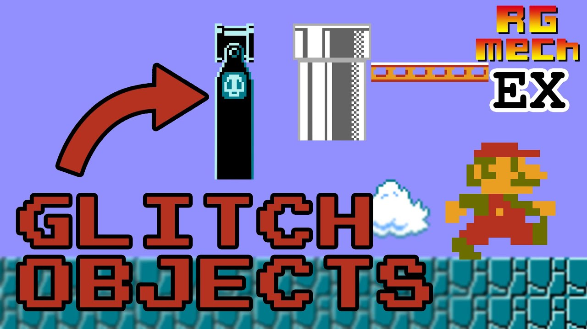


## warm start：为什么网球的 RAM 在 SMB1 里活下来

讲关卡存储前，先讲 SMB1 启动。因为 NES 网球换卡 glitch 全靠游戏的**warm start / cold start 检测系统**。

### 保留的 41 字节

SMB1 检测到 **cold start**（首次上电或断电再开），全 RAM 清零。检测到 **warm start**（按 reset，不断电），保留 **41 字节**内存区：

```asm
; warm start 保留的 41 字节 RAM
; 地址 $075F-$0787
;
; $075F：启动字节（world - 1）    [1 字节]
; $0760：选世界 flag（B 键） [1 字节]
; $0761-$0762：未用                    [2 字节]
; $0763-$0768：计时器（6 位，显示 3 位） [6 字节]
; $0769-$076E：Luigi 金币                   [6 字节]
; $076F-$0774：Mario 金币                   [6 字节]
; $0775-$077A：Luigi 分数                   [6 字节]
; $077B-$0780：Mario 分数                   [6 字节]
; $0781-$0786：最高分（6 位，1 位隐藏） [6 字节]
; $0787：魔法字节 $A5                 [1 字节]
```

41 字节只干一件事：game over 后**同世界续关**。6-3 死，游戏把世界 6 写启动字节，标题屏按住 A 加 Start 从 6-1 重开。

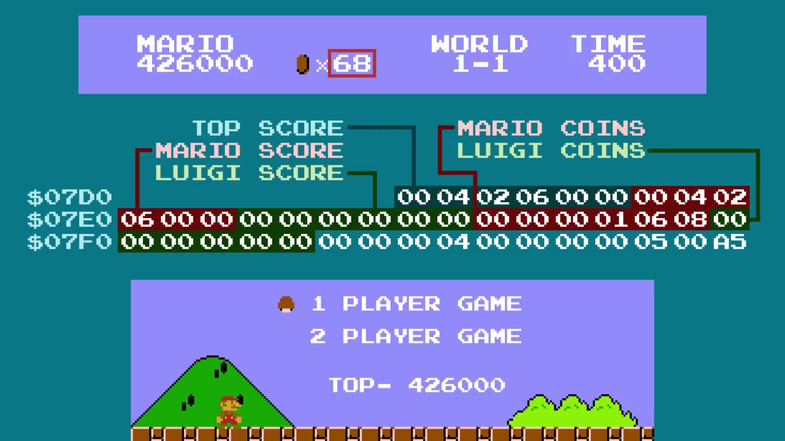

### warm start 双重校验

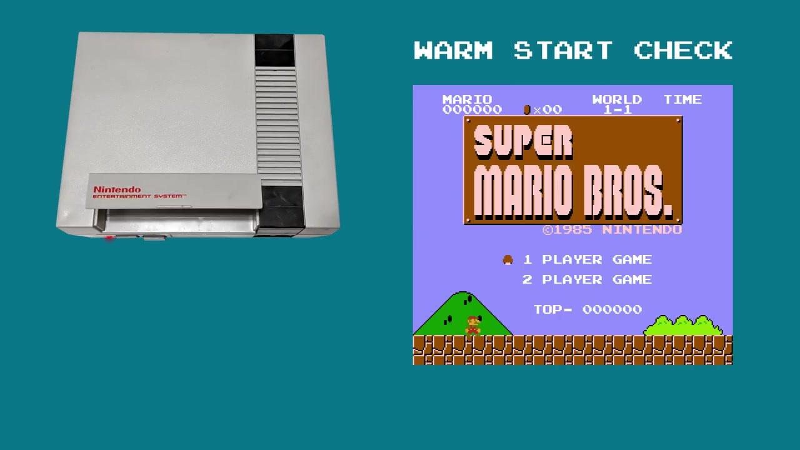

SMB1 启动不查一个条件查**两个**：

```asm
CheckWarmStart:
  ; 1. 查 $0787 魔法字节 $A5
  lda $0787
  cmp #$A5
  bne ColdStart        ; 不是 $A5 → cold start

  ; 2. 查最高分 6 位 ($0781-$0786)
  ;    每位必须 0-9
  ldx #0
CheckLoop:
  lda $0781,x
  cmp #$0A
  bcs ColdStart        ; 位 >= 10 → cold start
  inx
  cpx #6
  bne CheckLoop

  ; 两条件过 → warm start
  ; RAM 不清，起始世界保留
  jmp WarmStartBoot
```

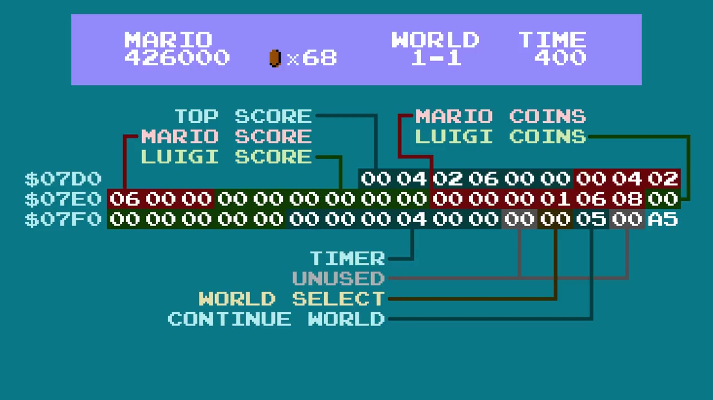

为什么双重？$A5 可能碰巧在（别的游戏留这值，或 RAM 芯片默认静置态）。再验最高分位合法（0-9），保证数据自洽。

### 为什么只有网球行

SMB1 首次插入（cold start），游戏：
1. 全 RAM 清，最高分 0，world 字节 0
2. $0787 写 $A5

然后不断电换网球。网球：
- 启动**不清 RAM**（少有 NES 游戏清）
- **不动最高分字节**，保持 0（合法）
- **不动 $A5 字节**，留着
- `$075F` 地址拿来做玩家脚步计数

```asm
; 网球脚步计数：
; 球场走一步 $075F 字节加一。
; SMB1 里同字节是"world number - 1"。
;
; 0 步  → world 0 → SMB1 里 world 1
; 1-7 步 → world 1-7 → 正常世界
; 8+ 步 → world 8+ → glitch 世界！
;
; 计数只在音乐停时涨
; （脚步音效音乐放时不播）。
```

换回 SMB1：
1. $A5 还在（网球没碰）
2. 最高分位还是 0（合法）
3. world 字节变成 8+（网球脚步加上去的）
4. SMB1 判 warm start，保留被污染的 world 字节
5. 按住 A 加 Start，world 9-1、world A-1、world 36-1 等等。

### 为什么先开马里奥再网球

微妙点：必须先开 SMB1，再网球，再 SMB1。直接从网球起，$A5 字节网球不写，warm start 检测失败，RAM 清掉。

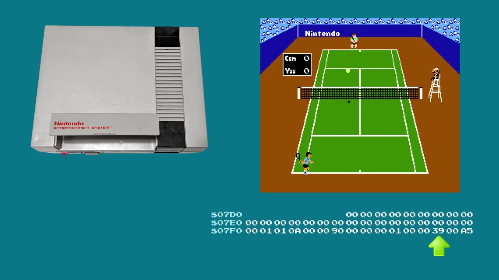

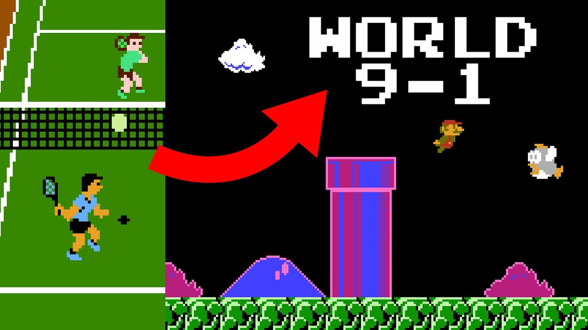

## SMB1 怎么把关卡塞进 40KB

任天堂 R&D4 要解看着简单的问题：横版卷轴关卡，tile、敌人、道具，塞进抠门的 ROM 预算。

解法是两层数据**完全独立**：

### tile 布局（关卡地图）

每关 tile 经 ROM 压缩结构指针定义。压缩原始但天才：控制字节加 1-3 数据字节。

tile 格式是 **run** 系统（类 RLE）：

```asm
; SMB1 tile 格式（简化）
; 每"命令"是控制字节：
;
; $00-$7F：放一个 tile，前进 1 列
; $80-$BF：tile 重复 N 次（N = 字节 - $80 + 1）
; $C0-$FF：特殊命令（行尾、跳跃、换色板）

例子：画 3 个连续砖块：
  $82 $01    ; tile $01（砖）重复 3 次
```

每关 13 行 16 列 tile（13x16 = 208 可见 tile）。压缩格式能压很低，天空和空列几乎不占地方。

6502 解压循环：

```asm
; tile 解压，主循环
; 输入：tile_data 指针 $XX
; 输出：关卡 tilemap 进 PPU RAM

DecompressTile:
  lda (tile_ptr),y      ; 读控制字节
  iny
  cmp #$80
  bcc SingleTile        ; $00-$7F：单个 tile
  cmp #$C0
  bcc RunLength         ; $80-$BF：run-length
  jmp SpecialCommand    ; $C0-$FF：特殊命令

SingleTile:
  sta PPU_DATA          ; 直接写 tile
  jmp Next

RunLength:
  sec
  sbc #$7E              ; N = 控制 - $7E
  tax
  lda (tile_ptr),y      ; 读要重复的 tile
  iny
: sta PPU_DATA
  dex
  bne :-
  jmp Next
```

### sprite 布局（敌人和物件）

并行，敌人和物件（? 块、水管、板栗仔、乌龟）存完全独立结构。每刷怪 2 字节：

```asm
; SMB1 sprite 格式
; 字节 0：X 位置（列）
; 字节 1：sprite 类型加 Y 页面位
; Y 从序列 index 推

sprite 序列：
  $01 $4B    ; 列 1 板栗仔
  $09 $4B    ; 列 9 板栗仔
  $10 $61    ; 列 16 ? 块（出金币）
  $15 $54    ; 列 21 绿乌龟
  $FF        ; 序列尾
```

每关最多引用 5 页 sprite（其实 5 个 16 列"屏"），实际大多数关只用 2-3 页。

### 指针表

设计天才在指针表。每关存成 **一对** ROM 地址：

```c
// 内部结构（简化）World Map
struct LevelPointer {
    uint16_t tile_ptr;   // tile 数据 ROM 地址
    uint16_t sprite_ptr; // sprite 数据 ROM 地址
};

// 4 张独立表，按 AreaType：
 // 0 = 水，1 = 地上，2 = 地下，3 = 城堡
LevelPointer level_table[4][128];
```

每表 128 项。**512 种组合**，官方游戏只用一小撮。剩下的读未初始化 RAM 或当指针使的数据。

载关时游戏这么干：

```asm
; 载关
; A = AreaType（0-3），X = LevelID（0-127）

LoadLevel:
  sta AREA_TYPE
  asl                  ; x2 做 16 位表偏移
  tax
  lda LevelTable_TilePtr, x
  sta TILE_PTR
  lda LevelTable_TilePtr+1, x
  sta TILE_PTR+1       ; tile 指针
  lda LevelTable_SpritePtr, x
  sta SPRITE_PTR
  lda LevelTable_SpritePtr+1, x
  sta SPRITE_PTR+1     ; sprite 指针
  jsr DecompressTiles
```

游戏无条件信指针：表里地址读出来，解压那个地址的东西，完事。

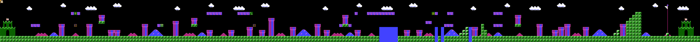

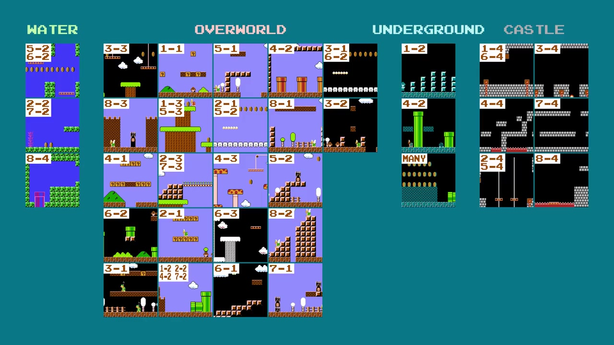

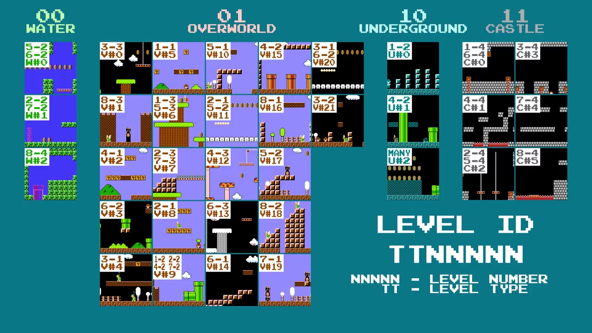

### 34 个独立关和 7-bit ID 系统

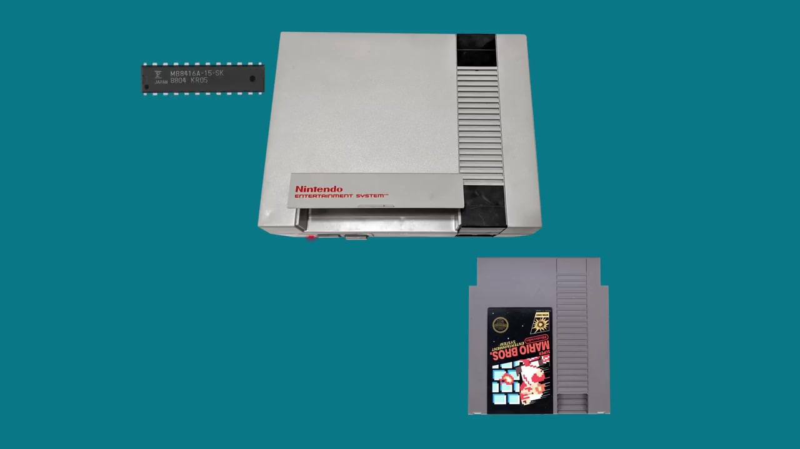

SMB1 不是 32 关，是 **34 个独立关**。很多关复用（5-3 = 1-1 加飞弹，"hard mode" flag 标）。真独立关：
- **水**（类型 0）：3 关（2-2、7-2、5-2/6-2 奖励区）
- **地上**（类型 1）：22 关（含两云奖励房）
- **地下**（类型 2）：3 关（含地下奖励房）
- **城堡**（类型 3）：6 关
- 加 1 cutscene 房（地下/水关前）
- 1 个 4-2 warp 区

每关 ID **7 位**。低 5 位子组编号，高 2 位区域类型：

```asm
; 7 位 Level ID 编码
; 位 6-5：类型（00=水，01=地上，10=地下，11=城堡）
; 位 4-0：子组编号
;
; 水 ID       : $00-$02  （类型 00，编号 0-2）
; 地上 ID     : $20-$35  （类型 01，编号 0-21）
; 地下 ID     : $40-$42  （类型 10，编号 0-2）
; 城堡 ID     : $60-$65  （类型 11，编号 0-5）
;
; ID $25 = %0100101 → 类型 01（地上），编号 5 → 1-1
; ID $23 = %0100011 → 类型 01（地上），编号 3 → 6-2
```

**128 可能 ID**（$00-$7F），34 个有真关卡。没用的 ID 指向随便哪。

### 指针表：两表，两顺序

tile 指针和 sprite 指针**存的顺序不一样**。代码用两张独立 16 位表（高字节低字节分两表存）：

```
sprite 指针顺序：
  index 0-5   ：城堡（6 关）
  index 6-27  ：地上（22 关）
  index 28-30 ：地下（3 关）
  index 31-33 ：水（3 关）

tile 指针顺序：
  index 0-2   ：水（3 关）
  index 3-24  ：地上（22 关）
  index 25-27 ：地下（3 关）
  index 28-33 ：城堡（6 关）
```

顺序为什么不同？没技术原因，大概开发时数据就这么摆的。但后果迷人：ID 非法时 tile 和 sprite 指针载*不同*关卡，拼出 **Frankenstein 关**。

两表之间导航靠小 **offset 表**（像目录）：

```asm
; 各类型 offset 表（水、地上、地下、城堡）
; 每项 = 对应表起始 index

SpriteOffsetTable:
  .byte $1F, $06, $1C, $00    ; 水=31，地上=6，地下=28，城堡=0

TileOffsetTable:
  .byte $00, $03, $19, $1C    ; 水=0，地上=3，地下=25，城堡=28
```

载 6-2（ID $23，地上编号 3）：

```asm
; 1. 类型 = 01（地上）→ offset 表 index = 1
; 2. sprite 偏移 = SpriteOffsetTable[1] = 6
;    最终 index = 6 + 3（关编号）= 9 → 第 10 个 sprite 指针
; 3. tile 偏移 = TileOffsetTable[1] = 3
;    最终 index = 3 + 3 = 6 → 第 7 个 tile 指针
; 4. 结果：tile 指针 $A619 加 sprite 指针 $9ED0 = 6-2 ✓
```

非法 ID $43（地下编号 3，不存在）呢？

```asm
; ID $43，类型 = 10（地下），编号 = 3
; sprite 偏移 = SpriteOffsetTable[2] = $1C = 28
;   index = 28 + 3 = 31 → 第 32 个 sprite 指针 = 5-2 水奖励区！
; tile 偏移 = TileOffsetTable[2] = $19 = 25
;   index = 25 + 3 = 28 → 第 29 个 tile 指针 = 1-4（城堡）！
;
; 结果：地下关配 1-4 tile
; 加 5-2 水区 Blooper。真 Frankenstein。
```

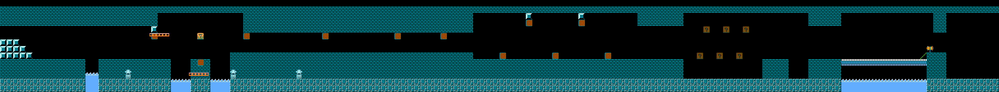

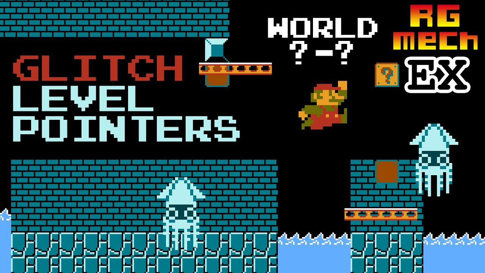

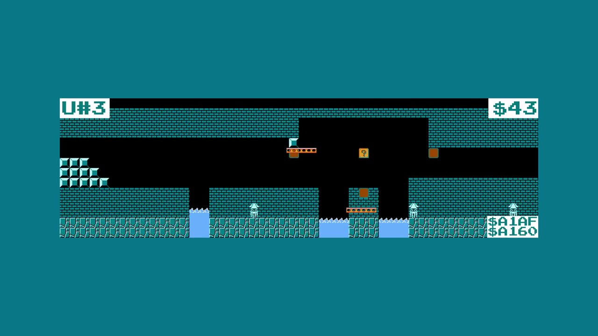

### world index 表：为什么 world 9 溢出

ROM 里 8 字节表给每世界（1-8）首关 index。后面紧跟 36 关 Level ID 全表按游戏顺序。

```asm
; WorldIndexTable（8 字节）
  .byte 0, 5, 10, 15, 20, 25, 28, 33
;   → 世界 1 从关 0 起
;   → 世界 2 从关 5 起
;   → 世界 8 从关 33 起

; LevelIDTable（36 字节）
  .byte $25, $28, $29, $26, $24, ... ; 36 Level ID
```

载 world 9，游戏读 WorldIndexTable 第 9 字节，不存在。溢 1 字节进 LevelIDTable，读到 $25，再拿 $25 当 LevelIDTable index（第 37 项），再溢 2 字节进 SpriteOffsetTable，读到 6。

```asm
; World 9：
;   1. WorldIndexTable[8]（溢出）→ LevelIDTable 读到 $25
;   2. LevelIDTable[37]（溢出）→ SpriteOffsetTable 第 2 字节 = 6
;   3. ID = 6 → 水关编号 6（不存在）
;   4. tile 指针 = 水指针编号 6 = 6-2 tile
;   5. sprite 指针 = index 31+6 = 37 > 33 → 非法指针
;   6. 结果：水下 6-2 加 glitch sprite
;      → world 9-1！
```

World G（16）溢更远掉到 Level ID $01，1-2 前 cutscene 关：

```asm
; World G（16）：
;   WorldIndexTable[15] → LevelIDTable 读到 $01
;   LevelIDTable[1] = $29（1-2 cutscene）
;   → world G-1 = 1-2 入场 cutscene
```

## glitch 世界为什么存在

游戏"正经"关 32 关（8 世界 × 4 关）。指针表每区域类型 128 项。32 关之外的项装 ROM 那地址的东西，可能是别的关，可能是声音数据，可能是 RAM，可能是随便啥。

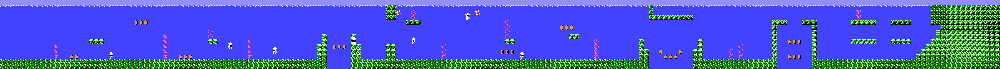

### Level ID $01 加 AreaType 0 = Minus World

最出名的 glitch 世界。Level ID $01 配 AreaType 0（水）指向：

- **tile 指针：$AE45** → 2-2/7-2 水下区
- **sprite 指针：$A171** → 2-2/7-2 sprite

结果：长得像 2-2 的水关，但旗杆没了。关卡无限循环。

就是 36-1 关（或 $-1 世界的 36-1）。

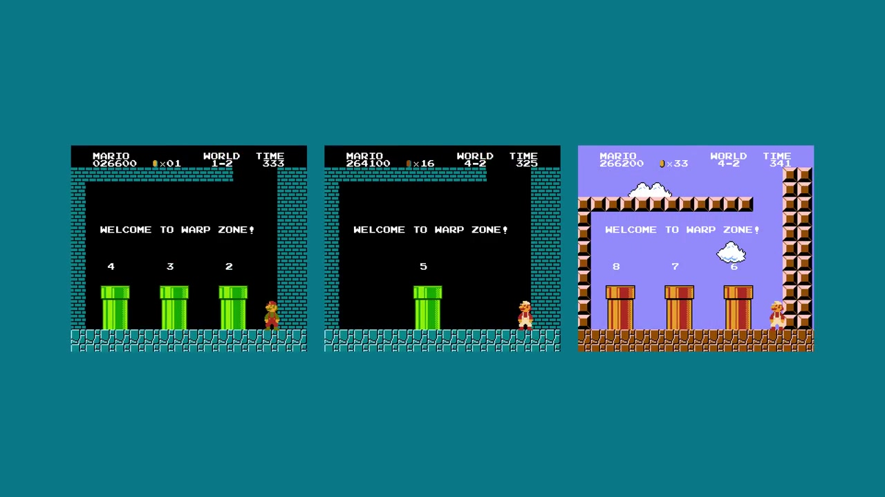

```asm
; Minus World 为什么没旗杆：
; 2-2/7-2 sprite（$A171）序列没有旗杆
; 游戏找 $FD sprite（旗杆）
; 永远找不到 → 无限循环
;
; 游戏无限生成关卡
; 直到计时器归零。
```

### 指向 RAM 的指针

tile 或 sprite 指针指 RAM 地址（$00-$7F）不指 ROM，游戏把 RAM 不停变的字节当 tile 解：

```asm
; 例子：Level ID $03 水
; tile 指针：$A46B（3-3，合法）
; sprite 指针：$009D（指零页 RAM！）
;
; 零页 RAM 装游戏寄存器、
; 马里奥位置、计数器状态……
; 游戏解压当 sprite 序列，
; 结果关里敌人其实是寄存器值。
```

零页一变（马里奥动，计时器走），关里"sprite"跟着变。所以有些 glitch 世界敌人闪烁变形。

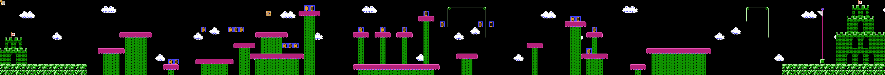

### Level ID $36：空关（地上）

Level ID $36 配地上：

- **tile 指针：$AC35**（1-2）
- **sprite 指针：$A0D8**（1-2）

结果：空。游戏载关但 RGMechEx 目录标"无此关"。tile 可能合法但 sprite 指向产出空关或坏关的地方。

### Level ID $1D（城堡）：crash 王

Level ID $1D 配城堡：

- **tile 指针：$A210**（4-4）
- **sprite 指针：$7EA0**（RAM！）

sprite 指针在 RAM = 未定义 sprite。游戏想在首行 tile 显示 Spiny 球或飞弹发射器。直接 crash。

```asm
; $1D 为什么 crash：
; sprite 指针指 RAM，
; 游戏把时刻变的字节
; 当"刷怪"指令解
; 结果：
; - 刷出不存在的物件（未定义值）
; - sprite NES 想显示非法 tile
; - PPU crash
; - 整机冻住
```

## 256 个 glitch 世界全目录

RGMechEx 写脚本把**全部**关卡地图生成出来，4 区域类型 × 128 ID。

世界计数 8 位（0-255）。世界 1-8 正经。剩 **248 个潜在 glitch 世界**。每个 glitch 世界是该世界首关，Level ID 经 WorldIndexTable 溢出机制算。

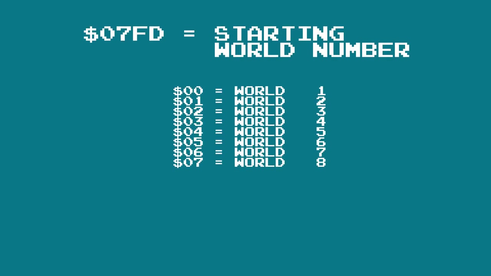

128 可能 ID 只有 **68 个是某世界"首关"**（经 glitch world 号可进）。60 个是第 2 关以后或进不去。

| 类型 | 独立可玩 ID | crash 的 ID | 空 ID |
|------|---------------------|-------------------|-----------|
| 水（0）    | 约 20  | 约 60  | 约 48  |
| 地上（1）| 约 30  | 约 55  | 约 43  |
| 地下（2） | 约 15 | 约 65 | 约 48  |
| 城堡（3）   | 约 25  | 约 58  | 约 45  |

很多 ID 通向同关，因为指针掉 ROM 同地址。Level ID $28（地上）tile 指针 $A7CD（2-1），出现在 **38 个不同 glitch 世界**，因为 sprite 指针 $9F51 掉 ROM 当 padding/声音数据复用的区，好多 ID 共用。


### 真独特的 6 个 glitch 关

19 个可进 glitch ID 里只有 **6 个载入不立刻 crash**：

| 世界 | Level ID | 说明 |
|-------|----------|-------------|
| E-1 (224) | $50 | 深坑上一块 ? 砖。马里奥出生即死。 |
| W | $57 | 马里奥出生卡住，动不了。 |
| 42 (133) | $50 | 云隧道，走远卡死马里奥。 |
| 62 (131, 240) | $4D | 冻住的城堡：马里奥出生在顶，下不来，卡住。 |
| 127 | $4B | 地下隧道，走远 crash。 |
| 137 | $4B | 触发 cutscene 自动卷轴。马里奥遇到单个 brick block 永远挡住。 |


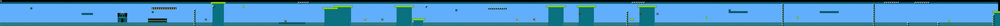


248 个 glitch 世界产出真新东西的只有六个。剩下是错区域类型的正常关，或黑屏。

## 关卡格式细看

看精确数据格式，理解 glitch 关为什么有的立得住有的不。

### 关头：2 字节 6 属性

每关开头 2 字节头定 6 属性：

```asm
; 字节 0：计时器 + Y 起点 + 修饰
;   位 7-6：计时器（00=不变，01=200，10=300，11=400）
;   位 5-3：马里奥 Y 起点（111/110 = 自动走）
;   位 2-0：关卡类型修饰
;              000=默认，001=波浪，010=砖墙，
;              011=水底，100=夜，101=雪，
;              110=雪夜，111=灰夜

; 字节 1：平台 + 背景 + 地板 pattern
;   位 7-6：特殊平台（00=树，01=蘑菇，
;                                 10=飞弹，11=云）
;   位 5-4：背景（00=无，01=云，
;                           10=山，11=栅栏）
;   位 3-0：初始地板 pattern（0-15）
```

类型修饰管视觉变体：水关顶部波浪、8-3 砖底、4-3 夜色板、6-2 雪等。

### tile 物件：2 字节，Next Screen 旗，3 槽队列

头后面是 **tile 物件**列表，每物件 2 字节。字节 $FD 标列表尾。

```asm
; tile 物件格式（16 位）：
; 字节 0：
;   位 7-4：X 位置（列 0-15）
;   位 3-0：Y 位置
;     Y=0-11  ：正常 Y 位置
;     Y=12    ：特殊物件（坑、桥、绳、? 块）
;     Y=13    ：跳屏 / 特殊物件 2
;     Y=14    ：换修饰/布景/地板
;     Y=15    ：特殊物件 3（城堡、楼梯、大水管）

; 字节 1：
;   位  7   ：NEXT SCREEN 旗
;   位 6-4 ：物件类型（0-7）
;   位 3-0 ：宽/高 / 子类型
```

"next screen" 旗一起，当前工作列加 1。物件放 16 列之后就靠这个。物件必须**按顺序**列（左到右），游戏顺序载：

```asm
; 载入 routine 每列两阶段：
; 阶段 1：找本列新开始的物件
;            进队列
; 阶段 2：队列每物件画 tile，
;            本列画完的出队
```

队列正好 **3 槽**。直接后果：同列开头物件不能超 3 个。队列满第 4 个忽略，永不载。

所以好关卡不堆物件。1-2 天花板 1up 砖加旁边砖拆两物件，就为守 3 上限。

### 特殊 Y 位置：12、13、14、15

Y=12 物件没 Y 位置（按类型写死）：

```asm
; Y=12：无 Y 位置物件
;   类型 0：坑（删地面）
;   类型 1：移动平台绳
;   类型 2-4：固定 Y 桥
;   类型 5：水/岩浆坑
;   类型 6-7：? 块排
```

Y=13 两亚组。字节 1 位 6 = 1：

```asm
; Y=13，位6=1：特殊物件
;   0 = L 形管（cutscene），1 = 旗杆，2-3 = 桥/斧/锤（城堡尾）
;   4 = 停屏，5 = 随机敌人，6 = 循环关，7+ = 可能 crash
```

位6=0，低 5 位编码**跳屏**（直接跳屏 N，不一个个 next screen 旗走）。

Y=14：同理位6=1 换类型修饰，位6=0 换背景加地板 pattern。

### 地板 pattern：16 种地面

关卡地面不是一个个物件。SMB1 用**地板 pattern**，背景 pattern 铺到下次改：

```asm
; 地板 pattern（4 位 = 16 种）
;   0 = 全空
;   1 = 2 tile 高地面
;   2 = 1 tile 高地面
;   3 = 地面加底
;   4 = 地面加底 2
;   5 = 地面 1/2 tile
;   6 = 3/4 地面
;   ... 到 15 = 全填（地面加天花板）
```

坑是物件的原因：特定列覆盖地板 pattern，不用为剩下改 pattern。

### 256 字节上限和 repeat

每关 tile 数据最多 **256 字节**。6502 Y 寄存器做 index，8 位。游戏读完没遇 $FD，**绕回开头**无限重复 256 字节：

```asm
; Y index = 8 位 → tile 数据最多 256 字节
; Y 溢出（255 → 0）没遇 $FD → 重复
; sprite 也一样，但管子物件（3 字节）
; 每次载入错开 index 奇偶。
```

有些 glitch 关靠 repeat 生成"无限"关。

### sprite 系统：2 字节加管子过渡

sprite 格式类似，无头，几点不同。字节 $FF 标列表尾。

```asm
; sprite 格式（2 字节）：
; 字节 0：X 位置（列）
; 字节 1：
;   位 7：NEXT SCREEN 旗
;   位 6-0：sprite 类型
;       含：板栗仔、乌龟、Blooper、
;       飞弹、Lakitu、Spiny、平台、
;       warp 区命令、蛤蟆/公主、
;       敌群刷怪命令
```

字节 1 最低位是 **hard 关 flag**：置 1 sprite 只在 ≥5-3 关出现。"hard mode" 就是这么造的。

Y 位置 15 = **跳屏**（tile 一样）。Y 位置 14 = **管子过渡**（3 字节）：

```asm
; sprite Y=14：管/藤过渡（3 字节！）
;   字节 0：X 位置
;   字节 1：位 6-0 = Level ID 7 位（去哪）
;   字节 2：位 4-0 = 去第几屏
;            位 7-5 = 这过渡有效世界
;
; 为什么要世界？奖励房多世界复用。
; 例：1-1 奖励房 2-1 和 7-1 也用。
; 这房 3 过渡，一世界一个，马里奥
; 落回对的地方。
```

sprite **无队列**。唯一限制：刷怪区（右屏外刚好）同时载 sprite 不超 4 个。超了忽略。

## 怎么进 glitch 世界

两条路。

### 经典：穿墙

穿墙（wall clip）出正常关，走到藏起来的 warp 区。拨 RAM 世界计数，载任意 Level ID。

步骤：
1. World 1-2：进隐藏尾管
2. 右墙穿墙
3. 虚空走到 warp 区
4. 游戏读成世界

但这路只到一小撮 glitch 世界。

### 狠的：NES 网球换卡

上面 warm start 节全讲了。总结：网球脚步计数写 RAM 同字节正是 SMB1 世界号，warm start 检测留住这个值。

### 玩家的：直接改内存看全部

模拟器自己逛全部 glitch，直接改 Level ID：

```asm
; FCEUX / Mesen 补丁：
; RAM 地址 $075F = 当前 Level ID
; RAM 地址 $0760 = Area Type（0=水，1=地上，2=地下，3=城堡）

; 例子：地上载 Level 57（0x39）
; 模拟器内存查看写：
; $075F = 0x39
; $0760 = 0x01
; 然后进 warp 管或死一次重来
; → 游戏载 Level ID $39 地上
```

RGMechEx 把 128 关 × 4 类型全地图放 [rgmechex.com](https://rgmechex.com/tech/smb1levels/index.html)。每项 tile 指针、sprite 指针、可视地图。

## 最离谱的几关

### Level ID $1F（水）：一关顶 15 个 glitch 世界

tile 指针 $A302（3-4）加 sprite 指针 $02A0，产出 15 个 glitch 世界（D-1、J-1、Y-1、Z-1、55-1、73-1……）。解释：sprite 指针掉 ROM 区数据凑合像合法 sprite，能玩，但 3-4 城堡 tile 配地上 sprite，渲染荒谬。

### Level ID $28（地上）：38 个 glitch 世界纪录

纪录保持。38 个 glitch 世界入口同关（2-1 tile 加 $9F51 sprite）。因为 sprite 指针 $9F51 掉 ROM 当 padding/声音数据复用区，好多 ID 共用。

### Level ID $49（地下）：FDS 关

tile 指针 $76AE 加 sprite 指针 $1C9D。tile 指针掉 FDS 版 ROM 预留区。结果：标准卡带没有的 tile。52-1 和 196-1 就是它。

### Level ID $00-$02：真奖励关

这些 ID 正经子关卡用：

- **$00**：5-2/6-2 水下区（H-1、39-1 用）
- **$01**：2-2/7-2 水（Minus World，36-1）
- **$02**：8-4 子关（136-1、151-1、215-1 用）

"奖励关"和 glitch 世界区别在 warp 区验当前世界：

```asm
; warp 区检查（简化）
; 游戏验目标世界 1-8
CheckWarp:
  lda TARGET_WORLD
  cmp #1
  bcc InvalidWarp       ; < 1 → 拒绝
  cmp #9
  bcs InvalidWarp       ; > 8 → 拒绝
  ; 1-8 才合法
  jmp DoWarp
```

号 > 8 或 0 的 glitch 世界正常管子到不了。要穿墙或换卡。

## 有些关为什么 crash：跳转表

游戏载 tile 物件拿类型当 **jump table** index：

```asm
; 标准 tile 物件跳转表（类型 0-11）
JumpTable_TileObjects:
  .word Obj_Special       ; 类型 0：? 块、隐藏、旗杆……
  .word Obj_Platform      ; 类型 1：特殊平台
  .word Obj_BrickRow      ; 类型 2：砖排
  .word Obj_BlockRow      ; 类型 3：砖块排
  .word Obj_CoinRow       ; 类型 4：金币排
  .word Obj_BrickCol      ; 类型 5：砖列
  .word Obj_BlockCol      ; 类型 6：砖块列
  .word Obj_Pipe          ; 类型 7：水管
  .word Obj_8             ; 类型 8
  .word Obj_9             ; 类型 9
  .word Obj_10            ; 类型 10
  .word Obj_11            ; 类型 11
```

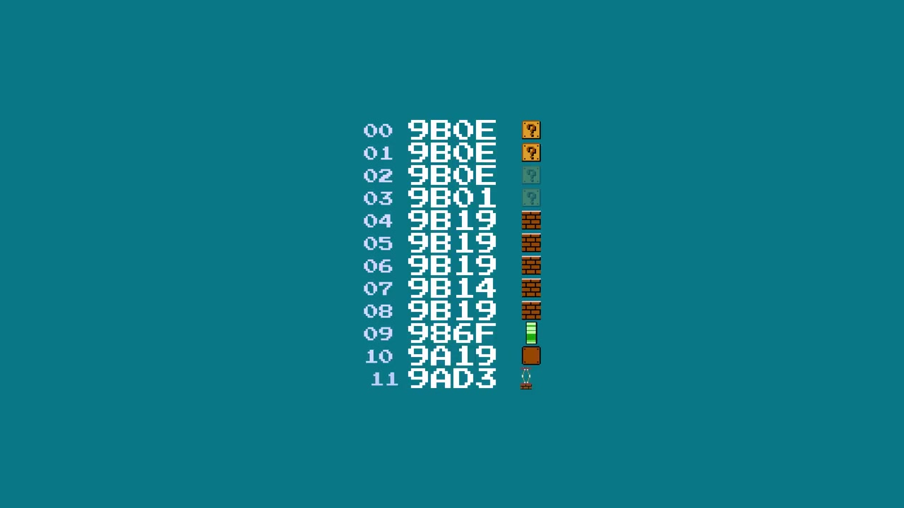

物件类型非法（≥12），游戏跳表里没有的指针。**4 种结局**：

1. **合法指针**，物件正常载
2. **跳到别的跳转表**（重叠），出别的物件。例：类型 12 指到 Y=13 表，出 L 管。
3. **跳到可执行代码**，随机执行（大概率 crash）
4. **显式占位（NOP）**，物件啥不干（有些 sprite 这样，原地打转不动的敌人）

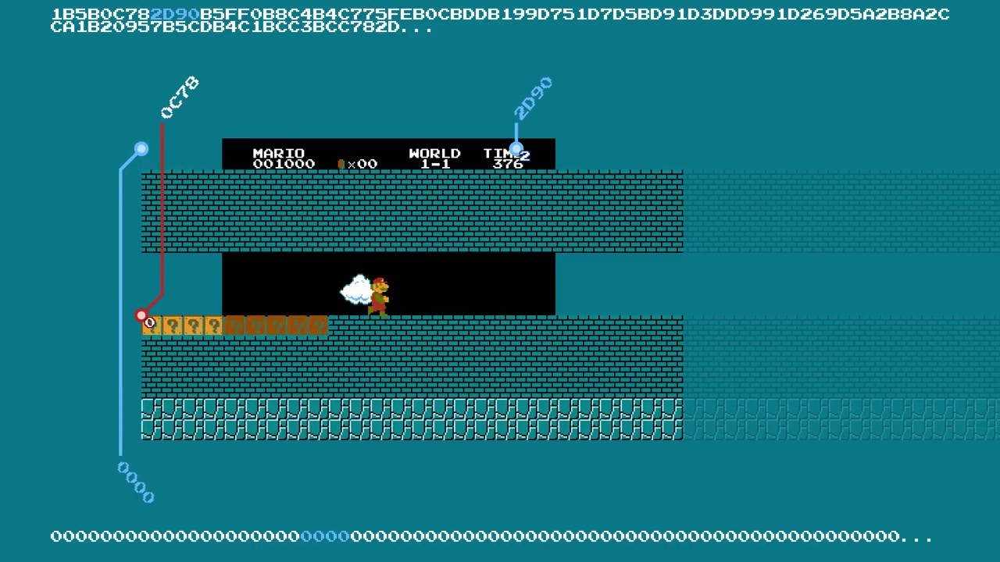

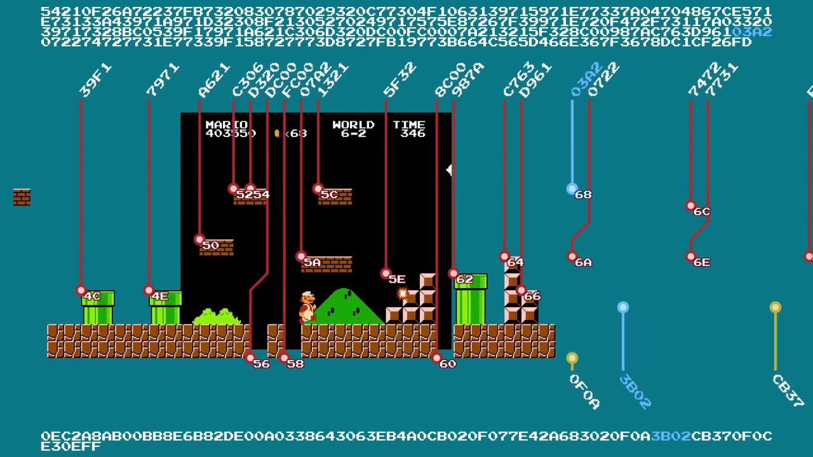

glitch 关 ID $58（crash 隧道）：sprite 指针指 NES 无 mapper ROM 不存在的内存区。游戏每帧同位置（0,0）载同一 Koopa 5 次，PPU 塞爆冻住。

```asm
; $58 为什么 crash：
; sprite 指针 → 非法地址（标准 NES 空间外）
; → 游戏把不定字节当 sprite 类型读
; → $00 Koopa（无 handler 非法类型）递归调用
; → 6502 栈溢出 → 冻住
```

### 管子 warp 悖论

还记 `target_world BETWEEN 1 AND 8` 检查吗？glitch 世界管子找到了，游戏验目标世界 1-8。glitch 世界号 > 8（36-1、255-1……），warp 失败。

Minus World 没尾也是这个：sprite 没旗杆，管子去不了 world 36。

### 同列 5 物件 trick

有绕 3 物件上限的 edge case。队列卡住（槽满加下个物件没 next screen 旗），游戏"预处理"当前列循环找带 next screen 旗的物件。每次预处理：

```asm
; 列预处理时：
; 1. 队列物件剩余宽度
;    每"假走"一列减一
; 2. 宽度到 0 出队
; 3. 空槽进新同列物件

; 结果：同列最多塞 5 物件。
; 手法：2 个跨屏边界物件
; （占槽 1、2），1 个 X 比前面小的 dummy 物件（卡队列），
; 再下屏 X=0 处 3 物件（一个带 next screen 旗）。
```

这叫"queue skip"，romhacker 拿它做比格式允许更密的关。

## 版本差异

### Famicom Disk System

FDS 版 SMB1 **内存 map 不同**。全部关卡指针移位，数据一样。变的：glitch 世界 index 全不同：

```
FDS World 36 → Level ID $09（5-3 水版）
  → 旗杆在！能过关。
  → 接着：$27（7-3 正常）→ $44（4-4 地下）
  → $44 能过，斧子管用，通关！

FDS Minus World 是能打通的"奖励世界"，
NES 版不是。
```

我最爱的 FDS 关：**ID $5F**，3-3 后半地下窄隧道版（可惜自动卷轴）。

### The Lost Levels（日版超级马里奥 2）

Lost Levels 改很多：

1. **tile sprite 同顺序**：非法 ID 也同关载，没 Frankenstein 关
2. **单 16 位指针表**，不高低字节分两表
3. **4 磁盘文件**：ROM 按 FDS 切了：
   - 文件 1：世界 1-4
   - 文件 2：世界 5-8
   - 文件 3：世界 9 加声音引擎
   - 文件 4：世界 A-D（指针表完全不同）
4. **同 Level ID = 4 种可能关**，看载哪个文件
5. **网球 glitch 没了**：续关选项（同世界 game over 续）让 warm start 多余，游戏 world > 9 直接**重置**
6. **新物件**：毒蘑菇、隐形块、隐形火花、倒管子、风，但插旧表中间，**和 SMB1 存档不兼容**
7. **4 世界后食人花全红**，**弹簧**只世界 2/B/3/C/7 绿

### 超级马里奥全明星（SNES）

直接移植同 6502 routine（SNES 兼容模式跑 NES 代码）：

- **warp 区修了**：Minus World 没了（文字出来前进左管去对的世界）
- **crash**：大多数 glitch 关 crash（ID $6A 和 9-1 外）
- **城堡物件加了**，更独特
- **但**：**4-2 wrong warp 还在**（没修！）

### 4-2 wrong warp：物件放错的 bug

4-2 两个管子过渡物件：藤蔓（warp 区）和水管（金币房）。藤蔓过渡物件放**太早**，藤蔓出屏前 3 屏。水管过渡物件放**太晚**，水管后 1 屏。

```asm
; 4-2 过渡时机：
; 过渡物件 1（藤蔓 → warp 区）：藤蔓前 3 屏放
; 过渡物件 2（水管 → 金币房）：水管后 1 屏放
;
; 正常第一个物件马里奥
; 到水管前失效。但马里奥够快（或
; 用 B+右捷径），藤蔓过渡
; 到水管还活着！
; → 游戏载 warp 区不载金币房。
;
; 物件放藤蔓后水管前，bug 就没了。
```

### 循环关

循环（8-4、7-4）怎么跑？关卡有带屏号和 Y 位置的**检查点**：

```asm
; 检查点：{屏号，纵位置}
; 马里奥过检查点高度对 → 关卡继续
; 否则 warp 回 4 屏（64 块）
;
; 无限循环：纵位置 = $F0
; （屏底下）→ 永不过。
;
; 检查点单 flag，world 7 除外
; 三 flag，至少挂 1 个；
;
; warp 回粗暴：tile 数据偏移硬编码值，
; sprite 数据偏移归零。场上敌人
; 瞬间卸载，火棒消失。
```

## 改格式，不改代码

SMB1 架构最迷人一课：开发者做出表达力很强的关卡系统，6502 渲染代码**一行没动**。关卡差异全来自**数据**（指针、物件、sprite、地板 pattern），不来自代码。

256 glitch 世界存在因为**指针表按 128 项 × 4 类型定**，游戏从不校验读的值。指针掉 RAM，游戏把马里奥寄存器当 tile 读。指针掉声音数据，游戏把音乐当关卡玩。跳转表溢出，游戏随机执行到 crash。

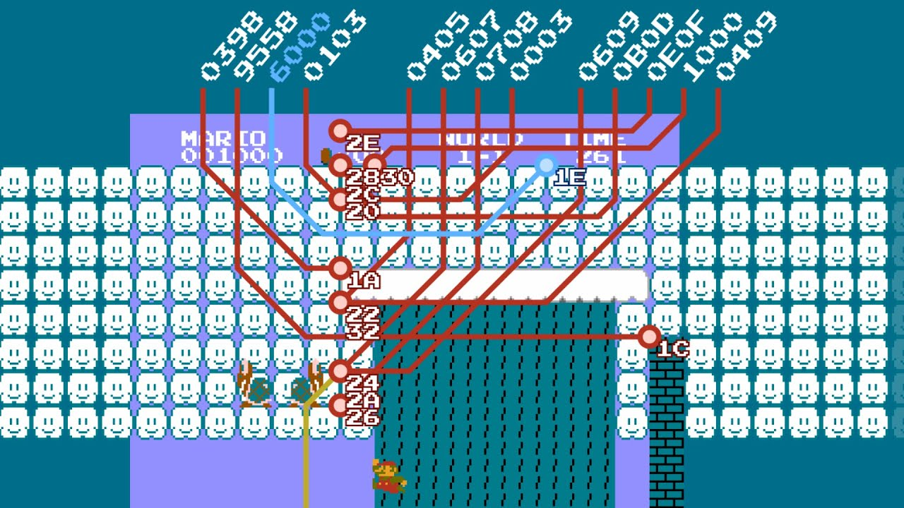

## 能学到什么

1. **tile sprite 分离**：两层完全独立，存的顺序不同拼出独特 Frankenstein 关
2. **压缩 RLE 加物件系统**：关卡不是位图，是放好的物件列表，加地板 pattern 铺地
3. **3 槽队列**：硬件（和关卡设计）硬上限
4. **无条件信指针**：信指针信跳转表，出 glitch 可玩关或 crash
5. **256 字节上限**：6502 Y 寄存器上限，走远数据重复
6. **warm start / cold start**："续关"系统开出网球换马里奥换卡门

最美的：全是 40KB 里 6502 代码。代码直连硬件，每次内存访问无条件信。指针烂游戏 crash。crash 我们叫 glitch 世界。

## 三句话记住

1. **glitch 世界是指针掉错地方**，游戏 128 ID × 4 区域类型，真独立关 34 个。world 号一坏（网球或穿墙），游戏载给别关设计的指针，512 种组合结果不可预测。

2. **Minus World 是 warp bug 加数据污染**，1-2 左管文字出来前进载 world 36（0x24）。这世界指 Level ID $01（2-2 水），无旗杆关。world 36 无管子过渡，关卡无限循环。缺校验造出 icon。

3. **网球 → 马里奥，比 OoT → 纸马早 15 年**，NES 换卡 RAM 靠电容和 SMB1 warm start / cold start 活下来。网球脚步计数（播脚步声加 RAM 字节）正好落在世界号地址。最高分位保持 0、$A5 字节完好、warm start 判过，巧合全齐才有这个门，只网球行。

[Retro Game Mechanics Explained](https://www.youtube.com/c/RetroGameMechanicsExplained) 原视频是真功夫，6502 反汇编细、全部关卡自动地图、换卡 warm start 讲透。没看过系列去看，短，每分钟都密。

地图源码在 [rgmechex.com](https://rgmechex.com/tech/smb1levels/index.html)，SMB1 完整反汇编开源仓库一堆。40 年前日本程序员 6502 手写这套关卡系统，无单元测试无 bug 跟踪，我们今天开源码还在学优化技巧。
