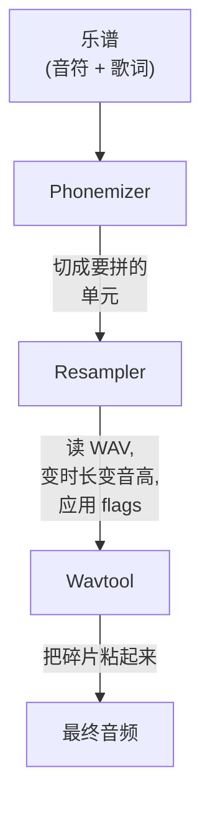

## UTAU：一款 Visual Basic 6 软件如何让歌声合成民主化

在我的主页里我就提过一嘴：我喜欢 UTAU。下面说说为什么。

2008 年，如果你想让合成 voice 唱歌，你只有一个选择：VOCALOID。雅马哈的软件。贵，专有，想自己做一个官方音色？没门。

然后有个日本人，Ameya/Ayame，自己捣鼓出了一个程序。一个用 **Visual Basic 6** 写的软件。免费。让你用自己录的 WAV 文件就能做出自己的 voice。

这个软件叫 **UTAU**（歌う，日语"唱歌"的意思）。在那个年代，它就是魔法。

比起代码写得漂不漂亮，我一直觉得它的出发点更迷人（编码原理其实相当巧妙，虽然实现辣眼睛）：它把语音合成交到了大众手里。你，我，任何一个有麦克风的人都行。

让我告诉你它为什么牛。

---

## 首先，为什么唱歌合成这么难

唱歌的 voice 不是一个个音符。辅音怎么起，元音怎么 hold，气息，音与音之间的过渡。"salut"里的"sa"，是嘶嘶的"s"滑向张开的"a"，滑得自不自然，直接决定像不像人。

今天我们用深度学习解决：拿几小时歌声训练模型，让它生成 voice（Synthesizer V、DiffSinger）。但那是 2020 年之后的事。2008 年？什么都没有。

UTAU 用的是更老、更贼的办法：**拼接合成**。

---

## 拼接合成：voice 碎片的复制粘贴

思路傻得可爱：录一小段一小段 voice，拼起来组成词。"salut" = 采样"sa" + "lu" + "to" 连起来。一个由乐谱驱动的 voice 拼图。

这就是那些把角色台词剪碎重组、让他说任何话的 YouTube Poop，只不过这里是自动的、规整的。

而 UTAU 正是从这里来的。在它之前有个东西叫 **"人力 VOCALOID"**（人力ボーカロイド，"手工 VOCALOID"）：人们手工剪人声，抽音素，改音高，在音频编辑器里重拼，模仿 VOCALOID 的声音。全手工。你想想那工作量。

Ameya 看着这个 khổ 差事，写了个工具把它自动化。最初 UTAU 就是这个：手工 VOCALOID 的助手。

---

## 为什么它是革命性的：voice 你自己造

这才是质变。

VOCALOID 是你去买 voice。Miku、Luka 等等。专业人士做的，雅马哈卖的。创作 voice 这件事只属于雅马哈。有了 UTAU，**任何人录下自己的 voice，就能把它变成唱歌乐器**。

最简单的 CV 模式是：把日语基础的约 100 个音节（"a"、"ka"、"sa"、"ta"……）录一遍，配好切分点，几个小时，你的 voicebank 就有了。

结果：生态炸了。社区做了成千上万个 voicebank，粉丝的 voice、朋友的 voice、自创角色的 voice。一个完全免费的虚拟歌手宇宙。而且软件自带 **Defoko**（Utane Uta），一个用 AquesTalk TTS 引擎生成的默认 voice，没麦克风也能先玩起来。

---

## oto.ini：系统的心脏

UTAU 怎么知道哪里该切、哪里该拼？靠每个 voicebank 的配置文件：**`oto.ini`**。每个 WAV 定义切分点（单位毫秒）：

- **Offset** → 开头要扔掉的静音
- **Preutterance** → 辅音滑向元音的边界（"sa"里"s"→"a"那一下）
- **Overlap** → 前一个音符叠进来的部分
- **Fixed region** → 长音符里不许拉伸的部分（一般是辅音）
- **Cutoff** → 结尾切哪里

**preutterance** 是最贼的参数。一个音节总有一截辅音在元音前面。音符要落在拍子上，真正要卡准的是*元音*，不是辅音。所以 UTAU 把采样往前错开："sa"里的"a"正好落拍，"s"稍微提前冒头。就像鼓手提前挥棒让鼓点正好落拍，只不过这里写在 `.ini` 里。

在一个"ka"采样上，`oto.ini` 的区域长这样：

```mermaid
flowchart LR
    A["🔇 静音<br/>(offset)"] --> B["🅺 辅音<br/>(fixed region,<br/>不拉伸)"]
    B --> C["🅰 元音<br/>(可拉伸区)"]
    C --> D["🔇 尾部切掉<br/>(cutoff)"]
    style B fill:#3b4a6b
    style C fill:#5b3b6b
```



辅音和元音的边界就是 preutterance。元音是长音符时拉伸的区域；辅音保持原样，不然你的"k"能拖两秒，难听死。

```ini
# oto.ini（简化）
# 文件=别名,offset,consonant,cutoff,preutterance,overlap
_ka.wav=ka,120,80,-200,90,40
```

每个采样五个值，全配好，UTAU 就能干净地拼出任何词。

---

## CV、VCV、CVVC：冲向真实感

基础模式 **CV**（辅音-元音），一个音节一个采样。简单，但有点机械：音节拼接很生硬。

2010 年社区发明了 **VCV**（元音-辅音-元音）。不再只录"ka"，而是录"a ka"，把上一个元音的尾巴也录进来。过渡变自然了，因为过渡*就在*录音里，而不是事后算出来的。

扎心细节：**VOCALOID 到 VOCALOID3（2011 年）才有 VCV。** 一个人用 VB6 写的免费软件，在过渡自然度上领先雅马哈一年。一个粉丝社区跑赢了跨国公司。

后来还有 **CVVC**、**ARPAsing**（英语）、**VCCV**……每种录法都把真实感往前推一步，全是社区发明、社区写文档。

---

## 完整流水线：一个词怎么变成声音

放一个音符、敲一个歌词，幕后发生的是这些：



**resampler** 是核心：拿你录的"ka"采样（某个固定音高），拉伸缩短、升降调去匹配目标音符，只拉伸可拉伸区，辅音原样不动（全靠 `oto.ini`）。

而且它是**模块化**的。UTAU 自带一个基础 resampler，但社区写了一堆别的（moresampler、TIPS……），各有各的音色。换合成引擎跟换插件一样。2008 年。一个免费软件。

---

## 引擎盖下的工地（以及为什么它惹人爱）

关于软件的技术状态，我得说实话：

- **Visual Basic 6 写的。** 2008 年就已经是死语言。要跑得装 VB6 运行时。
- **最初只有 Windows**（Mac 移植版 UTAU-Synth 2011 年才来）。
- **强制 Shift-JIS 编码。** 文件不是日语 Shift-JIS 编码，UTAU 直接懵。直到今天经常要把电脑切日语 locale 或用 AppLocale 启动。
- **界面简陋**，当年文档几乎全日语。

但就是这样。它掀起了一场全球运动。几十万个 voicebank。播放量几百万的歌。

最典型的例子：**重音 Teto**。2008 年 4 月 1 日的一个玩笑，假装自己是 VOCALOID 发出来。就是个玩笑。但大家太喜欢这个角色了，后来真的做了 UTAU voicebank，Teto 成了最出名的虚拟歌手之一。2023 年她甚至拿到了正式的 Synthesizer V voice。一个愚人节玩笑，在免费软件上，长成了传奇。

---

## 为什么它今天依然重要

UTAU 是"穷技术靠开放赢"的完美例子。

VOCALOID 技术更好、钱更多、更专业。但封闭。UTAU 粗糙、难看、VB6，但让所有人都能参与。做 voice，做 resampler，做插件，做录制方法。社区完成了剩下的一切。

而这个思路今天完全活着。**OpenUtau** 是现代的开源继任者，把想法打磨了一遍（跨平台、UTF-8、支持现代 resampler 和 AI）。拼接合成在深度学习模型身边依然站得住，因为它有个它们没有的优点：每一步都看得见，你掌控每一毫秒。

这也是我一直喜欢 UTAU 的地方。你看得见每一步。不是 AI 吐个你看不懂的魔法结果：你的 WAV、你的切分点，全由你决定。唱得难听，你知道为什么，也知道怎么修。我喜欢这种掌控感。

---

**三句话总结：**

1. **拼接合成 = voice 拼图**，UTAU 把小段 WAV 采样拼成词。`oto.ini` 定义每处怎么切怎么拼。你掌控一切，精确到毫秒，没有黑盒。

2. **开放打败技术**，VOCALOID 更好但封闭。UTAU 粗糙但让所有人做自己的 voice。社区把生态做炸，还在 VCV 上领先雅马哈一年。

3. **好想法比代码长寿**，VB6、Shift-JIS、只有 Windows……但思路经 OpenUtau 活到了今天。写得烂的绝妙技术也照样能赢。

说真的，光是冲着愚人节出生的重音 Teto，这软件就值得被记住。
