## 

Einen Minecraft-Server auf einem 1-Dollar-Mikrocontroller laufen zu lassen, sieht wie ein Witz aus.

Ich habe mich gefragt, und die Antwort lautet "Ja."

Es gibt ein Projekt namens [Bareiron](https://github.com/p2r3/bareiron/), unterzeichnet p2r3, und das ist wahrscheinlich eines der faszinierendsten Projekte, die ich in den letzten Jahren in der Minecraft Welt gesehen habe. Es wird von einem Binär gesprochen, der in **300 Kilabyte**, **6800 Zeilen von C**, Null externe Abhängigkeit, kein Malloc, kein Threading, und es dreht sich um eine **ESP32 bei 1 Dollar**.

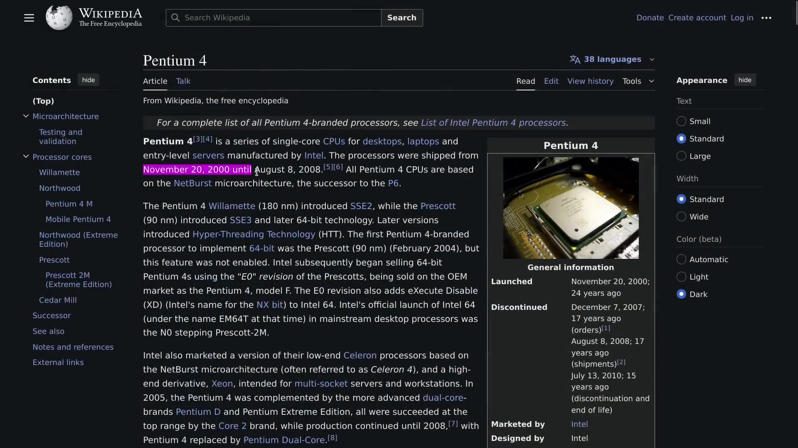

Wir haben unendliche Bodengenerierung, Biome, Höhlen, Kraft, Minen, Mobs, Hunger, Tresor, alles, was du von einem überlebenden Kellner erwartest.

Auf einem Chip, der **0.5 Watt** verbraucht und **160 MHz** von clock hat.

Um einen Gedankenauftrag zu geben: Ein Minecraft Vanilla-Server braucht mehrere RAM-Gigas. ESP32-C3 ist **520 KB von SRAM** (400 nach dem Boot). Die Prozessoren vor 20 Jahren drehten sich bereits in Gigahertz – dieses ist auf 160 MHz begrenzt. Der Faktor zwischen den beiden in reiner Leistung ist ungefähr **20.000**.

p2r3 hat keinen Minecraft-Server in C geschrieben, er hat jeden Stein des Servers neu erfunden, damit es in diesen Zwängen bleibt.

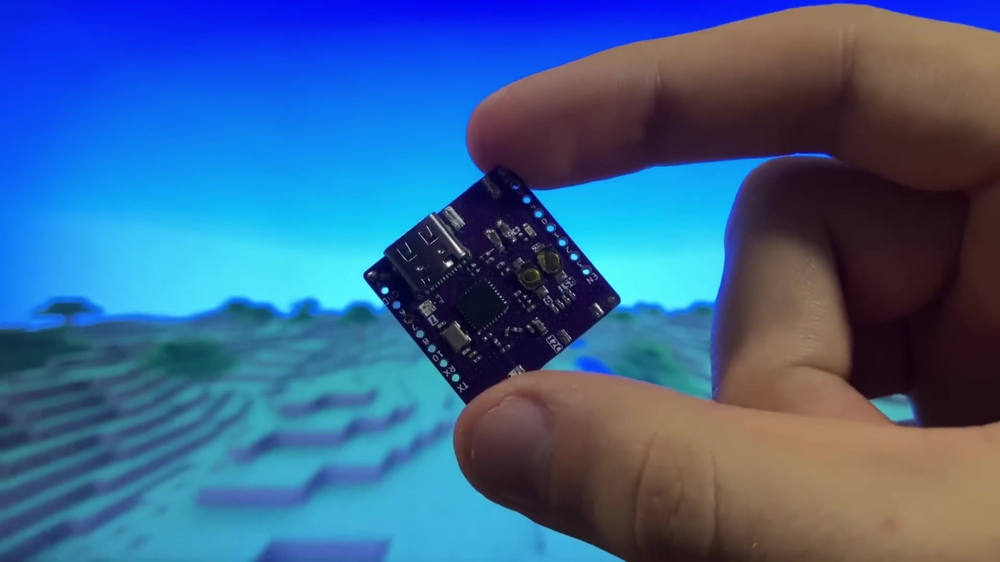

## Das Gehirn des Projekts: eine Generation von Land ohne Gedächtnis

Das größte Problem, wenn du einen eingebauten MC-Server machen willst, ist die Feldgeneration.

In Minecraft vanilla wird die Welt mit **Perlin noise** erzeugt: mehrere übereinander liegende Schichten (Oktaven), 6 biomische Parameter (Temperatur, Feuchtigkeit, Kontinentalität, Erosion, weirdness, Tiefe) und ein ganzes System von Caching, um nicht alles jedes Mal neu berechnen zu müssen.

Das Ergebnis ist wunderbar, aber es ist teuer in der Berechnung und es dauert RAM, um die erzeugten Chunks zu speichern.

Der Ansatz von Bareiron ist radikal anders. Statt Lärm zu stapeln, verwendet er das **bilinar interamine** an 4 Punkten, die durch einen **RNG-Deterministen** erzeugt werden.

Weißt du, wenn du ein kleines Pixelbild vergrößert und die Kanten verschwommen werden?
```c
// worldgen.c Zeilen117-171(einfach)

uint8_t interpolate (uint8_t a, uint8_t b, uint8_t c, uint8_t d, int x, int z) {
  uint16_t top    = a * (CHUNK_SIZE - x) + b * x;
  uint16_t bottom = c * (CHUNK_SIZE - x) + d * x;
  return (top * (CHUNK_SIZE - z) + bottom * z) / (CHUNK_SIZE * CHUNK_SIZE);
}

uint8_t getHeightAt (int x, int z) {
  int _x = floor(x / CHUNK_SIZE); // Chunk coordinates
  int _z = floor(z / CHUNK_SIZE);
  int rx = x % CHUNK_SIZE; // Offset inside chunk
  int rz = z % CHUNK_SIZE;
  uint32_t hash = getChunkHash(_x, _z);
  uint8_t biome = getChunkBiome(_x, _z);
  // Interpolation between4 Corners seeded by hash + biome
  return getHeightAtFromHash(rx, rz, _x, _z, hash, biome);
}
```
Standard-Bilinear-Interpolation: 4 Ecken, Gewichte je nach Position, nur eine`uint8_t`CHUNK_SIZE ist 8, also wird es in voller Multiplikation, keine Float.

p2r3 zeigt es Schritt für Schritt im Video: zuerst die 4 Ecken des Chunk, jeweils mit einer Höhe seeeded durch den RNG.

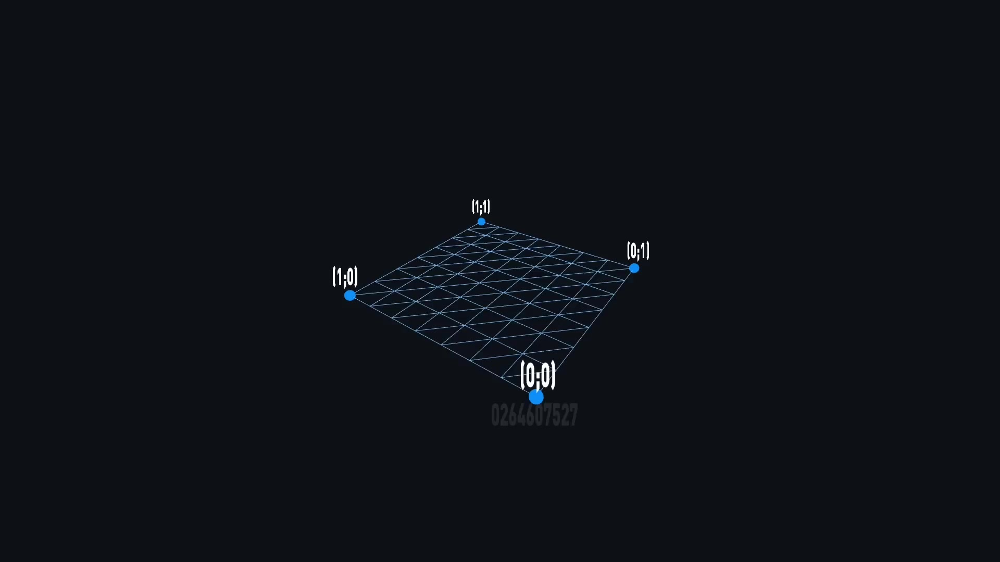

Dann erzeugt die Interpolation zwischen diesen 4 Punkten eine kontinuierliche Oberfläche.

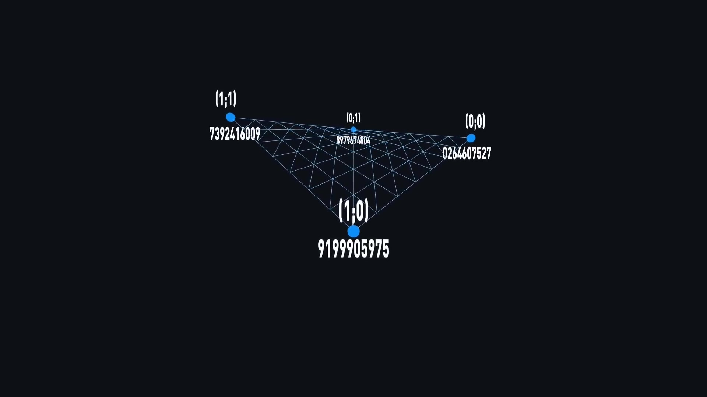

Und wenn man die Pattern auf allen benachbarten Chunks wiederholt, bekommt man ein Land, das sich bis ins Unendliche erstreckt.

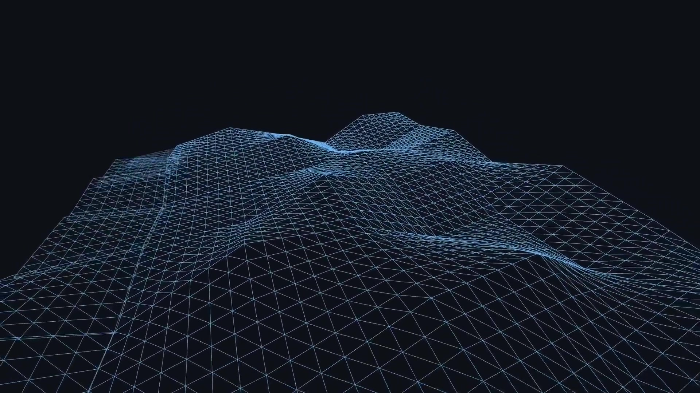

### Der deterministische RNG

Der Schlüssel, der das alles möglich macht, ist das seeding. Jeder Chunk hat 4 Ecken und jede Ecke braucht einen einzigartigen pseudo-zufälligen Wert, aber reproduzierbar.
```c
// worldgen.c Zeilen13-22

uint32_t getChunkHash (short x, short z) {
  uint8_t buf[8];
  memcpy(buf, &x, 2); // 16 X-Koordinatenbits
  memcpy(buf + 2, &z, 2); // 16 Z-Koordinatenbits
  memcpy(buf + 4, &world_seed, 4); // 32 Gesamtseed-Bits
  return splitmix64(*((uint64_t *)buf)); // Hash
}
```
Es packt 16 Bit von X, 16 Bits von Z und 32 Bit Seed in einem 8 Bytes Buffer und es geht alles in`splitmix64`Ergebnis: Ein einzigartiger deterministischer Wert für jede Position, basierend auf der Weltseed.

Der Server muss das Feld nicht speichern, sondern neu berechnen, wenn der Spieler in einem neuen Bereich ankommt und jedes Mal genau das gleiche Ergebnis erzielt.

Das`splitmix64`verwendet wird, ist ein ultra-schneller Prng für 64-Bit-Hash entwickelt:
```c
// worldgen.c (einfach)

static uint32_t splitmix64 (uint64_t state) {
  state += 0x9E3779B97F4A7C15ull;
  uint64_t z = state;
  z = (z ^ (z >> 30)) * 0xBF58476D1CE4E5B9ull;
  z = (z ^ (z >> 27)) * 0x94D049BB133111EBull;
  return (z ^ (z >> 31)) >> 32;
}
```
3 Operationen: addieren, xor/shift, multiplizieren, xorshift, replizieren und xor /shift. Alles wird direkt ohne Tisch oder Schnalle ausgeführt. Es nimmt den 8-Bytes-Buffer (X + Z + seed), behandelt ihn als 64-Bit-Integer und gibt 32 Bit Hash zurück. Es ist deterministisch, schnell und hält in 5 Zeilen.

### Warum ist das nicht Perlin Noise?

p2r3 sagt es selbst im Video: "Je mehr du die zufällige Zahl addierst, desto mehr wird das Feld regelmäßig, wie mehr Münzwerfer nähern dich 50/50." In der Praxis ist es die Anzahl der Hash-Bits, die es kombiniert:
```c
// worldgen.c Zeilen51-115

// Für eine Biome beschweren:4 Kombinierte Faktoren → Regelmäßig
h = (hash % 3) + ((hash >> 4) % 3) + ((hash >> 8) % 3) + ((hash >> 12) % 3);
// Für snowy plains:2 Faktoren → mehr Unfall
h = (hash % 5) + ((hash >> 4) % 5);
```
Jedes Biome wählt, wie viele Bit-Extraktionen es kombiniert. Je mehr es gibt, desto stabiler wird die Verteilung – als mehr Münzwerfer, die 50/50 näher kommen. Je weniger sie gibt, umso stärker sind die lokalen Variationen.

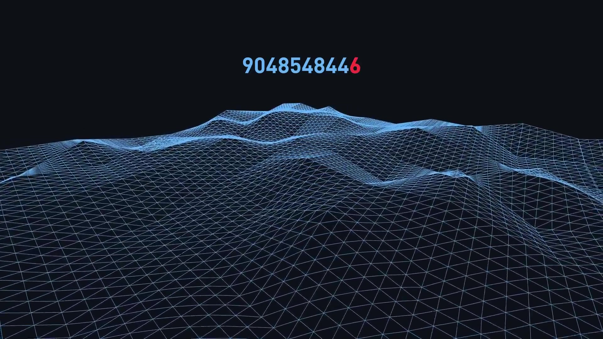

Mit nur 2 Faktoren erzeugt der Snowy Plains ein hügeliges, fast bergiges Gelände. Spikes und Tiefen sind häufig.

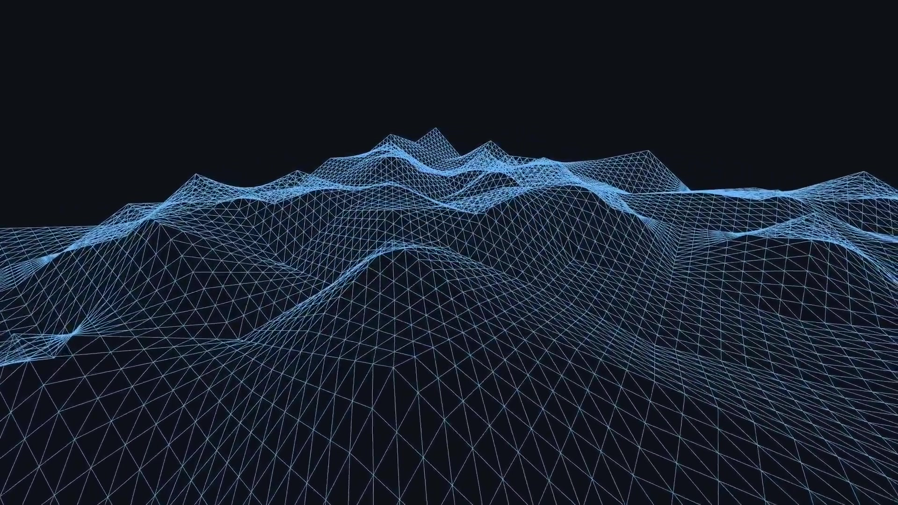

Mit 4 Faktoren bleiben die Ebenen flach und vorhersehbar.

Ein Chunk erzeugt sich in **200 ms** auf ESP32 – gegen eine nicht messbare Zeit auf derselben Hardware mit Perlin nuise so teuer.

### Das Detail, das tötet: Fragst du einen Block ohne die ganze Chunk erzeugen

Du spielst, du drückst einen Block, der Kellner muss wissen, was du dir geben sollst.

Mit dem Interferenz-Bilinar fragst du **jeden Punkt** der Ebene direkt von den Koordinaten aus. Die Ecken des Chunk erhalten sich von der Position des Spielers, die Interpolation gibt dir die Höhe zu jedem Offset. Eine Handvoll mathematischer Operationen, keine Chunksgeneration.

p2r3: "Was ich will, ist eine magische Funktion, die mir sagen kann, welcher Block sich in einer bestimmten Koordinatenposition befindet, ohne Zugang zum Speicher oder Berechnung teurer Tonkarten." Genau das hat er getan.

Hier ist, wie die Höhe zu konkreten Blöcken wird:
```c
// worldgen.c (einfach)

uint8_t getTerrainBlock (int x, uint8_t y, int z) {
  uint8_t surface = getHeightAt(x, z);

  if (y > surface)             return B_air;
  if (y == surface)            return biome_top[getChunkBiome(x, z)];
  if (y > surface - 4)         return B_dirt;
  if (y > surface - 16)        return B_stone;
  if (y > CAVE_BASE_DEPTH)     return B_deepslate;
                               return B_bedrock;
}
```
5 Bedingungen. Eine Schicht Fett/dirt/stone/deepslate/bedrock. Der Oberflächenblock hängt vom Biome ab via`biome_top[]`– Fett für die Ebenen, Sand für die Wüste. Ein einfacher Fall von if fällt in die richtige Schicht, was die Schleife und Switch ersetzt.

### Die Höhlen, die faulsten Mirror
```c
altitude_grotte = CAVE_BASE_DEPTH - (hauteur_surface - y);
```
Er strahlt die Höhe der Oberfläche unter der Erde aus, sieht aus wie die großen Deepslate-Hohlräume.

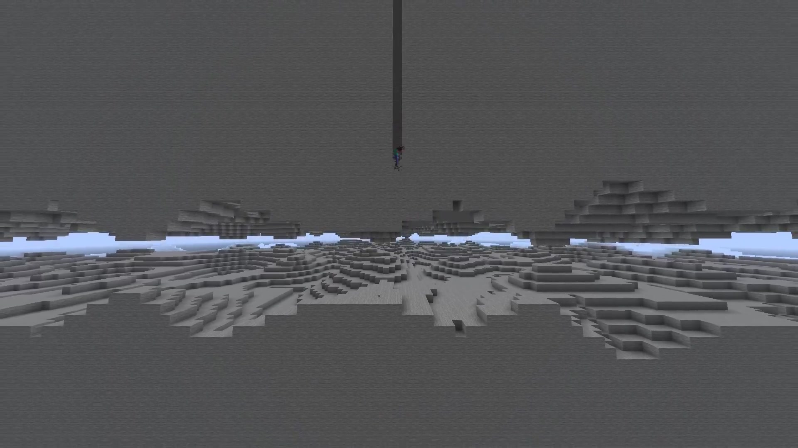

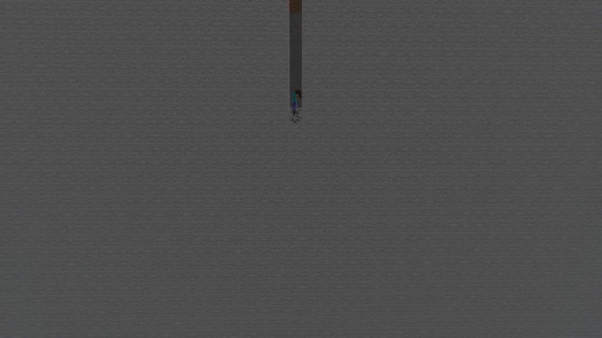

### Erze, Version XOR
```c
candidat = (chunk_x ^ col_x ^ col_z) % 100;
if (candidat < 5 && y < 16) -> diamond
```
Ein XOR-Koordinaten garantiert einen Kandidaten pro Säule. Der Typ hängt nur von der Höhe ab. Diamanten werden unter dem untersten Punkt der Höhlen versteckt, damit das Graben nützlich bleibt.

### Biome in Til Map

Jede Biome ist eine runde Insel in einem Gitter, seine Art von einem Pattern bestimmt, berechnet aus der Seed. Grid, vorhersehbar und kostenlos.

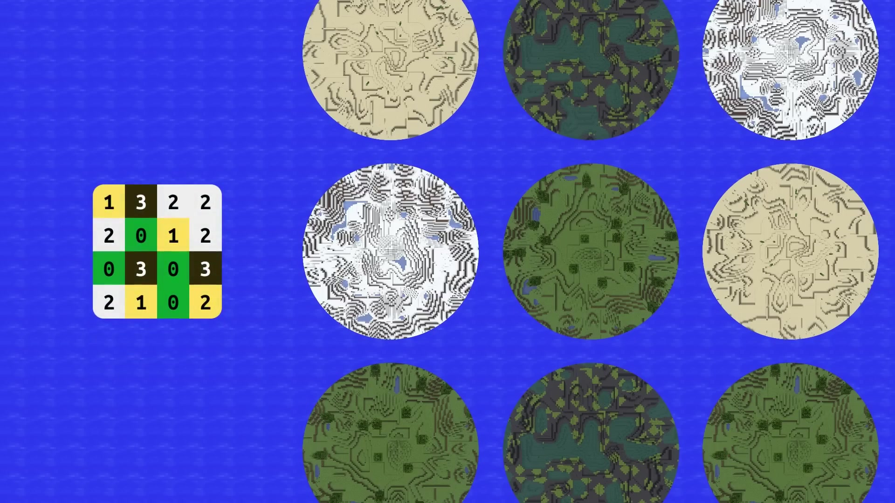

Jede Biome hat ihre eigenen Parameter in Tabellen kodiert:
```c
// worldgen.c (einfach)

static const uint8_t biome_base[] = {
  [BIOME_PLAINS]  = 48, // Basishöhe:48
  [BIOME_DESERT]  = 52, // etwas höher
  [BIOME_FOREST]  = 50, // zwischen den beiden
  [BIOME_TAIGA]   = 46, // etwas tiefer
  [BIOME_SNOWY]   = 40, // Tiefst
};

static const uint8_t biome_top[] = {
  [BIOME_PLAINS]  = B_grass,
  [BIOME_DESERT]  = B_sand,
  [BIOME_FOREST]  = B_grass,
  [BIOME_TAIGA]   = B_grass,
  [BIOME_SNOWY]   = B_snow_block,
};

static const uint8_t biome_factors[] = {
  [BIOME_PLAINS]  = 4, // 4 Extraktionen → sehr regelmäßig
  [BIOME_DESERT]  = 3, // 3 Extrakte → mäßig
  [BIOME_FOREST]  = 4, // 4 Extrakte → regelmäßig, hügelig
  [BIOME_TAIGA]   = 3, // 3 Extrakte → mäßig
  [BIOME_SNOWY]   = 2, // 2 Extraktionen → sehr unvorhersehbar
};
```
**Plains**: Höhe 48, 4 Faktoren → sehr flaches Gelände, Gras.
```c
h = (hash % 3) + ((hash >> 4) % 3) + ((hash >> 8) % 3) + ((hash >> 12) % 3);
// Ergebnis: Veränderung von ±4 Blöcke max
```
**Desert**: Höhe 52, 3 Faktoren, Block Oberfläche = Sand. Nie unter dem Meeresspiegel.
```c
h = (hash % 3) + ((hash >> 4) % 3) + ((hash >> 8) % 3);
// Ergebnis: Veränderung von ±6 Blöcke max, geknackt bisSEA_LEVEL + 1
```
**Forest**: Höhe 50, 4 Faktoren wie Plains aber höhere Basis → Waldhügel.

**Taiga**: Höhe 46, 3 Faktoren → mäßige Schwankungen, kaltes Gelände.

**Snowy plains**: Höhe 40, nur 2 Faktoren → am meisten unfallgefährdet.
```c
h = (hash % 5) + ((hash >> 4) % 5);
// Ergebnis: Veränderung von ±14 Blöcke max
```
Jedes Biome wird in **3 Tabellen mit 5 Einträgen** kodiert: Grundhöhe, Oberflächenblock, Anzahl der Faktoren.`getHeightAtFromHash`empfängt das Biome, sie konsultiert diese Tabellen, um das Feld anzupassen. 15 Datenbytes, um die gesamte Minecraft Biome System zu ersetzen.

Der Biome-Detektor verwendet die Seed, um festzustellen, welche Biome jedem Chunk entspricht:
```c
// worldgen.c (einfach)

static const uint8_t biome_pattern[] = {
  BIOME_PLAINS, BIOME_FOREST, BIOME_PLAINS, BIOME_DESERT,
  BIOME_FOREST, BIOME_TAIGA,  BIOME_PLAINS, BIOME_SNOWY,
  BIOME_PLAINS, BIOME_FOREST, BIOME_DESERT,  BIOME_PLAINS,
  BIOME_SNOWY,  BIOME_PLAINS, BIOME_FOREST, BIOME_TAIGA,
};

uint8_t getChunkBiome (short cx, short cz) {
  uint32_t h = splitmix64(cx * 31 + cz * 97 + world_seed);
  uint8_t index = h % 16;
  return biome_pattern[index];
}
```
Ein 16-Eingang-Pattern, ein seedierter Index mit Chunk-Koordinaten, ein repetitives, aber visuell konsistentes Raster, vier Zeilen Code, um das gesamte Bio-Parametersystem von Minecraft Vanilla zu ersetzen.

### getHeightAtFromHash: der Feldmontageor

Die Funktion im Herzen der Generation kombiniert die 4 Ecken seediert von Biome:
```c
// worldgen.c (einfach)

static uint8_t getHeightAtFromHash (int rx, int rz, short cx, short cz,
                                    uint32_t h, uint8_t biome) {
  // 4 Ecken aus dem Hash, seed unterschiedlich pro Ecke
  uint8_t h1 = biome_base[biome] + (h & 0x0F);
  uint8_t h2 = biome_base[biome] + ((h >> 4) & 0x0F);
  uint8_t h3 = biome_base[biome] + ((h >> 8) & 0x0F);
  uint8_t h4 = biome_base[biome] + ((h >> 12) & 0x0F);

  // Biome Contrainte: Wüste nie unter Wasser
  if (biome == BIOME_DESERT) {
    h1 = max(h1, SEA_LEVEL + 1);
    h2 = max(h2, SEA_LEVEL + 1);
    h3 = max(h3, SEA_LEVEL + 1);
    h4 = max(h4, SEA_LEVEL + 1);
  }

  // Interpolation von4 Ecken
  return interpolate(h1, h2, h3, h4, rx, rz);
}
```
Jedes Biom hat eine`biome_base`die die Referenzhöhe verschiebt, und die 4 Ecken werden aus dem Hash mit unterschiedlichen Verschiebungen extrahiert. Die Wüste zwingt die Min über dem Meeresspiegel – eine Spannungslinie, die Wasser ohne zusätzliche biomische Berechnung vermeidet.

### Bäume und Kaktus: probabilistische Anlage

Die Oberflächengeneration verwendet den gleichen Chunk Hash, um zu entscheiden, wo man pflanzen:
```c
// worldgen.c (einfach)

static void genFoliage (uint8_t *chunk_data, short cx, short cz,
                        uint32_t hash, uint8_t biome) {
  if (biome == BIOME_DESERT) {
    // Kaktus: ein Kandidat pro Chunk, Hash bestimmt die Position
    int tx = (hash >> 8) & 7;
    int tz = (hash >> 12) & 7;
    int ty = getHeightAt(cx * 8 + tx, cz * 8 + tz);
    if (chunk_data[ty * 64 + tz * 8 + tx] == B_sand)
      placeCactus(chunk_data, tx, ty + 1, tz);
  } else {
    // Bäume: Hash bestimmt, ob und wo sie gelegt werden
    int tree_count = (hash & 3); // 0-3 Bäume pro Chunk
    for (int i = 0; i < tree_count; i ++) {
      int tx = ((hash >> (4 + i * 4)) & 7);
      int tz = ((hash >> (6 + i * 4)) & 7);
      int ty = getHeightAt(cx * 8 + tx, cz * 8 + tz);
      placeTree(chunk_data, tx, ty + 1, tz);
    }
  }
}
```
0-3 Bäume pro Chunk für grüne Biome, 1 Kaktus für die Wüste. Der Hash des Chunks ist die einzige Quelle der Entropie – ein`& 7`für die Position im Chunk:`& 3`Alles ist deterministisch, nichts ist gespeichert.

### generateChunk: Alle zusammenfügen

Die Funktion, die alle zusammen setzt, um einen vollen Chunk von 8×8×256 Blöcke zu produzieren:
```c
// worldgen.c (einfach)

void generateChunk (uint8_t *chunk, short cx, short cz) {
  uint32_t hash = getChunkHash(cx, cz);
  uint8_t biome = getChunkBiome(cx, cz);

  // Für jede Spalte des Chunk (8×8 = 64)
  for (int x = 0; x < 8; x ++) {
    for (int z = 0; z < 8; z ++) {
      // Absolute Weltkoordinaten
      int wx = cx * 8 + x;
      int wz = cz * 8 + z;

      // Spaltenhöhe
      uint8_t height = getHeightAt(wx, wz);

      // Spalte von unten nach oben füllen
      for (int y = 0; y < height; y ++) {
        uint8_t block = getTerrainBlock(wx, y, wz);
        chunk[y * 64 + z * 8 + x] = block;
      }
    }
  }

  // Oberflächenelemente (Wellen, Kaktus) hinzufügen
  genFoliage(chunk, cx, cz, hash, biome);
}
```
Das ist alles. 3 verflochtene Schlingen: für jede Spalte, findest du die Höhe, füllen du die Blöcke, gehst du auf die nächste.`uint8_t [16384]`(8 × 8 × 256) die den gesamten Chunk darstellt. Der Chunks wird erzeugt und direkt an den Kunden gesendet, ohne dabei Caching, Lazy Loading oder Kompression zu durchlaufen.

## Speichern: Statische Arrays überall

Bareirorons Speicherarchitektur ist C-Architektur, die in seiner ganzen Pracht eingebettet ist: nur Globale Tabellen von fester Größe, weder Malloc, Hash Maps, noch verkettete Listen.

### Blockänderungen
```c
// globals.h Zeilen191-196

typedef struct {
  short x; // 2 Bytes – Grenze zu32 000 Horizontale Blöcke
  short z; // 2 Bytes
  uint8_t y; // 1 Byte – Grenze zu256 Vertikale Blöcke
  uint8_t block; // 1 Byte – Grenze zu256 Blocktypen
} BlockChange;
```
20 000 Einträge, d.h. etwa **25 000 Änderungen** – das entspricht einem vollständig ausgegrabenen Chunk und einem halben Chunc.`block`bis`0xFF`markiert einen freien Eintrag. Die Suche ist ein linearer Scan:

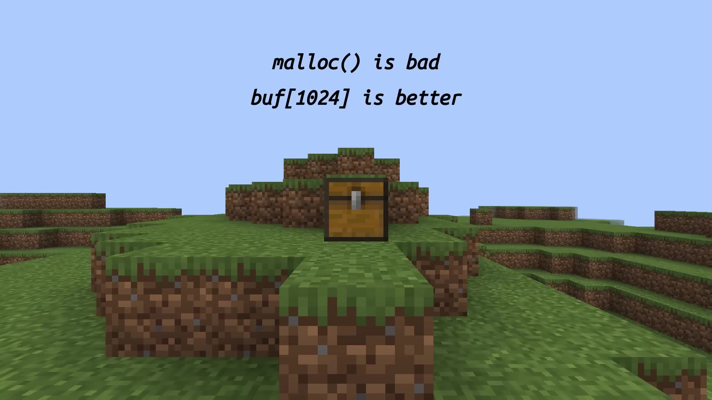
```c
// procedures.c

uint8_t getBlockChange (short x, uint8_t y, short z) {
  for (int i = 0; i < block_changes_count; i ++) {
    if (block_changes[i].block == 0xFF) continue;
    if (block_changes[i].x == x && block_changes[i].y == y && block_changes[i].z == z)
      return block_changes[i].block;
    #ifdef ALLOW_CHESTS
      if (block_changes[i].block == B_chest) i += 14; // skip chest data
    #endif
  }
  return 0xFF;
}
```
Eine Änderung hinzufügen ist so direkt wie die Suche:
```c
static uint8_t changes_count = 0;

void addBlockChange (short x, short z, uint8_t y, uint8_t block) {
  if (changes_count >= MAX_CHANGES) return;
  block_changes[changes_count].x = x;
  block_changes[changes_count].z = z;
  block_changes[changes_count].y = y;
  block_changes[changes_count].block = block;
  changes_count ++;
}
```
Ein Zähler, ein Index, ein Schreiben. Das Array speichert nur: keine Sortierung, keine Komplotte, keine Speicherverwaltung. Wenn das Arrêt voll ist, werden die neuen Änderungen ignoriert – das Feld kehrt zu seinem erzeugten Zustand zurück.

Der Kommentar des Autors über die 256 Block-limit: "Ich werde nicht planen, die leicht gewachsten Kupfertreppen so früh implementieren."

### Mobs: 8 Bytes pro Pfeifekopf
```c
// globals.h Zeilen240-251(pragma pack (push,1) zur Beseitigung von Padding)

typedef struct {
  uint8_t type; // 25=chicken,28=Cow,95=pig,106=sheep,145=Zombie
  short x;
  uint8_t y; // wenn health=0 Y wird ein Timer vor dem Löschen
  short z;
  uint8_t data; // Bit0-4: health, bit5: sheep sHEARED, Bits6-7: panic timer
} MobData;
```
8 Bytes. 16 Stellplätze max. Ausrichtung und Padding gehen zur Luke.`data`Byte ist ein Heimbitfield: 5 Bit Leben, 1 Bit Rasen, 2 Bit Panikzeit. Und wenn ein Mob stirbt, wird das Feld Y ein Timer vor dem Löschen.

### Spieler: Enge Pakes

Spielerdaten verwenden`#pragma pack(push, 1)`auch – Koordinaten in`short` + `uint8_t`, Bestandsaufnahmen in festen Tabellen`uint16_t` + `uint8_t`und ein Feld`flags`Das ist sowohl der Angriffscooldown, der Zustand von Spawn, Sneak, Sprint, Eat, Load, movement cooldow, und der Craft-Lock.

## Die Hauptschleife: while(true) und Nichtblocker

Der gesamte Server läuft auf einer Schleife, einem Thread, Null event library.
```c
// main.c Zeilen594-720

while (true) {
  task_yield(); // Lass das Watchdog auf ESP32 atmen

  // Neue Verbindung annehmen (nicht blockieren)
  for (int i = 0; i < MAX_PLAYERS; i ++) {
    if (clients[i] != -1) continue;
    clients[i] = accept(server_fd, ...);
    if (clients[i] != -1) client_count ++;
    break;
  }

  // Tick Server, wenn die Zeit abgelaufen ist
  if (get_program_time() - last_tick_time > TIME_BETWEEN_TICKS) {
    handleServerTick(time_since_last_tick);
    last_tick_time = get_program_time();
  }

  // Round-Robin: ein Kunde, ein Iteration-Paket
  client_index = (client_index + 1) % MAX_PLAYERS;
  if (clients[client_index] == -1) continue;

  // Paketkopf lesen: length + ID
  recv(client_fd, &recv_buffer, 2, MSG_PEEK);
  int length = readVarInt(client_fd);
  int packet_id = readVarInt(client_fd);
  handlePacket(client_fd, length - sizeVarInt(packet_id), packet_id, state);
}
```
Ein Kunde wird durch Iteration der Schleife behandelt, und ein einziges Paket wird gleichzeitig gelesen.`task_yield()`Am Anfang der Schleife lässt der FreeRTOS idle task auf ESP32 atmen – ohne das, das watchdog timer te reset den Chip.

Das Dispatch der Pakete ist ein monströser Switch mit **400 Zeilen**:
```c
// main.c Zeilen68-497

void handlePacket (int client_fd, int length, int packet_id, int state) {
  switch (packet_id) {
    case 0x00: // Handshake / Status / Login nach Zustand
    case 0x01: // Status ping
    case 0x02: // Plugin-Nachricht
    case 0x03: // Login/configuration acknowledgement
    case 0x08: // Katze
    case 0x0B: // Kundenstatus (respawn)
    case 0x11: // Click Container (behält Schließfächer)
    case 0x19: // Interact entity
    case 0x1D..0x20: // Movement Packets (der größte Fall)
    case 0x28: // Player action (dig/place)
    // ... 40+ Fall
  }
}
```
Ein Switch kompiliert als statischer Jump-Tisch, der Jump dynamische Tabelle, vtable und map ersetzt. Perfekt für das Einsteigen.

Der Fall`0x1D-0x20`ist die größte – es verwaltet Positionsupdates, Fallschäden, Chunk-Grenzüberquerungen, Mob-Spawn, Crunks-Generation, UND Hunger. Alles in einem großen Fall-through.

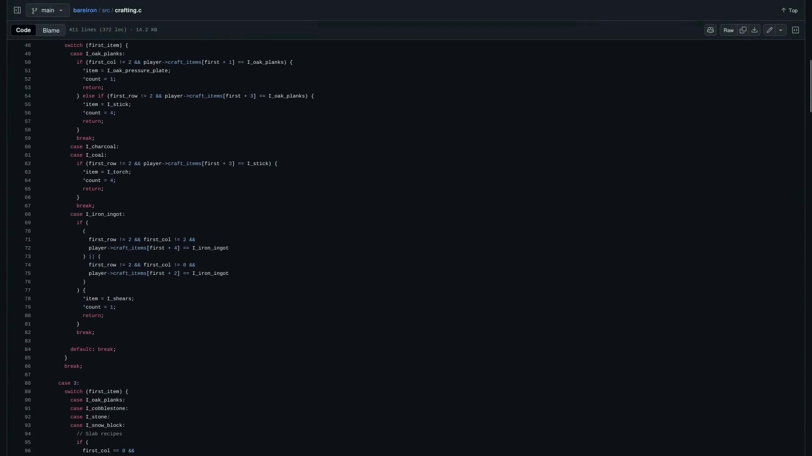

## Der Tick-Server und die Mob-IA

Funktion`handleServerTick`wird alle 50 ms (20 TPS) genannt. du verwaltet die Welt, während die Hauptschleife die Spieler betreut:
```c
// main.c (einfach)

void handleServerTick (uint32_t delta) {
  // Aktualisieren Sie jeden Mob
  for (int i = 0; i < MOB_COUNT; i ++) {
    if (mobs[i].type == 0 || mobs[i].data == 0) continue; // tot oder leer

    MobData *mob = &mobs[i];
    int px, pz;
    getNearestPlayer(mob->x, mob->z, &px, &pz);

    if (mob->type == MOB_ZOMBIE) {
      // Hostile: Spaziergang zum nächsten Spieler
      if (px < mob->x) mob->x --;
      else if (px > mob->x) mob->x ++;
      if (pz < mob->z) mob->z --;
      else if (pz > mob->z) mob->z ++;
      // Kontaktschäden bei2 Blöcke
      if (abs(px - mob->x) <= 2 && abs(pz - mob->z) <= 2)
        damagePlayer(getNearestPlayerId(mob->x, mob->z), 3);
    } else {
      // Passiva:8 Zufällige Richtungen
      uint8_t dir = getMobDir(mob);
      mob->x += dir_lookup[dir][0];
      mob->z += dir_lookup[dir][1];
      // Richtungsänderung alle ~40 Ticks
      if (mob->data >> 6 < 1) setMobDir(mob, rand() & 7);
      mob->data = (mob->data & 0x3F) | ((mob->data - 0x40) & 0xC0);
    }

    // Die Chunks um den Mob aufwecken
    setChunkGenerated(mob->x / 8, mob->z / 8);
  }
}
```
Die KI der feindlichen Mobs ist ein Koordinatenvergleich.`if (px < x) x–`. Der Zombie ignoriert pathfinding, A* und Hindernis: er passt X und Z unabhängig vom Spieler an – er durchquert die Wände, wenn es welche gibt.

Kontaktschäden sind bei 3 Kernen/Sec. p2r3 wollte es hoch, weil das Fehlen von pathfinding Zombies leicht zu kitieren macht.

Die Rüstung Formel ist die vor dem update Kampf – die einfachste Möglichkeit:
```c
// main.c (einfach)

static uint8_t applyArmor (uint8_t damage, uint16_t armor_value) {
  // Vor-1.9: lineare Reduktion
  // Jeder Rüstungspunkt =4 Reduktions-%, max80 %
  uint8_t reduction = (armor_value * 4);
  if (reduction > 80) reduction = 80;
  return damage * (100 - reduction) / 100;
}
```
Full Diamond = 80% Reduktion. Ein Zombie-Schlag auf 3 Kerne wird 0.6 Kerne. p2r3 wählte diese alte Formel, weil sie in 2 Operationen berechnet wird – keine Schwellen, keine Kurven, nur einen linearen Prozentsatz.

Passive Mobs: 8 Richtungen in einem Lookup-Tisch, Kursänderung alle ~40 Ticks. Das Feld`data`kodiert die aktuelle Richtung in den 2 Bit starkes Gewicht und den Zeitmesser für Richtungsänderung in den verbleibenden 6 Bit.

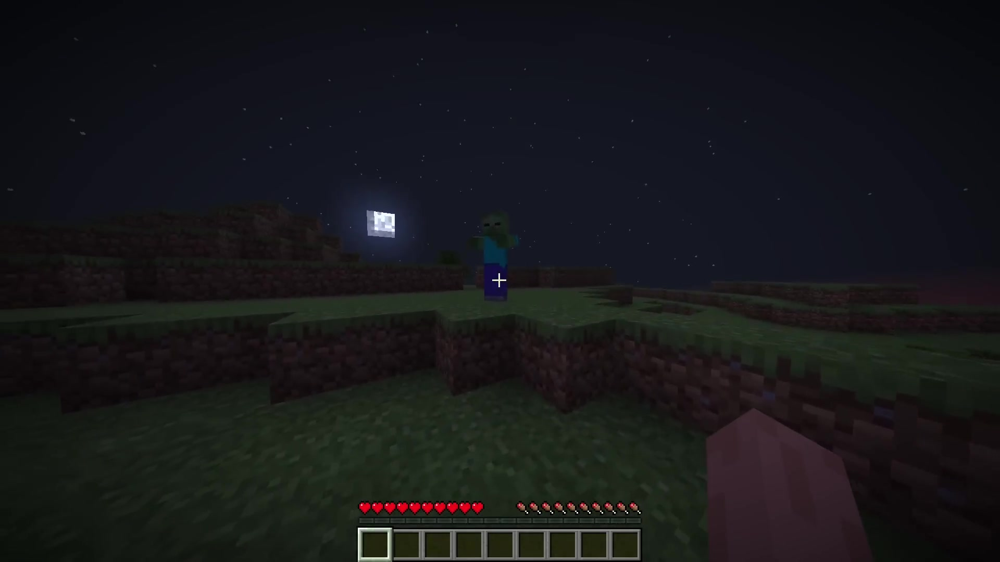

### Die Mobs-Repawn

Mobs spawnen nicht mit Random ticks. Sie erscheinen, wenn der tick Server eine neue Chunk Grenze trifft:
```c
if (player crossed chunk boundary) {
  for (int i = 0; i < MOB_COUNT; i ++) {
    if (mobs[i].type != 0) continue;
    spawnMob(&mobs[i], new_chunk_coords, getChunkHash(cx, cz));
    break;
  }
}
```
Sogar RNG wie das Grundstück, sogar chunk seed. Wenn ein mob Aufstellungsort frei ist, ist der Spawn deterministisch.

## Craft: keine Matrizen, if/else
```c
// crafting.c Zeilen9-347(einfach)

void getCraftingOutput (PlayerData *player, uint8_t *count, uint16_t *item) {
  // Wenn der Flag0 x80 ist aufgestanden, wird der Craft-Buffer von einem Kofferraum verwendet
  if (player->flags & 0x80) { *count = 0; *item = 0; return; }

  // Slots zählen, den ersten Item finden, Identität überprüfen
  uint8_t filled = 0, first = 10, identical = true;
  for (int i = 0; i < 9; i ++) {
    if (player->craft_items[i]) {
      filled ++;
      if (first == 10) first = i;
      else if (player->craft_items[i] != player->craft_items[first])
        identical = false;
    }
  }

  switch (filled) {
    case 1:  /* planches, lingots... */
    case 2:  /* bâtons, cisailles, torches */
    case 3:  /* pelles, épées, dalles */
    case 4:  /* table de craft, boots */
    case 5:  /* pioches, haches, casques */
    case 7:  /* jambières, composteurs */
    case 8:  /* fourneau, coffre, plastron */
    case 9:  /* blocs complets (fer, or, etc.) */
  }
}
```
Der erste Check: wenn flag`0x80`Der Craft-Buffer wird in den Tresorpointer recycliert.

Dann zählt er die gefüllten Slots, schreibe den ersten Item, prüfe die Identität.
```c
if (count == 8 && first == cobblestone && all_identical && center_empty)
    return furnace;
```
Für komplexe Formen verwendet er den Index des ersten items und checkt die relative Position ab. Die Rezepte teilen sich eine gleiche Matching-Funktion – das Material bestimmt das Ergebnis.

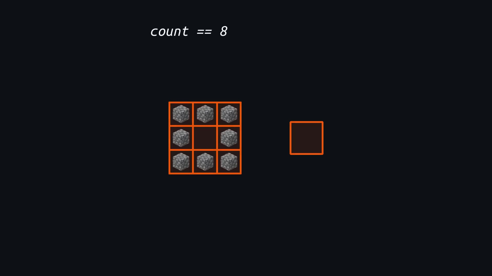

## Die Tresor: der Hack in der realen

Der Speicher-Hack, von dem jeder spricht, in wahrem Code:
```c
// procedures.c Zeilen1262-1293

if (target == B_chest) {
  // Tresoreingabe in der Blocktabelle suchen
  uint8_t *storage_ptr = NULL;
  for (int i = 0; i < block_changes_count; i ++) {
    if (block_changes[i].block != B_chest) continue;
    if (block_changes[i].x != x || block_changes[i].y != y || block_changes[i].z != z)
      continue;
    storage_ptr = (uint8_t *)(&block_changes[i + 1]); // Spitze nach dem Block
    break;
  }
  if (storage_ptr == NULL) return;

  // Schreckliches Memory Hack!!
  // Der PUNKTER wird in die Craft-Items des Spielers kopiert
  memcpy(player->craft_items, &storage_ptr, sizeof(storage_ptr));
  player->flags |= 0x80; // lockt das Craft

  // Safe-Schnittstelle an den Kunden senden
  sc_openScreen(player->client_fd, 2, "Chest", 5);
  for (int i = 0; i < 27; i ++) {
    uint16_t item;
    uint8_t count;
    memcpy(&item, storage_ptr + i * 3, 2);
    memcpy(&count, storage_ptr + i * 3 + 2, 1);
    sc_setContainerSlot(player->client_fd, 2, i, count, item);
  }
}
```
Und der Kommentar im Code:`// Terrible memory hack!!1!`

Genau das ist es. Er nimmt die Speicheradresse des nächsten Eintrages in`block_changes[]`, kopiert er es in`player->craft_items`(das ist ein`uint16_t [9]`18 Bytes - genug, um einen 32-Bit-Pointer zu speichern, und er hebt den Flag, damit niemand während dieser Zeit versucht, Craft zu fangen.

Auf jedem Klick in der Tresor-Inventur:
```c
// packets.c Zeilen620-638

uint8_t *storage_ptr;
memcpy(&storage_ptr, player->craft_items, sizeof(storage_ptr));
// storage_ptr zeigt nun auf die Daten aus dem Tresor
uint16_t *p_item = (uint16_t *)(storage_ptr + (slot - 41) * 3);
uint8_t *p_count = storage_ptr + (slot - 41) * 3 + 2;
```
Er holt den Zeiger vom Craft-Buffer ab und greift mit einem Offset auf die Slots zu. Die Daten werden in 3 Bytes pro Slot gespeichert (2 für die ID, 1 für die Menge), die in der Blocktabelle zusammengeklebt werden.

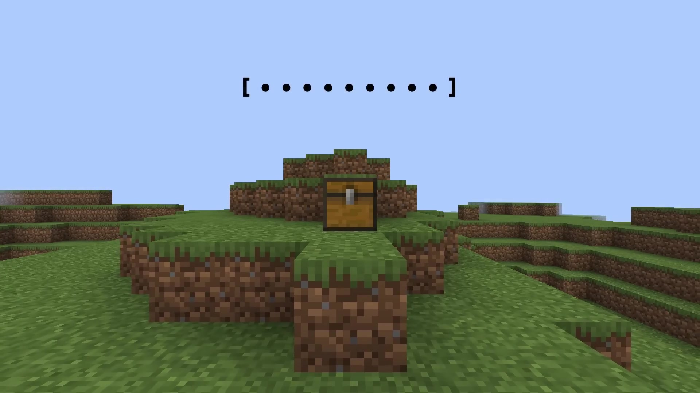

## Hunger: 5 Linien des Genies
```c
// main.c Zeilen293-305

// Spieler senden Bewegungspakete an ~20/sec wenn sie
// Wenn sie sich nicht bewegen, ist das viel weniger.
// mit Aktivität, um Hunger zu simulieren kostenlos.
if (player->saturation == 0) {
  if (player->hunger > 0) player->hunger--;
  player->saturation = 200;
  sc_setHealth(client_fd, player->health, player->hunger, player->saturation);
} else if (player->flags & 0x08) { // Sprinting
  player->saturation -= 1;
}
}
```
Das ist buchstäblich das. 5 Zeilen. Jedes Bewegungspaket dekrementiert die Sättigung. Wenn die Sattration auf Null kommt, sinkt der Hunger und wir sättigen wieder.`0x08`) verdoppelt sich der Drain.

Null Timer, Null Speicher zugewiesen, Null Compute dediziert. Ein Zähler, der auf Paketen, die bereits existieren, dekrementiert.

### Fallschäden

Das einfachste System für Schäden im Projekt:
```c
// Wenn der Spieler den Boden verlässt, speichert man sein Y
// Wenn er den Boden umreißt, wird er abgezogen.
degats = dernier_y_au_sol - y_actuel;
```
Eine Subtraktion.

## Blocks unterdrücken und platzieren

Wenn du auf einen Block klickst, dann das Paket`0x28`(Player Action) landet im Switch. Der Handler muss bestimmen, welcher Block sich in der Position befindet, ihn entfernen und das item in das Inventar setzen:
```c
// main.c Feld0 x28(einfach)

void handlePlayerAction (int client_fd, uint8_t action, int x, uint8_t y, int z) {
  switch (action) {
    case START_DESTROY_BLOCK: {
      // Blocktyp an der angeklickten Position bestimmen
      uint8_t block = getBlockAt(x, y, z);

      if (block == B_chest) {
        openChest(client_fd, x, y, z);
        break;
      }

      // Zu block_changes hinzufügen
      addBlockChange(x, z, y, 0); // 0= Luft

      // Geben Sie dem Spieler das item (trust the client)
      addItemToPlayer(client_fd, block_to_item(block), 1);

      // Aktualisieren an den Kunden senden
      sc_blockChange(client_fd, x, y, z, 0);
      sc_ackBlockChange(client_fd, x, y, z, 0);
      break;
    }
    case PLACE_BLOCK: {
      // Blocktyp von der Hand des Spielers lesen
      uint16_t item = getHeldItem(client_fd);
      uint8_t block = item_to_block(item);
      addBlockChange(x, z, y, block);
      removeItemFromPlayer(client_fd, item, 1);
      sc_blockChange(client_fd, x, y, z, block);
      break;
    }
  }
}
```
`getBlockAt`kombiniert die Spieler-Erstellung UND Änderungen:
```c
uint8_t getBlockAt (int x, uint8_t y, int z) {
  // Zuerst überprüfen Sie die Spieler-Änderungen
  uint8_t change = getBlockChange(x, y, z);
  if (change != 0xFF) return change;

  // Andernfalls lesen Sie aus dem erzeugten Feld
  return getTerrainBlock(x, y, z);
}
```
Die Priorität der Veränderungen, die Fallback-Show, die Null-Debatte, Null-Cache-Case, Null overhead.`getTerrainBlock`Unter der Haube ist es`getHeightAt`+ Stone/dirt/grass/coal Schichten.

### Der Instantofen

Das lustigste: Der Ofen existiert nicht als Einheit. Wenn du Cobblestone in das Feld "Koch" und Coal in "Fuel" legst, erscheint das Ergebnis sofort ohne Timer oder Chunk Ticking: es ist nur ein Inventar-Slot, der leer wird, wenn du die richtigen Items legest.

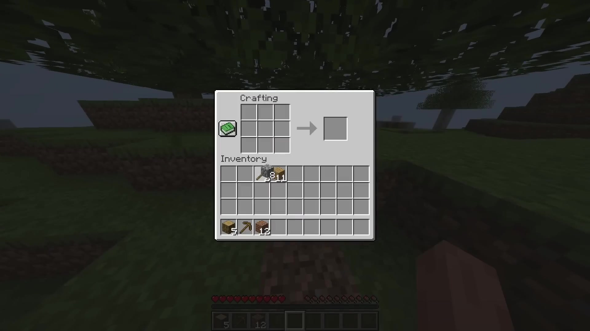

## Die ESP32 Schleife: ein MC Server in 4 KB Stack
```c
// main.c Zeilen732-779

#ifdef ESP_PLATFORM

void bareiron_main (void *pvParameters) {
  main();
  vTaskDelete(NULL);
}

static void wifi_event_handler (...) {
  if (/* connecté */) {
    xTaskCreate(bareiron_main, "bareiron", 4096, NULL, 5, NULL);
  }
}

void app_main () {
  esp_timer_early_init();
  wifi_init();
  // Der Rest wird vom event handler verwaltet
}
#endif
```
Der gesamte Server läuft in einer FreeRTOS-Aufgabe mit **4096 Bytes von Stack**. Das ist alles. Der Haupt-Thread-Hand wird nur WiFi initialisiert und auf eine Verbindung warten.`bareiron_main`die das`main()`Standard.

Der gesamte spezifische ESP32-Code ist durch`#ifdef ESP_PLATFORM`. Auf dem PC kompiliert es in Standard POSIX-Code.

## Was geopfert wurde

Damit das alles dir gehört, gibt es Vanilla-Features, die nicht existieren:

- **Zero-Netzwerkkompression** – zu teuer. Der Server erzeugt Chunks schnell, aber senden du sie ist das Bottleneck.
- **Zero random ticks** – die Bäume wachsen mit Bone meal oder nicht. Die Mobs spawnen an den Chunk Grenzen.
- **Zero-Institution item** – die Blöcke werden direkt in die Inventarisierung gemeißelt. Die Animation ist rein visuell.
- **Keine Inventarprüfung** – Trust the client. 64 Diamanten? OK. Ein Chunk in 1 Sekunden gemingt? okay. Zu verwenden zwischen vertrauenswürdigen Leuten.
- **Zero-Server** – Fackeln werden nach allem anderen gesendet, der Client berechnet.
- **Progressives Flüssigkeits-Null** – sofortiger Endzustand.

## Das Endergebnis

Ryzen 5 3600: ~0.5 ms pro chunk. ESP32-C3 bis 1$: $200 ms je chunc. Spielbar.

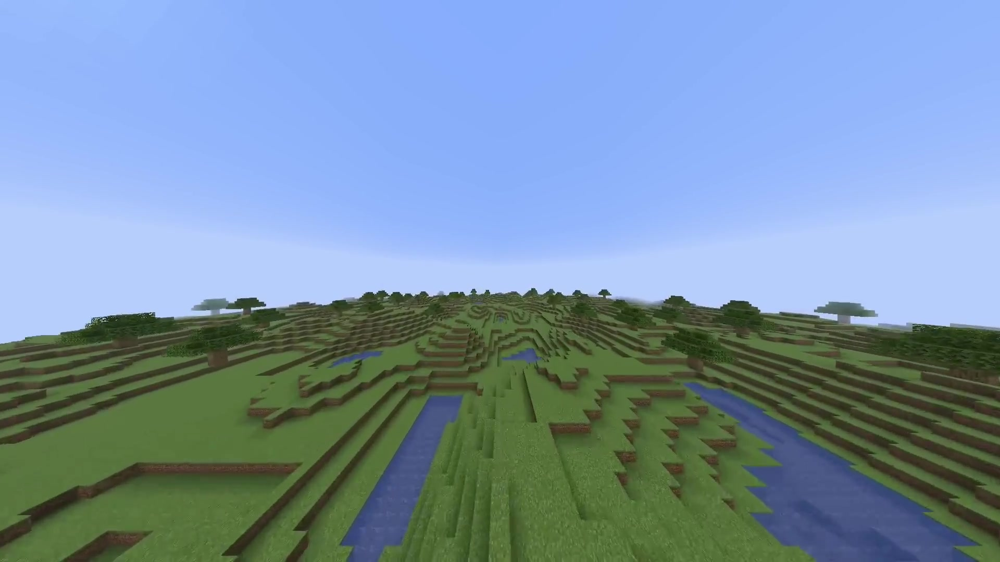

3+ Spieler: Rudert. Vergleichbar mit 2b2t zu Spitzenzeiten, sät der Autor.

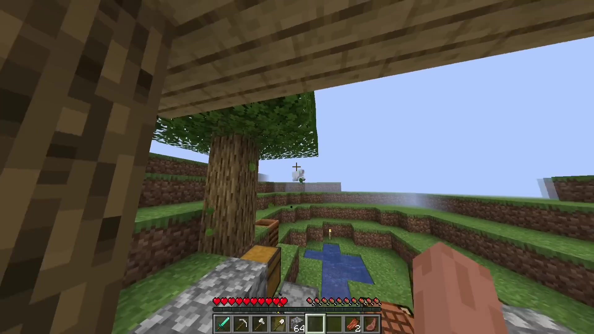

## Philosophie

p2r3: "Ich mag nur die Idee, dass dieser winzige 1-Ball-Chip, der 0.5 Watt verbraucht, etwas so fortgeschrittenes wie Minecraft drehen kann. Science isn't about 'why', it's about'why not'."

Jede Zeile ist ein Tradeoff:

- Perlin noise → Interpolation: weniger hübsch, 200x schneller, Null Speicher

- Craft-Matrix → hardcodiert matching: ekelhafter Code, Null Byte

- zlib → nichts: faule Verbindung = tot, aber spielbar

- Validierung → Trust: Null Sicherheit, Null Compute

Jede fehlende Feature ermöglicht es einer anderen, innerhalb der Grenzen der Hardware zu existieren.

**Die 3 Punkte, die zu berücksichtigen sind:**

1. **Interpolation + RNG** – 4 seedierte Punkte, unendliches Gelände, Null Lagerung, Query ohne die Chunk neu zu erzeugen, 200 ms Generation. Es ist der geniale Move, der alles andere möglich macht.
2. **Jede Feature hat Kosten** – Das Fehlen von Kompression, Randomik und Validierung ist die gewählte Wahl: Dies ermöglicht es, in 520 KB zu halten.
3. **Die vergeudeten Hacks sind die intelligentesten** – Tresor in der Blocktafel via memcpy, hungrig durch Bewegungspakete, Instant-Koch. Die saubere Lösung wäre zu teuer gewesen.

Wenn du Interesse an dem Projekt hast, dann ist alles auf der Hand. [GitHub en GPLv3](https://github.com/p2r3/bareiron/)Das ist schmutziges C, und ich habe selten so viel Spaß daran gehabt, einen Quellcode zu lesen.
