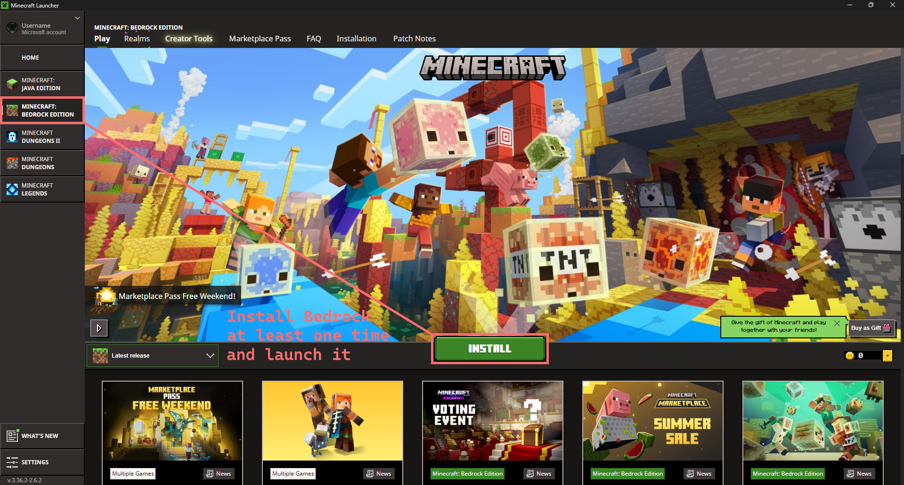
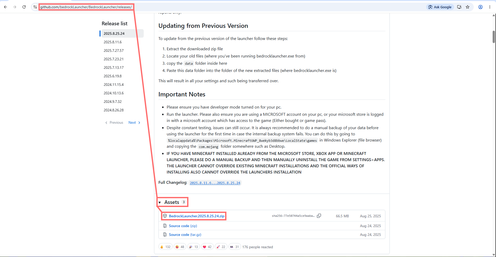
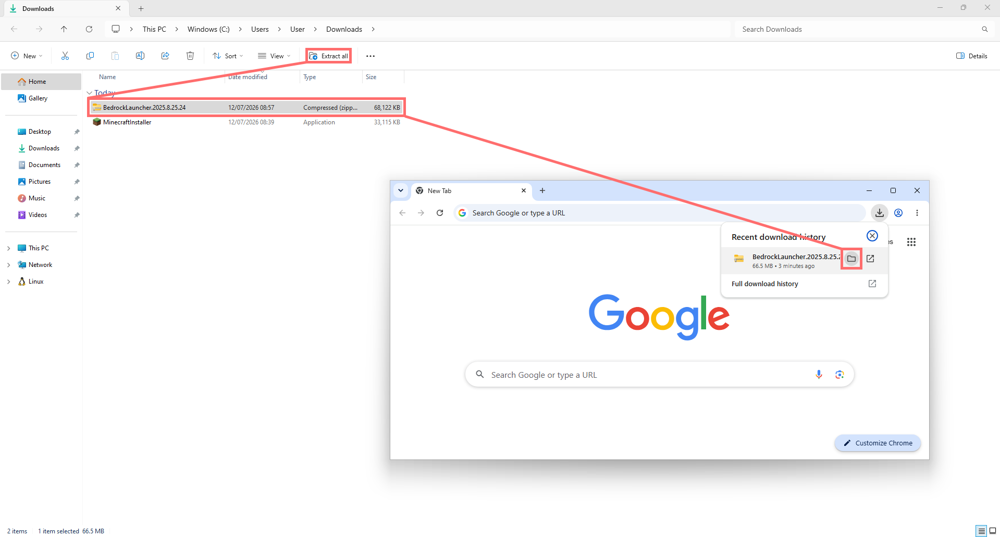
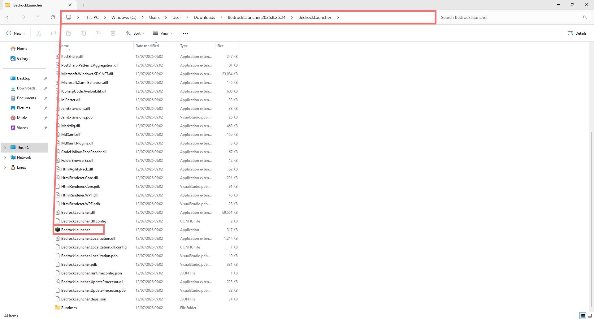
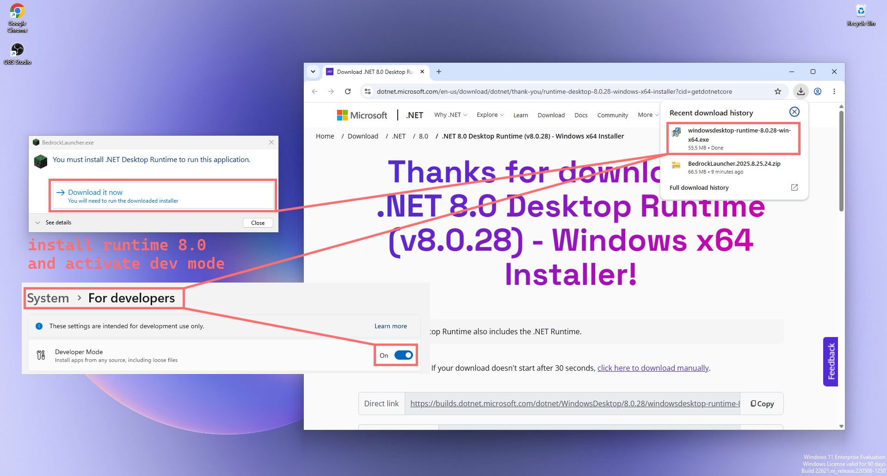
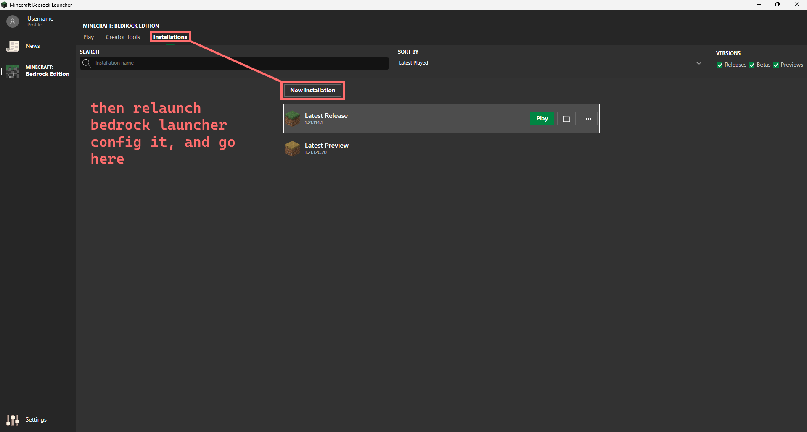
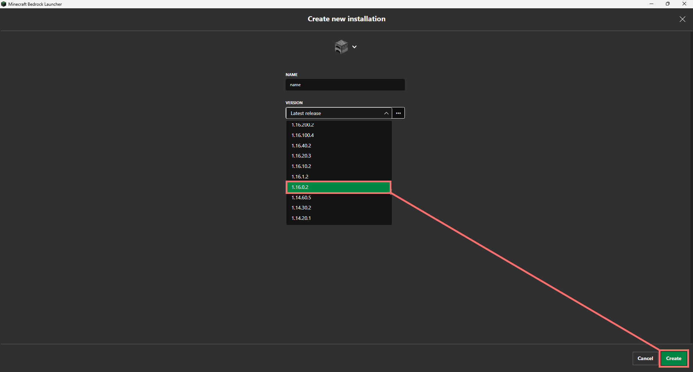
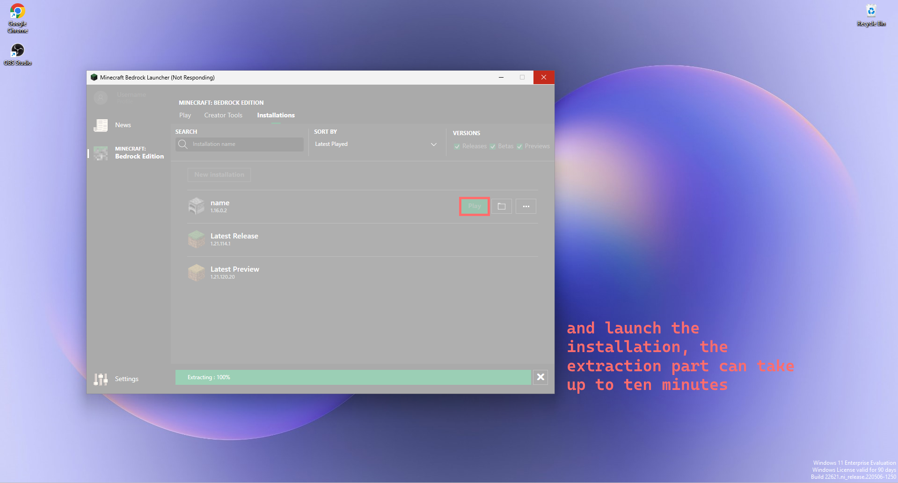
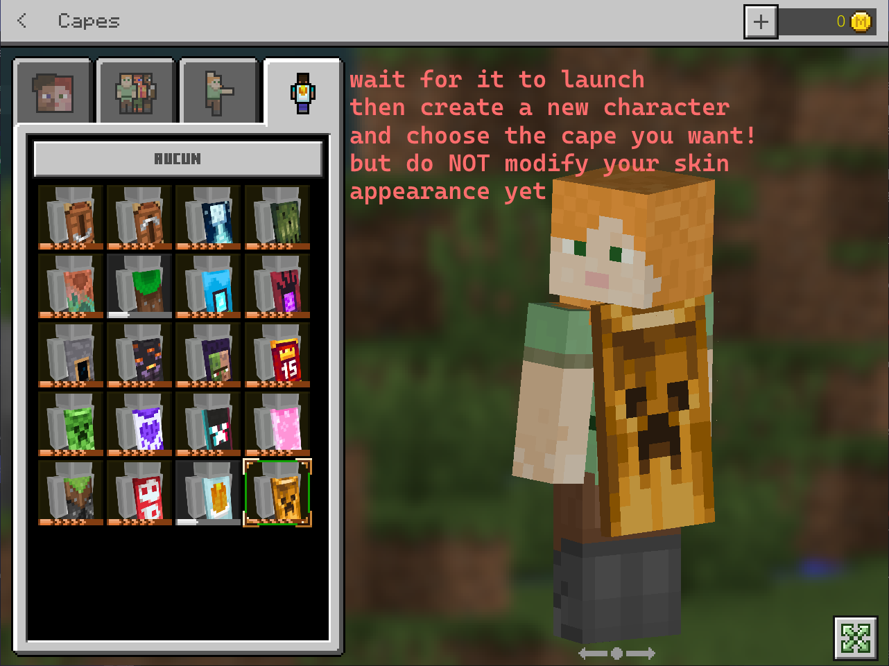
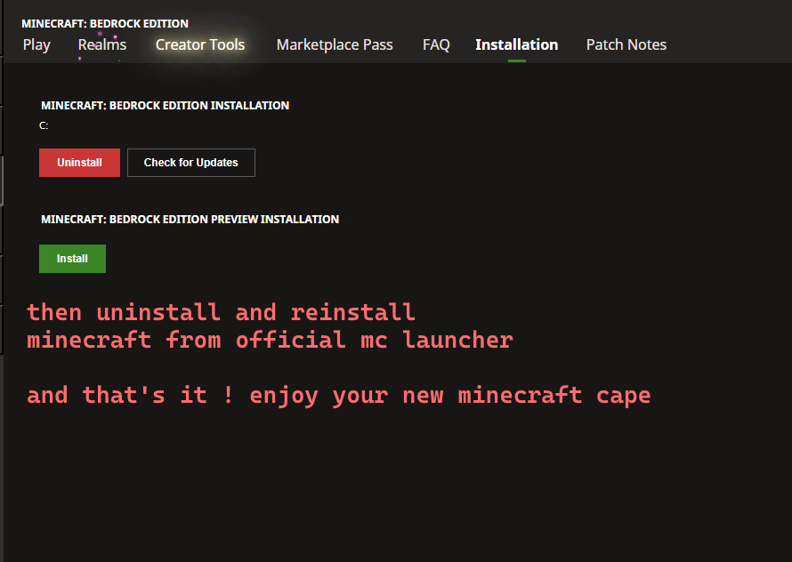

# 

Auf Java gibt es viele verdrehte Wege, um mit einem Umhang zu landen, den man nicht haben sollte (siehe Artikel über`cape-mod`). Auf Bedrock ist das Spiel anders, die Authentizität ist anders, aber es gibt trotzdem einen Weg – es genügt nur ein drittes Launcher und eine alte Version des Spiels, die die Validierung, die man für erworben hält, ignoriert.

Hier ist, wie man es macht, und dann sehen wir, was wahrscheinlich unter der Haube passiert.

## Was du brauchst

- Ein Microsoft-Konto, das bereits Minecraft Bedrock besitzt (Deines ist sehr gut)
- Der offizielle Minecraft Launcher installiert
- [BedrockLauncher](https://github.com/bedrockLauncher/BedrockLauncher), ein Open-Source-Launcher von Drittanbietern, mit dem du jede historische Version von Bedrock installieren und starten können
- .NET 8.0 Desktop Runtime
- Der Entwicklermodus aktiviert auf Windows

## Schritt 1 – Bedrock mindestens einmal mit dem offiziellen Launcher installieren

Bevor du etwas anderes tun, öffnest du den offiziellen Minecraft Launcher, gehst du auf die Registerkarte **Minecraft: Bedrock Edition** und klicken du auf **Install**. Bedrocks muss mindestens einmal auf offiziellem Weg installiert und gestartet worden sein, bevor du BedroickLauncher berühren.

## Schritt 2 – BedrockLauncher herunterladen

Die GitHub Release Seite des Projekts. Nimm den Reißverschluss der neuesten Version in **Assets**.

## Schritt 3 – Archiv auslesen

Nachdem du den Reißverschluss heruntergeladen hast, hol ihn aus deinem Ordner.`Downloads`(oder überall, solange du die Akte danach findest).

## Schritt 4 – Ausführbare starten

Geh in den extrahieren Ordner und starte`BedrockLauncher.exe` .

## Schritt 5 – Installierst du .NET Desktop Runtime und aktivieren du den Entwicklermodus

Beim ersten Start wird Windows höchstwahrscheinlich die **.NET 8.0 Desktop Runtime** – installieren. du musst auch den **Entwicklermodus** in`Paramètres > Système > Pour les développeurs`, weil BedrockLauncher das Spiel als lose Paket (rohe Dateien, nicht ein echtes Paket vom Store unterzeichnet) installiert, und Windows verweigert diese Art der Installation ohne diesen Modus.

## Schritt 6 – Eine neue Installation erstellen

Starte BedrockLauncher, logge dich mit deinem Microsoft-Konto ein, geh auf die Registerkarte **Einrichtungen** und klicke dann auf **New Installation**.

## Schritt 7 – Eine alte Version auswählen

Gibt einen Namen für die Installation und dann aus der Versionsliste, eine **alte** Version – typischerweise eine Version`1.16.x`oder älter. Klicken du auf **Create**.

## Schritt 8 – Installation starten

Klicken du auf **Play**. Die Dateiauslesen kann je nach Maschine bis zu zehn Minuten dauern – der Launcher wird starr aussehen (siehe Not Responding ✓), das ist normal, lass ihn laufen.

## Schritt 9 – Umhang auswählen

Nachdem das Spiel gestartet ist, melde dich mit deinem Konto an, erstelle einen neuen Charakter und gehe in den Skin Editor, Registerkarte **Capes**. Dort findest du die vollständige Liste aller Umhänge, die in Minecraft existieren – einschließlich derjenigen, die du nie hattest (Kapseln von Promo-Events, vergangenen Festivals, Mob-Abstimmung, etc.).Wähle, welche du willst.

**Trakt nicht den Rest des Skin-Stils an diesem Punkt**, lass nur das Umhang.

## Schritt 10 – Offizielle Version neu installieren

Gehe zurück in den offiziellen Launcher, Registerkarte **Installation**, und klicke auf **Uninstall** auf die Hauptinstallation von Bedrock und installiere sie (oder mach **Check for Updates**). Relance Minecraft Bedrocks aus dem offiziellen Lancher dieses Mal.

Und hier ist es – dein Umhang ist da, auf der offiziellen Version, auf deinem echten Profil.

## Was wahrscheinlich passiert

Ich habe meine Hände nicht in Bedrocks geschlossenen Quellcode (im Gegensatz zu Java, der dekompilierbar ist) gelegt, also ist das folgende eine **wahrscheinliche** Erklärung, keine absolute Gewissheit. Aber das beobachtete Verhalten stimmt ziemlich gut mit der folgenden Hypothese überein.

### Der Umhang-Auswahlschalter war nie eine Zugriffskontrolle

Auf Bedrock zeigt der Umhang-Auswahlbildschirm wahrscheinlich **die vollständige Liste der Umhänge im Spiel**, nicht nur derer, die dein Konto besitzt. Bei neusten Kunden wird ein Applikationsfilter (Clientseite oder über einen Netzwerkanruf zu einem grauen Xbox/Microsoft-Entitlement-Service) verwendet oder verdeckt die nicht vorhandenen Umhänge.

Der Schlüsselpunkt ist, dass dieser Filter wahrscheinlich ** nach dem Schlag** auf eine ziemlich neue Version des Spiels hinzugefügt wurde. Eine Version wie 1.16.x ist vor diesem Filter, oder verwendet einen anderen Check-Mechanismus (oder fehlt): Alles in der Liste wird wählbar, entitierbar oder nicht.

### Wo genau ist der Umhang gespeichert?

Das ist der Teil, der erklärt, warum es die Neuansiedlung überlebt. Die Wahl von Skin/Kape auf Bedrock ist nicht nur eine lokale Einwegdatei – es wird wahrscheinlich auf dem Xbox Live-Profil synchronisiert, das mit deinem Microsoft-Konto verknüpft ist (das gleiche System, das deinen Skin auf anderen Plattformen verwaltet – Mobil, Konsole usw.). Wenn du einen Umhang im alten Client wählst, sendet dieser diese Auswahl höchstwahrscheinlich an den Profilservice, genau wie ein aktueller Kunde mit einem legitimen Cape – weil es aus Sicht des Kunden keinen Unterschied zwischen einem Cape ✓ zu dir und einem gewählten Cape gibt ^. Der Profilservice vertraut dem Kunden auf diesem Punkt: er speichert die Auswahl, ohne die Änderung zu ändern, wenn das Entitlement tatsächlich hinter ihm existiert, zumindest nicht zum Zeitpunkt des Schreibens.

Ergebnis: Wenn du das offizielle Spiel auf den neuesten Stand bringen, wird es deinen aktuellen Skin/Kape auf dem Profilservice abholen – und der Service sendet getreu das aufgenommene, nicht-legitime Cape inklusive. Der Entitlement-Check, wenn vorhanden, wird wahrscheinlich nur zum Zeitpunkt der **Auswahl** in der U.S. (daher der Filter auf den letzten Kunden) durchgeführt und lässt die** Ansicht** von dem, was bereits auf dem Profile gespeichert ist, übergeben.

### Parallel zu Java

Es ist dieselbe Familie von logischen Fehlern wie die Familie von`cape-mod`auf Java: ein Dienst vertraut einem Datendatensatz, ohne seinen Ursprung in jedem Schritt zu überprüfen. Auf Java ist es eine gültige, aber auf dem falschen Profil zurückgebildete RSA-Signatur. Bei Bedrock ist es wahrscheinlich eine Auswahl von Umhängen, die von einem alten Kunden akzeptiert wurde, der nie den richtigen Filter hatte und dann ohne Überprüfung auf den dauerhaften Status des Kontos übertragen wurde. In beiden Fällen ist das Problem nicht der Eingangspunkt (der Java-Mod, der alte Bedrocks-Client) – ist, dass die Schicht, die das Untergrund-Becken umformt, dies nicht tut oder nur einmal an der falschen Stelle tut.

## Warum funktioniert es immer noch?

Zwei mögliche Erklärungen, nicht unvereinbar zwischen ihnen:

1. **Mojang sieht das wahrscheinlich nicht als Priorität an.** Es braucht einen Drittanbieter-Launcher, eine Handhabung in mehreren Schritten, und das Ergebnis ist rein kosmetische – kein Gameplay-Vorteil, keine anderen Daten beeinträchtigt.
2. **Patching es richtig würde erfordern, die Eindrücke bei jeder Wiedergabe des Profils** zu ändern, nicht nur bei der Auswahl – das bedeutet, einen zusätzlichen Netzwerkanruf auf jede Skin-Anzeige, für ein Problem, das nur Ästhetik betrifft.

## Schlussfolgerung

Dieses Tuto hält in zehn Screenshots, aber es zeigt ein Prinzip, das überall in Softwaresicherheit gefunden wird: Sobald ein historisches System (eine alte Client-Version, eine Legacy-API, ein nie aktualisierter Service) noch in einen geteilten Zustand schreiben kann, schützt die Zugriffskontrolle der Gegenwart nur das, was durch die Gegenwart geht. Alles, was noch mit der alten API sprechen kann, umgeht den neuesten Filter – der Filter funktioniert auf den neuesten Versionen, aber er wurde nie auf die frühere Version angewendet.

---

**Ressourcen**

- **BedrockLauncher**:[github.com/bedrockLauncher/BedrockLauncher](https://github.com/bedrockLauncher/BedrockLauncher)
- **Verknüpfte Artikel**: Cape Mod, Java-Äquivalent durch RSA-Signaturinjektion

**3 Schlüsselpunkte**

1. Der Umhänge-Auswahlschalter einer alten Version von Bedrock zeigt wahrscheinlich die vollständige Liste der Umhänge des Spiels ohne Entitlementfilter an.
2. Die Auswahl wird dann auf deinem Xbox Live-Profil synchronisiert, wie jedes legitime Umhang – der Profilservice vertraut dem Kunden.
3. Der Entitlement-Check, wenn vorhanden, erfolgt bei der Auswahl in der letzten UI – nicht beim Lesen von dem, was bereits auf dem Konto gespeichert ist.
