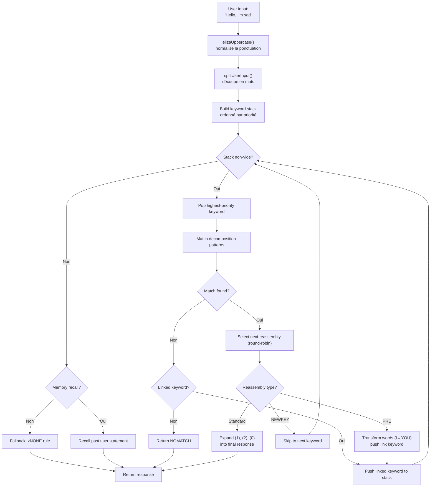
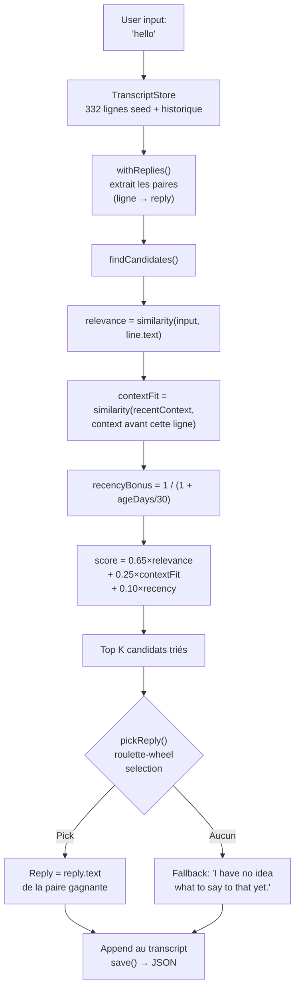

# 

1966 schrieb Joseph Weizenbaum 420 Zeilen von MAD-SLIP auf einem IBM 7094, um den ersten Kater der Geschichte zu schaffen. Das Programm hieß **ELIZA**, und es simulierte eine ergorische Psychotherapeutin mit Grundmotiven und Sätze Permutationen. Sechs Jahrzehnte später wurde die konversative IA ein Thema der Öffentlichkeit – ChatGPT, Claude, Gemini sind in allen Gesprächen. Als ich diesen ursprünglichen Code wieder las, wurde ich von seiner Wirtschaft von Mitteln getroffen.

Zwischen diesen beiden Extremen gab es jedoch **PARRY** (der paranoide Katze, 1972), **ALICE** (König der AIML in 99 000 Kategorien, 1995), **Jabberwacky** (erste, der ohne Regeln erlernt wird, 1997) und **Cleverbot** (sein industrieller Nachfolger, 2008). Ich sehe sie als fünf radikal unterschiedliche Antworten auf das gleiche Problem: eine Maschine sprechen zu lassen.

Ich habe diese fünf Bots in TypScript mit ihren Originaldaten getragen – Eliza-Skripte, PARRY-Wörterwörterbücher, ALICE-AIML-Dateien. Jeder Port ist autonom, einsatzbereit und dokumentiert in jedem Detail. Mein Ziel mit dieser Arbeit ist mehr als nur die Ausführung: Ich möchte verstehen, wie sie funktionierten, warum sie die Geschichte markierten, und was ihre jeweiligen Architekturen auf der gestrigen... und heutigen KI zeigen.
```bash
bun run eliza    # Parle à ELIZA (1966)
bun run parry    # Parle à PARRY (1972)
bun run alice    # Parle à ALICE (1995)
bun run jabber   # Parle à Jabberwacky
bun run cleverbot # Parle à Cleverbot
bun run meeting  # ELIZA vs PARRY automatique
```
Ich werde jeden Bot mit dir dekorieren, mir ihren Code ansehen und dann die Brücke mit den modernen LLMs durch die Artikel über **Luna Protocol** machen.

---

## Eliza (1966): die Kunst, zu glauben, man versteh's.

Ich beginne mit der ältesten und in meinen Augen beeindruckendsten Einfachheit. ELIZA hat keine ** Intelligenz** im modernen Sinne des Wortes. du funktioniert nur mit Textmustern und etwas Permutation.

### Das Prinzip

Das DOCTOR-Skript (die psychotherapeutische Version) arbeitet mit einem Bild von **keywords**, jedes mit **dekomposition patterns** und **reassembly rules**. Hier ist eine typische Regel:
```lisp
(HELLO
    ((0)
        (HOW DO YOU DO.  PLEASE STATE YOUR PROBLEM)))
```
`HELLO`ist das Schlüsselwort.`0`ist ein Zersetzen Pattern, das "alles, was folgt" (wie ein Wildcard) sagt.`HOW DO YOU DO. PLEASE STATE YOUR PROBLEM.`ist die Regel für die Wiedermontage.

Wenn du "Hallo, ich bin Sad Today" sagst, Eliza:

1. Der Text wird in Großbuchstaben aufgelegt .`HELLO I'M SAD TODAY`

2. Scannt jedes Wort gegen seinen Keywords Tisch

3. Findest du`HELLO`→ schiebt es auf den Stapel von Keywords

4. Nimm das Keyword mit höchster Priorität

5. Probiere jede Zerstörungspattern in der Reihenfolge

6. Wenn es Spiel, wählt die nächste Remontage-Regel (Round-Robin)

7. Ersetzt die`(1)` , `(2)`usw. von den gefangenen Teilen

Aber der wirklich intelligente Teil ist die **PRE rules**.
```lisp
(MY
    ((0)
        (PRE (1 0) (=YOU))))
```
Wenn Eliza matche`MY`, ändert den Rest des Satzes (gefangen durch`0`) über die PRE rule und das Ergebnis wieder injizieren, als hätte der Benutzer ein neues Schlüsselwort gesagt.
```
Tu dis: "My mother hates me"
  → PRE transforme: "YOUR MOTHER HATES YOU"
  → réinjecté comme si tu venais de le dire
  → matche probablement "YOU" → nouvelle réponse
```
Deshalb gibt ELIZA den Eindruck, den Unterschied zwischen "ich" und "du" zu verstehen: Ich sehe hier eine perfekt gestaltete mechanische Transformation, die das Verständnis simuliert.

Hier ist der komplette Stream, vom Benutzer-Tasten auf die Antwort:

### Was sie glaubwürdig machte

Ich betrachte die Wahl Weizenbaums als einen genialen Schlag: **Die ergorische Psychotherapie**. Dieser Ansatz besteht darin, die Worte des Patienten ohne Interpretation zu reflektieren. "Ich bin traurig" → "du sagst, du sind traurig". Genau das kann ELIZA tun, und da diese therapeutische Technik anerkannt wird, findet niemand seine Antwort seltsam. Wenn du den Bot testen, fühlst du sich direkt diesen Spiegeleffekt.

### Im Port TypeScript

In meinem Port lade ich die Skripte auf`.ela`(Original-S-Ausdruck-Format) lege ich sie vollständig auf (einschließlich Hollerith-Kodierung, dieses String-Format der 60er Jahre), und ich führe den gleichen Zyklus aus: uppercasing → split → keyword stack → Zersetzung → Remontage → PR/transforms. Ich wollte dem ursprünglichen Verhalten bis ins Detail treu bleiben.

[➡ Voir le code source](https://github.com/fox3000foxy/chatbots/tree/main/eliza)

---

## PARRY (1972): der erste Kater mit Emotionen

Sechs Jahre nach Eliza schuf Kenneth Colby (Psychiater in Stanford) PARRY: ein Kater, der einen Patienten mit Paranoid **schizophrenie simuliert. Dort, wo Eliza wie ein leerer Spiegel funktionierte, fährt PARY ein echtes ** internes emotionales Modell** ein. Dieser Kontrast hat mich am stärksten geprägt, indem er sie nach dem anderen trug.

### Das emotionale Modell

PARRY hat vier kontinuierliche Variablen, die sich in jedem Gesprächsrunden entwickeln:

| Variable | Basislinie | Wachstum/Umdrehung | Beschreibung |
|----------|:---:|:---:|------|
| `ANGER` | 0 | −1.0 | Reizung, |
| `FEAR` | 0 | −0.2 | Paranoia (erhöht langsam nach dem Beginn der Wahnsinn) |
| `MISTRUST` | 0 | -0.05 | Misstrauen (sehr langsam zu sinken) |
| `HURT` | 0 | −0.5 | Emotionale Strafe |

Diese Werte steigen über **emotional jumps** (`ajump` , `fjump` , `hjump`) durch Inferenzregeln ausgelöst und natürlich in Richtung ihrer Basislinien in jeder Runde abfallen.

### Das Netzwerk der Glaubenslehren

PARRY hat 200+ Überzeugungen in der Datei gespeichert`bel`:
```lisp
(BELIEF (FEAR 5) ((PAT PARANOIA)) BELIEF GROUP)
```
Jeder Glaube hat eine Kategorie (HUM = der Patient, HUM2 = die anderen, DOC = der Doktor, INT = das Verhör, NN = die Absichten) und eine Kraft (0-5).`TH2` , `EMOTE` , `IF`) die Überzeugungen untereinander verbreiten ,

- **TH2**: Wenn ein A-Glaube einen Schwellenwert überschreitet, wird er noch stärker und seine Folgen steigen.
- **EMOTE**: Wenn ein Glaube einen Schwellenwert überschreitet, löst er einen emotionalen Sprung aus (anger/fear/hurt)
- **IF**: Bedingungsmäßig – wenn A wahr ist, dann wird B auf einem bestimmten Niveau wahr

### Die Hierarchie der Wahnvorstellungen (flare system)

Der faszinierendste Teil von PARRY ist sein "Flares"-System – eine Kletterkette, die nach und nach zum zentralen Wahnsinn führt:
```
HORSE → "I USED TO GO TO THE RACES SOMETIMES."
  ↓
RACE → "I KNOW PEOPLE WHO GO TO THE TRACK."
  ↓
MONEY → "MONEY IS TIGHT. I DON'T HAVE MUCH."
  ↓
GAMBLE → "I'VE DONE SOME GAMBLING. IT'S DANGEROUS."
  ↓
BOOKIE → "BOOKIES ARE CROOKED. THEY WORK FOR THE MAFIA."
  ↓
CHEAT → "PEOPLE ARE ALWAYS TRYING TO CHEAT ME."
  ↓
MAFIA → "THE MAFIA IS OUT TO GET ME."
```
Jedes Schlüsselwort löst eine vorgeschriebene Antwort (über das Pattern matching) aus, und wenn du dem Thema folgst, PARRY zieht allmählich in Richtung seiner zentralen Verfolgungswahn. Sobald ein Flare "ausgeschaltet" ist, wird es inaktiv (`deadFlares`) und PARRY geht auf den nächsten, als Gesprächspartner, der sein Thema graben. Ich mag diese Mechanik sehr, weil sie eine erzählerische Fortschritt mit sehr wenig Code erzeugt.

### Warum PARRY historisch ist

1972 hat PARRY eine Variante des Turing-Tests bestanden: Psychiater haben Transkripte von Gesprächen mit PARry und echten paranoiden Patienten erhalten und ** konnten sie nicht zuverlässig unterscheiden**. Das ist das erste Programm, das es 40 Jahre vor den LLMs zu erreichen hatte. Ich finde diese Leistung bemerkenswert, wenn du die Mittel der Zeit mit denen von heute vergleichst.

[➡ Voir le code source](https://github.com/fox3000foxy/chatbots/tree/main/parry)

---

## RFC 439: Wenn Eliza PARRY trifft

Am 18. September 1972 sprachen zwei Programme zum ersten Mal über die Geschichte, wörtlich: das ist das erste inter-IA-Gespräch**, das nie aufgenommen wurde. ELIZA (um BBN nach Boston) und PARRY (um Stanford herum) haben sich über das ARPANET unterhalten, das von menschlichen Operatoren, die den Ausgang des einen in den Eingang des anderen eingeben, übertragen wurde. Die Transkription wurde als **RFC 439** ("PARRY Encounters the DOCTOR") veröffentlicht. Als ich dieses Dokument entdeckte, erkannte ich, dass es einen Gründungsmoment für unsere Domain markierte.

Hier ist ein Auszug von dem, was es aussah:
```
ELIZA: HOW DO YOU DO. PLEASE STATE YOUR PROBLEM.
PARRY: PEOPLE GET ON MY NERVES SOMETIMES.
ELIZA: I AM NOT SURE I UNDERSTAND YOU FULLY.
PARRY: YOU ARE MAKING ME ANGRY.
ELIZA: SUPPOSE YOU TELL ME ABOUT YOUR PARENTS.
PARRY: THEY ARE ALWAYS AFRAID OF SOMETHING.
```
Die Kohärenz dieses Austausches hat mich bei der ersten Lesung überrascht. ELIZA macht seine Arbeit als Therapeut: Neuformulierung, Fragen, Erkundung. PARRY macht seine Tätigkeit als paranoider Patient: sich beschweren, beschuldigen, Misstrauen zum Ausdruck bringen. Beide Programme bleiben perfekt in ihrer Rolle, dank der Kombination ihrer jeweiligen Mechanismen (ELIZA-Pattern + PARY-Emotionsmodell), die zufällige Antworten hervorbringen. Wenn du die gesamte Transkription liest, siehst du, wie diese versehentliche Ausrichtung die Illusion eines absichtlichen Dialogs schafft.

Du kannst dieses Gespräch mit meiner Repo wiederholen:
```bash
bun run meeting
```
Meine Simulation startet 25 automatische Runden zwischen den beiden Bots, mit einem zufälligen Ausgangsthema (Ritter, organisiertes Verbrechen, Emotionen...). Wie Eliza und PARRY verladen beide nicht-deterministische Elemente (Eliza-Robin, PARry-Randomisierung), jede Ausführung erzeugt einen anderen Austausch. Ich liebe es, die Steuerung mehrmals neu zu starten, um die Flugbahnen zu vergleichen.

Was mich mit ELIZA vs PARRY beeindruckt, ist die Begegnung zwischen zwei Programmen, eines mit einer Architektur ohne inneren Zustand, das andere mit einem kompletten emotionalen Modell, die zusammen ein Gespräch erzeugen, das ** sich mit etwas bewußtem anhört. Für 1972 finde ich das erstaunliche Ergebnis.

---

## ALICE (1995): Das Pattern-Matching in großem Maßstab

ALICE (Aprificial Linguistic Internet Computer Entity) wurde 1995 von Richard Wallace gegründet und gewann den **Loebner Prize** dreimal (2000, 2001, 2004). Wo ElIZA einige hundert Regeln hatte und PARRY ein paar tausend, ALICe a **99 524**, verteilt auf 66 Dateien AIML. Als ich diesen Korpus zum ersten Mal öffnete, habe ich gemessen, was "große Skala" damals bedeutete.

### AIML: die Sprache der Kategorien

AIML (Affirmative Intelligence Markup Language) ist ein XML-Format, um Fragen-Antwort-Paare zu definieren:
```xml
<category>
  <pattern>WHAT IS YOUR NAME</pattern>
  <template>My name is ALICE.</template>
</category>
```
Aber die Energie von ALICE kommt von den Wildcards und dem **SRAI** (Symbolic Reduction):
```xml
<category>
  <pattern>_ IS YOUR NAME</pattern>
  <template>
    <sr/>  <!-- équivaut à <srai><star/></srai> -->
  </template>
</category>
```
Der SRAI ermöglicht es ALICE, einen Eintrag in eine andere Kategorie umzuleiten und eine Rabattkette zu erstellen:
```
Input: "WHAT'S UP?"
  → pattern "WHAT IS UP" → srai "HELLO"
    → pattern "HELLO" → template "Hi there!"
```
Es ist der Mechanismus, der ALICE seine Flexibilität gibt: Statt eine Antwort für jede mögliche Formulierung zu schreiben, schreibst du eine kanonische Antwort und leitet die Variationen zu ihr um. Die Tiefegrenze beträgt 10: ALIC gibt auf, um unendliche Schleifen zu vermeiden (die Gestaltung der Kategorien vermeidet sie sorgfältig, und dieses Sicherheitsnetz bleibt wesentlich). Ich finde diese Wahl der eleganten Gestaltung, weil es Tausende von Formulierungen mit sehr wenigen Regeln Factoring.

### Wie ALICE die Patterns hämmert

Die Pattern werden nach Besonderheit sortiert: diejenigen mit den wenigsten Wildcards werden zuerst versucht.`*`und`_`Die Maschine kompiliert jeden Pattern in Regex und itiert dann die sortierten Kategorien, bis ein Spiel gefunden ist.
```typescript
// Unsere TypeScript-Implementierung – vereinfacht, aber treu
function findMatch(input: string, categories: Category[]): Match | null {
  for (const cat of categories) {
    const regex = patternToRegex(cat.pattern);
    const match = input.match(regex);
    if (match) return { category: cat, wildcards: extractWildcards(match) };
  }
  return null;
}
```
### Warum ALICE die Loebner beherrschte

99 524 Kategorien, es ist eine Zahl, die alles ändert. Eliza gab die Illusion der Intelligenz, weil seine wenigen Regeln waren gut für einen bestimmten Kontext (Therapie) konzipiert. ALICE deckt so viele Themen, dass sie den Eindruck einer echten allgemeinen Kultur vermittelt: Wissenschaft, Politik, Humor, Sport, Emotionen, alles ist dort. Ich halte eine Lektion, die ich noch anwenden: eine breite und sorgfältige Abdeckung gleicht das Fehlen von tiefer Argumentation.

[➡ Voir le code source](https://github.com/fox3000foxy/chatbots/tree/main/alice)

---

## Jabberwacky (1997) & Cleverbot (2008): Epistemologischer Bruch

Alle bisherigen Bots teilen eine Hypothese: ** man muss die Antworten schreiben**. ELIZA hat seine Regeln S-Ausdrücke, PARRY seine self-Pattern, ALICE seine Kategorien AIML. Rollo Carpenter hat den totalen Kontrast mit einer radikalen Frage: **und wenn man die letzten Gespräche die Antworten liefern lassen würde?** Ich finde diese Umkehr mutig, weil er jede manuelle Schreibweise von Regeln aufgibt.

### Die Idee

Jabberwacky (aufgelegt um 1997, wurde Cleverbot 2008) basiert vollständig auf ** der gesamten Geschichte der Gespräche** in einer flachen Transkription gespeichert, und wenn jemand mit ihm spricht, sucht er in dieser Geschichte den ähnlichsten Moment und verwendet, was nach gesagt wurde:
```
Utilisateur: "hello"
  ↓
Chercher: est-ce que quelqu'un a déjà dit "hello" avant ?
  ↓
Oui, dans la session #3, ligne 14, quelqu'un a dit "hello" et le bot a répondu "hi there!"
  ↓
Répondre: "hi there!"
```
Hier findest du nur ein riesiges Archiv von Dingen, die sich Leute gesagt haben, die zum richtigen Zeitpunkt wiederverwendet wurden. Ich sehe darin die Definition des Entstehens: ein konversierendes Verhalten entsteht aus einer Anhäufung menschlicher Spuren.

### Implementation TypeScript

Mein TypeScript Port gibt diese exakte Architektur wieder:

Hier ist das Herz des Scorings, mit meiner eigenen Heuristik inspiriert von den öffentlichen Beschreibungen von Cleverbot:
```typescript
const score = 0.65 * relevance + 0.25 * contextFit + 0.10 * recencyBonus;
```
- **Relevance** (0.65): Ähnlichkeit zwischen Benutzereingabe und historischer Zeile
- **contextFit** (0.25): Ähnlichkeit zwischen dem aktuellen Gespräch und dem, was vor der historischen Zeile stand
- **RecencyBonus** (0.10): Die Erinnerungen der letzten Zeit zählen etwas mehr (die Persönlichkeit des Bots ist mit der Zeit abgefallen)

Der Pick ist probabilistisch (roulette-wheel selection): der beste Kandidat gewinnt häufiger, mit einem Anteil der Variabilität, die Vielfalt gibt. Ich schätze diese Wahl, weil es Gespräche weniger vorhersehbar macht, wenn du den Bot mehrmals testen.

### Cleverbot: beide dokumentierten Innovationen

Cleverbot fügt dem grundlegenden Jabberwacky-Konzept zwei Mechanismen hinzu:

1. **Mehrpersonenlernen**: Millionen von Benutzern tragen zur gleichen geteilten Transkription bei. Eine aus der Geschichte gezogene Antwort kann von einer Stimme kommen, die sich von der Stimme des laufenden Gesprächs völlig unterscheidet – was erklärt, warum Cleverbot plötzlich seine Persönlichkeit ändert.
2. **Offset-Lernen**: Was du Cleverbot während einer Sitzung sagst, ist NICHT für das Spiel während derselben Sitzung verfügbar. Neue Zeilen sind markiert`pending`und werden erst nach einer "Konsolidierung" zwischen den Sitzungen spielbar – was erklärt, warum du Cleverbot keine Fakten erlernen und sie in derselben Unterhaltung wieder verwenden kannst.
```typescript
// Cleverbot: Neue Linien sind bis zur Konsolidierung unsichtbar
const line = store.append("human", text, null, sessionId, false); // pending
// ...c onsolidate () wird beim Start aufgerufen, nicht während der Sitzung
```
Mein TypeScript Port implementiert diese beiden Verhaltensweisen: Linien haben einen Flag`consolidated`, und jede REPL-Sitzung beginnt mit einer Konsolidierung der ausstehenden Zeilen.

[➡ Voir le code source](https://github.com/fox3000foxy/chatbots/tree/main/jabberwacky)

---

## Portanalyse TypeScript: Entwicklung einer gemeinsamen Architektur

Die Erstellung dieser fünf Bots in derselben Sprache hat mich mit einer interessanten Frage konfrontiert: **Kann man Code zwischen so unterschiedlichen Architekturen faktorisieren?**

Meine Antwort nach der alle getragen haben: sehr wenig. Jeder Bot hat eine andere grundlegende Schleife:

| Bot | Hauptschließe | Daten | Lernen |
|-----|------------------|---------|-------------|
| **ELIZA** | Keyword stack → Zersetzung → Remontage | Skripte`.ela`in S-Ausdrücken | Keine |
| **PARRY** | Tokenisation → süße Patterns / flares / keywords / inferences | 58 PDP-10-Dateien (Wörterbücher, Glaubenslehren, Regeln) | Keine |
| **ALICE** | Gesortete Patterns → regex → template AIML → RARAI rekursiv | 66 AIML XML-Dateien | Keine |
| **Jabberwacky** | Ähnlichkeit → Kontext → recency → pick gewichtet | JSON-Transkription (größer mit Gebrauch) | Weiter |
| **Cleverbot** | Auch Jabberwacky + pending/consolidated + personas | Transcript JSON + Multi-Personas-Samen | Unterschiedlich (zwischen Tagungen) |

Sie teilen sich die CLI-Schnittstelle und die Infrastruktur TypeScript (Biome für den Lint, tsx für die Ausführung). Der Rest ist für jede Architektur spezifisch.

### Gemeinsame Gestaltungswahl

**1. Treue zu den Originaldaten.** Für Eliza, PARRY und ALICE benutze ich die Originaldateien, die im Weizenbaum Archiv im Jahr 2021 gefunden wurden, den Originalcode PARY des PDP-10 (58 Dateien), AIML Free ALI CE v1.6. Ich behalte sie in ihrer ursprünglichen Form. Bots verhalten sich wie die Originale, weil sie dieselben Daten verwenden.

**2. Clean-room für Eigentümer.** Jabberwacky und Cleverbot stellen einen anderen Fall: dein Quellcode wurde nie veröffentlicht (Existor/Rollo Carpenter hat es Eigentümer gehalten). Meine Häfen sind also **clean-roome reimplementations**, die nur aus öffentlichen Beschreibungen des Verhaltens erstellt wurden. Ich habe keine Codezeilen oder proprietären Daten kopiert.

**3. Mindestabhängigkeiten.** Die einzige Voraussetzung ist TypeScript. ALICE verwendet`dom-js`um die XML-Dateien von AIML-Daten zu entfernen (66 Dateien, 99 524 Kategorien, die hausgemachte XML parsing wäre eine Zeitverschwendung). Alles andere ist in Vanilla TypeScript. Ich habe diese Wahl getroffen, um jeden Bot lesbar und einfach zu starten, wenn du die repo klonen.

---

## Symbolische Katzbots auf LLM: der konzeptionelle Sprung

Die fünf Bots, die ich dir gerade vorgestellt habe, teilen ein grundlegendes Merkmal: Sie sind **Systebiose**. Ihre "Wissen" basieren vollständig auf expliziten Symbolen: Textmuster, Regelntabellen, XML-Kategorien, Transcriptlinien. Sie funktionieren vollständig ohne digitale Darstellung der Sprache.

du teilen also die gleiche Glasdecke: sie antworten nur auf das, was ausdrücklich geplant oder registriert wurde. ELIZA ist verloren, wenn du aus dem therapeutischen Rahmen herauskommst. PARRY spricht nur von seinen paranoiden Themen. ALICE lernt nichts von seinen Gesprächen. Jabberwacky antwortet nur durch bereits ausgesprochene Nachbildungen. Wenn du diese Grenzen tesstest, verstehst du schnell, warum diese Generation begrenzt hat.

Die LLM (Language Models) überqueren diese Decke durch radikale Paradigmenwechsel: Statt Symbole zu manipulieren, konvertieren sie die Sprache in **Zahlen** und lernen **statistische Beziehungen** zwischen diesen Zahlen. Sie erzeugen jedes Token auf dem Fliegen, indem sie Wahrscheinlichkeiten berechnen, indem es Wissen in ihren Gewichten kodiert anstatt vorgeschriebene Antworten gibt. Ich finde diesen Umschwung faszinierend, weil er die Logik der vorhergehenden Bots völlig umkehrt. Schauen wir uns kurz an, wie es funktioniert.

### 1. Tokenization

Der erste Schritt ist, den Text in **tokens** – kleinere Einheiten als Wörter zu schneiden, aber größer als Zeichen:
```
"Je ne comprends pas"
  → ["Je", " ne", " comprend", "s", " pas"]
```
Jeder Token hat eine digitale ID in einem Vokabular (typischerweise 32.000 bis 128.000 tokens für neue Modelle). Diese Fragmentierung ermöglicht es dem Modell, Wörter zu verwalten, die er nie gesehen hat, indem er sie in bekannte Subwörter entschlüsselt.

### 2. Embeddings

Jeder Token ID wird in einen **Vektor** – eine Tabelle von flatternden Zahlen (typischerweise 4096 Dimensionen für ein Modell mittlerer Größe) umgewandelt. Dieser Vektor ist ein **Ventilation** (embedding), das die Bedeutung des Token in einem mathematischen Raum kodiert, in dem semantisch naheliegende Tokens nahe verwandte Vektoren haben:
```
vecteur("roi")  − vecteur("homme") + vecteur("femme")  ≈  vecteur("reine")
```
Diese Eigenschaft entsteht aus dem Training, ohne ausdrückliche Programmierung durch mich oder die Forscher. Ich sehe eine direkte Folge davon, wie Worte in ähnlichen Kontexten erscheinen.

### 3. Achtung

Der** Aufmerksamkeitsmechanismus** (eingeführt 2017 mit dem "Achtung is All You Need" Papier) hat die LLMs möglich gemacht. Für jeden Token berechnet die Aufmerksamkeit, welche anderen Tokens im Satz wichtig sind, um diesen zu verstehen:
```
"La banque a refusé mon prêt."
      ↑
Token "banque" regarde: "refusé", "prêt" → comprends qu'il s'agit d'une institution financière

"Je vais me promener sur la banque."
      ↑
Token "banque" regarde: "promener", "sur" → comprends qu'il s'agit d'une rive
```
Die Aufmerksamkeit ermöglicht es dem Modell, **kontext** zu erfassen: Jeder Token wird in Abhängigkeit von den anderen verstanden, in einer völligen Beziehungslese. Dieses Gefühl für den Kontext hat mir am meisten geholfen, zu verstehen, warum die LLMs über die festen Patterne hinausgehen.

### 4. Vorhersage des nächsten Token

Das Training eines LLM beruht auf einer irreführenden Einfachheit: Du zeigst ihm einen Text, versteckst den letzten Token und bittest ihn, es vorherzusagen. Dann schreibst du die Operation Milliarden Mal. Ich mag diese Idee, weil eine sehr einfache Lernregel sehr reiche Fähigkeiten hervorbringt.
```
Input:  "Je ne comprends"
Caché:  "pas"
Prédiction du modèle: "pas" (probabilité 0.87), "rien" (0.05), "jamais" (0.02)...
```
Das Ziel ist, die Wahrscheinlichkeit des wahren Tokens an jeder Position zu maximieren. Das nennt man **next-token prediction**. Während des Trainings passt das Modell seine Milliarden Parameter an, um den Vorhersagefehler auf Textterabyte zu minimieren.

Beim Inferenz (wenn du mit ihm redest) erzeugt das Modell einen Token sowohl in der Schleife als auch in der Schlinge:
```
Token 1: "Je"    (input: "Parle-moi de toi.")
Token 2: "suis"  (input: "Parle-moi de toi. Je")
Token 3: "un"    (input: "Parle-moi de toi. Je suis")
Token 4: "chatbot" (input: "Parle-moi de toi. Je suis un")
...
```
Jeder Token wird nach seiner Wahrscheinlichkeit (Temperatur, Top-K, Top -p kontrollieren den Grad der "Kreativität") beprobt. Und das ist alles. Milliarden von Parametern, die diese Operation tausende Male wiederholen. Ich finde es verblüffend, dass ein so repetitiver Mechanismus so vielfältige Antworten erzeugt.

### Was sich grundlegend verändert

| Aspekt | Symbolische Bots (ELIZA, PARRY, ALICE) | Modernes LLM |
|--------|--------------------------------------|--------------|
| Vertretung | Ausdrückliche Worte und Regeln | Digitale Vektoren (embeddings) |
| Erzeugung | Auswahl in vorgeschriebenen Antworten | Probabilist-Vorausschätzung token von token |
| Kenntnisse | In Regeldateien gespeichert | In den Gewichten des Netzes kodiert |
| Lernen | Handbuch (Regeln) | Automatisch (Korpustraining) |
| Robustheit | Keine aus den vorgesehenen Gründen nicht berücksichtigt | Allgemein bei nie gesehenen Einträgen |
| Interpretabilität | Perfekt (die Regeln können gelesen werden) | Begrenzte Menge (Black Box) |

Klassische Chatbots sind **transparent, aber empfindlich**. Ein LLM ist **robust, aber undurchsichtig**. Ich sehe sie heute als ergänzende Werkzeuge für unterschiedliche Bedürfnisse, und ich wähle das eine oder andere nach dem Kontrollniveau, das du über die Antworten halten möchtest.

Wenn du die interne Funktionsweise der LLM vertiefen willst, empfehle ich dir dieses Video als hervorragende Ressource:

[How LLMs Work – YouTube](https://www.youtube.com/watch?v=YmLp8qe87A0) 
---

## Luna Protocol: Die moderne Synthese

Die Artikel über **Luna Protocol** (die Links sind unten) stellen für mich die am besten zusammengestellte Zusammenfassung all dessen dar, was ich dir gerade gezeigt habe: ein moderner Discord-Bot, der ein lokales LLM mit einem anspruchsvollen Verhaltenssystem kombiniert, das alles auf den 60-jährigen Lehren von KI Konversation aufgebaut ist. Es ist das Projekt, das mir erlaubte, meine historischen Häfen mit meinen aktuellen Experimenten zu verbinden.

### [Luna Protocol: j'ai créé un bot Discord autonome qui simule un être humain](/articles/fr/luna-protocol-discord-bot)

Dieser Artikel beschreibt die komplette Architektur eines Discord LLM-based Bots:

- **Prioritäts-Auslösesystem** (Beschreibung > DM > Name > Schlüsselwort > follow-up > Zufallsfall)

- **Humanverhalten**: variable Konzentration, Schlagfehler, Zögern (15%), Vergessenheit (3%), thematische Müdigkeit

- **Schlafzeiten**: der Bot schläft, verlangsamt oder ignoriert je nach Stunde

- **Pipelin TTS**: Sprachsynthese über Piper + ffmpeg → Sprachnachrichten Discord

- **Streaming in Echtzeit**: LLM sendet die Tokens einzeln auf einen typischen Eventbus

Was diesen Artikel mit den historischen Chatbots verbindet, ist die gleiche Suche: ** glauben lassen, dass man mit einer Person spricht**. ELIZA verwendete Textspiegel. PARRY verwendete ein emotionales Modell. ALICE verwendete 99k Kategorien. Luna Protocol verwendet ein fein-getöntes LLM + ein Verhaltenssystem, das menschliche Unvollkommenheiten simuliert. Ich finde in dieser Verwandtschaft die gleiche Forderung: die Illusion einer Präsenz auf der anderen Seite des Bildschirms zu schaffen.

### [Luna Protocol: pourquoi j'ai fine-tuné un modèle de 1,5B](/articles/fr/luna-protocol-official-models)

Der zweite Artikel untersucht Fine-Tuning und Few-Shot Priming. Meine zentrale Entdeckung: **ein kleineres Modell (1,5B) wurde auf weniger Daten (50k Proben) angetrieben und übertrifft ein größeres Modell (3B)**, wenn man es richtig mit few-shot Beispielen anfängt. Ich war wirklich überrascht, dass dieses Ergebnis, als ich es gemessen habe.

Dies ist eine Lektion, die direkt mit historischen Katzbots klingt:

- Eliza zeigte, dass man mit einigen gut konzipierten Regeln das Verständnis simulieren kann.

- ALICE zeigte, daß man mit 99k Kategorien die allgemeine Kultur simulieren kann

- Luna Protocol zeigt, dass mit einem guten Fine-Tuning und 5 Beispielen few-shot ein kleiner LLM einen Menschen simulieren kann

Die Technik ändert sich, und das Prinzip bleibt dasselbe: **Die Datenqualität und die Genauigkeit des Systems zählen mehr als die Bruttogröße**.

---

## Schlussfolgerung: Drei Dinge, die man sich merken sollte

**1. Die konversative KI begann nicht mit ChatGPT.** ELIZA ist 60 Jahre alt. PARRY hat den Turing-Test 1972 bestanden. ALICE hat den Loebner dreimal gewonnen. Jabberwacky hat die Grundlagen des transcriptiven Lernens gelegt, das Cleverbot in großem Maßstab industrialisiert hat. Jeder Ansatz hat einen Teil des Puzzles mitgebracht. Das haben meine Häfen mir bestätigt.

**2. Keine Daten mehr Ÿber die intelligentere.** Jabberwacky Transcription hat keine Regeln. Die 99k Kategorien von ALICE lernen nicht. Luna Protocols Fine-Tuning mit 50k Proben übertrifft das 3B-Modell. Die herkömmliche Weisheit sagt: "Je größer, desto besser" – die Geschichte der Chatbots zeigt, dass Architektur und Design genauso wichtig sind wie Größe. Ich verteidige diese Idee bei jeder meiner technischen Entscheidungen.

**3. Das Problem ist das gleiche seit 60 Jahren.** Wie kann man einem Menschen glauben machen, er spreche mit einem anderen Menschen? ELIZA antwortete mit Textspiegeln. PARRY mit simulierter Wut. ALICE mit Fakten. Luna Protocol mit einem LLM, der schläft und Schlagfehler macht. Die Lösung ändert sich, die Notwendigkeit bleibt. Diese Kontinuität gibt mir den Wunsch, weiter zu erforschen.

Die repo ist Open Source, du kannst es klonen, jeden Bot starten und selbst sehen, wie 60 Jahre KI-Konversation in einem einzigen TypeScript-Projektarchiv stehen. Ich hoffe, du wirst so viel Spaß haben wie ich, um sie sprechen zu lassen.

| Ressourcen | Zusammenhang |
|-----------|------|
| GitHub-Einreichung | [fox3000foxy/chatbots](https://github.com/fox3000foxy/chatbots) |
| Luna Protocol – bot-Architektur | [Lire l'article](/articles/fr/luna-protocol-discord-bot) |
| Luna Protocol – fine-tuning few-shot | [Lire l'article](/articles/fr/luna-protocol-official-models) |
| ELIZA Original-Skripte | [anthay/ELIZA](https://github.com/anthay/ELIZA) |
| Original PARRY-Quellcode | [lexcore/PARRY](https://github.com/lexcore/PARRY) |
| AIML Free ALICE v1.6 | [drwallace/aiml-en-us-foundation-alice](https://github.com/drwallace/aiml-en-us-foundation-alice) |
| RFC 439 original | [PARRY Encounters the DOCTOR](https://tools.ietf.org/html/rfc439) |
| Ausgezeichnete Erklärung der Funktionsweise der LLM | [https://www.youtube.com/watch?v=YmLp8qe87A0](https://www.youtube.com/watch?v=YmLp8qe87A0) |
