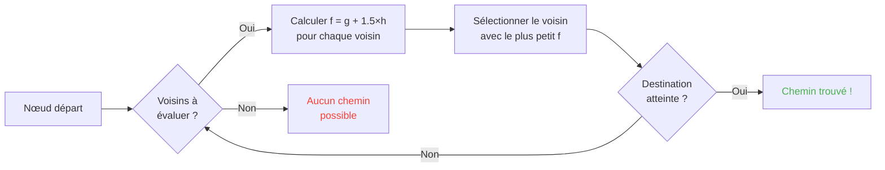

## 

Ich habe stundenlang zugesehen, wie Schafe in Wänden stürzen.

Und ehrlich gesagt, die beste Investition meines Lebens.

Je mehr du dir diese Mobs ansiehst, desto mehr weißt du, dass sie nichts zu riskanter sind. Jede Bewegung ist kodiert, vorhersehbar und vor allem völlig bruchstückbar. Ich habe schließlich in Minecrafts Quellcode getaucht, um genau zu verstehen, wie das pathfinding funktioniert, und was ich entdeckt habe, ist, dass du die Mob-Mobs buchstäblich mind-control buchstabieren kannst.

Dieses Handbuch ist alles, was ich gelernt habe, als ich durchsuchte.

---

## Wie funktioniert die Mob-IA (Säulen: das ist dumm)

### Die Goals

Jedes Mob hat *goals*. Es ist eine Liste von Aktionen, die es tun kann und wie viel er braucht, um sie zu tun. Je kleiner die Zahl, desto höher die Priorität, wie eine todo list version chaos.
```java
protected void registerGoals() {
   this.goalSelector.addGoal(4, new Zombie.ZombieAttackTurtleEggGoal(this, 1.0, 3));
   this.goalSelector.addGoal(8, new LookAtPlayerGoal(this, Player.class, 8.0F));
   this.goalSelector.addGoal(8, new RandomLookAroundGoal(this));
   this.addBehaviourGoals();
}
```
Hast du schon mal einen Zombie gesehen, der ein Schildkrötenei ignoriert, um dich zu beschießen?`ZombieAttackTurtleEggGoal`a Priorität 4, während`ZombieAttackGoal`- Der Goal, der ihm sagt, er soll dir die Fresse stopfen... - ist Priorität 2.

Ja, ein Zombie isst dich lieber, als ein Ei zu brechen.

Der Goal, der uns wirklich interessiert, ist`WaterAvoidingRandomStrollGoal`, Priorität 7. Das "ich habe nichts zu tun, also gehe ich zum Pfeifen" goal. Hier wird alles interessant.

### Die Bewegung (oder "wie ein Random zu Fuß hat 1 von 60 Chancen auf ein Auftreten")

Alle Ticks (alle 0.05 Sekunden), das Spiel ruft`canUse()`Ich seh mal nach, ob sich der Mob bewegt.
```java
public boolean canUse() {
   if (this.mob.hasControllingPassenger()) {
      return false;
   } else {
      if (!this.forceTrigger) {
         if (this.checkNoActionTime && this.mob.getNoActionTime() >= 100) {
            return false;
         }
         if (this.mob.getRandom().nextInt(reducedTickDelay(this.interval)) != 0) {
            return false;
         }
      }
      Vec3 $$0 = this.getPosition();
      if ($$0 == null) {
         return false;
      } else {
         this.wantedX = $$0.x;
         this.wantedY = $$0.y;
         this.wantedZ = $$0.z;
         this.forceTrigger = false;
         return true;
      }
   }
}
```
Also, um es kurz zu machen: Wenn du auf dem Mob montiert bist -> nein, wenn der Mob seit 5 Sekunden nichts getan hat -> Nein, wenn das Random nein sagt -> nicht. Das Spiel will wirklich nicht, dass der Mobi sich bewegt.

Aber wenn er sich bewegt,`getPosition()`übernimmt die folgende Funktion:
```java
protected Vec3 getPosition() {
   if (this.mob.isInWater()) {
      Vec3 $$0 = LandRandomPos.getPos(this.mob, 15, 7);
      return $$0 == null ? super.getPosition() : $$0;
   } else {
      return this.mob.getRandom().nextFloat() >= this.probability
         ? LandRandomPos.getPos(this.mob, 10, 7)
         : super.getPosition();
   }
}
```
Schau dir diese beiden Zahlen am Ende an: es ist der XZ-Radius und der Y-Riff. Im Wasser sucht der Mob weiter (15 statt 10).`super.getPosition()`Die Mobs FÜLLEN aus dem Wasser.** Deswegen schwimmen deine Tiere wie kranke Tiere zum Rand.

Knusprige Details: es ist buchstäblich 0.1% Glück, dass der Mob nimmt`super.getPosition()`anstatt`LandRandomPos`Eins für tausend, das ist typischer Mojang.

### LandRandomPost: die verfaulte Optimierung, die alles ändert

Das ist mein Lieblingsschritt, der schönste technische Schwachsinn, der das pathfinding ausnutzbar macht.
```java
public static Vec3 getPos(PathfinderMob $$0, int $$1, int $$2, ToDoubleFunction<BlockPos> $$3) {
   boolean $$4 = GoalUtils.mobRestricted($$0, $$1);
   return RandomPos.generateRandomPos(() -> {
      BlockPos $$4xx = RandomPos.generateRandomDirection($$0.getRandom(), $$1, $$2);
      BlockPos $$5 = generateRandomPosTowardDirection($$0, $$1, $$4, $$4xx);
      return $$5 == null ? null : movePosUpOutOfSolid($$0, $$5);
   }, $$3);
}
```
`movePosUpOutOfSolid`Wenn die gewählte Position in einem festen Block ist, schiebt das Spiel es nach oben, bis es in der Luft ist.

Es ist eine Optimierung: Statt Zeit zu verlieren, um die Positionen unter der Erde zu ignorieren, geht das Spiel zurück zur Oberfläche. Schlau? Ja. Aber es schafft eine Verrücktheitsvorstellung: **Mobs bevorzugen Höhen**.

Stell dir vor. Du hast viele Blöcke unter der Oberfläche, das Spiel erzeugt 10 zufällige Positionen. Die in den Blöcken werden nach oben geschubst. Die dichten Bereiche (unter einem Hügel) erzeugen mehr gültige Positionen als die Hohlbereiche. Ergebnis: Das Mob geht statistisch häufiger zum Hügeln.

Vertrau mir, wir werden das in zwei Minuten kaputtmachen.

### Auswahl: der Wettbewerb des besten Blocks

10 Positionen, nur ein Gewinner, ein Punkt-Wettbewerb:
```java
public static Vec3 generateRandomPos(Supplier<BlockPos> $$0, ToDoubleFunction<BlockPos> $$1) {
   double $$2 = Double.NEGATIVE_INFINITY;
   BlockPos $$3 = null;
   for(int $$4 = 0; $$4 < 10; ++$$4) {
      BlockPos $$5 = (BlockPos)$$0.get();
      if ($$5 != null) {
         double $$6 = $$1.applyAsDouble($$5);
         if ($$6 > $$2) {
            $$2 = $$6;
            $$3 = $$5;
         }
      }
   }
   return $$3 != null ? Vec3.atBottomCenterOf($$3) : null;
}
```
Die Position mit dem besten GAGNE-Score und wenn man die Punktekriterien kennt, kann man die Position gewinnen, die man will.

---

## Die Vorlieben der Mobs (oder "Warum deine Kuh überquert die Straße")

Jedes Mob hat einen anderen Geschmack und das ändert alles.

| Mob | Kiffe das. |
| --- | --- |
| **Tiere** (Kälte, Schafe, Schweine) | Gras und Licht(Hipster) |
| **Moster** (Zombies, Skelette) | Schwarz(Edgelords) |
| **Tortuen** | Wasser, sonst Sand, sonst Licht |
| **Hoglins** | `crimson_nylium`; hassen`warped_fungus` |
| **Striders** | Nur die Lava. |
| **Silverfish** | Die unheilbaren(logischen) Blöcke |
| **Guardians** | Wasser + Licht(Snobs) |
| **Mooshrooms** | Myzelium + Licht(Pilz) |
| **Bienen** | Ja, sie bevorzugen die Luft. |
```java
// Tier: Schau nach unten, wenn es Gras ist, max.
public float getWalkTargetValue(BlockPos $$0, LevelReader $$1) {
   return $$1.getBlockState($$0.below()).is(Blocks.GRASS_BLOCK) ? 10.0F : $$1.getPathfindingCostFromLightLevels($$0);
}

// Monster: genau das Gegenteil
public float getWalkTargetValue(BlockPos $$0, LevelReader $$1) {
   return -$$1.getPathfindingCostFromLightLevels($$0);
}
```
Monster sind buchstäblich "wenn es beleuchtet ist, negative Punktzahl, ich gehe woanders hin." Sie machen den Knall im Licht.

Also kannst du deine Tiere buchstäblich mit Gras und Licht führen und deine Monster mit Dunkelheit.

---

## Der A*-Algorithmus in Minecraft (die geheime Formel)

Minecraft verwendet den A*-Algorithmus(A-Star) für das pathfinding. Mojang aber setzte seine Pfote:
```
f(n) = g(n) + 1.5 × h(n)
```
- **g(n)** = bereits zurückgelegter Pfad (1 pro Block, ~1.41 diagonal)
- **h(n)** = Vogelflugstrecke
- **1.5** = weil Mojang etwas gestreifte Werte liebt

Normalerweise A* verwendet`f(n) = g(n) + h(n)`. MOJANG hat einen FAKTOR 1.5. . Warum? Damit das Algo schneller zum Ziel geht und weniger Suchzweige schneidet. Ergebnis: Der gefundene Weg ist "gut," aber nicht immer das beste. Es ist ein ein wenig betrunkenes A*.

Wichtiges Detail: **Ein Mobilteil kann nur auf 16 Blöcken pathfinderieren** (sa *follow range*). Wenn das Ziel zu weit entfernt ist, wählt er den nächsten Block aus, den er erreichen kann. Das bedeutet, dass man einen Monolith außerhalb der Reichweite erzeugen kann, und der Mobilteil wird in den nächsten, dem Monolithe nähern Block patfinder, was seine Bewegungen völlig vorhersehbar macht.

### Die beiden Errungenschaften, die das Spiel brechen

#### 1. Block-Updates = Zwangsumrechnung
```java
public boolean shouldRecomputePath(BlockPos $$0) {
   if (this.hasDelayedRecomputation) return false;
   if (this.path != null && !this.path.isDone() && this.path.getNodeCount() != 0) {
      Node $$1 = this.path.getEndNode();
      Vec3 $$2 = new Vec3(
         ((double)$$1.x + this.mob.getX()) / 2.0,
         ((double)$$1.y + this.mob.getY()) / 2.0,
         ((double)$$1.z + this.mob.getZ()) / 2.0
      );
      return $$0.closerToCenterThan($$2, (double)(this.path.getNodeCount() - this.path.getNextNodeIndex()));
   }
   return false;
}
```
Jedes Blockupdate in der Nähe des Mob-Weges zwingt eine Neuberechnung von A* mit einem 1-sekunde Cooldown. Du setzt eine 1-Sekunde-Uhr neben einen Mob und er berechnet seinen Weg STADT. Es ist das Äquivalent, ein GPS zu setzen, das jede Sekunde zurückbleibt.

Was, wenn du das mit 50 Mobs gleichzeitig machst?

#### 2. Blockmalus (Pathfinding Malice)

Einige Blöcke machen Mobs Angst. Im wörtlichen Sinne. Jeder Block hat damit verbundene Kosten, definiert durch eine Aufzählung:

| Block / Bedingung | Malus |
| --- | --- |
| **Honighose** | +8 durchqueren |
| **Schweine** | Unverkäuflich |
| **Geschlossene Türen** | Unverkäuflich |
| **Feuer** | +16 überqueren, +8 zu lang |
| **Tiere & Dorfbewohner** | Feuer = -1(NOP) |
| **Kaktus / Sweet berry** | Unverbindlich; angrenzend = +8 |
| **Wasser** | +8 über- oder entlangfahren |
| **Magma** | +8 lang(Hülse) |

Die Tiere sind noch extremer:
```java
protected Animal(EntityType<? extends Animal> $$0, Level $$1) {
   super($$0, $$1);
   this.setPathfindingMalus(PathType.DANGER_FIRE, 16.0F);
   this.setPathfindingMalus(PathType.DAMAGE_FIRE, -1.0F);
}
```
DAMage_FIRE bei -1.0F ist buchstäblich "verbietet." Ein Tier stürzt sich lieber ins Leere, als durch Feuer zu springen.

### Übung: der große Pfadwettbewerb

Stell dir vor, ein Dorfbewohner muss zwischen mehreren Wegen wählen.

- **Camin A**: 15 Blöcke, aber 6 Blöcke entlang Wasser (+8 jeweils)
- **Camin B**: 18 Blöcke mit 2 Wasserblöcken(+8) und 1 angrenzenden Wasserblock(+8)
- **Cemin C**: 14 Blöcke geradeaus... aber mit Feuer -> EMPFÄNGLICH für einen Dorfbewohner
- **Chemin D**: 16 Blöcke mit 1 Block neben Magma(+8) + 1 Block angrenzend Honig(+8)
- **Chamin E**: 25 Blöcke aber Kakteen überall (+8 überall) -> 90.82 Gesamtkosten

Mentale Berechnung:

- Pfad A: 15 Blöcke + 6×8 für Wasser = 15 + 48 = **63** ... aber es ist die 1.5×Distanz hinzuzufügen.
- Pfad B: länger, aber weniger Malus. Gesamtcost = kumulierte Entfernung + Malus
- Pfad D: Magma und Honig stack ihre Malus.

Der Gewinner ist oft der **Cemin B**: der Umweg ist rentabel, weil das Wasser CHERE ist.

Ein Dorfbewohner ist im Wesentlichen ein Kostenrechner mit Beinen.

### Jeder Mob hat seinen Geschmack

Ein Dorfbewohner: "aus dem Feuer? NEIN DANKE BYE" Ein Zombie: "vom Feuer? OK boomen * flammend überqueren*"

Du hast buchstäblich Straßen, die manche Mobs nehmen, und andere nicht.

---

## Die Dorfbewohner: der ultimative Basar

Okay, Dorfbewohner, das ist das am wenigsten verstandene System von Minecraft, aber sobald du den Code eingedrückt hast, merkst du, dass es sich um vorhersehbare Maschinen mit Bürozeiten handelt.

### Sensoren und Gedächtnisse

9 Sensoren, die alle 20 Ticks drehen (1 Sekunde). Jeder sucht einen Strahl um den Dorfbewohner herum und speichert das Ergebnis in Erinnerung. Der Dorfbeschauer sieht alles, erinnert sich an alles und handelt im Amt.

So wie: "Ist ein Feind da? ein Item auf dem Boden? ein Spieler, mit dem er spricht?" Er fährt ALLES.

### Pakete (seine Tagesphasen)

Das Gehirn eines Dorfbewohners ist ein Aktivitätspaket, das sich nach der Zeit aktiviert:

| Verpackung | Zeitplan | Der Dorfbewohner... |
| --- | --- | --- |
| **Core** | H24 | Öffnet Türen, Schwimmen (80% der Zeit) und PEI-Akquiert |
| **Work** | 8.15 Uhr | "Ich werde arbeiten" – geht zu seinem Posten |
| **Meet** | 15:17 Uhr | "Apero!" – geh zur Glocke, du Trottel |
| **Rest** | 18:00-6:00 Uhr | "Schlaf" – geh ins Bett |
| **Idle** | 6:00 Uhr, 17:00 bis 18:00 | "Ich bin Drüse" – spazieren, Babys machen, auf Betten springen |
| **Panic** | Verletzung/Hostil | "IM RECHT" – FUTTER |

Das **Panic** Paket ist das einzige, das alle anderen unterbrechen kann. Auch wenn der Dorfbewohner schläft oder arbeitet, wenn ein Zombie, ein ALLGEMEINER PANIK, vorhanden ist.

### POI-Erwerb: das Ding, das die drahtlose Redstone ermöglicht
```java
Set<Pair<Holder<PoiType>, BlockPos>> $$12 = (Set)$$10xx.findAllClosestFirstWithType(
   $$0, $$11, $$8x.blockPosition(), 48, PoiManager.Occupancy.HAS_SPACE
)
```
`Acquire POI`scannt alle POIs im Umkreis von 48 Blöcken(Interetpunkte). Er hält die nächsten 5 Punkte, überprüft, ob ein Pfad existiert, und erwirbt den ersten zugänglich.

Jedes OP hat eine begrenzte Anzahl von Slots:

- **Arbeitsplätze**: 1 Slot

- **Betten**: 1 Slot

- **Cloches**: 32 Slots

Der DINGUE-Punkt: **Der Slot ist zum Zeitpunkt des Erwerbs reserviert, NICHT bei der Ankunft**. Ein Dorfbewohner kann einen Komposter von der anderen Seite der Karte absperren, ohne ihn jemals zu erreichen.

- Du fängst die Energie an?

### Wireless Redstone.

1. Du steckst einen Dorfbewohner in eine Mine mit einem Weg zu einem Kompostier
2. Er erwirbt den Komposter (slot genommen, plus Person kann es verwenden)
3. Der Dorfbewohner ist zu weit weg, um darauf zu klicken, die Bone meal bleibt
4. Du stellst dieses Dorf überall auf der Welt auf, er hält den Slot.
5. Wenn du dein Ding aktivieren willst, dann tust du den Dorfbewohner.
6. Der Slot wird frei, ein anderer Dorfbewohner erwirbt den Kompost, zieht die Bone meal ab
7. BLOCK UPDATE -> jede redstone Schaltung aktiviert

Du hast ein kabelloses Redstone-Signal geschaffen, das überall übertragen werden kann, mit Null Chunk Load, das auf dem Weg benötigt wird.

Meine Lieblingsnutzung? Ein Mini-Spiel "Bunty Hunter": Du setzt mehrere Dorfbewohner mit Kompostern, der Spieler muss LE bon dörfisch töten, um den Ausgang zu aktivieren. Es ist völlig wtf wie mechanisch.

### Der Pathfinding Deadlock (oder "der Dorfbewohner, der für immer freeze")

Es gibt einen guten TROP-Bug zwischen`Acquire POI`(die einen Pfad sieht) und die tatsächliche Navigation (die nicht bereit ist, sie zu benutzen). Das passiert, wenn der Block über dem Arbeitsplatz nicht befahrbar ist.

- Core package: "Ich will das POI erwerben"
- Navigation: "Ich kann nicht gehen da"
- Ergebnis: Der Dorfbewohner bleibt für immer LIEGT, mit sich selbst zu kämpfen.

Im wörtlichen Sinne sind frozen-Dorfs in der Lage, als Dekoration oder als "props" in Gebäuden zu verwenden. Ein Standpanzer? Ja. Ein Wachmann, der sich nicht bewegt? Ja, Macabre? Ptet. Aber effektiv.

---

## Schlussfolgerung

Das pathfinding der Minecraft Mobs ist kein Zufall, sondern ein deterministisches System, das auf Noten basiert, vorhersehbar UND schäbig.

**Die drei zu berücksichtigenden Punkte:**

1. **Blöcke unter den Füßen = Höhenvorhang**: gefüllt oder leer den Keller, um die Mobs zu führen
2. **Die Malus sind für jedes Mob verschieden**: schafft Straßen, die einige nehmen und keine anderen
3. **PAI-Slots sind reserviert**: Wireless Redstone kostenlos, Transportieren, all das

Der Minecraft-Quellcode ist eine Goldmine aus unterbeutetem Mechanik. Ich habe stundenlang Java gelesen, entschlüsselt und offen? Jede Zeile ist ein funktionierender Easter Egg. Außer, dass diese du überleben, um drahtlos Redstone mit Dorfbewohnern zu machen. Bestbest bestätigt Spiel.
