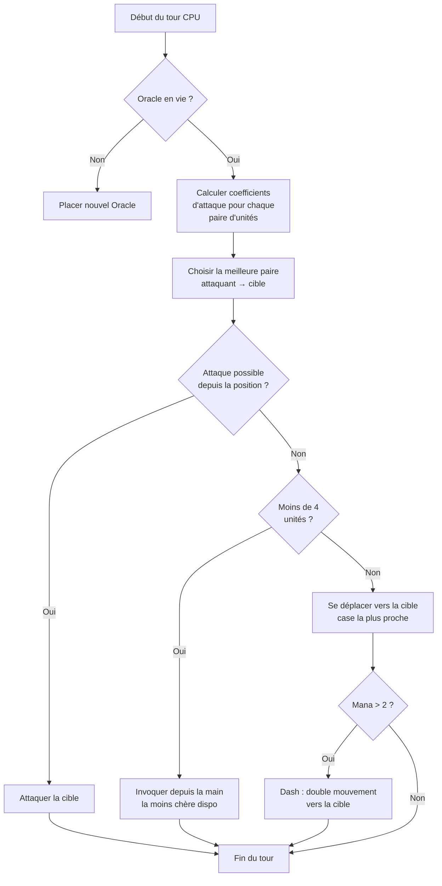

## 

Es gibt Projekte, die mit "Hier, wenn ich ein Schachspiel mit Mythologien?" beginnen und die mit einem System mit einer IA enden, das alle 5 Runden über eigene Hyperparameter entscheidet.

Nausicaa ist es. Ein Spiel mit einer Drehung für jede Drehung, wo du dein Deck mythologischer Kreaturen baust, dein Mana mana manipulierst, Einheiten auf einem 10x8-Plateau ausbreitest und eine IA hat Persönlichkeitskrisen.

Ich habe viel Zeit auf dieser IA verbracht, und das Ergebnis ist mir manchmal noch nicht bewusst, und ich ziehe es vor.

## Das Spiel in der realen

Bevor wir über das Gehirn sprechen, müssen wir den Körper verstehen:

- 10x8, Einsatzbereich von 2 Reihen pro Spieler
- Mana beginnt bei 1, +1 pro Runde, max 6. Du rufst an, greifst an und nutzt Fähigkeiten.
- Ziel: das gegnerische Orakel töten

12 Einheiten, Kosten und verschiedene Bewegung Patterns:

| Unit | Kosten | Bewegung | PV |
| --- | --- | --- | --- |
| Orakel | 0 | König (8 Richtungen) | 1 |
| Gobelin | 1 | Vor 3 Feldern | 1 |
| Harpie | 1 | König (8 Richtungen) | 1 |
| Najade | 1 | Diagonal | 1 |
| Griffin | 2 | Hop 2 Felder | 2 |
| Meerjungfrau | 2 | Lateral | 1 |
| Centaurir | 2 | Reiter (in L) | 2 |
| Archer | 3 | Lateral | 1 |
| Phönix | 3 | Diagonale (dunkel) | 1 |
| Metamorph | 4 | Platztausch | 1 |
| Seher | 4 | Keiner (Mana-Generator) | 1 |
| Titan | 6 | Begrenzte Fläche (Attackenbereich) | 3 |

Jede Einheit hat ihre eigene Angriffspattern. Die Meerjungfrau tritt in die 4 Diagonalen, der Archer in der Ferne auf 3 Felder, der Titan zerstört ringsum in Beschwörung. Kurzum, ein Schachspiel mit Mythologie und Deckbuilding.

## Wie ich die CPU denken ließ

Die Grundidee ist einfach: ** Jede feindliche Einheit hat einen Attraktivitätskoeffizienten**. Je gefährlicher sie ist, desto mehr will die KI sie erledigen.
```javascript
const UNITS_ATTRACTIVENESS = {
    "oracle": 100,
    "titan": 95,
    "shapeshifter": 90,
    "phoenix": 80,
    "siren": 70,
    "archer": 70,
    "seer": 70,
    "griffin": 60,
    "centaur": 60,
    "harpy": 50,
    "naiad": 30,
    "gobelin": 20
};
```
Oracle 100 – logisch ist die Win Condition. Titan 95, weil er nebenan OS. Gobelin 20, er ist ein Fantasie-Mann, wir scheißen drauf.

Dann berechne ich für jedes Paar Einheiten (eine Verbündete, eine Feindin),
```
interet = attractivite × coeff_attract / (distance × coeff_dist)
```
Je gefährlicher und nahrhafter du bist, desto mehr will dich die KI high machen.
```javascript
calculateAttackCoefficient(x1, y1, x2, y2) {
    const distance = this.calculateEuclideanDistance(x1, y1, x2, y2);
    if (distance === 0) return Infinity;
    return (UNITS_ATTRACTIVENESS[unit.type] * COEFFICIENTS_IMPORTANCE["attractiveness"]) / distance;
}
```
### Der Schlag der Koeffizienten, die sich ändern

Der wichtigste Punkt ist, dass die Koeffizienten von Bedeutung ** alle fünf Runden zufällig ändern**.
```javascript
if (this.turnCount % 5 === 0) {
    const distanceCoefficient = parseInt(Math.random() * 100);
    const attractivenessCoefficient = parseInt(Math.random() * 100);
    this.regulateImportanceCoefficients({
        distance: distanceCoefficient,
        attractiveness: attractivenessCoefficient
    });
}
```
Ein Schlag der KI geht überaggressiv (Akte 95, Abstand 5), sie durchquert alles, um deinen Oracle zu töten. Der Schlag nach ihr priorisiert die Distanz und stellt sich wieder ein.

Es ist von den Geistern von Pac-Man geklaut – Blinky Jagd, Pinky emkusque. Hier ändert die KI "Persönlichkeit" alle Phasen.

**Ergebnis: Die KI kann nicht auf einem ganzen Spiel vorherzusagen.** Die CPU macht nie zweimal dasselbe Spiel.

### Das Orakel ist ein Haufen Puppe.

Der feindliche Orakel flieht buchstäblich.
```javascript
const awayFromTarget = {
    row: Math.max(0, Math.min(7, botUnitElement.row + (botUnitElement.row - targetUnitElement.row))),
    col: Math.max(0, Math.min(9, botUnitElement.col + (botUnitElement.col - targetUnitElement.col)))
};
```
Er berechnet die entgegengesetzte Richtung der Bedrohung und fährt weg. Wenn eine Wand ist, sucht er das nächste freie Feld in dieser Richtung.

Du kommst drei Runden in die Nähe des Orakels und er ist schon am anderen Ende geflohen.

### Die Entscheidungsschleife

So entscheidet die KI:

1. Wenn ich mehr Oracle (tot) habe, platziere ich ein neues
2. Berechnung des Koeffizienten für jedes Drehmoment → feindliche Einheit
3. Wählst du das beste Paar
4. Wenn die Einheit das Ziel von ihrer Position angreifen kann → Angriff
5. Wenn ich weniger als 4 Einheiten → die billigsten von Hand
6. Andernfalls bewegen du sich zum Ziel (der nächste Bewegungsfeld des Feindes)
7. Wenn genug Mana (> 2), Dash (doppelte Bewegung) um sich nähern
8. Wenn die Einheit Orakel → weglaufen


```javascript
async makeAction(dash=false) {
    // Alles in Sequenz
    // das CPU dash, wenn es genug Mana hat
    if(botPlayer.mana > 2) {
        this.makeAction(true);
    }
}
```
### Warum euklidische Entfernung

Ich benutze die euklidische Distanz:
```javascript
calculateEuclideanDistance(x1, y1, x2, y2) {
    const deltaX = Math.pow(x1 - x2, 2);
    const deltaY = Math.pow(y1 - y2, 2);
    return Math.sqrt(deltaX + deltaY) * COEFFICIENTS_IMPORTANCE["distance"];
}
```
Warum nicht Manhattan? Weil Einheiten verschiedene Bewegung Patterns (L wie Reiter, Diagonale, etc.) haben. Vogelflugdistanz ist eine bessere Annäherung der Gefahr.

## Warum nicht die Minima

Ich hätte ein klassisches Minimax kodieren können, aber mit 12 Arten von Einheiten, verschiedenen Bewegungspattern, besonderen Fähigkeiten... explodiert der Spielbaum so schnell, dass es unspielbar wird.

## Was cool ist

Das System der Attraktivität schafft rigolos Dilemmas:

- Der Seher (70) erzeugt Mana. Wenn du ihn leben lässt, hat der Gegner mehr Ressourcen, aber der Titan (95) ist noch gefährlicher.
- Der Metamorph (90) kann seinen Platz mit jeder Einheit wechseln, er kann deinen Oracle stehlen.
- Die Harpyie (50) hat einen explosiven Angriff, der sie auch umbringt.

Die KI bewertet die Gesamtgefahr nach Positionen, nicht nur Rohdaten.

Es gibt auch eine Funktion.`activateSimulation()`um Szenarien zu testen, ohne eine Wiederholung zu machen:
```javascript
activateSimulation() {
    // Platzierung spezifischer Einheiten auf dem Plateau
    // Nützlich für die I.A.-Debugger
    this.game.board = simulation.board;
    this.game.players = simulation.players;
}
```
## Was fehlt

Wenn ich mehr Zeit hätte:

- Die KI reagiert auf den aktuellen Zustand, sie sagt nicht voraus, was der Spieler tun wird.
- du plant nicht ihre Hand auf mehreren Türmen
- Metamorph und Centaur haben Fähigkeiten, die sie unterbenutzt
- Stärkung des Lernens: du gegen sich selbst spielen lassen, um Coeffs anzupassen

Aber für ein Browserspiel ist es echt heiß, aber Kumpels verlieren gegen, also ist es validiert.

## Test

Dispo auf [nausicaa-game.github.io](https://nausicaa-game.github.io/)Du klickst auf "Spielen," CPU-Modus ON, und du siehst zu, wie die KI es macht.

Tipp: Lass die KI gegen sich selbst spielen. Du wirst aggressive Phasen sehen und dann pfft sie alles zurück.

Der Code ist auf [GitHub](https://github.com/nausicaa-game/nausicaa-game.github.io)in`js/cpu.js` .

**3 Punkte , die zu berücksichtigen sind:**

1. **Heuristische Koeffizienz** – keine Minima, jede Einheit hat eine Attraktivität
2. **Coeffs, die alle 5 Runden ändern** – die KI, die andere Aggression und Kontrolle, Pac-Man-Modus
3. **Das Orakel fliegt** – es berechnet die entgegengesetzte Richtung zur Bedrohung und bricht

Wenn du Ideen hast, die KI noch böser zu machen, öffne einen Ausweg.
