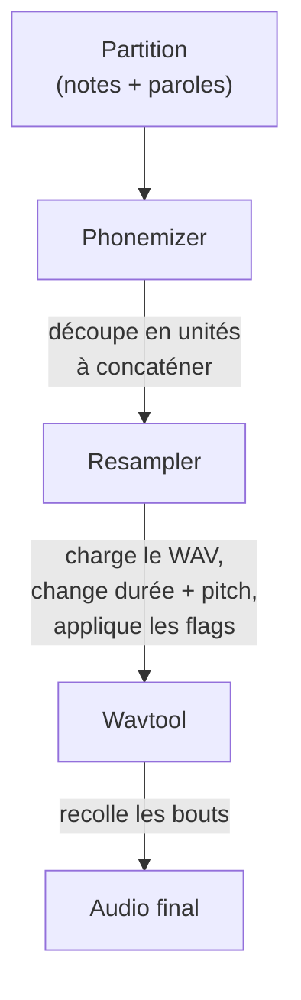

## 

Ich hatte ein Wort auf meiner Hauptseite berührt: Ich liebe UTAU.

Im Jahr 2008, wenn du eine synthetische Stimme erpressen wolltest, hattest du eine Option: VOCALOID. Yamahas Software. Lieber, Besitzer, mit offiziellen Stimmen, die du nicht selbst erschaffen konntest.

Und dann gibt es einen japanischen Kerl, Ameya/Ayame, der ein Programm in seiner Ecke veröffentlicht hat. Eine Software, die in **Visual Basic 6** verschlüsselt ist. Frei.

Diese Software heißt **UTAU** (="Singen" auf Japanisch). Und für seine Zeit war es Magie.

Ich fand ihn immer faszinierend für seine Idee, seine Startseite mehr als für seine technische Sauberkeit (das Prinzip der Kodierung bleibt wirklich clever, auch wenn die Implementierung die Augen pickt): er öffnete die Sprachsynthese für die breite Öffentlichkeit. Du, ich, jeder mit einem Mikrofon.

Lass mich erklären, warum es großartig war.

---

## Erstens, warum die Gesangssynthese so hässlich ist.

Du hast keine Noten, die Konsonanten greifen an, das Vokal, das hält, den Atem, die Übergänge zwischen den beiden.

Heute wird das Deep Learning geregelt: Du trainierst ein Modell über Stunden des Gesangs und er erzeugt die Stimme (Synthesizer V, DiffSinger). Aber das ist 2020+. 2008 ist nichts.

UTAU verwendet die Methode der vorherigen, älteren und bösartigen Methode: **Konkadentialsynthese**.

---

## Die konkatenative Synthese: Kopieren und Einfügen von Stimmenspitzen

Die Idee ist dumm wie ein Kohl: du speicherst kleine Stimmenspitzen und klebst sie zusammen, um Wörter zu bilden. "Hallo" = Probe "sa" + "lu" +"to," gefesselt. Ein Klangpuzzle, das von einer Partition gesteuert wird.

Das ist das YouTube Poop-Prinzip, wo man die Wörter eines Perso überschneidet, um ihn alles sagen zu lassen – außer dass es hier quadratisch und automatisiert ist.

Und UTAU kommt buchstäblich von dort. Vor ihm existierte der **"Jinriki Vocaloid"** (S.E., "Vocaloid Manual"): Menschen schnitten von Hand die Vokalspuren ab, extrahierten Phoneme, rezitierten und sammelten sie in einem Audio-Editor, um eine Vocaloid-Stimme nachzuahmen. In der Hand. Du stellest dir das Taf vor.

Ameya sah sich diese Galerie an und kodierte das Werkzeug, um es zu automatisieren. UTAU-Basis war nur das: ein Assistent für manuelles Vocaloid.

---

## Warum es revolutionäre war: Du erschufst die Stimme

Das ändert alles.

VOCALOID, du hast eine Stimme gekauft. Miku, Luka, etc. Von Profis erschaffen, verkauft von Yamaha. Die Schöpfung blieb Yamaham vorbehalten. Mit UTAU, **Jeder nimmt seine Stimme auf und macht sie zu einem singenden Instrument**.

Der einfachste Lebenslauf ist: Du speicherst die ~100 Silben des japanischen Basis-Silben ("a," "ka", "sa", 'ta"...), konfigurierst die Schnittpunkte, und hier ist deine Voicebank.

Das Ergebnis: Das Ökosystem explodierte. Tausende Voicebanks, die von der Gemeinschaft geschaffen wurden – Stimmen von Fans, Kumpels, Persern. Eine ganze Welt von virtuellen Sängern, kostenlos. Und die Software kam mit **Defoko** (Utane Uta), einer Standardstimme, die über den TTS AquesTalk-Engine erzeugt wurde, also konntest du sogar ohne Mikrofon anfangen.

---

## Das oto.ini: das Herz des Systems

Woher weiß UTAU, wo man die Klänge abschneiden und einfügen kann? Über eine Config-Datei von Voicebank: **`oto.ini`**. Für jede WAV definiert sie die Schneidpunkte (in Millisekunden):

- **Offset** → Stille zum Start springen
- **Preutterance** → der Punkt, an dem die Konsonanten in den Vokal überwechseln (die Grenze "s"→"a" in "sa")
- **Overlap** → wie viel die vorhergehende Note übertrifft
- **Fixed region** → der Teil, der NICHT auf eine lange Note gestreckt werden soll (typische Konsonanz)
- **Cutoff** → wo das Ende zu schneiden

Die **preutterance** ist der cleverste Param. Eine Silbe hat immer ein Stück Konsonant vor dem Vokal. Damit deine Note über die Zeit fällt, ist es die "Voyelle", die stürzen muss, nicht die Konsonante. Also UTAU verschiebt die Probe zurück: die "a" von "seine" landet über die Zeiten, das "s" überfließt direkt vor. Wie ein Schlagzeug, das seinen Schlag vorwegnimmt, damit der Klang gerade fällt – außer dass es dort in einem`.ini` .

Die Gebiete des`oto.ini`so zerschneiden:

```mermaid
flowchart LR
    A["🔇 silence<br/>(offset)"] --> B["🅺 consonne<br/>(fixed region,<br/>pas étirée)"]
    B --> C["🅰 voyelle<br/>(zone étirable)"]
    C --> D["🔇 fin coupée<br/>(cutoff)"]
    style B fill:#3b4a6b
    style C fill:#5b3b6b
```

Die Grenze zwischen Konsonant und Vokal ist die Vorherrschaft. Vokale sind die Zone, die man für lange Noten ausdehnt; Konsonanten bleiben intakt, sonst würde dein "k" zwei Sekunden dauern und schrecklich klingen.
```ini
# oto.ini (einfach)
# Datei=alias,offset,consonant,cutoff,preutterance,overlap
_ka.wav=ka,120,80,-200,90,40
```
Fünf Werte pro Ton, bei allen Proben, und UTAU zusammengestellt jedes Wort, das du richtig nennen.

---

## CV, VCV, CVVC: das Rennen um Realismus

Der Grundmodus **CV** (Vogelkonsonant) ist ein Silbe-Sound. Einfach, aber ein wenig roboterisch: die Gelenke zwischen Silben sind roh.

Im Jahr 2010 erfindet die Gemeinschaft den **VCV** (Voyelle-Consonne-Voyell). Statt "ka" allein zu registrieren, registrierst du "a ka" – mit dem Schwanz des vorherigen Vokals. Der Übergang wird natürlich, weil er * in der Aufnahme ist, nicht nach dem Schlag berechnet.

Das Detail, das piek: **VOCALOID hatte nicht VCV vor VOCALOID3, im Jahr 2011.** Der VB6-Freeware-Code von einem Typ allein Yamaha ein Jahr vor dem Realismus der Übergänge. Eine Gemeinschaft von Fans schneller als die multinationale.

Dann kamen die **CVC**,**ARPAsing** (Englisch), **VCCV**... jede Methode, die den Realismus weiter ausdrückt, alle von der Gemeinschaft erfunden und dokumentiert.

---

## Die komplette Pipeline: Wie ein Wort zum Ton wird

Wenn du eine Notiz legst und ein Wort schreibst, dann passiert hinter den Kulissen:

**resampler** ist das Hauptstück: Er nimmt deine aufgezeichnete "ka"-Probe in einer bestimmten Höhe und das Reiten/Zeichnen, um die gewünschte Note zu matchen – indem er nur die dehnbare Zone ausdehnt und die Konsonanz intakt hält (daher das`oto.ini`).

Und es ist **modular**. UTAU kam mit einem Basisresampler, aber die Gemeinschaft hat andere (moresampler, TIPS...) gepflanzt, jeder mit seinem Klangkorn. Du hast den Synthesemotor als Plugin gewechselt. 2008 auf einem Freeware.

---

## Die Baustelle unter der Haube (und warum es spannend ist)

Ich muss ehrlich sein über den technischen Stand der Software:

- **In Visual Basic kopiert 6.** Eine Sprache, die bereits 2008 tot ist, braucht den VB6-Runtime, um sie zu drehen.
- **Windows only an der Basis** (die Mac-Portierung, UTAU-Synth, kam 2011).
- **Shift-JIS-Kodierung obligatorisch.** Wenn deine Dateien nicht in Japanischer Shift JIS kodiert sind, versteht UTAU nichts. Noch heute muss man seinen PC oft in Japanisch lokalisieren oder AppLocale verwenden, um ihn zu starten.
- **Interface austeère**, damals fast 100% Dokumentation auf Japanisch.

Und doch hat diese Software eine weltweite Bewegung geschaffen, Zehntausende Voicebanks, Millionen von Malen gehörte Lieder.

Das beste Beispiel: **Kasane Teto**. Ein 2008 geschaffener und als ein Scherz vom 1. April geworfener Charakter, der sich als VOCALOID ausgibt. Es war ein Witz. Außer, dass die Leute den Charakter liebten, wurde eine echte Voicebank UTAU hinter dem Spiel erschaffen, und Teto wurde eine der berühmtesten virtuellen Sängerinnen der Welt. Im Jahr 2023 hatte sie sogar ein offizielles Synthesizer V Stimme. Ein Charakter, geboren von einem Aprilfisch auf einer kostenlosen Software.

---

## Warum zählt das noch?

UTA ist das perfekte Beispiel für eine "arme" Technologie, die durch die Öffnung gewinnt.

VOCALOID war technisch überlegen, besser finanziert, mehr Profi. Aber geschlossen. UTAU war gebrannt, hässlich, VB6 – aber er ließ alle teilnehmen. Erstellte Stimmen, erstellt Resampler, erstellt Plugins, erstellt Aufnahmemethoden. Die Community tat den Rest.

Und das Konzept überlebt heute völlig. **OpenUtau**, ein moderner Open-Source-Nachfolger, übernimmt die Idee und den Staubentstaub (Multiplattform, UTF-8, Unterstützung der modernen ERAmpler UND KI). Die konkatenative Synthese steht noch neben den Modellen deep learning, weil sie einen Vorteil hat, den sie nicht haben: du verstehst genau, was passiert, und du kontrollieren jede Millisekunde.

Das hat mir in UTAU immer gefallen, und du siehst genau, was passiert, und es ist keine KI, die dir ein magisches Ergebnis spuckt, das du nicht verstehst: Du hast deine WAVs, deine Schneidpunkte, und das bist du, die über alles entscheiden.

---

**Die 3 Punkte, die zu berücksichtigen sind:**

1. **Konkatenative Synthese = Stimmenpuzzle** – UTAU klemmt kleine WAV-Proben zusammen, um Wörter zu bilden.`oto.ini`Legt fest, wo jeder Ton abgeschnitten und kleben soll. Du steuerst alles, in Millisekunde, ohne Blackbox.
2. **Die Öffnung schlägt die Technik** – VOCALOID war besser aber geschlossen. UTAU war gebrannt, ließ aber alle ihre Stimmen erschaffen. Die Gemeinschaft hat das Ökosystem explodiert und Yamaha sogar auf dem VCV vorgedrungen.
3. **Eine gute Idee überlebt den Code** – VB6, Shift-JIS, Windows only... und dennoch dreht sich das Konzept noch über OpenUtau. Eine geniale Technologie kann mit den Füßen kodiert werden.

Ehrlich gesagt, allein für Kasane Teto, geboren von einem Aprilfisch, verdient diese Software Respekt.
