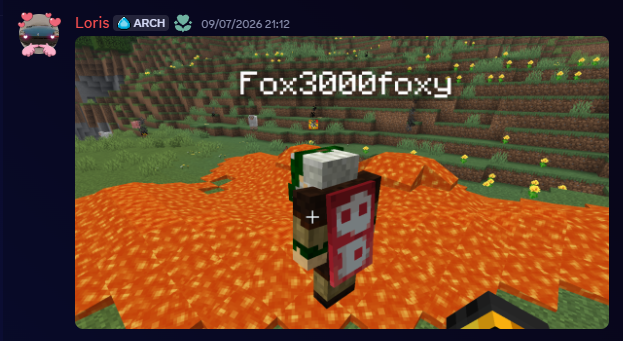
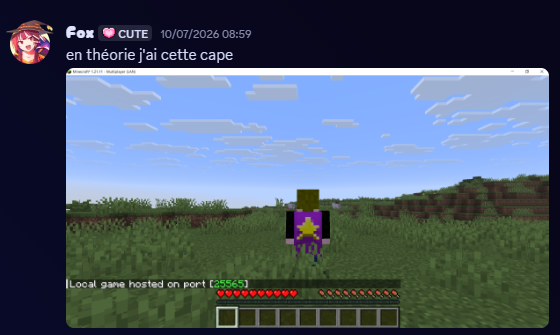
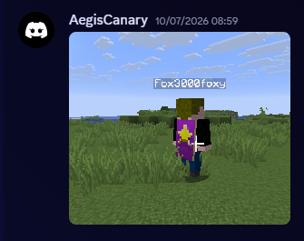

# Cape Mod : วิธีการขโมยเป้าของ Jeb_ ด้วยการฉีดลายเซ็น RSA


ถ้าฉันบอกว่ามีเพียงแค่ลายเซ็น RSA ที่ถูกต้อง -- แต่สำหรับ **บัญชีไม่ดี** -- เพื่อทำให้เพื่อนของคุณเชื่อว่าคุณใส่เป้าทางการของ Mojang? ยินดีต้อนรับสู่ `cape-mod`, ไอเดีย Fabric ที่แสดงให้เห็นว่า Minecraft เชื่อถือการลงนามโดยไม่ตรวจสอบว่าโปรไฟล์ที่เกี่ยวข้องเป็นของคุณจริงหรือไม่.

## บริบท : วิธีที่ Minecraft จัดการสกินและเป้

ใน Java Edition มีคำถามที่ไม่ค่อยถาม: **ใครเป็นผู้รับผิดชอบในการแสดงสกินและเป้ของผู้เล่น -- ลูกค้า หรือเซิร์ฟเวอร์?**

คำตอบมีความละเอียดอ่อน :

| **องค์ประกอบ** | **ใครส่ง?** | **ใครดาวน์โหลด?** |
|---|---|---|
| **พื้นผิวสกิน** | เซิร์ฟเวอร์ส่ง URL ที่ลงนาม | ไคลเอ็นต์ดาวน์โหลดจาก `textures.minecraft.net` |
| **พื้นผิวเคป** | เซิร์ฟเวอร์ส่ง URL ที่ลงนาม | ไคลเอ็นต์ดาวน์โหลดจาก `textures.minecraft.net` |
| **คุณสมบัติ `textures`** | เซิร์ฟเวอร์ส่ง `GameProfile` จากการตรวจสอบของ Mojang | ไคลเอ็นต์ตรวจสอบลายเซ็น RSA |

ประเด็นหลัก: ทั้งหมดอยู่ในคุณสมบัติที่เรียกว่า `textures` ของ `GameProfile`. คุณสมบัตินี้ประกอบด้วย:  

- Payload JSON ในรูปแบบ base64 ที่ประกอบด้วย URL ของเท็กซ์เจอร์  
- ลายเซ็น **RSA** ที่ทำด้วยกุญแจส่วนตัวของ Mojang  

## กำแพงลายเซ็น RSA  

แต่ละคุณสมบัติ `textures` ดูเหมือนนี้เมื่อทำการถอดรหัส:

```json
{
  "timestamp": 1783666316269,
  "profileId": "d90b68bc81724329a047f1186dcd4336",
  "profileName": "akronman1",
  "signatureRequired": true,
  "textures": {
    "SKIN": {
      "url": "http://textures.minecraft.net/texture/3e6defcb7de5a0e05c75525c6cd46e4b9b416b92e0cf4baa1e0a9e212a887f3f7"
    },
    "CAPE": {
      "url": "http://textures.minecraft.net/texture/70efffaf86fe5bc089608d3cb297d3e276b9eb7a8f9f2fe6659c23a2d8b18edf"
    }
  }
}
```

ลูกค้าตรวจสอบลายเซ็น RSA กับ **กุญแจสาธารณะที่ฝังอยู่ใน jar** (`yggdrasil_session_pubkey.der`) :

```java
// Property.java (authlib)
public boolean isSignatureValid(PublicKey publicKey) {
    Signature sig = Signature.getInstance("SHA1withRSA");
    sig.initVerify(publicKey);
    sig.update(this.value.getBytes());
    return sig.verify(Base64.decodeBase64(this.signature));
}
```

สำหรับผู้เล่นจากระยะไกล (นอกเกมท้องถิ่น), ลูกค้าจะยอมรับเฉพาะสกินที่ **กำหนดว่า `secure`** -- คือการมีลายเซ็นที่ถูกต้อง :

```java
// SkinManager.createLookup() -- ถูกย่อ
PlayerSkin skin = optional
    .filter(ps -> !isRemote || ps.secure())  // ← ผู้เล่นห่างไกลต้องได้รับความปลอดภัย
    .orElse(defaultSkin);
```

การตรวจสอบนี้ป้องกันการทำลายตัวในทฤษฎี แต่การตรวจสอบจะหยุดตรงนั้น และนี่คือจุดที่การโจมตีเริ่มต้น

## ความบกพร่อง: ลายเซ็นแบบเล่นซ้ำ

ไคลเอ็นต์ตรวจสอบว่า ลายเซ็น RSA **เป็นที่ถูกต้อง**. มักจะละเลยการตรวจสอบว่า `profileId` ที่อยู่ใน JSON ตรงกับ UUID จริงของผู้เล่นหรือไม่

กล่าวอีกอย่าง: คุณสมบัติ `textures` ที่มาจาก **บัญชี Mojang ที่มีอยู่** (เช่นบัญชีของพนักงาน Mojang) สามารถเล่นซ้ำได้กับผู้เล่นอื่น ๆ. ลายเซ็นยังคงถูกต้อง -- มันถูกสร้างโดย Mojang จริง ๆ -- แต่มาจากบัญชีอื่น

### วิธีดึงลายเซ็นที่แท้จริง?

Jeb_ (UUID `853c80ef-3c37-49fd-aa49-938b674adae6`) มีเคปของ Mojang Studios. จากเซิร์ฟเวอร์เซสชัน Mojang :

```bash
curl -s "https://sessionserver.mojang.com/session/minecraft/profile/853c80ef-3c37-49fd-aa49-938b674adae6?unsigned=false"
```

ตอบ :

```json
{
  "id": "853c80ef-3c37-49fd-aa49-938b674adae6",
  "name": "jeb_",
  "properties": [
    {
      "name": "textures",
      "value": "ewogICJ0aW1lc3RhbXAiIDogMTc4MzYxOTcyNjAxMSwKICAicHJvZmlsZUlkIiA6ICI4NTNjODBl...",
      "signature": "RgIPF4d/iTDWJV..."
    }
  ]
}
```

ลายเซ็น `signature` ของฟิลด์ `value` นี้ถูกสร้างโดย Mojang.  
C'est RSA-2048 SHA-1.  
Elle est **absolument** valide, même si tu la replays sur un autre UUID -- parce que la signature de Jeb_ reste une signature de Jeb_, et le client omet de contrôler à qui elle était destinée.  

## โค้ด : วิธีการทำงานของโมด  

โมด `cape-mod` เล็กมาก -- 65 บรรทัดของ Java. นี่คือแกนหลัก :

```java
@Mixin(Player.class)
public class ServerPlayerMixin {
    private static final String TEXTURES_VALUE =
        "ewogICJ0aW1lc3RhbXAiIDogMTc4MzY2NjMxNjI2OSwKICAicHJvZmlsZUlkIiA6ICJkOTBi...";

    private static final String TEXTURES_SIGNATURE =
        "oxoAfZRLVNSfXYFMNbDKZ9XxrTHmz/k2yxzOxksXY3f6aDhY3gCyFCCtDreEWI7fpG9...";

    @Inject(method = "getGameProfile()Lcom/mojang/authlib/GameProfile;", 
            at = @At("RETURN"), cancellable = true)
    private void injectCape(CallbackInfoReturnable<GameProfile> cir) {
        Player self = (Player) (Object) this;
        if (!(self instanceof ServerPlayer serverPlayer)) return;
        MinecraftServer server = ((ServerPlayerAccessor) serverPlayer).getServer();
        if (!(server instanceof IntegratedServer)) return;

        GameProfile host = server.getSingleplayerProfile();
        GameProfile original = cir.getReturnValue();
        if (host == null || !host.name().equals(original.name())) return;

        // แทนที่คุณสมบัติ textures ด้วยของ Jeb_
        ImmutableMultimap.Builder<String, Property> b = ImmutableMultimap.builder();
        for (Property p : original.properties().values()) {
            if (!p.name().equals("textures")) {
                b.put(p.name(), p);
            }
        }
        b.put("textures", new Property("textures", TEXTURES_VALUE, TEXTURES_SIGNATURE));
        cir.setReturnValue(new GameProfile(original.id(), original.name(), 
                                           new PropertyMap(b.build())));
    }
}
```

**ขั้นตอน** :
1. **Mixin** sur `Player.getGameProfile()` -- จุดที่โปรไฟล์ผู้เล่นถูกคืนค่า
2. ตรวจสอบว่ามันเป็นเซิร์ฟเวอร์ท้องถิ่น (Integrated Server)
3. ตรวจสอบว่ามันเป็น host (โลก LAN)
4. **แทนที่** คุณสมบัติ `textures` ด้วยของ Jeb_ (ฮาร์ดโค้ด)
5. ส่งกลับ `GameProfile` ใหม่พร้อม textures ที่ถูกแทรก

`GameProfile` จึงเป็น **ปลอม**: เป็นโปรไฟล์ที่สร้างขึ้นอย่างประดิษฐ์ ซึ่งไม่ตรงกับผู้เล่นจริง คุณสมบัติ `textures` ถูก **เล่นซ้ำ** จาก Jeb_ -- ลายเซ็น RSA เป็นจริงแต่ถูกใช้กับโปรไฟล์ที่ผิด แพ็กเกจเครือข่ายนั้นจึงเป็นที่ถูกต้อง: เซิร์ฟเวอร์จะส่ง `ClientboundPlayerInfoUpdatePacket` ปกติพร้อมโปรไฟล์ที่แก้ไขแล้ว มันเป็นโปรไฟล์ที่ถูกปลอม; แพ็กเกจยังคงเป็นที่ถูกต้อง。

เมื่อเพื่อน ๆ ของ host เข้าร่วมผ่าน LAN พวกเขาได้รับ `ClientboundPlayerInfoUpdatePacket` พร้อมโปรไฟล์ที่แก้ไขแล้ว. ผู้เล่น :
1. ถอดรหัส payload base64
2. ตรวจสอบลายเซ็น RSA → ✅ ถูกต้อง (เป็นจริงแล้วของ Jeb_)
3. ทำเครื่องหมายสกินเป็น `secure=true` (เพราะล

เราจะเห็นอย่างชัดเจนตัวแบบสีแดง/ขาวของคลุมอย่างเป็นทางการของ Mojang Studios การแสดงผลยังคงเหมือนกับจบจริงของ Jeb_ ที่สวมคลุมของตัวเอง -- ลูกค้าโหลดพื้นผิวเดียวกันจาก `textures.minecraft.net`

และในมุมมองติดตัวจริง ๆ หนึ่งในเกมจริง ๆ :



คลุมลอยขึ้นด้านหลังของผู้เล่น มอยด์กับการเคลื่อนไหว ความแตกต่างไม่สามารถพิจารณาได้จากสกินแท้ ๆ ที่มีคลุมอย่างเป็นทางการ

มุมมองอื่น ๆ ในโลกที่มีลาวาและพื้นดิน :



และมุมมองใกล้สุดท้ายของการเล่นที่แท้จริง ซึ่งเราจะเห็นคลุมกำลังทำงาน :



สำหรับคนที่เข้าร่วม LAN โดยไม่ทราบว่าผู้โฮสต์ใช้โมด คลุมยังคงมีรูปลักษณ์เทียบเท่าคลุมจริงของ Mojang นี่คือจุดสำคัญ: **ลายเซ็นต์ถูกต้อง** ลูกค้าจึงจัดการมันว่าเป็นสิทธิ์

## ทำไมมันถึงเป็นช่องโหว่ (และทำไมมันไม่ใช่ช่องโหว่)

นี่คือความขบขัน: การล่ามได้ผล **อย่างแม่นยำเพราะลายเซ็นต์เป็นจริง** นี่เป็นสิ่งที่ต่างจากการข้ามเข้ารหัส -- เป็นปัญหาที่อยู่ในระดับตรรกะของโมเดลความเชื่อถือ

| Check | Résultat |
|---|---|
| **ความถูกต้องของลายเซ็น RSA** | ✅ ถูกต้อง (ลงนามโดย Mojang สำหรับ Jeb_) |
| **`profileId` ใน payload ตรงกับ UUID ของ host หรือไม่?** | ❌ ไม่ (Jeb_'s UUID ≠ UUID ของ host) |
| **ลูกค้า ตรวจสอบความตรงกันหรือไม่?** | ❌ **ไม่. เพียงลายเซ็น RSA เท่านั้นที่ถูกตรวจสอบ.** |

Minecraft ให้ความเชื่อมั่น **การลงนาม** มากกว่าประสบการณ์ของผู้ถือมัน ถ้าการลงนามมาจาก Mojang ผู้เล่นก็ยอมรับได้ นี่ก็เหมือนกับการแสดงหนังสือเดินทางปลอมที่มีลายเซ็นของรัฐบาล – ตรามีความถูกต้อง แม้ว่าหนังสือเดินทางนั้นไม่ใช่ของคุณ

## ผลกระทบด้านความปลอดภัย

### จำกัดใน LAN

ม็อดทำงานได้เฉพาะบนเซิร์ฟเวอร์ภายใน (LAN) การโจมตีจึงต้อง:
- มีม็อด Fabric ติดตั้งแล้ว
- เป็นเจ้าภาพของโลก LAN
- เพื่อนของคุณเชื่อมต่อโดยไม่ต้องติดม็อด (vanilla)

### แต่ความเป็นไปได้กว้างขวางขึ้น

โดยทฤษฎีแล้ว ด้วยเทคนิคเดียวกันอาจทำได้:
- **แทรกข้อมูลลงนามอื่น ๆ**: หัวหน้า, ប្រើ enchantments ที่ผิดกฎหมาย, ส่วนประกอบ chat ภยันธิบางอย่าง
- **ผสานกับ tunnel LAN** (NGROK, playit.gg, Radmin VPN) เพื่อส่งผลกระทบแก่ผู้เล่นบนอินเทอร์เน็ต
- **ขยายไปยังคุณสมบัติอื่น ๆ** ของโปรไฟล์ที่พึ่งพิงการลงนาม

### ทำไม Mojang ไม่ได้อาจจะ patch

นี่ไม่ใช่ “ช่องโหว่” ตามความหมายคงที่ – การลงนามคือถูกต้อง แก้ไขเรื่องนี้จะหมายถึงต้องแก้ไขโมเดลการตรวจสอบสิทธิ์ทั้งหมดของ Mojang ซึ่งซับซ้อน ตอนนี้นี่ก็เป็นกรณีที่ขอบเขตเยอะ – ผู้เล่นบน LAN ควรจะเชื่อถือกันได้

## เหตุผลเชิงปรัชญา

Cape Mod เป็นตัวอย่าง **proof of concept** ที่ดีของความจริงที่กว้างขึ้น: **คุณต้องตรวจสอบว่าใครได้ลงนามข้อมูลนั้นและในหัวข้อใดก่อนที่จะให้ความเชื่อมั่น**

นี่คือบทเรียนการเข้ารหัสขั้นพื้นฐาน RSA ลงนามใน **ข้อความ** ; **ตัวตน** ของผู้รับอยู่ห่างจากลายเซ็น หากฉันให้คุณลายเซ็น RSA ที่ถูกต้องจาก Mojang คุณจะรู้แต่ว่า Mojang ได้ลงนาม *บางอย่าง* โดยไม่มีกำหนดแน่นอนว่าผู้รับคือใครจากข้อความเพียงอย่างเดียว

นั่นคือนิยามที่เกิดขึ้นจริงกับใบรับรอง SSL/TLS ในปี 2000 เมื่อ CAs ลงนามใบรับรองโดยไม่ตรวจสอบโดเมนอย่างถูกต้อง -- ลายเซ็นเป็นไปตามกฎหมาย แต่จะถูกใช้ในโดเมนผิด

## Conclusion

Cape Mod ไม่ใช่แค่แฮ็กในความหมายทั่วไป -- นี่คือการใช้จุดอ่อนการตรวจสอบแบบตรรกะใน Minecraft อย่างละเอียดอ่อน มันแสดงให้เห็นว่า:

1. **ลายเซ็นที่ถูกต้องไม่ทำให้มั่นใจในตัวตนของผู้ถือ**
2. **ใน LAN ความเชื่อมั่นเปราะบางกว่าที่คนคิด**
3. **คุณสมบัติ `textures` ของ Minecraft คือเนื้อหาที่ฉีดเข้า

- **GitHub**: [fox3000foxy/cape-mod](https://github.com/fox3000foxy/cape-mod)
- **Minecraft การตรวจสอบ**: [Yggdrasil protocol](https://wiki.vg/Authentication) (wiki.vg)
- **RSA การเข้ารหัส**: [RFC 3447](https://tools.ietf.org/html/rfc3447) (PKCS #1)

**3 จุดสำคัญ**

1. ลายเซ็น RSA ตรวจสอบข้อความแทนการยืนยันตัวตน -- รายละเอียดที่ทำให้หลายระบบเสียค่าใช้จ่าย
2. Minecraft ไม่ได้ตรวจสอบว่าโปรไฟล์ของผู้เล่นตรงกับลายเซ็นที่ได้รับหรือไม่ -- ช่องโหว่ในขั้นตอนการตรวจสอบ, โดยการเข้ารหัสยังคงอยู่เรียบร้อย
3. ใน LAN หรือผ่านท่อ ทุกอย่างเป็น open bar ให้กับโมดที่ควบคุมเซิร์ฟเวอร์ตัวฝังอยู่
